# minivllm: overall report

> **This is the detailed, kept-up-to-date write-up of the whole project.** [`README.md`](README.md) is the short entry point; this file keeps every stage's narrative, results discussion, lessons, exercises, code notes and conventions in one place. It is derived from [`docs/`](docs/). Measured numbers live in [`RESULTS.md`](RESULTS.md).

A tiny LLM inference engine built from scratch, one idea at a time, with a benchmark after every step. It is inspired by [vLLM](https://github.com/vllm-project/vllm), a high-throughput, memory-efficient serving engine. **minivllm** aims to be the micrograd of inference engineering: small enough to read in an afternoon, measured well enough to trust.

**The thesis, in one line:** batch-1 decoding is memory-bound and overhead-bound, so serving speed comes from reading fewer bytes per token and sharing every weight read across many requests. Each stage below removes one source of waste and measures what it bought.

**What the whole thing taught:** [`docs/learned.md`](docs/learned.md), a few minutes of reading; the headline numbers are the table in [`README.md`](README.md#headline-results).

**Start here:** 
1. [`01_baseline_and_kv-cache.ipynb`](01_baseline_and_kv-cache.ipynb) covers Stages 1 & 2.
2. [`02_static_batching.ipynb`](02_static_batching.ipynb) covers Stage 3.
3. [`03_continuous_batching.ipynb`](03_continuous_batching.ipynb) covers Stage 4. 
4. [`04_paged_kv_cache.ipynb`](04_paged_kv_cache.ipynb) covers Stage 5. 
5. [`05_ngram_speculation.ipynb`](05_ngram_speculation.ipynb) covers Stage 6. 
6. [`06_draft_model_speculation.ipynb`](06_draft_model_speculation.ipynb) covers Stage 7. 
7. [`07_weight_quantization.ipynb`](07_weight_quantization.ipynb) covers Stage 8. 
8. [`08_fused_int8_and_self_speculation.ipynb`](08_fused_int8_and_self_speculation.ipynb) covers Stage 9. 
9. [`09_graph_speculation.ipynb`](09_graph_speculation.ipynb) covers Stage 10. 
10. [`10_multirow_kernel.ipynb`](10_multirow_kernel.ipynb) covers Stage 11. 
11. [`11_engine.ipynb`](11_engine.ipynb) covers Stage 12, the engine, and [`99_vllm_compare.ipynb`](99_vllm_compare.ipynb) is its head-to-head with vLLM. 
12. [`12_batched_step.ipynb`](12_batched_step.ipynb) covers Stage 13, the batched decode step: its cost counted, three changes to it, and the result next to vLLM (done). 
13. [`13_paged_kernel.ipynb`](13_paged_kernel.ipynb) covers Stage 14, attention that reads the paged cache in place with Triton kernels (measured on a T4). 

Run them on a Kaggle T4.

> **Where the numbers are.** This README explains what the stages teach and what the results mean. Every measured number lives in [`RESULTS.md`](RESULTS.md), which is from `results/stage*.json`. 

## Roadmap

| Stage | Question it answers | Key idea | Notebook | State |
| --- | --- | --- | --- | --- |
| 1 | What does naive generation cost? | Own Qwen2.5-0.5B forward pass, recompute everything every token | `01_baseline_and_kv-cache.ipynb` | Done |
| 2 | Where does time go, and how close to the hardware limit? | **KV cache**, prefill vs decode, roofline, `torch.compile` | `01_baseline_and_kv-cache.ipynb` | Done |
| 3 | What does batching buy, and what does padding waste? | **Static batching**: left padding, attention mask, per-sequence RoPE positions | `02_static_batching.ipynb` | Done |
| 4 | How do we stop short requests waiting on long ones? | **Continuous batching**: a scheduler swaps finished sequences out mid-batch | `03_continuous_batching.ipynb` | Done |
| 5 | How do we stop wasting KV memory? | **Paged KV cache**: block table plus allocator, fragmentation before vs after | `04_paged_kv_cache.ipynb` | Done |
| 6 | Can one weight read yield more than one token? | **N-gram speculation**: guess several tokens from the context, check them all in one pass (prompt lookup, no second model) | `05_ngram_speculation.ipynb` | Done |
| 7 | Is a small draft model a better guesser than the context, and cheap enough to pay? | **Draft-model speculation**: the same checker with a small model as the proposer, a go/no-go gate on the cost ratio, a CUDA graph over the draft step | `06_draft_model_speculation.ipynb` | Done |
| 8 | If a decode step were limited by the bytes it reads, how much would reading fewer save? | **Weight-only int8 quantization**: one scale per output row, a go/no-go gate on one layer (an eager dequantize moves more bytes than fp16), accuracy with two controls, memory, step time against the bandwidth floor | `07_weight_quantization.ipynb` | Done |
| 9 | Can a fused kernel turn Stage 8's no-go around, and can the int8 copy draft for its own model? | **A fused int8 kernel in Triton** and **self-speculation**: the int8 copy of the target as the draft, with acceptance measured before any kernel, a go/no-go gate on one layer, and the speed of an int8 target with speculation | `08_fused_int8_and_self_speculation.ipynb` | Done |
| 10 | Do int8 weights and speculation multiply once the decode loop lives in CUDA graphs? | **A multi-row int8 kernel**, **a forward pass captured in a CUDA graph** and **a graph speculative decoder**: a kernel that reads each weight once for the two to eight rows of a checking pass, a free n-gram guesser so the target is what is tested, and int8 against fp16 in the eager engine and in a graph | `09_graph_speculation.ipynb` | Done |
| 11 | Was the loss of Stage 10 the multi-row kernel, or the idea? | **Row-exact int8 kernels**: two kernels compiled for exactly one to eight rows, with one accumulator per row and no shared memory, a search pruned by an offline compile for the T4, a fair clock (GPU state logged, warm-up, candidates timed in turns) and a fair fp16 baseline (a padded output projection) | `10_multirow_kernel.ipynb` | Done |
| 12 | What happens when the pieces meet in one engine that serves requests, and how does it compare with Hugging Face and vLLM on the same traces? | **`LLMEngine`**: continuous batching on the paged cache, a bucketed decode step that runs as CUDA graphs, lookup speculation in latency mode, per-request sampling, a small HTTP server, and an open-loop load generator with goodput under a latency target. The same trace served by the engine, Hugging Face `generate` and vLLM | `11_engine.ipynb`, `99_vllm_compare.ipynb` | Engine and vLLM runs done |
| 13 | Why does the batched step get slower as the load rises, and how much of the gap to vLLM do three changes close? | **Fold the query heads** into the query rows so nothing is expanded, **buckets that pad at most a quarter**, and an **eager fallback above a batch size** read from the step logs, each alone and then together, with the bytes counted and timed first, a closed-loop concurrency sweep, and the best variant served over HTTP beside the vLLM rows | `12_batched_step.ipynb` | Run done: folding is the main win, the best variant is much closer to vLLM |
| 14 | Can attention that reads the KV blocks where they are, instead of gathering them, close more of the gap to vLLM? | Two **Triton kernels** (per query head; per key-value head with the group served from registers) that walk each row's own blocks through its block table with an online softmax: no gather, no padding blocks, capturable in a CUDA graph; tested against a reference on a CPU, gated at the layer level, then run in the engine | `13_paged_kernel.ipynb` | Measured on a T4: wins on partly filled rows, a gain under load, the fallback now costs |

### How the stages build on each other

```text
Stage 1  naive                    every step recomputes the whole sequence
   ->removes: recomputation

Stage 2  + KV cache               one token per step, but the GPU reads all weights for a single sequence
   ->Stage 2 shows this is memory-bound (about 1 FLOP per byte), so more math per byte is free

Stage 3  + static batching        many sequences share each weight read, but padding wastes slots
   ->removes: one-request-at-a-time serving

Stage 4  + continuous batching    finished sequences leave, new ones join, no idle slots
   ->removes: padding waste and head-of-line blocking

Stage 5  + paged KV               the cache is allocated in blocks, so memory is not fragmented
   ->removes: KV memory fragmentation, which caps batch size
   
Stage 6  + n-gram speculation     guess several tokens from the context, check them in one pass, so one weight read can yield several
   ->removes: some of the one-token-per-step cost, when the guesses are right

Stage 7  + draft-model speculation  a small model guesses instead of the context, behind the same checker
   ->removes: the limit that guesses can only repeat the context, if the draft step is cheap enough

Stage 8  + weight-only int8         every weight stored in one byte plus a scale per output row, so a step reads fewer bytes
   ->removes: half of the bytes read per token, which shortens a step only if a kernel reads them as bytes (none of the three ways tried on the T4 did)

Stage 9  + fused int8 kernel         a Triton kernel that reads the int8 weights as bytes, and the int8 copy as a draft for its own model
   ->removes: the loss of Stage 8 at one token, in a graph or compiled decode loop; not yet for several tokens at once

Stage 10 + decode loop in graphs     a kernel for a few rows, every model pass a CUDA graph replay, and int8 and speculation together
   ->removes: the launch cost of a hand-written kernel, and speculation in a graph works; the multi-row int8 kernel is a no-go, so int8 and speculation do not yet multiply

Stage 11 + row-exact int8 kernels    the same kernel job rewritten with no shared memory and exact row counts, timed with a fair clock against a fair fp16 baseline
   ->removes: part of Stage 10's loss (an int8 checking pass costs about a fifth fewer plain steps), not enough: the gate is a no-go again and int8 and the lookup still do not multiply

Stage 12 + the engine               the pieces behind one interface: admission, prefill, batched decode as CUDA graphs per bucket, lookup speculation when alone, sampling, a server
   ->removes: the notebooks' separate loops; what it measures is the whole against Hugging Face and vLLM on the same open-loop traces

Stage 13 + the batched step         count what a batched step moves, fold the query heads, pad less, fall back to the eager step above a batch size (done)
   ->removes: the head expansion, part of the padding, and the batches where the captured step loses; what is left is the gather itself

Stage 14 + in-place paged attention  kernels that read each row's own blocks where they are, through the block table
   ->removes: the gather (two copies of every row's keys and values to the bucket width) and the cost of padding blocks; what is left is the weights read every step and an untuned kernel (done)
```

The Stage 2 results are the motivation for everything after it. The roofline shows decode sitting at a tiny fraction of the hardware ridge point (see [Roofline](RESULTS.md#stage1_2-roofline)), so the only way to use the GPU is to serve many sequences per weight read. That is exactly what Stages 3 and 4 do, and Stage 5 keeps the KV cache from limiting how many fit.

---

## Stages 1 & 2: Baseline & KV Cache

[`01_baseline_and_kv-cache.ipynb`](01_baseline_and_kv-cache.ipynb) is a guided walkthrough. Each section follows the same shape (Goal, Concept, Code, Result, Takeaway), and you are asked to write down a prediction before every benchmark. The surprising results are the point.

The notebook is a thin driver. Cells that start with `%%writefile` write the `minivllm/` and `bench/` packages, and the notebook then imports them, so the package is the source of truth.

| # | Section | What you learn | Runtime on a Kaggle T4 |
| --- | --- | --- | --- |
| 1 | Setup | Reproducible environment record (`ENV`), `QUICK` flag | seconds |
| 2 | The code | KV cache, model, engine, benchmark helpers | seconds |
| 3 | Load model and parity gate | Prove our forward pass matches Hugging Face before benchmarking | about 1 min |
| 4 | Stage 1: naive baseline | Cost of recomputing everything | about 20 s |
| 5 | Stage 2: KV cache | Prefill vs decode | about 25 s |
| 6 | Roofline ceiling | Why decode is memory-bound | seconds |
| 7 | Crossover analysis | Where does the cache start to win? | about 2 min (about 6 with the probe sweep) |
| 8 | Prefill scaling | TTFT, prefill throughput and decode ITL vs prompt length | about 30 s |
| 9 | `torch.compile` | Closing the gap to the ceiling | about 2 min |
| 10 | Roofline chart | The arithmetic-intensity picture | seconds |
| 11 to 13 | Save results, optional publish, summary | JSON plus figure inventory, what we learned | seconds |

## Results (Stages 1 & 2)

All measured values are in [`RESULTS.md`](RESULTS.md) (source: [`results/stage1_2.json`](results/stage1_2.json)). The environment for the run (GPU, library versions, model revision) is listed under [Setup](RESULTS.md#stage1_2-setup). This section explains what the numbers mean.

**Fixed conditions**

- **Model:** `Qwen/Qwen2.5-0.5B` in fp16, because the T4 has no bf16.
- **Architecture:** 24 layers, 14 query heads, 2 KV heads, head_dim 64.
- **KV cache cost:** 12 KiB per token.
- **Workload:** batch 1, greedy decoding, a random prompt.
- **Timing:** medians over repeated runs after a warm-up, with `cuda.synchronize()` around every timer.

### 1. Is our forward pass correct?

Nothing is benchmarked until it matches Hugging Face. On a real prompt the notebook asserts that the last-position logits agree within fp16 noise, and that the greedy tokens of Hugging Face, `generate_naive` and `generate_cached` are identical over 128 steps. Cached and naive must agree exactly because they compute the same math. Any mismatch means the cache changed the result, which is a bug.

### 2. Is the KV cache faster? Not at first.

Numbers: [Naive vs cached generation](RESULTS.md#stage1_2-naive-vs-cached).

Cached throughput is flat, because every decode step does the same work. Naive throughput holds for short outputs and then falls as each step recomputes a longer sequence. Below the crossover the cache is slower, because at batch 1 on a 0.5B model both paths are dominated by Python and kernel-launch overhead (24 layers times many small ops), not by FLOPs. Recomputing a short sequence costs about the same as computing one token, so the cache has nothing to save until recomputation gets large.

**2a. Where do they cross?** Three estimates come from the extended sweep: interpolating the speedup on a linear axis, interpolating on a log2 axis, and fitting quadratic naive time against linear cached time (plotted). The sweep has only a few, widely spaced lengths, so these are coarse, and they bracket a range rather than a single point. See [Crossover](RESULTS.md#stage1_2-crossover) for the values.


**2b. Does a direct measurement agree?** A dense probe around the predicted crossover measures the speedup directly and interpolates where it crosses one. It is the slowest step in the notebook, so `QUICK = True` skips it, and the crossover table says so when it was skipped. Trust the probe over the sweep-based estimates, which interpolate across a wide gap: in the latest run the probe landed below all three of them. The two can disagree because the speedup curve is shallow near the crossing (it climbs only slowly with output length), so a few percent of measurement noise moves the crossing by tens of tokens. Quote a range, not a point.


### 3. Prefill and decode behave differently

Numbers: [Prefill and decode](RESULTS.md#stage1_2-prefill-decode).

Two different latencies appear in this section, and they are not the same thing:

- **TTFT** (time to first token) is the **prefill**: one forward pass over the whole prompt. It depends on prompt length.
- **ITL** (inter-token latency) is the **decode** step: one single-token forward pass per generated token, reusing the KV cache.


**How to read it.** The top panel is time to first token. It is flat across short prompts, so short prefills are launch-bound like decode: a forward pass over hundreds of tokens takes about as long as a forward pass over one token, which means the time is overhead, not math. The bottom panel (same prompt-length axis) is prefill throughput, which therefore climbs almost linearly with prompt length while TTFT stays flat. At the longest prompt TTFT jumps and throughput drops, which is where real compute starts to matter. Processing more tokens per weight read is nearly free at small sizes, which is the case for batching.


**Decode does not care about context length here.** On a shared axis, TTFT takes off at the longest prompt while ITL stays a flat line, even though the KV cache grows by a factor of 64 across the sweep. Each decode step is dominated by reading all the weights and launching kernels. The extra KV bytes are a small fraction of what a step already reads, so the step time barely moves. The flat line is the result, not a plotting artifact. It holds up to the longest context measured.

### 4. How close is decode to the hardware limit?

Numbers: [Roofline](RESULTS.md#stage1_2-roofline).

Batch-1 decode reads every weight plus the KV cache once per token, so the ceiling is `bandwidth / bytes per token`. The roofline table compares eager decode, `torch.compile`d decode and that ceiling, using both the spec bandwidth and a measured copy bandwidth.

`torch.compile(mode="reduce-overhead")` on the single-token decode step roughly doubles decode throughput for a one-time compile cost. Eager and compiled are measured the same way (p50 inter-token latency through `generate_cached`), so the comparison is fair.

On the roofline, decode does about one FLOP per byte, against a ridge point in the hundreds of FLOPs per byte. It is deep in the memory-bound region, so extra compute would not help. Both operating points sit well below the bandwidth roof, so the remaining gap is overhead, not bandwidth.


### What this sets up (Stages 1 & 2)

Batch-1 decode uses a tiny share of the compute the GPU offers. Serving many sequences at once amortizes each weight read across all of them and raises arithmetic intensity. Stage 3 measures how much that helps, and what padding costs.

### Other plots (Stages 1 & 2)

The plots not embedded above are listed, with captions, under [Plots](RESULTS.md#stage1_2-plots) in `RESULTS.md`.

## Stage 3: Static Batching

[`02_static_batching.ipynb`](02_static_batching.ipynb) tests the Stage 2 prediction that batch-1 decode is overhead-bound and far below the hardware ridge point, so serving several sequences per step should be nearly free, and then measures what static batching costs.

It first makes batching correct (left-padded prompts, per-sequence RoPE positions, an attention mask) and proves it with four gates before any benchmark. Then it runs these experiments:

| # | Section | Question |
| --- | --- | --- |
| 4 | A. Batch-size scaling | How much aggregate throughput does batching buy, and where does the step stop being free? |
| 5 | A2. Roofline revisited | Do the measured points follow the bandwidth roof as arithmetic intensity grows with batch size? |
| 6 | B. Padding waste | How much of a batch is padding when prompt lengths differ? |
| 7 | C. Idle decode slots | How much work goes to requests that already finished, and does the batching gain survive a realistic mix of lengths? |
| 8 | D. The latency hit | How long do short requests wait for the longest request in their batch? |
| 9 | E. KV memory over-allocation | How much of the preallocated KV cache holds real tokens, and what would that mean for a larger model? |

Sections 1 to 3 cover setup, the code and the correctness gates, and sections 10 to 12 save the results, optionally publish them and summarize. Like the Stage 1 & 2 notebook, it is self-contained: its `%%writefile` cells write the whole `minivllm/` and `bench/` packages.

## Results (Stage 3)

All measured values are in [`RESULTS.md`](RESULTS.md#stage3-setup) (source: [`results/stage3.json`](results/stage3.json)), measured on the same Tesla T4 and model as Stages 1 & 2. The workload runs in sections 7 and 8 are single passes because they are long, so treat their throughput numbers as having some noise. The idle and padding shares are exact counts and do not.

### 1. Is batching still correct?

Yes. Four gates ran before any benchmark: the default path still matches Hugging Face, a padded batch of very different prompt lengths matches each prompt run alone (logits at fp16 noise level, identical greedy tokens), extra padding does not change the logits, and a negative control without the mask and positions changes the answers by orders of magnitude more. One bug worth remembering: a padding query row with nothing to attend to makes the softmax NaN, and one NaN row poisons the real tokens that read its values. Letting every row attend to at least itself fixes it.

### 2. What does batching buy? Almost everything, almost for free.

Numbers: [Batch-size scaling](RESULTS.md#stage3-batch-scaling).

Aggregate decode throughput scales almost perfectly linearly with batch size across the whole sweep, while the step time stays essentially flat. Each request therefore keeps nearly the same speed whether it is served alone or with many others. The largest batch tested was `B = 64`, so the knee where the step stops being free was **not reached**. The p99 step latency adds jitter but no trend in the batch size. The cost shows up in TTFT instead: it stays flat while the batch holds only a few hundred prompt tokens (prefill is launch-bound, as in Stage 2, and the flat region matches the one Stage 2 found for a single prompt) and then grows roughly in proportion to the batch as prefill becomes compute-bound.


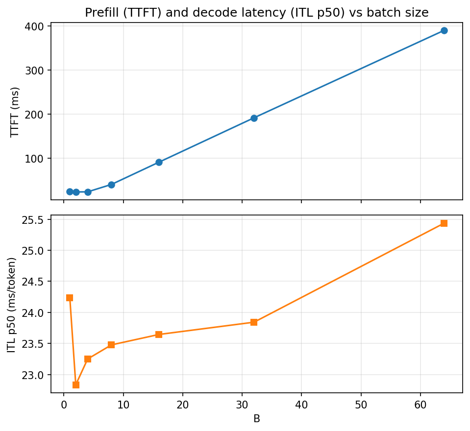

Numbers: [Batched roofline](RESULTS.md#stage3-roofline).

Arithmetic intensity grows in proportion to the batch, because the weights are read once for every sequence. The measured points move up the bandwidth roof **parallel to it, at a constant small fraction of it**, the same fraction Stage 2 measured for eager batch-1 decode. So batching uses the headroom but does not close the gap between the measured rate and the roof. That gap is launch overhead, not bandwidth, and it is what `torch.compile` and CUDA graphs attack.


### 3. What does static batching waste?

Numbers: [Padding waste](RESULTS.md#stage3-padding), [Idle decode slots](RESULTS.md#stage3-idle-decode), [Goodput vs batch size](RESULTS.md#stage3-goodput).

- **Padding.** The share of prompt slots that are padding depends on how uneven the prompts are, and on which prompts happen to share a batch. Averaged over many random batches it grows steadily with the spread factor, but any single batch can land well above or below that average, so one measured batch is an example and not a trend. Padding always costs KV-cache memory. It costs time only once prefill is compute-bound, where TTFT grows with the padded size.
- **Idle decode slots.** A batch decodes until its longest request is done, and finished requests keep their slot and keep being computed. With any long requests in the mix, most decode slot-steps are idle. Raw throughput barely changes (the GPU is just as busy) while **goodput**, the tokens people actually asked for, collapses. A few long requests keep entire batches running.
- **The gain does not survive a realistic mix.** With equal request lengths goodput stays close to the ideal linear line. With mixed lengths it bends away from that line already at small batch sizes and then flattens, because a larger batch is more likely to contain a long request, so more slots idle for longer and the padded prompt grows. Both shares rise with the batch size and then level off once every batch contains the longest prompt and a long output.

<p align="center">
  
  
</p> 

<!--
| | |
|---|---|
|  |  |
-->


The two kinds of waste share a unit (a share of slots) but not a cost: idle decode slots turn almost one-for-one into lost goodput, while padding costs prefill time and KV memory.

### 4. Who pays? Short requests.

Numbers: [Latency of short requests](RESULTS.md#stage3-latency).

Static batching returns a batch only when its longest request is done, so a short request is released long after it finished. Two effects pull in opposite directions. With all requests arriving at once, a larger batch clears the queue sooner, which **shortens** every request's total response time. Blocking **lengthens** it: the time a finished short request waits for its batch grows steadily with batch size, until at the largest batch most of a short request's response time is spent finished and waiting. Total response time falls with the batch size and then flattens (it can even tick up at the largest batch, where the whole workload is a single batch), which hides the waiting and is why blocked time is reported separately. The trade is cheap for a while and steepest at the end: past a mid-sized batch, extra goodput costs much more blocking.


### 5. How much preallocated KV is used?

Numbers: [KV memory over-allocation](RESULTS.md#stage3-kv-memory).

Each batch allocates one rectangle of cache slots sized for its longest prompt and longest output. With mixed lengths, utilization falls as the batch grows and settles at a minority of the allocated bytes, and it is far lower if every slot reserves the model's maximum context, as a server that does not know the output length would. This model is too small for memory to bind. The projection table in `RESULTS.md` (analytic, not measured) shows the same ratio for larger models, where contiguous reservation limits the batch to a handful of sequences while the actual tokens would fit many more. The ratio is the same for every model, because it depends only on the reserved context versus the actual length. What the model changes is whether the absolute count is large enough to matter.

### What this sets up (Stage 3)

Static batching keeps the throughput and charges the waiting to the users, and it reserves cache for lengths nobody uses. Both are scheduling and memory problems, not compute problems, and they are what Stages 4 and 5 remove.

### Other plots (Stage 3)

The plots not embedded above, including the step-latency band, the padding and prefill time of the measured batch, the blocked-time distribution and the KV-utilization plots, are listed, with captions, under [Plots](RESULTS.md#stage3-plots) in `RESULTS.md`.

## Stage 4: Continuous Batching

[`03_continuous_batching.ipynb`](03_continuous_batching.ipynb) answers the question Stage 3 ended with: what if a finished request could leave its slot at once, and a waiting request could take it?

It replaces the one-length-for-everyone KV cache with a pool of slots that each have their own length (`SlotCache`), and the wave-by-wave scheduler with an iteration-level one (`run_continuous`). Every iteration, waiting requests are prefilled into free slots (alone, with no padding), one decode step runs for all slots at their own positions, and a request is released the moment it has produced all its tokens. It proves this correct first: the tokens match running each request alone, even when requests arrive over time and slots are reused, and a negative control shows that the mask hiding a reused slot's stale keys matters. Then it runs these experiments:

| # | Section | Question |
| --- | --- | --- |
| 4 | A. Closed batch | At the same concurrency and with the same requests as Stage 3, how much goodput and response time does continuous batching win back? |
| 5 | B. Open-loop load | With requests arriving over time, where does each policy stop keeping up, and what happens to latency and time to first token on the way? |
| 6 | C. Prefill interference | What does a new request's prefill cost the requests already running, and what does a limit on prefills per iteration trade? |
| 7 | D. KV slot reservation | How much of the slot pool holds tokens, and how many more sequences would a paged cache fit in the same memory? |

Static and continuous batching are compared on the **same** Poisson arrival trace. Both run on a *virtual clock* that advances by the measured GPU time of each step and jumps over idle gaps, so a low-load run takes seconds while the latency stays exact. Like the earlier notebooks it is self-contained: its `%%writefile` cells write the whole `minivllm/` and `bench/` packages.

## Results (Stage 4)

All measured values are in [`RESULTS.md`](RESULTS.md#stage4-setup) (source: [`results/stage4.json`](results/stage4.json)), measured on the same Tesla T4 and model as the earlier stages. Every cell of the closed-batch and load sweeps is a single pass over one request set or one arrival trace, so treat the numbers as having some noise, especially in the tails. With only a few dozen requests the response time p99 is simply the slowest request.

### 1. Is continuous batching correct?

Yes. Requests arriving at different times and sharing a few slots, so that slots are freed and reused and sequences sit at different positions in the same decode step, produce exactly the tokens that running each request alone produces. Limiting the prefills per iteration changes only the schedule, not the tokens. A negative control shows why the per-slot mask matters: when a slot is reused by a short sequence, it still holds the keys of its longer previous occupant, and ignoring the mask changes the logits by far more than fp16 noise, while a slot with nothing stale is unaffected.

### 2. What does it win back? About twice the goodput, at a fraction of the response time.

Numbers: [Closed batch](RESULTS.md#stage4-closed).

At the same concurrency and with the same requests as Stage 3, continuous batching delivers about twice the goodput of static batching up to moderate concurrency, and somewhat less at the largest pool, because it never computes a finished request. Mean response time falls by a factor of two to four, and short requests gain the most: they are released when they are done instead of when the longest request in their batch is, so their blocked time is zero by construction. The gain is not unlimited. Slot occupancy falls as the slot count grows, because a closed batch of this size cannot keep a large pool full, so goodput stops rising once the workload cannot fill the slots.

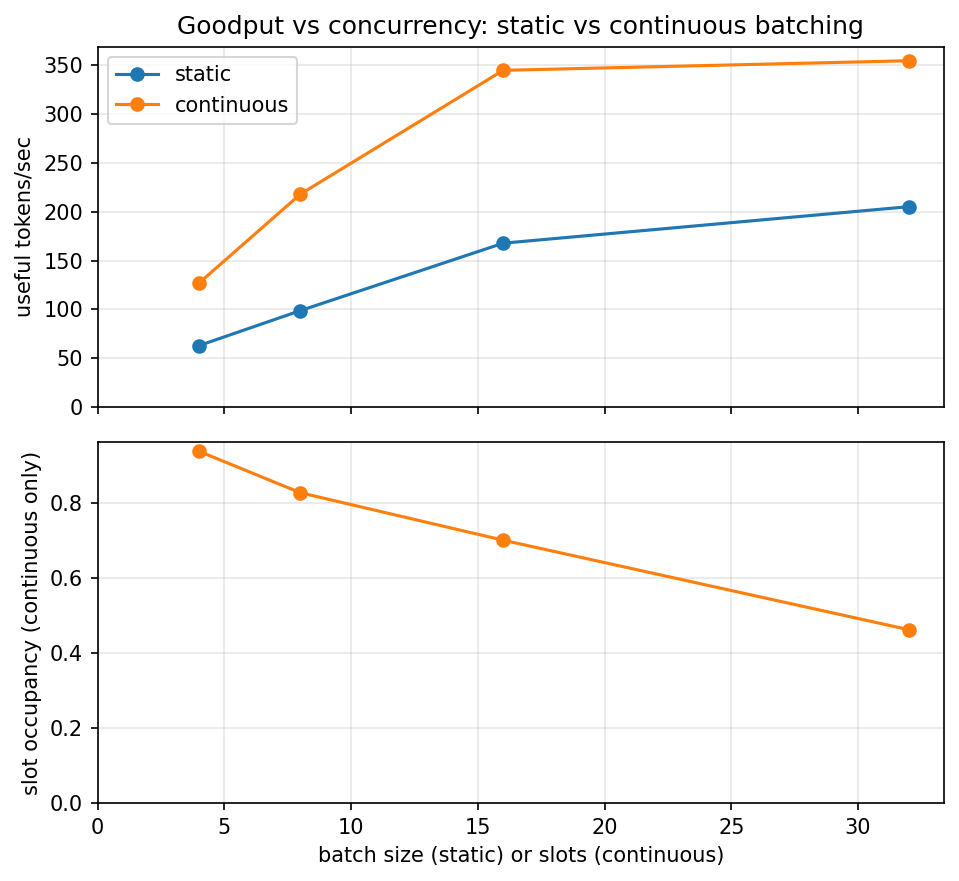
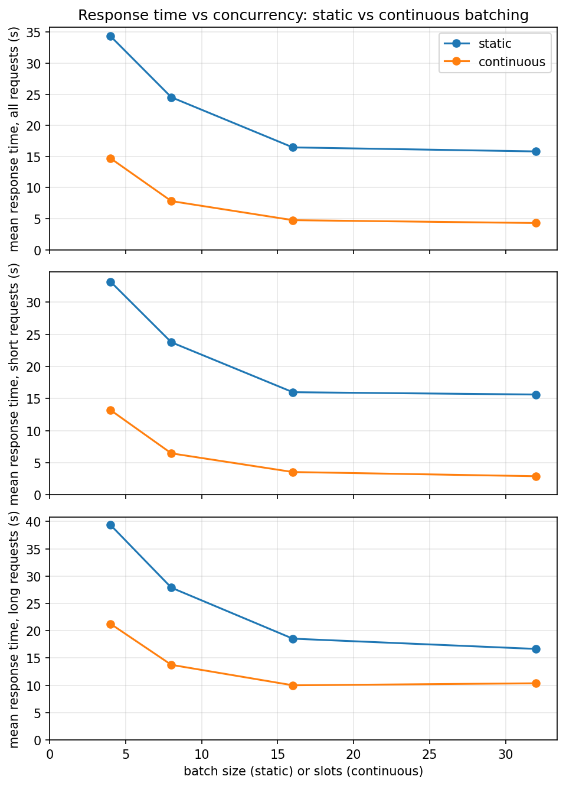

### 3. What happens under load? Static batching queues early, continuous batching barely queues.

Numbers: [Open-loop load](RESULTS.md#stage4-load).

With requests arriving over time, static batching already queues at the lowest load tested, because a request that arrives while a batch is running must wait for the whole batch, long requests included. Its median response time and time to first token are several times those of continuous batching at light load, and both climb with every step in the offered load, while its completed rate flattens at a low level well below the offered load: that is its capacity. Continuous batching admits a request as soon as a slot is free, so its median response time and its time to first token stay nearly flat across the sweep, and it only starts to queue at the top of the range. Its completed rate keeps rising to more than twice the level where static batching flattens, and it has not flattened yet, so its capacity is at least that high.

Two caveats for reading the load results. First, the completed-versus-offered plot understates continuous batching's capacity, because a finite trace ends only when the last long request has drained, so the completed rate bends away from the offered load even before the queue forms. The time to first token and the queueing time are the clearer saturation signals. Second, a GPU that is busy all the time is not necessarily saturated under continuous batching: a decode step costs about the same for a few or many live requests (Stage 3), so the GPU can be busy while slots are still free. What saturates a continuous server is its slot count.


### 4. What does a new request cost the others? One more step.

Numbers: [Prefill interference](RESULTS.md#stage4-prefill-budget).

A new request has to be prefilled before it can decode, and that prefill runs between decode steps, so every request already running waits for it. The median gap a running request sees between two tokens is just the decode step, but the tail gap is about twice that: a decode step plus one prefill. A limit of one prefill per iteration trims the worst gap and costs a little tail time to first token, which is the trade the budget is meant to offer, but at this load the effect is small. Prefills are cheap in this launch-bound regime (about one decode step each, a small share of the GPU time) and rarely is more than one request waiting. The cost grows with longer prompts and heavier load, which is why production servers split long prompts into chunks.

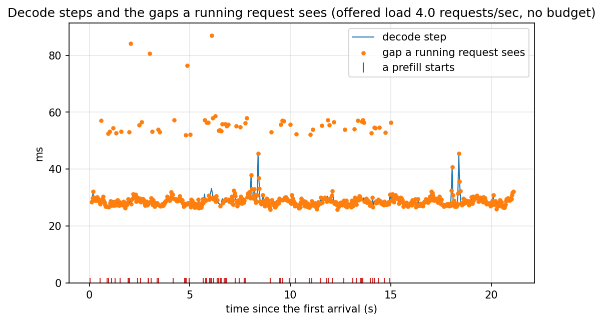
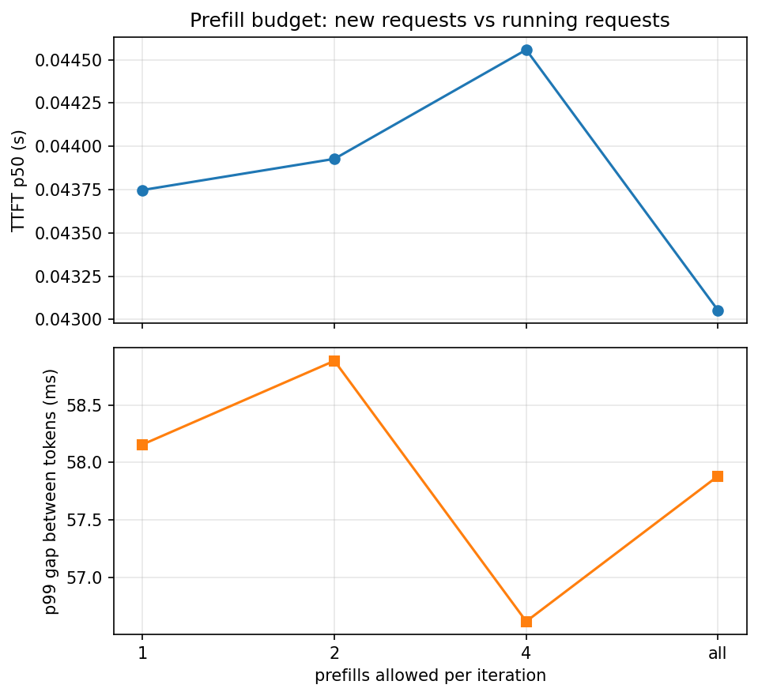

### 5. What is still wasted? The reserved cache.

Numbers: [KV slot reservation](RESULTS.md#stage4-kv-slots).

Continuous batching fixed the compute waste, but every slot is still a rectangle sized for the longest request the workload can produce. On average only a minority of the slot pool holds tokens, and the share falls as slots are added, since a larger pool is less often full. The waste here is not padding or finished tails but reservation: memory held for tokens that may never exist. A paged cache, which allocates in small blocks as a sequence grows, would fit a few times more sequences in the same memory. That figure is an upper bound, and the one based on the peak use is the more honest. For this small model memory does not bind, but for a model with a large cache per token the reservation caps the slot count at a handful.

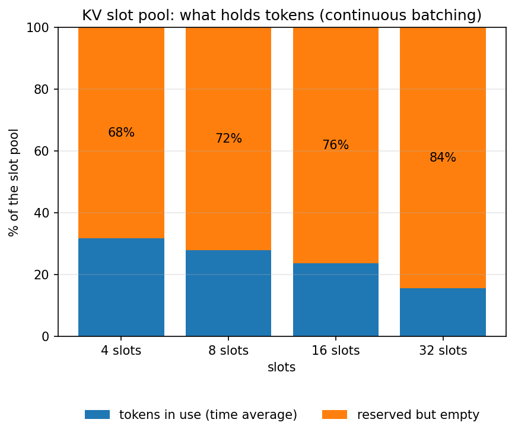

### What this sets up (Stage 4)

Continuous batching keeps the batch full, so the next limit is memory: how many sequences fit, and with them the throughput, is capped by the worst-case slot reservation. That is what Stage 5 removes.

### Other plots (Stage 4)

The plots not embedded above, including the completed-versus-offered load plot, are listed, with captions, under [Plots](RESULTS.md#stage4-plots) in `RESULTS.md`.

## Stage 5: Paged KV Cache

[`04_paged_kv_cache.ipynb`](04_paged_kv_cache.ipynb) answers the question Stage 4 ended with: what if a sequence held only the memory its request needs, instead of a rectangle sized for the longest request?

It cuts the KV memory into small fixed-size blocks in one shared pool. A `BlockAllocator` hands blocks out and takes them back, and `PagedCache` gives every sequence a block table, the list of blocks that hold its tokens, so token `t` lives in block `table[t // block_size]` at offset `t % block_size`. A request is admitted when the pool has enough free blocks for all it will store and returns them the moment it finishes, so blocks are recycled and scattered over the pool. Attention gathers a sequence's keys and values through its block table into one dense tensor, then runs the same attention as before (a fused paged-attention kernel would read the blocks in place, which is exercise 2). `run_paged` is `run_continuous` with admission by memory in place of admission by free slot. It proves this correct first: the tokens match running each request alone while requests wait for memory and blocks are recycled, the block size does not change them, and a negative control shows that the mask hiding a recycled block's stale keys matters. Then it runs these experiments:

| # | Section | Question |
| --- | --- | --- |
| 4 | A. Same memory, more sequences | Given the same KV memory as a contiguous cache, how many more sequences run at once, and what does that do to goodput and response time? |
| 5 | B. Where the memory goes | What share of the pool holds tokens in each cache, and what is left over? |
| 6 | C. The price: gather and block size | What does reading the cache through a block table cost, and how does the block size trade waste against speed? |
| 7 | D. Open-loop load at fixed memory | With requests arriving over time and a tight KV budget, where does each cache stop keeping up? |

Both caches always get the **same number of bytes**: a budget is counted in worst-case slots, the memory a contiguous cache needs for that many sequences, and the paged cache gets those bytes as blocks. Like the earlier notebooks it is self-contained: its `%%writefile` cells write the whole `minivllm/` and `bench/` packages.

## Results (Stage 5)

All measured values are in [`RESULTS.md`](RESULTS.md#stage5-setup) (source: [`results/stage5.json`](results/stage5.json)), measured on the same Tesla T4 and model as the earlier stages. Both caches always get the same number of bytes, and every cell of the sweeps is a single pass over one request set or one arrival trace, so treat the numbers as having some noise, especially in the tails. With only a few dozen requests the response time p99 is simply the slowest request.

### 1. Is paging correct?

Yes. Requests arriving at different times, in a pool so small that requests have to wait for memory and blocks are recycled and scattered, produce exactly the tokens that running each request alone produces, for several block sizes. A negative control shows why the per-sequence mask matters: when a block is recycled, it still holds the keys of its previous owner, and ignoring the mask changes the logits by far more than fp16 noise, while a sequence on fresh blocks is unaffected.

### 2. What does it buy at the same memory? About twice the sequences, so more goodput, until memory stops binding.

Numbers: [Same memory](RESULTS.md#stage5-memory).

A contiguous slot reserves the worst case, so a fixed amount of memory holds only as many sequences as it has slots, however short they are. A paged sequence holds only what its request needs, so the same bytes hold about twice as many of the typical request: the paged cache runs about as many sequences at once as a contiguous cache with twice the memory. More sequences in each decode step means each weight read serves more tokens (Stage 3's lesson), so goodput rises by more than a third while memory is the limit, mean response time falls by well over a third, and time to first token falls even more, because requests no longer wait for a slot. The gain is not unlimited. When memory is plentiful nothing waits for it any more, the caches run nearly the same number of sequences, and the gap closes.


### 3. Where does the memory go? Mostly into tokens, with a small rounding term and some stranded by the queue.

Numbers: [Where the KV memory goes](RESULTS.md#stage5-kv-breakdown).

Only a minority of the contiguous pool holds tokens, and the share falls as slots are added. In the paged pool a much larger share holds tokens at every budget. What remains is memory reserved for tokens still to come (a request is given all its blocks when it is admitted), the rounding of each sequence's last block, which is a small share of the pool, and memory that is not handed out. Some of that last part is unavoidable slack at a large budget, where the workload cannot use it. But even at the tightest budget some memory is not handed out while requests wait: the first request in line does not fit in the free blocks, and strict first come, first served keeps the smaller requests behind it waiting (exercise 5). Reserving lazily, one block at a time, would shrink the reserved-but-empty part, at the price of preempting a sequence when the pool runs dry (exercise 1).

<!--  -->

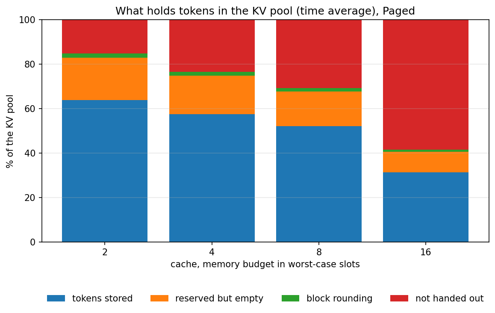


<!-- <p align="center">
  
  
</p> -->

### 4. What does it cost? A slightly slower step, and waste that grows with the block size.

Numbers: [The gather and the block size](RESULTS.md#stage5-block-size).

Attention now reads its keys and values through a block table. Here that means gathering the blocks of every running sequence into a dense tensor before the ordinary attention, which costs a copy and a few more kernel launches per layer, so the decode step is a little slower than the contiguous one at the same concurrency. A fused paged-attention kernel, which reads the blocks in place, would not pay for the copy (exercise 2). In this implementation the step time does not depend on the block size over the range tested, so the block size only trades waste: the unused tail of each sequence's last block grows with the block size, from negligible at small blocks to a large share of the memory at the largest. This experiment cannot show what makes very small blocks costly in a real kernel (a longer block table and less efficient memory access), so it is the waste side of the trade only.


### 5. What happens under load? The contiguous cache queues early, the paged cache keeps admitting.

Numbers: [Open-loop load at fixed memory](RESULTS.md#stage5-load).

With the same small KV memory and requests arriving over time, the two caches look alike at light load. As the rate rises, the contiguous cache runs out of slots long before memory is used, so requests queue, its time to first token climbs, and its completed rate flattens well below the offered load: that is its capacity at this memory. The paged cache keeps admitting while there are free blocks, so it runs more sequences, completes more requests, and its time to first token stays low where the contiguous cache's climbs. Its completed rate is still rising at the top of the sweep, so its capacity is at least that high. It too would saturate, when memory or the cap on running sequences runs out, and the share of steps in which memory held a request back shows when that starts. The caveat from Stage 4 applies: the completed rate of a finite trace understates capacity, so judge saturation from the time to first token and the queueing time.

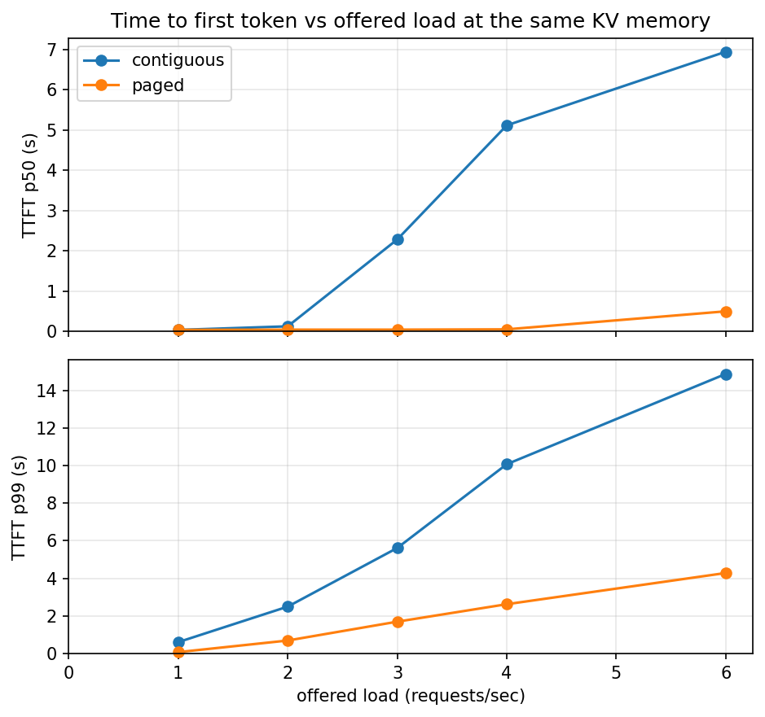
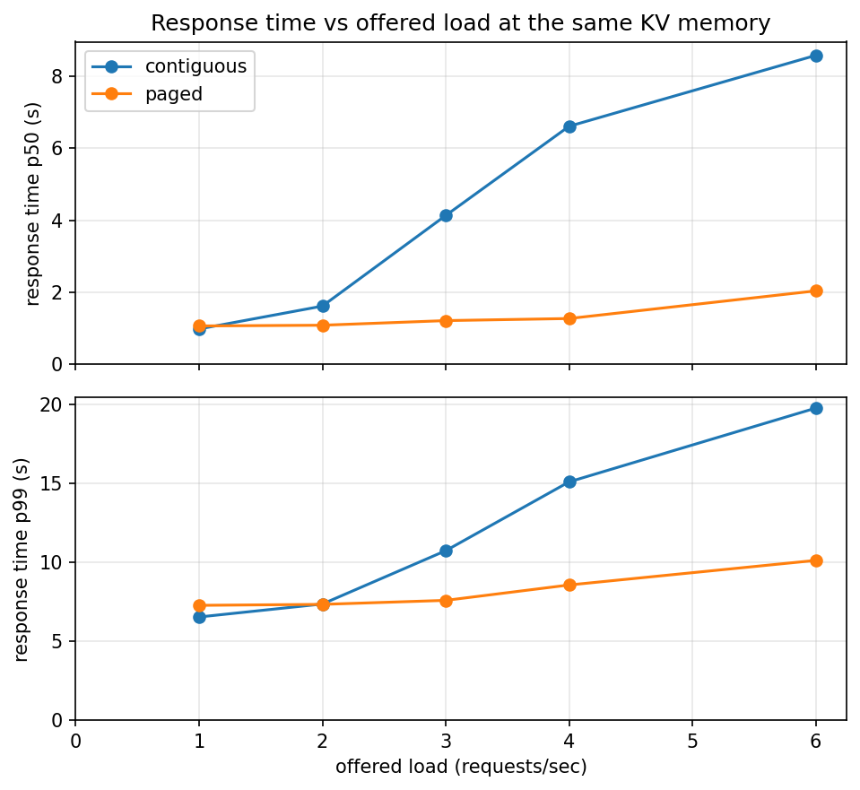

### What this sets up (Stage 5)

The engine now uses its KV memory well and keeps the batch full, so what is left is the cost of each step: every decode step still reads all the weights, and the gather is a copy that a better kernel would avoid. Stage 6 attacks it with speculative decoding: guess several tokens, check them all in one pass, and keep the ones the model agrees with, so one weight read can yield several tokens.

### Other plots (Stage 5)

The plots not embedded above, including the two single-cache versions of the memory breakdown and the completed-versus-offered load plot, are listed, with captions, under [Plots](RESULTS.md#stage5-plots) in `RESULTS.md`.

## Stage 6: N-gram Speculation

[`05_ngram_speculation.ipynb`](05_ngram_speculation.ipynb) answers the question Stage 5 ended with: a decode step still reads all the weights to produce one token per sequence, so what if one step could produce several?

A decode step on this GPU is launch-bound, so feeding it a few more tokens costs almost nothing. Speculative decoding spends that slack. A draft guesses the next `k` tokens, one forward pass feeds the last token and the whole draft together and reads the model's own choice after each, and the longest prefix of the draft that agrees with the model is kept, plus one bonus token. Every kept token is the model's own greedy choice, so the output is the same as plain greedy decoding, only in fewer passes. The draft here is **prompt lookup**: find where the last few tokens occurred earlier in the context and propose what followed them. It needs no second model, and it works when the output repeats the input. Checking the draft needs two small changes: `model.forward` can return the logits of every position and accept several tokens on a non-empty cache when given an explicit mask, and `KVCache.truncate` rolls the cache back over the rejected tokens. The notebook proves this correct first: the output equals plain greedy decoding for several draft lengths on real prompts, a negative control shows that skipping the rollback breaks the output, and two artificial drafts (always wrong, always right) show the extremes. Then it runs these experiments:

| # | Section | Question |
| --- | --- | --- |
| 4 | A. Why checking is cheap | How does the time of a forward pass grow when each sequence feeds more tokens, and at which batch size do the extra tokens stop being free? |
| 5 | B. When guessing works | How often is the draft right on text that copies its input, on repetitive code, and on open-ended writing? |
| 6 | C. The speedup | How much faster is it, how close is that to what the two measurements above predict, and what is the ceiling with a perfect draft? |
| 7 | D. Under batching | What happens to the gain when many sequences share each pass? (A projection from sections 4 and 5, not an end-to-end measurement.) |

Like the earlier notebooks it is self-contained: its `%%writefile` cells write the whole `minivllm/` and `bench/` packages. Weight quantization, the other direction considered for this stage, is left for the standalone engine on a bigger GPU, where decode is limited by reading the weights and not by launching kernels. Replacing the lookup with a small draft model is the next stage.

## Results (Stage 6)

All measured values are in [`RESULTS.md`](RESULTS.md#stage6-setup) (source: [`results/stage6.json`](results/stage6.json)), measured on the same Tesla T4 and model as the earlier stages. Every cell is a single pass over a handful of prompts (four per workload), so treat the numbers as having some noise. The batching section is a projection, not a measurement.

### 1. Is speculative decoding correct?

Yes. For prompts of all three kinds and several draft lengths, the generated tokens match plain greedy decoding over the compared prefix. A negative control shows why the cache rollback matters: without it the output goes wrong at the first rejected draft. Two artificial drafts show the extremes: one that is always wrong gives one token per pass and the plain output, and one that is always right (an oracle that already knows the answer) gives the maximum number of tokens per pass and the plain output. Over the full generation length a few outputs differ from plain greedy after many identical tokens. That is what an fp16 near-tie would look like, since a checking pass has a different matrix shape from a one-token step, but the notebook counts these outputs and does not locate where they diverge, so the cause is an inference.

### 2. Why is checking cheap? Because a decode step is launch-bound, until the batch gets large.

Numbers: [Cost of checking tokens](RESULTS.md#stage6-verify-cost).

At small batch sizes a pass that feeds several tokens per sequence costs only a little more than the one-token step, and the extra cost is about the same whether a few tokens or many are fed: a small, roughly fixed price appears as soon as more than one token is fed and then barely grows. The time per token fed therefore falls almost in proportion to the tokens fed. At a large batch the picture changes. The step is already heavier, and feeding many tokens per sequence makes it grow with the tokens in flight, so the extra tokens stop being free. This is the same wall Stage 3 met when it grew the batch, seen from the other side.

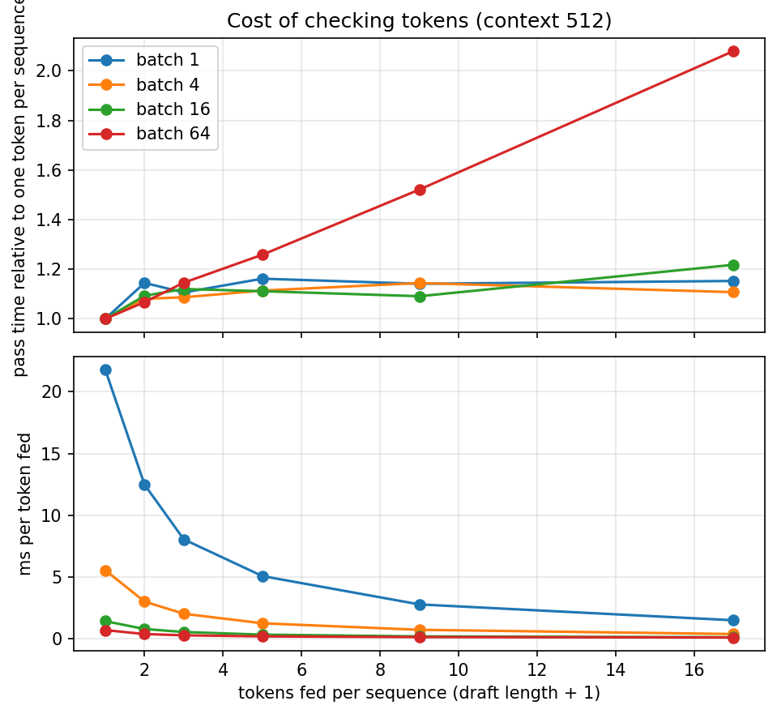

### 3. When is a guess right? When the output repeats what is already in the context, which is more often than expected.

Numbers: [Plain vs speculative decoding](RESULTS.md#stage6-speculative).

Prompt lookup proposes what followed an earlier occurrence of the last few tokens. When the model copies a passage, or continues repetitive code, the draft is found and right most of the time, so one pass yields several tokens. Acceptance falls as the draft gets longer, because a long draft is only accepted up to its first wrong token, but tokens per pass still rise with the draft length. Open-ended writing also gains, less than copying, which was not what we expected: the draft is found in about half of the passes and is right more than half the time. A likely reason is that the lookup searches the whole context, including the model's own output, and greedy decoding from a small model tends to repeat itself, so even free-form text offers matches. The notebook does not measure this, so treat it as a hypothesis, and expect the gain on open-ended text to depend on the model and on greedy decoding.

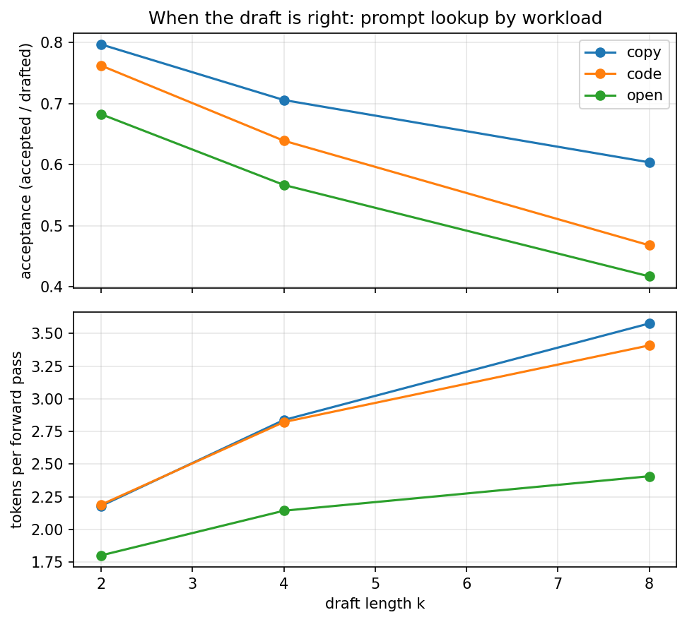

### 4. How much does it buy? About two to three times on repetitive text, close to what the passes predict.

Numbers: [Plain vs speculative decoding](RESULTS.md#stage6-speculative), [The ceiling](RESULTS.md#stage6-oracle).

The speedup follows from two measurements: tokens per pass, and how much more a checking pass costs than a plain step. Their product is within a few percent of the measured speedup, so almost nothing is lost outside the forward passes. Copying and repetitive code come out about two to three times faster than plain decoding, and the speedup is still rising at the longest draft tried, with diminishing returns as acceptance falls, so the best draft length was not found within the range. The ceiling run shows where the limit is: a draft that is always right would do much better at every length, so the limit is the quality of the draft, not the cost of checking it.

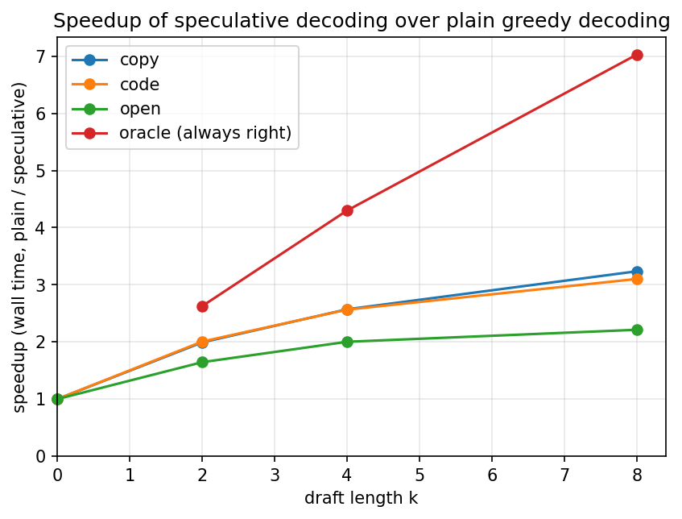

### 5. What happens under batching? The gain erodes for long drafts but stays above one, in a projection.

Numbers: [Projection to batching](RESULTS.md#stage6-projection).

We did not build batched speculation, because every sequence accepts a different number of tokens and the batch becomes ragged. Instead the notebook combines the two measurements it has: tokens per pass from the single-sequence runs, divided by the cost of a checking pass at each batch size. The projection assumes every sequence behaves like the one measured and ignores drafting time, so it overstates the real gain and is useful for its trend. The projected gain is largest at small batch and erodes at the largest batch tried, mostly for the long drafts, whose checking pass costs the most there, but it stays above one throughout the range. Beyond that range, and in a real server, speculation and batching compete for the same spare capacity: a busy server already fills each pass with many sequences, which is the other way to spend idle compute. That makes speculation mainly a latency tool for lightly loaded servers.

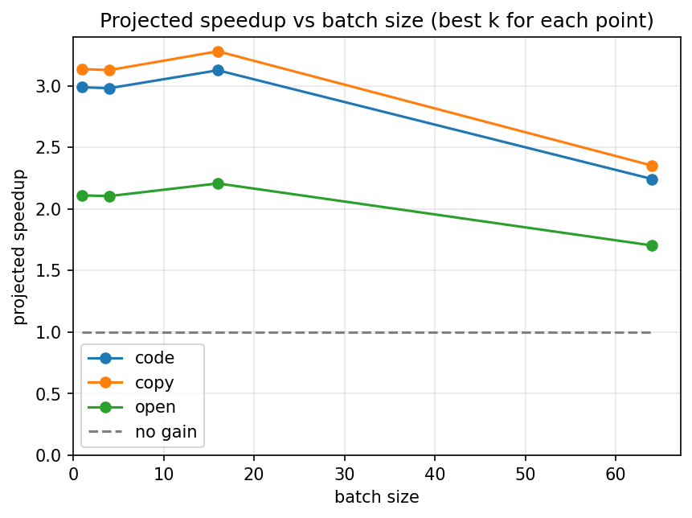

### What this sets up (Stage 6)

Prompt lookup can only repeat what is already in the context. The next stage keeps the checking pass exactly as it is and plugs in a small draft model, so the guesses can be new text, and compares the two guessers head to head on the same prompts.

### Other plots (Stage 6)

All plots are listed, with captions, under [Plots](RESULTS.md#stage6-plots) in `RESULTS.md`.

## Stage 7: Draft-Model Speculation

[`06_draft_model_speculation.ipynb`](06_draft_model_speculation.ipynb) takes the checking pass of Stage 6 and replaces its guesser. Prompt lookup is free but can only repeat what is already in the context. A **draft model**, a small model of the same family, guesses new text by ordinary greedy decoding, and a larger model checks the guesses in one pass. The checker `generate_speculative` is not edited: a draft model is just another `proposer(context, k) -> list of token ids`, the interface `PromptLookup` already has. The pair is `Qwen/Qwen2.5-0.5B` as the draft and `Qwen/Qwen2.5-1.5B` and `Qwen/Qwen2.5-3B` as the targets: one family and one tokenizer, and each target fits on a 16 GB T4 next to the draft.

A draft model changes the question from "is the guess right" to "is the guess worth its price". One round with `k` guesses costs `k` draft steps plus one checking pass, so the notebook starts from a cost model and writes it down before it measures anything:

```text
tokens per round  =  (1 - a^(k+1)) / (1 - a)       a = per-token acceptance rate of the draft
cost per round    =  k * c + v                     in plain target steps:  c = draft step time / target step time,
                                                   v = cost of the checking pass over a plain step (near one while launch-bound)
speedup           =  tokens per round / cost per round
```

The same acceptance rate can mean a win or a loss depending only on `c`. If a decode step were limited by reading the weights, `c` would follow the parameter ratio and be small. But decode on this GPU is overhead-bound (Stages 2 and 3): a step costs about its number of kernel launches, which grows with the number of layers and not with the number of parameters, so `c` may be close to one even though the draft has far fewer parameters. The notebook therefore opens with a **go/no-go gate**: it measures `c` and `a` first, says plainly if the draft model cannot pay, and carries on measuring either way, because a "no" is a result. The fix it tests is a **CUDA graph** over the draft's single-token step, which replays the whole step with one launch.

`DraftModel` (in `minivllm/draft.py`) keeps its own KV cache and **syncs** it every round. The context has grown by the guesses the target accepted and one token of its own, so the draft truncates its cache to the longest prefix it shares with the new context (keeping the keys of accepted guesses, dropping the rest), feeds the few tokens the cache does not have, and guesses `k` tokens greedily. A call therefore costs exactly `k` draft forward passes and never a prefill. It runs in three modes: eager (an ordinary cache), static (a fixed-shape `StaticKVCache` run eagerly, to tell the cost of fixed shapes from the benefit of the graph) and graph (the static step captured once with `torch.cuda.graph` and replayed; if capture is not possible it falls back to the static path and records why).

The notebook proves the result correct before it measures anything: both models still match Hugging Face, a draft's proposals after any pattern of accepted and rejected guesses equal its own greedy decode, and speculative output equals plain greedy decoding of the target for the n-gram proposer and for the draft in every mode. Three controls show what each part is for. A draft that skips its own rollback only **loses acceptance**: its output is still identical, because the target checks every token, so a broken proposer can waste time but not change the result. A *target* that skips its rollback does break the output, as in Stage 6, once a guess has been rejected (when every guess is accepted there is nothing to roll back). And a draft that is the target itself is accepted every time and yields `k + 1` tokens per round, the ceiling of the method. Then it runs these experiments:

| # | Section | Question |
| --- | --- | --- |
| 1 | The go/no-go gate | What is `c`, the draft step cost over the target step cost, in eager, static-shape and CUDA-graph form, and how does it compare with the weight ratio and the layer ratio? What is `a` on open-ended text? Does the cost model predict a win? |
| 2 | The proposer | How does `DraftModel` keep its cache in step with a context the target keeps rewriting? |
| 3 | Correctness | Is the output still exactly plain greedy decoding, and do the negative controls break what they should? |
| 4 | Acceptance | How often is the draft right, by workload and draft length, for each of the two targets, next to the n-gram proposer rerun in the same session? |
| 5 | Speedup | How close is the measured speedup to the cost model, what did the CUDA graph change, and what does the Stage 6 projection method say about larger batches? |
| 6 | Head to head | Which proposer wins on which workload, at its best draft length, and where does a round spend its time, guessing or checking? |

Like the earlier notebooks it is self-contained: its `%%writefile` cells write the whole `minivllm/` and `bench/` packages. The two targets are loaded one after the other, so only one is in memory with the draft at a time. The CUDA-graph path can only run on a GPU, so on a machine without one the draft falls back to the static path; the notebook reports whether capture worked.

## Results (Stage 7)

All measured values are in [`RESULTS.md`](RESULTS.md#stage7-setup) (source: [`results/stage7.json`](results/stage7.json)), measured on a Tesla T4 with `Qwen/Qwen2.5-0.5B` as the draft and `Qwen/Qwen2.5-1.5B` and `Qwen/Qwen2.5-3B` as the targets, four prompts per workload and 128 generated tokens per prompt. Every cell is a single pass, so treat the numbers as having some noise. The CUDA graph was captured successfully on this GPU. The batching section is a projection, not a measurement.

**One caveat: the plain baseline is timed once.** Every speedup divides by it, so one slow baseline run inflates every speedup in its row, and it varies between runs. Across three runs of this notebook (the first two are in the git history) the 3B `copy` baseline differed by about a quarter between the first run and the reruns, and with it the headline 3B `copy` n-gram speedup. The 3B baselines also sat above the 3B micro-benchmark step in all three runs, by a few percent to about a half, for a reason the notebook does not locate, while the 1.5B baselines did not. So read a single speedup against the 3B baseline as good to about a quarter. The cost ratios, the ratios between proposers inside one workload and target (which share the baseline) and the projections moved much less between runs, and the claims below are written to depend only on those. Timing the baseline several times is in the exercises.

### 1. Is draft-model speculation correct? Yes, and each control shows what its rollback is for.

Both models still match Hugging Face. A `DraftModel` proposes its own greedy continuation after any pattern of accepted and rejected guesses, in all three modes, with a few guesses differing (probably fp16 near-ties in the masked static path, which the notebook does not locate). Speculative output equals plain greedy decoding at every draft length, for the n-gram proposer and for the draft model in every mode. Over full-length runs most outputs are identical and the rest differ late in the generation, which is what an fp16 near-tie would look like but is an inference here, as in Stage 6.

Three controls, measured in the notebook and not stored in the results file, show what each part is for. A draft that skips its own rollback keeps its guesses worse (its acceptance and its tokens per round roughly halve) but the output stays identical, because the target checks every token: a broken proposer can waste time and cannot change the result. The *target* skipping its rollback does break the output, as soon as a guess has been rejected: every output broke with the draft model on open text, and every workload broke with a proposer that is always wrong. A first version of this control used a good draft on a copy prompt and showed nothing, because no guess was rejected and a round that accepts everything keeps everything it fed. It now guarantees rejections. And a draft that is the target itself is accepted every time and reaches the maximum tokens per round for the generation length.

### 2. What does a draft step cost? Nearly as much as a target step, until it is captured in a CUDA graph.

Numbers: [Cost of a draft step](RESULTS.md#stage7-cost), [The go/no-go gate](RESULTS.md#stage7-gate).

The draft has about a third of the 1.5B target's weights and about a sixth of the 3B target's, but most of the 1.5B target's layers and two thirds of the 3B target's, and an eager draft step costs about its share of the layers and not of the weights. That is the launch-bound picture of Stages 2 and 3 from the other side: a smaller model is not a proportionally cheaper step, because the step is paid for in kernel launches. Run over a fixed-shape cache, still eagerly, the step costs only slightly more, so the fixed shapes a graph needs are almost free. Replaying the step from a CUDA graph removes most of the launch cost: the draft step takes about half the time or less, and the cost ratio `c` falls from near the layers ratio to much nearer the weights ratio.

The gate turned on exactly this. At the measured acceptance on open text, the cost model predicts a slowdown for the eager draft and a gain for the graph draft, so the same draft is a no-go in one mode and a go in the other, and the rest of the run measured how far reality sits from that prediction.


### 3. Is the draft right? More often than the n-gram lookup on every workload, and about as often at every draft length.

Numbers: [Plain vs n-gram vs draft model](RESULTS.md#stage7-sweep).

The per-token acceptance rate of the draft model is higher than the n-gram lookup's on every workload and for both targets, and the gap is widest on open-ended text, where the lookup has least to copy from. The draft is also accepted often on text that copies its input and on repetitive code, since copying is easy for a small model. The acceptance rate barely moves as the draft gets longer, which is what the independence assumption of the cost model needs, and the tokens per round that the closed form predicts match the measured tokens per pass closely for the draft model. For the n-gram lookup the closed form is optimistic: it often proposes fewer than `k` tokens, or none, so a round does not have a fixed length.

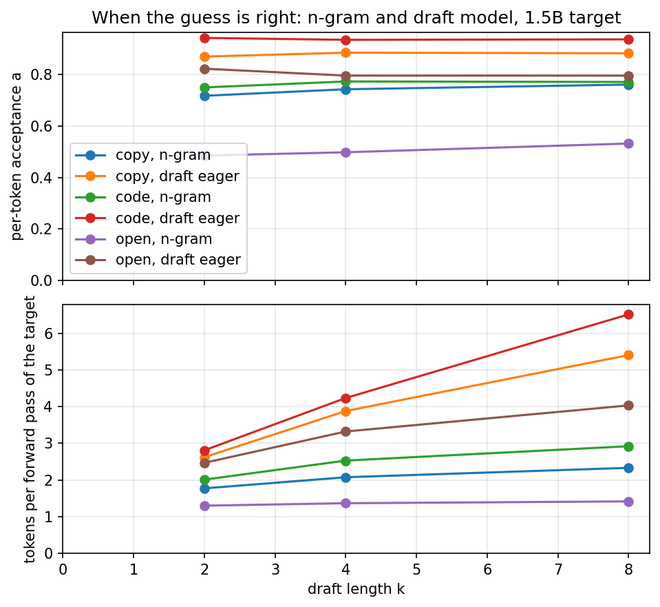
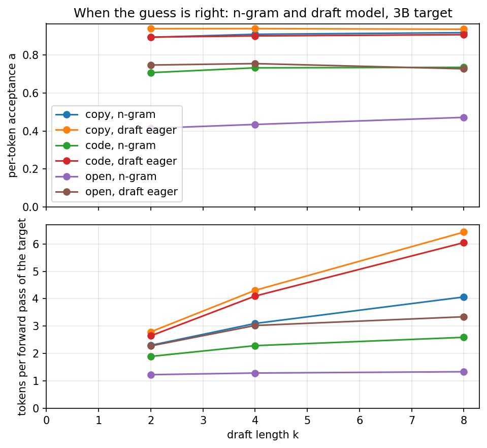

### 4. What does the speedup follow? The cost model, once it is given what a round really pays.

Numbers: [Plain vs n-gram vs draft model](RESULTS.md#stage7-sweep), [Cost of a draft step](RESULTS.md#stage7-cost).

The eager draft model slows decoding down for the 1.5B target at the longest draft on every workload, because each extra guess costs nearly a full target step and a longer draft buys fewer new tokens per guess. With the 3B target the cost ratio is lower and the eager draft does better, but the 3B baselines are the noisiest, so the projection at batch size one, which does not use the plain baseline, is the safer read: at most a modest gain on repetitive text and about none on open text. The graph draft is faster than the eager draft at every draft length, workload and target, and its best draft length is longer than the eager draft's.

The cost model fed with the micro-benchmark `c` is accurate for the eager draft and **overstates** the gain of the graph draft. The reason is visible in the guess times: a round's guess time is one eager step plus one graph step for each further guess, to within about a tenth at every draft length and target. The first guess of a round feeds the new tokens (the bonus token, and sometimes the last accepted guess) through an ordinary pass, which the graph does not cover, so the cost per guess seen during the run is higher than the cost of a replayed step. Given the cost per guess actually seen in the run, the cost model predicts the draft model's speedup to within about a quarter on every row, and much closer on most. The next lever is therefore the first guess of each round, not the replayed steps.

The prediction written before the run also said the eager gate would be a no-go and the graph a go; with the 1.5B target the measured speedups on open text agree in sign, and the graph's gain is smaller than the gate's prediction for the reason above.

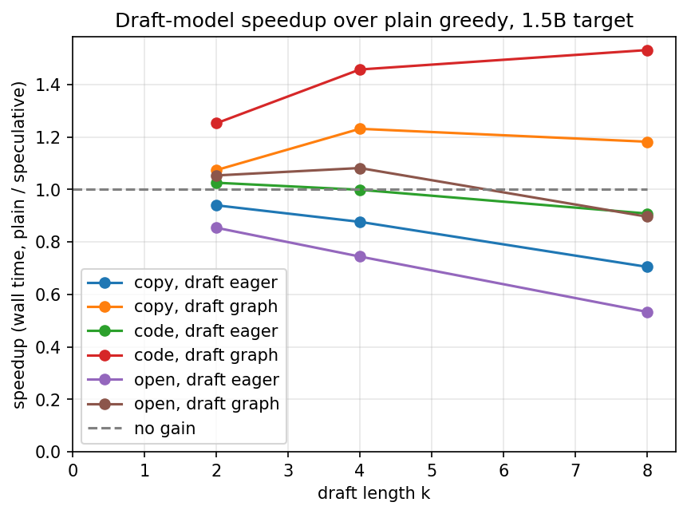
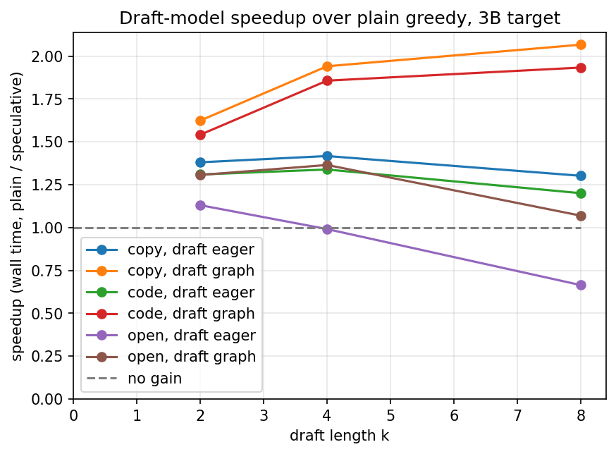
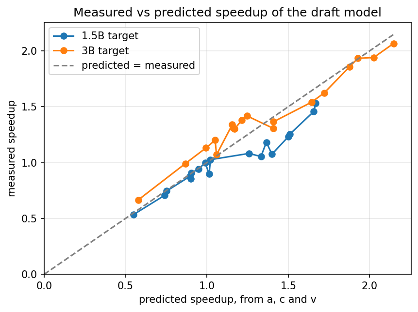

### 5. Who wins? The n-gram lookup, on every workload and both targets, though the gap closes on open text with the larger target.

Numbers: [Head to head](RESULTS.md#stage7-head-to-head).

The prediction written before the run was that the n-gram lookup would win on text that copies its input and the draft model on ordinary prose. Half of it held. The n-gram lookup wins `copy` and `code` clearly with both targets. On open-ended text it also still wins: clearly with the 1.5B target and narrowly with the 3B target, where the graph draft comes within a small margin. Stage 6 had already found that the lookup gains on open text too, probably because it also searches the model's own output and a small greedy model repeats itself. So the draft model is the better *guesser* everywhere, and still loses on this GPU at batch size one, because its guesses are not free: the time split shows the draft's guessing slice comparable to or taller than the target's checking pass, while the lookup's slice is negligible. To pay, a draft model would need a much cheaper step or a much larger target. The n-gram speedup is still rising at the longest draft length on every workload, so its best draft length was not found within the range.

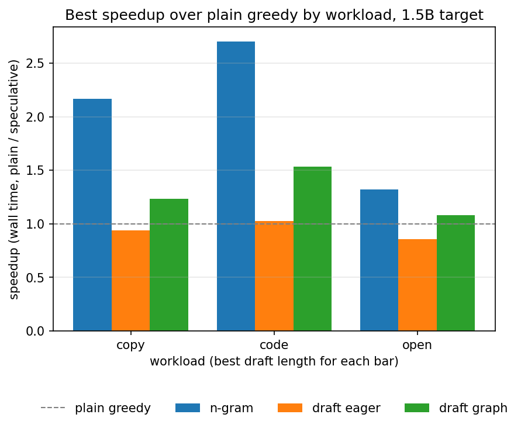

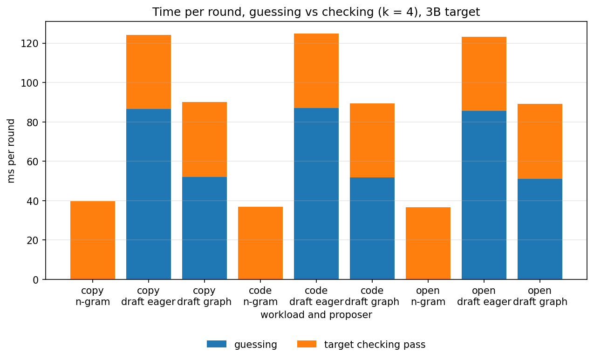

### 6. What happens under batching? The n-gram gain erodes and the draft model's holds up, in a projection.

Numbers: [Projection to batching](RESULTS.md#stage7-projection), [Cost of checking tokens and of a draft step by batch size](RESULTS.md#stage7-verify-cost).

The prediction written before the run was the opposite for the draft model: that it would erode faster, because each of its guesses is a full step that gets heavier with the batch. What the measured step times show is that the target's step grows with the batch faster than the draft's, so the draft's step cost relative to the target's falls as the batch grows, and its projected gain holds up or rises while the n-gram lookup's erodes. On open text the lookup's projected gain is gone, at or below one, by the largest batch, and with the 3B target the draft model's projected gain overtakes it there. That the target's step grows faster is read off the measured step times, and the notebook does not break either step down further. As in Stage 6 this is a projection: it assumes every sequence behaves like the single sequence measured, ignores the raggedness of a batch and the fact that each sequence would need its own draft cache, and it covers the eager draft only, since the captured graph is for batch size one. It overstates the real gain and is useful for its trend.

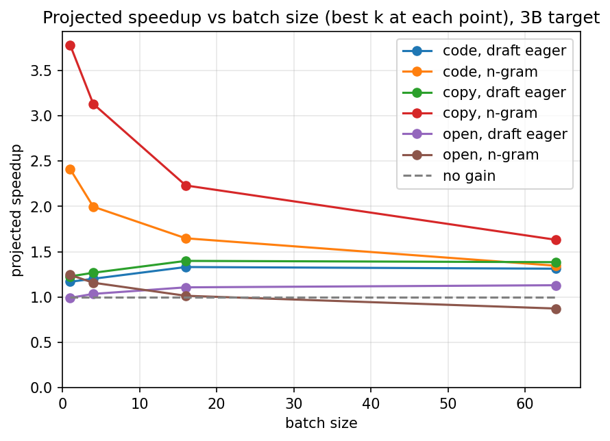

### What this sets up (Stage 7)

The graph covers all the guesses of a round but the first, which feeds the new tokens through an ordinary pass. Capturing that pass too, which has a variable length, is the cheapest next step. Beyond it, the draft step is still dominated by launches and layers, so a draft with fewer layers, or a bigger GPU where decode is limited by reading the weights and a small model really is proportionally cheaper, changes the answer. That is the next stage's ground: leaving the notebook, running the engine on a bigger GPU and comparing it with an established serving system on the same traces.

### Other plots (Stage 7)

All plots are listed, with captions, under [Plots](RESULTS.md#stage7-plots) in `RESULTS.md`.

## Stage 8: Weight-Only Int8 Quantization

[`07_weight_quantization.ipynb`](07_weight_quantization.ipynb) asks the question Stage 7 left open from the other side. Stage 7 found that a decode step on this GPU is launch-bound: a draft model with a third of the target's weights still cost most of a target step, and even after a CUDA graph removed the launches the draft step stayed well above what reading its weights alone would take. Weight bytes were not what limited the step. **If a step were limited by the bytes it reads, how much could be saved by reading fewer?**

**Weight-only int8 quantization** stores every weight matrix as one byte per weight plus one scale per output row, and keeps the activations in fp16. For a weight `W` of shape `[out, in]` and a row `r`:

```text
scale_r = max |W[r, :]| / 127
q[r, j] = round(W[r, j] / scale_r)        an integer in [-127, 127], stored as int8
y       = (x @ q.T) * scale               the scale applies to the output row, the activations stay fp16
```

That halves the bytes of the matrices. Whether it makes a decode step faster depends on one thing: whether the step is limited by bandwidth. The notebook opens with a **go/no-go gate**, as Stage 7 did, because the obvious implementation is a trap. Eager PyTorch has no int8 weight-only matmul, so it converts the weights to fp16 first, which writes a full fp16 copy of the matrix and reads it back. Counting bytes per weight:

| Way | Bytes moved per weight |
| --- | --- |
| fp16 layer | 2 (read) |
| int8, eager dequantize, then matmul | 1 (read int8) + 2 (write fp16) + 2 (read fp16) = 5 |
| int8, conversion fused into the matmul | 1 (read int8) |

So the straightforward way moves two and a half times *more* bytes than the layer it replaces, and only a fused kernel gets the saving. The gate times one linear layer at the real Qwen2.5 shapes with each way this PyTorch build has (the eager dequantize, the same function under `torch.compile`, and `torch._weight_int8pack_mm` where it exists for this GPU), against the measured copy bandwidth. A way that does not work here is reported with the reason, and if no way beats fp16 that is the result, and the rest of the notebook measures accuracy, memory and the gap to the bandwidth floor anyway.

The package change is small. `minivllm/quant.py` holds `QWeight` (an int8 matrix and its scales), `quantize_weight`, `quantize_model` and `qlinear`; `MiniQwen.forward` calls one `linear(x, w, b)` helper that is `F.linear` for an fp16 weight, so the fp16 path is unchanged and a test keeps it matching Hugging Face. The embedding table, the norms, the biases and the RoPE tables stay as they are. Two details matter. First, **bytes stored are not bytes read**: Qwen2.5-0.5B, 1.5B and 3B tie the embedding table to `lm_head`, so quantizing `lm_head` leaves an fp16 table for the lookup next to an int8 copy for the final matmul, and the saving in memory is smaller than the saving in bytes read per token. Second, the int8 product `x @ q.T` is about `127 / amax(row)` times bigger than the real output and fp16 stops at 65504, so `qlinear` scales its input by a power of two first and undoes it in the output scale.

The notebook runs these experiments, with a prediction written down before each benchmark:

| # | Section | Question |
| --- | --- | --- |
| 1 | The go/no-go gate | Does any way of multiplying by an int8 weight read fewer bytes per second than the fp16 layer, at the real layer shapes? |
| 2 | The quantizer | What does per-channel int8 store, what is the error per row, and how do bytes stored differ from bytes read per token? |
| 3 | Accuracy | What do int8 weights cost in logits, perplexity and greedy output, and can the metrics tell a broken quantizer from a good one? |
| 4 | Memory | What do the weights take on the GPU, fp16 against int8, for 0.5B, 1.5B and 3B? |
| 5 | Speed | How do the decode step times of fp16 and int8, eager and under `torch.compile` with CUDA graphs, compare with each other and with the bandwidth floor, by model size and batch size? |
| 6 | Back to Stage 7 | Does a quantized draft model lower the cost ratio `c`, and is speculation still exact with a quantized target? |

Two controls make the accuracy numbers trustworthy. One scale for the whole matrix instead of one per row shows what per-channel scales are for, and a deliberately wrong scale (each row gets its neighbour's) must wreck the model, or the metrics could not detect a broken quantizer. Every timing in the speed section is a median of repeated runs with its spread recorded, because the plain baseline of Stage 7 was timed once and one of its numbers differed noticeably between runs.

## Predictions (Stage 8)

Written before the first run, and kept here so the results can be compared with them.

- **Gate.** The fp16 layer sits near the copy bandwidth on the large layers and far below it on the small ones. The eager dequantize is slower than fp16 by about the extra traffic. Whether the compiled way fuses the conversion on this GPU and torch version, and whether `torch._weight_int8pack_mm` exists for a T4, is not known in advance, which is why the gate comes first.
- **Accuracy.** Per-channel int8 keeps the logits close, the perplexity within a few percent of fp16 and most greedy outputs identical, but not all of them. One scale per matrix is clearly worse. The wrong scale breaks the model.
- **Memory.** Bytes read per token fall to about half of fp16's at every size. Bytes stored fall by much less for the smallest model, where the embedding table is a large share, and by more for the bigger ones.
- **Speed.** Eager int8 is slower than eager fp16 at every size and batch. Compiled int8 gains only if the compiler fuses the conversion, and more for 3B than for 0.5B. At larger batch the gain shrinks. No step reaches the bandwidth floor.
- **Stage 7.** An eager int8 draft step is not cheaper than the fp16 one, and a graph-mode one falls only by the bandwidth part of a small model's step, so `c` does not fall much. Speculation with a quantized target is still exact relative to that target's own greedy output.

## Results (Stage 8)

All measured values are in [`RESULTS.md`](RESULTS.md#stage8-setup) (source: [`results/stage8.json`](results/stage8.json)), measured on a Tesla T4 with `Qwen/Qwen2.5-0.5B`, `1.5B` and `3B` (the accuracy section runs the two smaller ones), PyTorch 2.11 and transformers 5.16. Every timing is the median of repeated runs with the spread recorded. The spread of the decode steps is a few percent at most; it is larger for the smallest layers of the gate, whose time is a single launch. The notebook was run once, so read the numbers as having some noise, and the claims below depend on the direction and rough size of differences, not on the second digit.

**What the result is about.** The gate tried three ways of multiplying by an int8 weight that stock PyTorch offers on this GPU: an eager dequantize, the same function under `torch.compile`, and the built-in `torch._weight_int8pack_mm`. The verdict is about those three ways on a T4. It is not a statement that int8 weights cannot speed up decoding: a hand-written fused kernel (exercise 3), or a library that has one, may do what these three did not, and the notebook does not test them.

### 1. Does any int8 way beat the fp16 layer? No: the gate is a no-go on this GPU and build.

Numbers: [The go/no-go gate](RESULTS.md#stage8-gate).

On the large layers (the two MLP shapes and `lm_head`) the fp16 layer reaches most of the measured copy bandwidth at batch size one, as predicted, and on the small `k/v` layer it reaches a small fraction of it, because that layer is one launch over a few hundred thousand weights. No int8 way is faster than the fp16 layer on any large layer, at batch size one or sixteen, so the gate says no-go. The best of the three is the compiled dequantize, and it is still several times slower than fp16.

Two parts of the prediction missed. The eager dequantize was predicted to be slower by about the extra traffic, roughly two to two and a half times; on the large layers it is three to four times slower. The extra time over the fp16 layer, set against the bytes the conversion has to move, implies that the conversion kernel moves bytes at well under half of the copy bandwidth. That is an inference: it assumes the matmul that follows costs what the fp16 layer costs, and the notebook does not time the two kernels apart. The prediction also left open whether `torch.compile` would fuse the conversion into the matmul, and whether `torch._weight_int8pack_mm` would exist for a T4. Compiling helps a little over the eager way and nowhere near enough, so either the conversion was not fused or the fused kernel is slow, and the notebook does not tell the two apart (it does not inspect the generated code). `torch._weight_int8pack_mm` exists and runs, and is slower than the eager way on every large layer at batch size one and far slower than fp16 at batch size sixteen, where its time grows with the batch as if every row of the batch re-read the weights. That reading of the timing pattern is a guess.

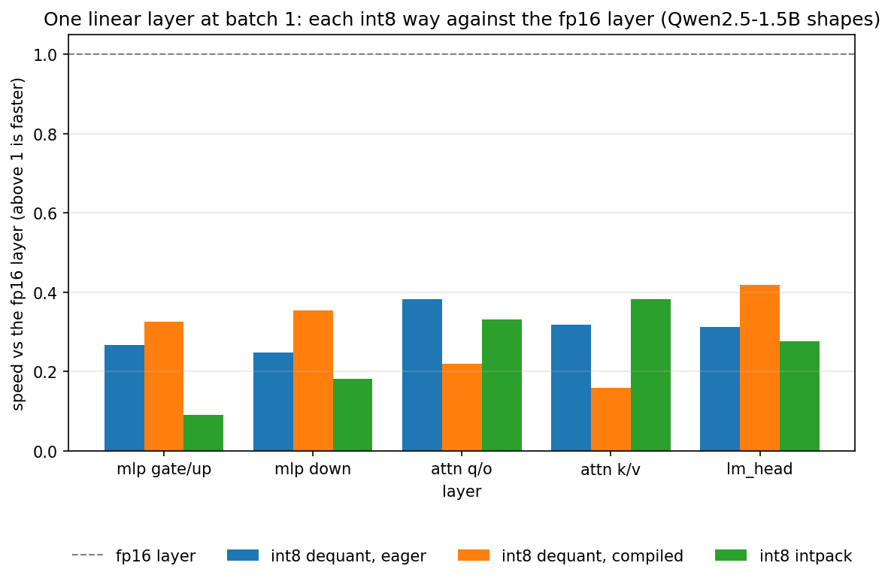


### 2. What does the quantizer cost per weight? A small error per row, and one scale per matrix is several times worse.

Numbers: [The quantizer](RESULTS.md#stage8-quantizer).

After per-channel quantization the median relative error of a weight row is of order one percent for every kind of matrix of the 0.5B model. One scale for the whole matrix makes it larger for every kind, from under twice as large for the value projection to about six times as large for the MLP matrices. That is the effect the control was built to show: a row of small weights gets steps set by the largest weight anywhere in the matrix and loses its resolution.


### 3. What does int8 cost in accuracy? Almost nothing in perplexity, something in the greedy output, and both controls can fail.

Numbers: [Accuracy](RESULTS.md#stage8-accuracy).

Per-channel int8 keeps the perplexity within a fraction of a percent of fp16 for both sizes, the KL divergence from the fp16 distribution is a few thousandths of a nat, and the top-1 token is the same at nearly every position. One scale per matrix is clearly worse: a perplexity several percent higher and a KL more than twenty times larger. The wrong scale destroys the model, with a perplexity in the millions, so these metrics do detect a broken quantizer (the notebook stops if they do not).

The prediction that most greedy outputs would match fp16 was too optimistic. Fewer than half of the per-channel int8 outputs are identical to fp16's over 128 tokens: two of six at 0.5B and three of six at 1.5B. The matching prefix tells where they part. Both repetitive-code outputs match completely for both sizes, the `copy` outputs match for most of their length, and the open-ended outputs part early, much earlier at 0.5B, whose prompts there are ten tokens long and leave the continuation free. That is what near-ties flipping an early token would look like, with the rest of the sequence following, but this comparison does not measure the margin at the first difference (section 6 does, for speculation), so it is an inference. The largest difference of any single logit is also large for per-channel int8 although the mean difference is small, so a few positions are far off; the notebook does not locate them, and the outlier channels of exercise 7 are the first thing to look at.

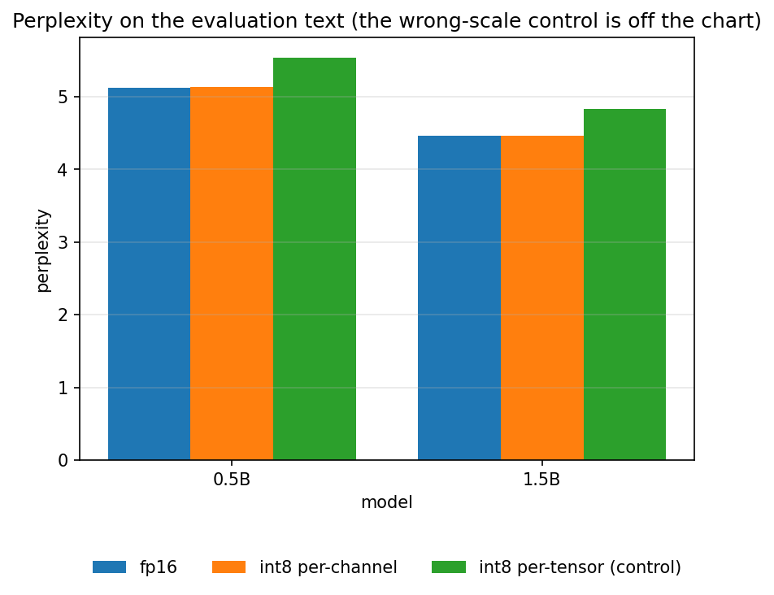

### 4. What does it save? Half of the bytes read per token at every size, and a share of the stored bytes that grows with the model.

Numbers: [Memory](RESULTS.md#stage8-memory).

The prediction held. Bytes read per token fall to half at every size, because every matrix and `lm_head` is int8. Bytes stored fall by less, because the embedding table stays in fp16 for the lookup next to the int8 copy that `lm_head` reads: the saving is about a fifth for the 0.5B model, where the table is a large share of the weights, and about two fifths for the 3B model. The memory a loaded model takes agrees with its stored bytes to within a couple of percent, so nothing else is holding memory. A 3B model in int8 takes about three fifths of its fp16 memory, which is what makes exercise 5 (a model that does not fit in fp16) possible.


### 5. Does it make a decode step faster? No: int8 is slower at every size and batch size, eager and compiled, and by more for larger models.

Numbers: [Decode step time](RESULTS.md#stage8-speed).

First the fp16 steps, which set the stage. The share of its bandwidth floor that an fp16 step reaches rises with the model: small for 0.5B, where the step is launch-bound as in Stages 2 and 7, and for 3B about three quarters eagerly and about four fifths compiled. So at 3B the step is mostly limited by reading the weights, which is the regime where int8 should help if it could be read as bytes.

It does not help. The eager int8 step is slower than the eager fp16 step at every size and batch size, and at batch size one the slowdown grows with the model, from under twice for 0.5B to about three times for 3B, because the extra work is per weight. The compiled int8 step is slower than the compiled fp16 step at every size, and compiling recovers only part of the eager loss. The time the eager dequantize adds to a step is about the same at every batch size, which is what a conversion that touches every weight once per step would do, so the slowdown ratio shrinks with the batch only because the fp16 step itself grows. The built-in int8 matmul is faster than the eager dequantize at batch size one for the smallest model, slower for the larger two, and slower than the eager way from batch size four up at every size, by a factor that grows with the batch. Every int8 step stays far below its (halved) floor.

Against the predictions: eager int8 slower everywhere held; compiled int8 gaining only if the compiler fused the conversion held in the sense that it did not and there was no gain; and no step reaching the floor held. The prediction that the gain would be larger for 3B than for 0.5B has nothing to apply to, since there is no gain. What grows with the size is the loss.

What a fused kernel could do is a projection, not a measurement. If an int8 step reached the same share of its floor that the fp16 step reaches for 3B, it would take about half the time, because its floor is half. Nothing in this notebook reads int8 weights as bytes at that rate, so the projection is the size of the gap a fused kernel would be chasing, not a result. The `torch.compile` warm-up took between half a minute and a minute per run, so the six compiled runs add a few minutes to the notebook.


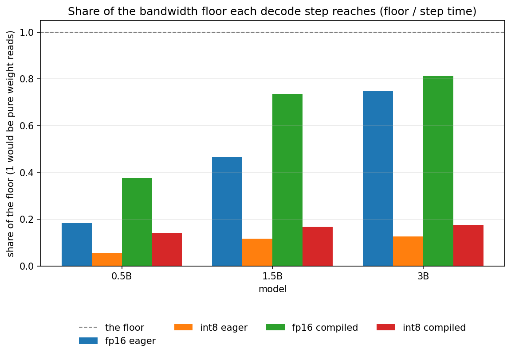


### 6. Does a quantized draft help Stage 7? No: it raises the cost ratio, and speculation stays exact up to fp16 near-ties.

Numbers: [A quantized draft](RESULTS.md#stage8-draft).

Stage 7's exercise 6 asked what happens to `c`, the draft step over the target step, if the draft is made cheaper by quantizing it. With these ways it gets more expensive: `c` rises for the int8 draft in eager mode and in graph mode. The prediction for eager mode was that `c` would not fall, which held. For graph mode it said `c` would fall a little; it rose by a lot. The captured step now contains the dequantize work as well, which is the likely reason, but the notebook does not break the captured step down, so that is an inference.

Exactness needed one correction. A quantized target still gives, in principle, the output of its own plain greedy decoding, but on a GPU in fp16 a checking pass and a plain step multiply different matrix shapes and round differently, so an output can differ from plain greedy exactly where the target's top two tokens are nearly tied (Stage 6 saw the same effect and could only infer it). The first version of this check required the outputs to agree for most of the generation and failed on exactly such a difference. It now runs the fp16 target as a control and, at the first difference, reads the target's own logit gap between the two tokens. The fp16 target's three outputs are all identical to plain greedy. The int8 target's outputs are identical for two of the three prompts, and the third differs at the third generated token with a logit gap of about a hundredth, a tie. This is three prompts of thirty-two tokens, so it supports "no difference was large", not a rate of near-ties.


### What this sets up (Stage 8)

Weight bytes are a real saving in memory and, at 3B, a possible saving in time, but the time saving needs a kernel that reads the int8 weights as bytes, and the three ways stock PyTorch gave this notebook on a T4 are not that. The obvious next step is exercise 3: a fused kernel, written by hand or taken from a library, compared with the three ways of the gate. Where it would matter most is where the fp16 step is already near its floor, as 3B is here, and not for 0.5B, whose step is limited by launches. That is also the ground of leaving the notebook: a bigger GPU and a comparison with an established serving system on the same traces.

### Other plots (Stage 8)

All plots are listed, with captions, under [Plots](RESULTS.md#stage8-plots) in `RESULTS.md`.

## Stage 9: A Fused Int8 Kernel, and the Quantized Model as Its Own Draft

[`08_fused_int8_and_self_speculation.ipynb`](08_fused_int8_and_self_speculation.ipynb) takes up what Stage 8 left open. Stage 8 ended with a no-go: weight-only int8 halves the bytes a decode step reads, but none of the three ways PyTorch offers to multiply by an int8 weight (an eager dequantize, the same under `torch.compile`, the built-in `torch._weight_int8pack_mm`) read those bytes as fast as the fp16 layer reads its own, so every int8 decode step was slower than fp16 and a quantized draft raised Stage 7's cost ratio. The result pointed at the missing piece, a kernel that reads the int8 weights as bytes, and at where it would matter most: the 3B model's fp16 step was already mostly limited by reading weights.

Stage 9 writes that kernel in Triton and asks what it buys, alone and together with speculative decoding. There are two ways the two could combine, and the notebook measures both.

- **An int8 target with speculation.** Speculation cuts the number of weight reads per token and int8 cuts the bytes per read. In a bandwidth-bound step the two should multiply. This needs a kernel: the time the eager dequantize adds to a step is about the same at every batch size (Stage 8), so speculation, which spreads a step over several tokens for fp16 and int8 alike, cannot by itself turn int8 from a loss into a gain.
- **The int8 copy as the draft of its own model (self-speculation).** The int8 copy is nearly the same model: Stage 8 measured the same top token as fp16 at almost every position. Its guesses should therefore be right far more often than a 0.5B model's, and it shares the target's embedding table, so it costs the int8 matrices and not a second model. Whether its guesses are also cheap is what the kernel decides. Whether they are *right* does not depend on any kernel, so the notebook measures that first.

**The kernel** (`minivllm/int8_kernel.py`) computes `y = (x @ q.T) * scale` with `q` an int8 matrix and one scale per output row. It loads a tile of int8 weights, converts it to fp16 in registers, multiplies, accumulates in fp32 and applies the scale to the fp32 result, so the traffic is one byte per weight and there is no fp16 overflow to guard against (Stage 8's input prescale is not needed). There are two kernels: `gemv1` for a single token, which multiplies a tile of weights by a slice of the input on the FMA units and reduces once at the end, and `dot` for a block of tokens (a decode batch, the checking pass of speculation, a prompt), which uses the tensor cores and reads the weights once for all the rows. Block sizes are compile-time constants, chosen by a tuning run over a small grid for every real layer shape and kept in an explicit table; Triton's own autotuner is not used because it times candidate launches and so cannot run inside CUDA-graph capture, which the draft's step needs. `qlinear` gets a third path, `"triton"`, and imports the kernel only then, so a machine without Triton still works. On a machine without a GPU the same kernels run in Triton's interpreter.

As in Stage 7 and Stage 8, the notebook proves what it can before it measures: the kernel against the dequantize path at every layer shape and several row counts, with a control that must fail (a wrong scale), then the go/no-go gate on one layer. Every timing is a median of repeated runs with the spread, and the plain baseline of every speedup is timed several times and its median used, the weakness of Stage 7's single timing.

| # | Section | Question |
| --- | --- | --- |
| 1 | Acceptance of an int8 self-draft | How often does the int8 copy guess the fp16 model's next token, against a 0.5B draft and the n-gram lookup? No kernel needed. |
| 2 | The kernel | Is it correct, how do the tuned block sizes differ by shape, and does it beat the fp16 layer and the three ways of Stage 8? |
| 3 | The decode step | What does it do to a whole step at 0.5B, 1.5B and 3B, eager and in a CUDA graph, against the bandwidth floor, and what does the checking pass cost? Accuracy is checked against Stage 8's. |
| 4 | Speculation with it | Do an int8 target and the n-gram lookup multiply? What is the cost ratio of the int8 self-draft, and does it beat the n-gram lookup and the 0.5B draft? Does the cost model predict the speedups? |

## Predictions (Stage 9)

Written before the first run, and kept here so the results can be compared with them.

- **Acceptance.** The int8 self-draft is accepted very often on every workload: on repetitive text and code at least as often as the n-gram lookup, and on open-ended text clearly more often than the 0.5B draft, where the lookup has little to copy. It is accepted a little more often for the 3B target than for the 1.5B one, which is a weaker guess.
- **The kernel.** It agrees with the dequantize path to within fp16 rounding at every shape and row count, and a wrong scale is caught. If it reaches somewhat less than the share of the copy bandwidth that the fp16 layer reaches, it should beat the fp16 layer on the large layers at one token by a factor between one and a half and two, with two as the ceiling. It does not beat the fp16 layer on the small `k/v` layer, which is launch-bound. At several tokens the tensor-core kernel stays near its one-token result, because the weights are still read once. Whether Triton reaches that on a T4 is not known in advance, which is why this is a gate.
- **The decode step.** The int8 step is faster than the fp16 step at 3B, less so at 1.5B and about not at all at 0.5B, whose step is limited by launches. A CUDA graph removes the launch cost that Triton makes larger in eager mode. The checking pass costs only a little more than a single token for both weight formats. No step reaches its floor.
- **Speculation.** An int8 target with the n-gram lookup is faster than an fp16 target with the n-gram lookup by about the factor int8 gives a plain step: the two gains multiply. The int8 self-draft's cost ratio in a graph is probably higher than the 0.5B draft's, since it reads a model three times larger, and its acceptance is much higher, so the question is which wins. It should beat the 0.5B draft everywhere and the n-gram lookup on open text; on repetitive text, where the lookup's guesses are free, the lookup should still win. The cost model should predict the speedups to within about a quarter and overstate the graph draft's gain, because the first guess of every round is an eager pass (Stage 7).

## Results (Stage 9)

All measured values are in [`RESULTS.md`](RESULTS.md#stage9-setup) (source: [`results/stage9.json`](results/stage9.json)), measured on a Tesla T4 with `Qwen/Qwen2.5-0.5B`, `1.5B` and `3B` (the speculation sections use the 1.5B and 3B models as targets and the 0.5B model as the small draft), PyTorch 2.11, Triton 3.6 and transformers 5.16. Every timing is a median of repeated runs with the spread recorded, and every speedup divides by a plain baseline that is itself the median of three timings, so the baseline noise of Stage 7 is not in these rows. The speculative rows are single passes of three prompts per workload and 96 generated tokens each, so differences of a few percent are noise. The notebook was run once. The claims below depend on the direction and rough size of differences.

**What the run is about.** The question was whether a kernel that reads int8 weights as bytes turns Stage 8's no-go around, and whether the int8 copy can be a draft for its own model. The answer is mixed, and the mix is informative: the kernel wins where it was written to win (one token, in a CUDA graph), the int8 copy is the best guesser of all, and the combination loses in this notebook because one part of the kernel, the part that handles several tokens at once, is slow.

### 1. Is the int8 copy a good draft for its own model? Yes, the best guesser of the three, on every workload.

Numbers: [Acceptance of an int8 self-draft](RESULTS.md#stage9-acceptance).

The per-token acceptance of the int8 self-draft is very high on every workload and for both targets, and higher than the 0.5B draft's everywhere, with the widest margin on open-ended text, where a small model is wrong most often and the n-gram lookup has little to copy (its acceptance there is low, as in Stage 7). That is the prediction, and it held except for one detail: the self-draft was not consistently more accepted for the 3B target than for the 1.5B one, which was a guess. Tokens per round follow: with a draft length of four, the self-draft produces nearly the maximum of five tokens per round on every workload. This part does not depend on any kernel, so it stands whatever the kernel does: the int8 copy is nearly the same model.

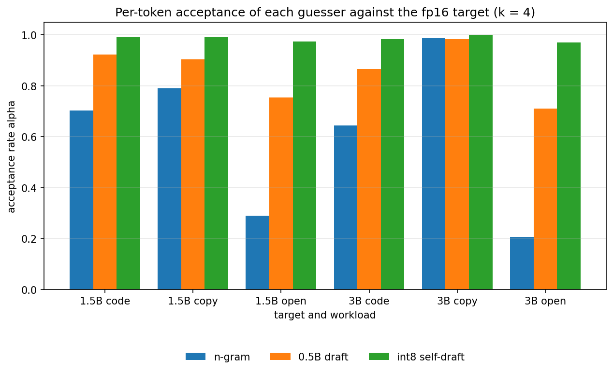

### 2. Is the kernel correct, and does it beat the fp16 layer? Correct, and yes at one token, no at several tokens and on the narrow layers.

Numbers: [The fused int8 kernel](RESULTS.md#stage9-kernel), [The go/no-go gate](RESULTS.md#stage9-gate).

The kernel agrees with the dequantize path to within fp16 output rounding at every shape and row count, and a wrong scale is caught by the same check, so the check can fail. Its accuracy is that of Stage 8: the perplexity of the Triton path equals the dequantize path's to within noise, and both sit within a fraction of a percent of fp16's.

The gate is a **go**, and uneven. At one token the kernel beats the fp16 layer on all three large layers and beats every way of Stage 8 on all three. The gain is largest on `lm_head`, where the int8 layer is more than twice as fast as the fp16 layer, and about a fifth to a quarter on the two MLP shapes. The tuned one-token kernel reads the MLP matrices at roughly half to two thirds of the measured copy bandwidth, and `lm_head` at the copy bandwidth or slightly above. A figure above the copy bandwidth is not a measurement error: the copy figure counts bytes read plus bytes written, so a kernel that only reads can exceed it, and the "floor" of every step in this notebook, which divides bytes read by the copy figure, is therefore a conservative floor. The narrow attention layers (`q/o`, `k/v`) lose: they are launch-bound (Stage 8), a Triton launch costs more than a cuBLAS one, and fewer bytes do not help a layer that is one launch. Exercise 1 is aimed at them.

Two parts of the prediction missed. The gain on the MLP layers is smaller than the factor of one and a half to two that I expected, because the kernel reaches a smaller share of the copy bandwidth there than the fp16 layer does. And the prediction that the tensor-core kernel "stays near its one-token result" at several rows was wrong by a large margin: at five and sixteen rows on the large layers it is six to twelve times slower than the fp16 layer, and tuned it reaches under a tenth of the copy bandwidth. I did not profile it, so the reason is an inference: the kernel converts each int8 tile to fp16 and moves it through shared memory to the tensor cores, and a T4 has no asynchronous copies, so with a small tile nothing overlaps the loads with the conversion and the weights arrive slowly. The one-token kernel has none of that, which is why it is fast.


### 3. Does it make a decode step faster? In a CUDA graph and compiled, yes, at every size and more for bigger models; eagerly, no.

Numbers: [Decode step time](RESULTS.md#stage9-step).

This is the result that matters most. In **eager** mode the int8 step is slower than the fp16 step at every size (and much slower at several rows, where the slow kernel runs). In a **CUDA graph**, and under **`torch.compile`** (which did trace the hand-written kernel, to my surprise), the int8 step is faster than the fp16 step at every size, and by more for bigger models: roughly one and a third times for 0.5B, one and a half for 1.5B and nearly one and four fifths for 3B, where the int8 compiled step reaches about seven tenths of its bandwidth floor. The reason eager mode loses is the number of kernel launches: the gap between the eager and the graph int8 step at 3B is far larger than the same gap for fp16, which is what launches that cost the CPU more than cuBLAS launches would look like, but I did not profile the launches, so that too is an inference. The prediction was a gain in eager mode at 3B and a graph that removes launch cost; the second half held and the first did not.

The gain follows the share of the step that is weight traffic, as the Stage 8 data predicted: small for 0.5B, whose step is mostly launches even in a graph, and larger for 3B. No step reaches its floor.

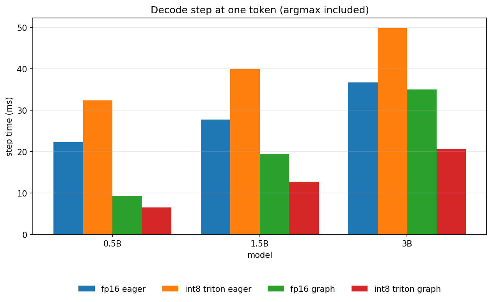
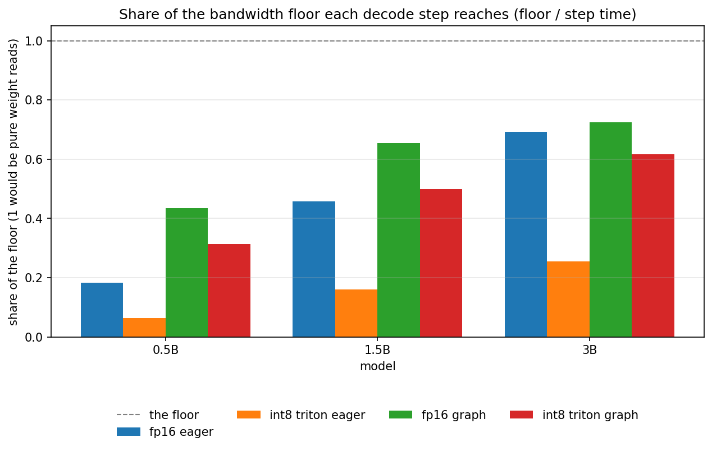

### 4. What does a block of tokens cost? Little for fp16, a lot for int8 beyond the smallest model.

Numbers: [The checking pass](RESULTS.md#stage9-step).

Speculation needs the checking pass (feeding the last token and the draft in one pass) to cost about what one token costs, and for fp16 it does: feeding five tokens costs a few percent to an eighth more than feeding one, at every size. For int8 it does not: feeding five tokens costs more than twice as much as feeding one for the 1.5B model and three and a half times as much for the 3B model (for 0.5B it is hidden by the launch-bound step). That is the slow tensor-core kernel again, now inside a decode loop, and it is what the next section pays for.

### 5. Does speculation with it pay? Not with this kernel, and the cost model says exactly why.

Numbers: [Speculation with the int8 model](RESULTS.md#stage9-speculation).

**An int8 target with the n-gram lookup** is slower than an fp16 target with the n-gram lookup on every workload and both targets, and slower than fp16 plain decoding. The lookup does gain over the int8 plain decoding on copy text and about nothing on code, and it loses to it on open text, because the checking pass costs the int8 model several times a plain step; and the int8 plain decoding in these runs is the eager one. So the gains do not multiply here, which was the prediction that missed most.

**The int8 self-draft** has a cost ratio in a graph that is below one and above the 0.5B draft's (it is a model three to six times larger, at half the bytes), and above one when run eagerly. And yet its measured speedups over fp16 plain decoding are below one on copy and code, at most about one on open text, and it does not beat the n-gram lookup anywhere. The n-gram lookup keeps beating both drafts on copy and code, as in Stage 7. The reason is in the time per round: the guess time of the self-draft is several times what `k - 1` graph steps should cost. A round's first guess feeds the tokens the target just accepted through the draft model in an ordinary pass, and with an int8 draft that pass is two or more tokens through the slow multi-token kernel, once per round (and the whole prompt, on the first round). The first guess of each round was already the cost left to attack at the end of Stage 7, and here it is the whole story.

The cost model confirms it. Fed with each row's measured acceptance, guess time and checking time, it predicts the speedup of every draft row (the 0.5B draft and the self-draft, graph and eager) to within about a tenth, so the loss is not a failure of the idea but a measured cost. For the n-gram lookup it is optimistic, as in Stage 7.

**A projection, not a result.** If the first guess of a round cost one graph step instead of a slow multi-token pass, the same cost model, with the measured acceptance, step and checking times, gives the self-draft roughly one and a half times fp16 plain decoding on the 1.5B target on every workload, and a gain over the n-gram lookup and the 0.5B draft on open text; on the 3B target it gives about one and a third times on open text and no gain over the lookup on copy. Nothing in this notebook measured a cheaper feed, so this is the size of the prize, not a finding.


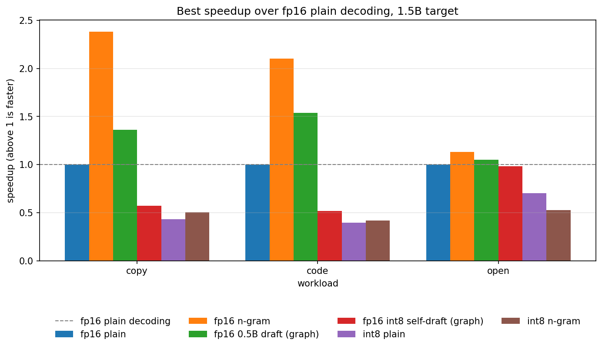


### 6. Is it still exact? Up to fp16 near-ties, as before.

Numbers: [Speculation with the int8 model](RESULTS.md#stage9-speculation).

Every setup is checked against its own plain greedy decoding (speculation keeps a model's output; it does not make int8 match fp16). Three quarters of the checked outputs are identical, and at every difference the target's own logit gap between the two tokens is a tie: a hundredth of a logit or exactly zero. This is a small check (the first prompt of each workload, thirty-two tokens), so it supports "no difference was large", not a rate of ties.

### What this sets up (Stage 9)

The result points at one thing. The one-token kernel and the graph make the int8 decode step about twice as fast as the fp16 one at 3B, and the int8 copy is the best draft there is, but anything that feeds several tokens through the int8 model is slow. A kernel for a handful of rows, which reads each weight once and does its products on the FMA units instead of the tensor cores (a checking block of five tokens is five multiplications per weight, which a T4's FMA units have room for), would fix both the checking pass of an int8 target and the first guess of a self-draft. For prompts, falling back to the dequantize path costs little. After that the questions of this stage can be asked again with the loss removed: the end-to-end speed of a compiled int8 decoder, and the self-draft against the n-gram lookup on open text. The engine outside the notebook comes after.

### Other plots (Stage 9)

All plots are listed, with captions, under [Plots](RESULTS.md#stage9-plots) in `RESULTS.md`.

## Stage 10: A Decode Loop That Lives in CUDA Graphs, and Do Int8 and Speculation Multiply

[`09_graph_speculation.ipynb`](09_graph_speculation.ipynb) picks up the two things Stage 9 could not fix. The fused int8 kernel made a one-token decode step faster than fp16, but only inside a CUDA graph or under `torch.compile`: a Triton kernel launched eagerly costs about as much CPU time as it saves. And anything that fed several tokens through the int8 model was slow, because the kernel for a block of tokens used the tensor cores and read the weights several times slower than the fp16 layer did, so the checking pass of speculative decoding cost the int8 model two to three and a half times a one-token step. Stage 9's speculation loop was eager, so even a fast kernel could not have won in it.

Working the Stage 9 numbers through again changed the order of the next steps. The int8 copy as the draft of its own model is the best guesser there is, but its ceiling is set by arithmetic: a draft that is the same model at half the bytes costs about half a target step by construction, so against a fair baseline (the fp16 model in a CUDA graph, not eager) the most a self-draft can give is a modest gain, and it is slower than simply running the int8 model in a graph. It only makes sense when the output has to be exactly the fp16 model's. The question Stage 9 started with is cleaner with a guesser that costs nothing, the n-gram lookup: then the only thing that decides is the cost of the checking pass, and the target, fp16 or int8, is the thing under test.

**Stage 10 asks whether int8 weights and speculative decoding multiply.** Speculation cuts the number of weight reads per token and int8 cuts the bytes per read, so in a step that is limited by reading weights the two should compose. Two pieces are needed that Stage 9 did not have.

- **A multi-row int8 kernel** (`gemvm` in `minivllm/int8_kernel.py`). The checking pass feeds the last accepted token and up to `k` drafts, two to eight rows of `x`. A few rows is not a matrix product, it is a few matrix-vector products that share their weights, and the weights are the expensive thing to move. The kernel loads each int8 tile once, converts it in registers, and multiplies it by every row on the ordinary FMA units into a three-dimensional accumulator that is reduced once at the end. No tensor cores, no shared-memory staging. Above eight rows the int8 path falls back to the dequantize path, which is fine for a prompt, where the matmul is compute-bound anyway. The tuner now times each candidate as repeated calls inside one CUDA graph, because for the small layers the launch is as large as the kernel and hid the differences in Stage 9.
- **A forward pass that lives in a graph** (`StaticForward` in `minivllm/draft.py`, `GraphDecoder` in `minivllm/graph_decode.py`). A captured pass for a fixed number of tokens over the static KV cache, with static buffers for the token ids and positions, the attention mask computed from the positions inside the graph, and the logits as the graph's output. A plain decode step is the pass for one token; the checking pass of speculation with `k` drafts is the pass for `k + 1` tokens, with short drafts padded and a round with no draft at all run as an ordinary one-token step. The token never leaves the GPU between steps. The rollback after a rejected draft is free: a pass writes its keys at the positions it is given, a row only attends to keys at or before its own position, so the stale keys of rejected drafts sit beyond the decoder's length where no row can see them and the next pass overwrites them. Nothing is copied or cleared. A control keeps this honest: a mask that lets rows see later keys breaks the output.

The notebook proves what it can before it measures: the kernel against the dequantize path at every shape and at every row count from one to nine, sixteen and thirty-seven, with a control that must fail (a wrong scale); the graph decoder against plain greedy decoding of the same weights for any proposer (the tests use an always-wrong one, an always-right one and one that proposes fewer tokens than the block holds), with a control that must break; then the go/no-go gate on the large layers, timed in a CUDA graph.

| # | Section | Question |
| --- | --- | --- |
| 1 | The multi-row kernel | Is it correct at every row count, which kernel does the tuner pick for each, and does it beat the fp16 layer at two to eight rows, in a graph and the Stage 9 way? Was Stage 9's tensor-core kernel just badly tiled? |
| 2 | A forward pass in a graph | What does a block of tokens cost against a single token in a graph, for fp16 and int8, and eagerly? Does the multi-row kernel change what the model computes? |
| 3 | Plain decoding in a graph | What does quantization buy a decoder at batch one once the loop itself is fast, as a rate of a whole generation? |
| 4 | Speculation in the graph | Do int8 and the n-gram lookup multiply, against fp16 eager, fp16 in a graph and int8 in a graph? Is the output still exact? Does the cost model predict the speedups? |

## Predictions (Stage 10)

Written before the first run, and kept here so the results can be compared with them. They come from arithmetic on the Stage 9 numbers, and the second and fourth are the ones I am least sure of.

- **The kernel.** It agrees with the dequantize path to within fp16 rounding at every row count and a wrong scale is caught. On the large layers at five rows, inside a graph, it is faster than the fp16 layer, because the weights are read once at one byte each and a handful of rows is a handful of multiply-adds per weight, which the FMA units of a T4 have room for if they overlap with the loads. Five, seven and eight rows cost the same, since the kernel pads to eight accumulators, and fewer rows cost a little less. The tensor-core kernel stays far slower at five rows whatever tile the new grid finds. The tuner picks the one-token kernel at one row, the multi-row kernel at two to eight, and the tensor-core or dequantize path above eight. The risk is Triton's handling of a three-dimensional accumulator, and the tuning table will show it.
- **A pass in a graph.** For fp16 a pass of five or seven tokens costs a little more than a one-token pass. For int8 it costs more than that, but far less than the slow kernel did in Stage 9, and int8 in a graph is still faster than fp16 in a graph at those lengths. Eager int8 passes are much slower than graph passes, and fp16 ones much less so. The multi-row kernel's logits differ from the dequantize path's by far less than int8 differs from fp16, with the same top token.
- **Plain decoding.** A graph helps fp16 a lot at the smallest model, where the step is mostly launches, and almost not at all at 3B, where it is mostly weight reads. Int8 in a graph is faster than fp16 in a graph, by more for bigger models, and several times faster than fp16 eager (the baseline of every earlier stage) at the smallest model. Eager int8 stays slower than eager fp16.
- **Speculation.** The n-gram lookup helps both weight formats on repetitive text and code and is about neutral on open text, where it rarely finds a draft and the rounds without one are plain steps. The gains multiply, less a little: int8 plus the lookup beats each alone on repetitive text and code, by somewhat less than the product of the two separate gains, because the checking pass costs more relative to a plain step on int8 than on fp16. Against fp16 eager plain decoding the combination reaches several times on repetitive text, with the larger model gaining most. The cost model, fed with the measured checking cost and acceptance, predicts the speedups to within about a quarter and overstates open text. Every difference from plain greedy is an fp16 near-tie, an fp16 eager run shows near-ties without any graph or int8, and the non-causal control changes the output.

## Results (Stage 10)

All measured values are in [`RESULTS.md`](RESULTS.md#stage10-setup) (source: [`results/stage10.json`](results/stage10.json)), measured on a Tesla T4 with `Qwen/Qwen2.5-0.5B`, `1.5B` and `3B` (the speculation section uses the 1.5B and 3B models as targets), PyTorch 2.11, Triton 3.6 and transformers 5.16. Every timing is a median of repeated runs with the spread recorded, and the plain baselines of the speculation sweep are the median of three timings. The speculative rows are single passes of three prompts per workload and 96 generated tokens each, so differences of a few percent are noise. The notebook was run three times and the results file holds the last run. I compared the first and the last: every figure that matters reproduces (the kernel, the gate, the cost of a checking pass, the speculation ratios), and what differs is noise and the 3B fp16 baselines, which are the subject of the follow-up check below. The claims below depend on the direction and rough size of differences.

**What the run is about.** The question was whether int8 weights and speculative decoding multiply once the decode loop lives in CUDA graphs. They do not, and the reason is one kernel. The graph decoder works, the n-gram lookup works, and fp16 with the lookup in a graph is the best setup on repetitive text. The multi-row int8 kernel is a no-go: a checking pass costs the int8 model about two plain steps where it costs fp16 one, so int8 with the lookup loses to fp16 with the lookup on copy and code and to int8 plain decoding on open text.

**Two things the run turned up in its own measurements,** both settled by two diagnostic cells added to the notebook after the first run (the [follow-up check](#follow-up-check-d1-and-d2) below). The fp16 `lm_head` layer is about twice as slow at one row as at two when it runs in a graph, because the one-row kernel cuBLAS picks under graph capture is slow, and that flatters every figure taken against an fp16 graph step at one token. And the 3B fp16 rows of the plain-decoding section and of the speculation baselines were measured slow, because the first block timed after heavy work runs on a GPU whose clocks are still settling. The claims and the discussion below rest on the passes of section 3 and on rows that are not affected, and say where a figure is.

### 1. Is the multi-row kernel correct, and what does the tuner pick? Correct, and it picks as predicted.

Numbers: [The multi-row kernel](RESULTS.md#stage10-kernel).

The kernel agrees with the dequantize path to within fp16 output rounding at every shape and at every row count from one to nine, sixteen and thirty-seven, and a wrong scale is caught by the same check, so the check can fail. The tuner chose the one-token kernel at one row on every shape, the multi-row kernel at two, four and eight rows on every shape, and the dequantize path above eight rows on every shape in the last run (the tensor-core kernel won one shape at sixteen rows in the first). Two candidates per shape did not compile or launch at eight, sixteen and a hundred and twenty-eight rows. The table counts them without naming them, but at sixteen rows and above only tensor-core tiles and the dequantize path are candidates, so they are tensor-core tiles. The tensor-core kernel, in other words, never mattered in this stage.

### 2. Does it beat the fp16 layer? No: the gate is a no-go, and the kernel is not memory-bound.

Numbers: [The go/no-go gate](RESULTS.md#stage10-gate).

Inside a CUDA graph, on the three large layers, the tuned kernel beats the fp16 layer at one row (by between one and two thirds and two times on the two MLP layers), is about even at two rows (a little better or a little worse depending on the layer), and from three rows up is slower than the fp16 layer on every large layer, with the gap widening: roughly seven tenths of the fp16 layer's speed at three rows, five eighths at five, three fifths at eight and under a third at sixteen. The gate is a no-go at five rows. The prediction was a gain of between one and a third and one and four fifths at five rows, so this missed by a wide margin. The same measurement the Stage 9 way (one call per timing, launch cost included) tells the same story with a smaller gain at one row.

The kernel is not memory-bound. Its time grows with the rows, by more than half between two and eight rows on every large layer, and at eight rows it reads about a quarter of the copy bandwidth where the one-token kernel reads roughly eight tenths to nine tenths of it. Five, seven and eight rows cost almost the same (the kernel pads to eight accumulators, and going from five to eight rows costs only a few percent more), which is the design working as intended. Three rows are not as smooth: on the largest MLP layer the three-row layer is slower than the five-row one, so the tile the tuner chose for the three-to-four-row bucket is a worse one. The tuner's winners sit at the edge of its grid: all but one of the winners on matrices of ten million weights or more use the largest tile of the grid, and most winners use the smallest warp count, so the grid was too small. That says the search stopped early, not why the kernel is slow.

What limits it is not settled, and the arithmetic needs care, because of the clocks (follow-up check). Under this load the T4 runs power-capped at about a gigahertz, far below its boost clock, so its multiply-add peak is about 2.3 trillion a second and not the roughly 4 trillion of the boost-clock figure. At the copy bandwidth, eight multiply-adds per weight would need about five sixths of that peak, four rows about two fifths and two rows about a fifth. So at eight rows the FMA units could not keep up with memory even for a perfect kernel on this clock, which fits the time growing with the rows. But the kernel is nowhere near the FMA peak either: it reaches about a twelfth of it at two rows and about a fifth at eight (on `lm_head`). It is neither memory-bound nor FMA-bound, so there is real inefficiency in it as well. My leading hypothesis is the three-dimensional accumulator, whose broadcast and reduction layouts the one-token kernel does not need, together with the conversion of each int8 weight; I did not profile it, so it is a guess.

The tensor-core kernel of Stage 9 is not just badly tiled for few rows. Its time hardly changes between one and sixteen rows, at a tenth to a fifth of the fp16 layer's speed, and at five rows it is between three and a half and five times slower than the tuned multi-row kernel. A cost that does not depend on the rows is a per-weight cost, which is consistent with Stage 9's suspicion about the conversion and the staging through shared memory, still unprofiled.

The one-row ratio deserves a caveat: it is flattered by the fp16 layer's own slowness at one row in a graph (follow-up check). On the two MLP layers, which do not show it, the gain is between one and two thirds and two times.


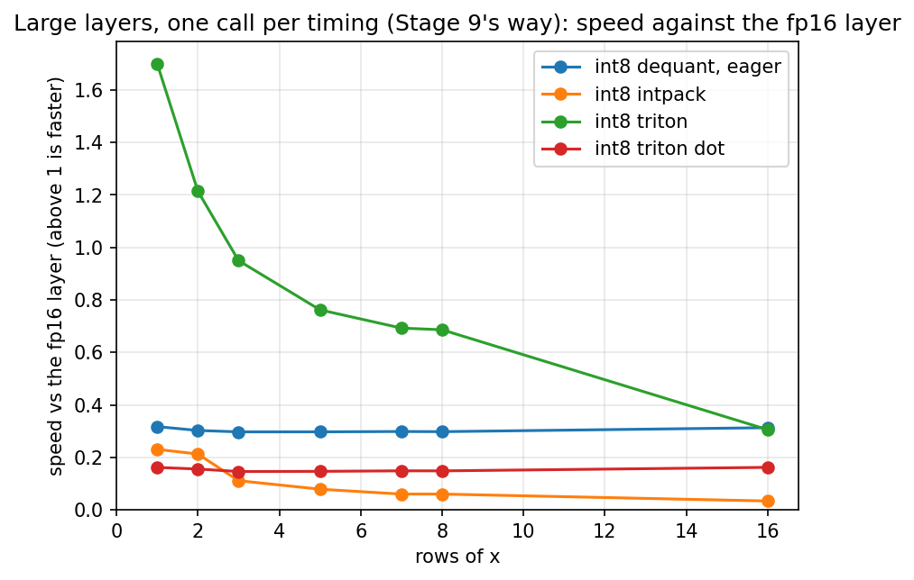

### 3. What does a checking pass cost in a graph? Nothing for fp16, about two plain steps for int8, and that is the kernel.

Numbers: [A forward pass in a graph](RESULTS.md#stage10-block).

For fp16, feeding five or seven tokens costs the same as feeding one at every size, to within a few percent: the cost factor `v` of the cost model is one. For int8 it is not. It is about one and three quarters at 0.5B and between two and a third and about two and three fifths at 1.5B and 3B, where the prediction was between one and a tenth and one and three fifths. So a five-token int8 pass is slower than the fp16 one at every size, by about a third, although the one-token int8 pass is faster than the fp16 one by a factor that grows with the model (and is flattered at one token by the `lm_head` effect).

The whole difference is the kernel. Adding up the tuned layer times of section 2 over every matrix of a model, eight rows cost as much more than one row as the measured seven-token pass costs more than the one-token pass, to within about a tenth at 1.5B and 3B (at 0.5B the small layers are latency-bound in the tuning timings, so the sum overshoots and was not used). Attention, norms and the cache add nothing to speak of to a wider block. The graph also explains why Stage 9 saw so little: in eager mode a pass of five or seven tokens costs about what one token costs for both formats, because launches dominate, and the graph removes the launches. The graph speeds the one-token pass up by a factor that shrinks as the model grows and is larger for int8 than for fp16 (for fp16 at 3B it is almost none, since that step is weight reads and not launches).

Accuracy is not the problem. The multi-row kernel's logits differ from the dequantize path's with a KL divergence more than fifty times smaller than int8's difference from fp16, and the top token is the same at every position of every block checked.

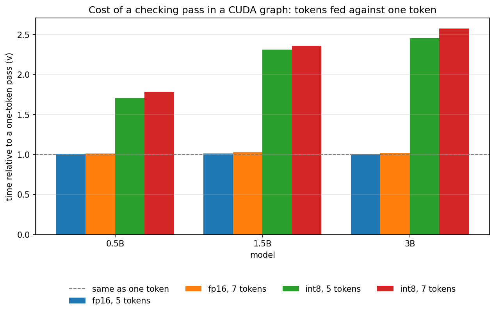

### 4. What does plain decoding in a graph buy? A lot, and int8 gets more of it than fp16.

Numbers: [Plain decoding in a graph](RESULTS.md#stage10-plain).

The graph decoder costs almost nothing over the single pass it replays: its time per token is at most about a tenth above the section 3 pass (the largest ratios are on the fp16 rows, which are the first rows timed after each model load) and about equal or below it for int8. In a graph int8 decodes faster than fp16 at every size, by about one and a half at 0.5B, nearly one and nine tenths at 1.5B and about two at 3B, which is the Stage 9 step result seen as a rate. The graph helps fp16 most at the smallest model, where the step is mostly launches (more than twice), and by a quarter to two fifths at 1.5B; at 3B it helps almost not at all. Eager int8 decoding stays slower than eager fp16 at every size. Against the eager fp16 baseline of every earlier stage, int8 in a graph decodes about three and two thirds times faster at 0.5B and about two and a third times faster at 1.5B, and at 3B about one and nine tenths times against section 3's eager pass.

Three cautions. The 3B fp16 rows of the table were measured during the warm-up described in the follow-up check, so they are slow (the eager row also has a very large spread), and every 3B ratio against them is inflated: the table says about two for int8 against fp16 in a graph and about two and three quarters against eager, where the steady-state rates give about one and nine tenths for both. Second, int8's lead over the fp16 graph step is flattered by the fp16 `lm_head` effect, which is an avoidable cost: for 1.5B, an fp16 `lm_head` run at its two-row speed would shorten the fp16 graph step by about an eighth and put int8's lead at about one and a half rather than one and seven tenths (judging by the size of the layer, the cost should be a larger share of the step at 0.5B and a smaller one at 3B, which I did not measure). [Stage 11](docs/stage11.md) measured the whole step with the head padded and found a few percent, not an eighth, so this estimate from one layer's timing was several times too large. Third, none of this touches the eager comparison. Every output equals the eager output of the same weights, so no tie had to be read.

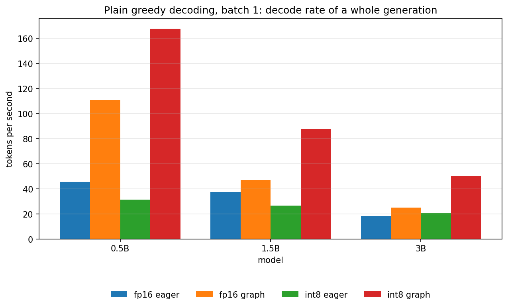

### 5. Do int8 and speculation multiply? No.

Numbers: [Speculation in the graph](RESULTS.md#stage10-speculation).

**The lookup in a graph with fp16 weights** more than doubles plain decoding in a graph on copy and code at both targets (by far more on copy at 3B, where the lookup is accepted almost every time) and gives a small gain on open text, where it rarely finds a draft. The graph speeds the fp16 lookup up by about two fifths at 1.5B and barely at 3B. The lookup's acceptance depends on the workload and not on the weights: it differs by less than a tenth between fp16 and int8 on the same workload.

**With int8 weights** the lookup beats int8 plain decoding on copy at both targets (by a third at 1.5B, by more than twofold at 3B), is about a fifth better on code at 1.5B and a little worse at 3B, and loses to it on open text, by about a fifth at 1.5B and a quarter at 3B. The prediction that it would be about neutral on open text missed: a round that does find a draft costs the int8 model more than two plain steps for well under two tokens.

**The gains do not multiply.** Int8 plus the lookup reaches somewhere between about three eighths and seven tenths of the product of the two separate gains, and fp16 with the lookup in a graph beats int8 with the lookup on copy and code at both targets. The best graph setup is fp16 with the lookup on copy and code and int8 plain decoding on open text. The reason is the checking cost `v` measured inside the sweep: between about one and nine tenths and two and two fifths plain steps for the int8 lookup rounds on copy and code (about one and a half on open text, where many rounds find no draft and run the cheap one-token pass), against one for fp16. Against the fp16 eager baseline of every earlier stage, the best setup decodes about three and a half times faster on copy at 1.5B, about three times on code and about two and a quarter times on open text. At 3B the baselines of the sweep were measured slow (follow-up check), so the table overstates the ratios; against the steady-state fp16 rates the best setup is about five and a half times on copy, about twice on code and nearly twice on open text.

**The cost model.** Fed the tokens per round that the acceptance rate predicts, it overstates the speedup of every lookup row, by a seventh to a half, because the lookup's drafts are often shorter than `k`; the prediction that it would be within a quarter held for only part of the rows. Fed the measured tokens per round instead, it predicts them to within about a tenth, slightly optimistic (the sweep also pays for the prefill). So the model is right and the usual inputs are wrong for this guesser.

**A projection, not a result.** If the int8 checking pass cost about one and a seventh plain steps instead of about two, the same arithmetic with the measured acceptance, step times and prefill puts int8 plus the lookup at about one and a third to one and four fifths times the measured fp16 graph plus lookup once each format's own prefill is included, which is the basis of every other speedup here (about one and three fifths to nearly twice for decoding alone). The low end is copy at 3B, where the fp16 lookup run is so short that the prefill is a large share of it. Nothing in this notebook measured a cheaper kernel, and the clocks (follow-up check) suggest that eight rows may not reach that on this GPU, so this is the size of the prize and not a finding.

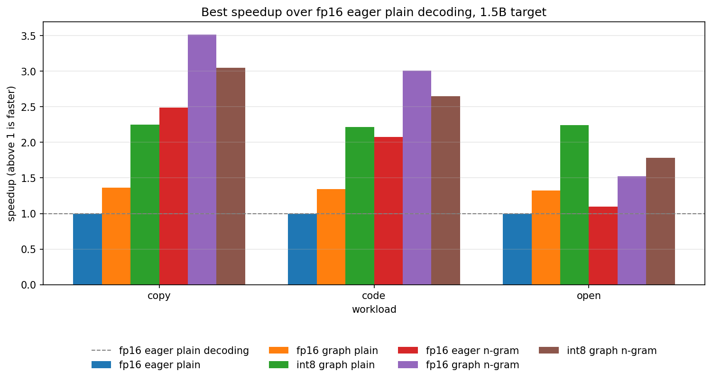


### 6. Is it still exact? Up to fp16 near-ties, and the control can fail.

Numbers: [Speculation in the graph](RESULTS.md#stage10-speculation).

Every setup is checked against its own plain greedy decoding (the first prompt of each workload, thirty-two tokens). Twenty-two of the twenty-four are identical, and the two differences (the int8 lookup on code, at both targets) have a logit gap of a hundredth of a logit or exactly zero between the two tokens, so they are ties. A decoder whose mask lets every row see all keys up to the end of its block, the control that must break the rollback and the causal mask, changes the output on all three workloads, so the check can fail. Over the whole sweep, the graph does not lower how many outputs equal plain greedy (fp16 in a graph has as many identical outputs as fp16 eager), and int8 has somewhat fewer than fp16, all of its differences being in the lookup rows, where the checking pass uses the multi-row kernel and the plain step the one-token one, probably because the two round differently. Only the checked outputs have their logit gap read. The eager fp16 control showed no difference in the checked prompts, so those checks do not by themselves show that ties occur without a graph or int8; the counts over the whole sweep do (the eager fp16 engine also differs from its own plain greedy in a few outputs).

### Follow-up check (D1 and D2)

The two diagnostic cells sit in [`09_graph_speculation.ipynb`](09_graph_speculation.ipynb) with their outputs; their numbers are not in the results file, so this section gives them in words.

**D1, the fp16 `lm_head` at one row.** The layer at the 1.5B shape was timed at one, two and three rows, eagerly and in a graph, twice in opposite row orders, with `F.linear` and with a plain matrix product, and with the input padded to two rows with only one used. In a graph one row takes about twice as long as two or three, with both ways of writing it and in both orders (so it is not a warm-up effect), while the padded version takes the two-row time, about twice as fast as the one-row layer it computes the same result for. Eagerly the one-row layer is only about a sixth slower than the two-row one. So the cause is the one-row kernel that cuBLAS selects under graph capture, and the fix is to compute `lm_head` on two rows. That is an avoidable cost in every fp16 graph step at one token (estimated here at about an eighth of the 1.5B step; [Stage 11](docs/stage11.md) later measured the padded step directly and found a few percent), which is why a fair fp16 graph baseline should pad it, and why the figures above that compare against the fp16 graph step at one token are flattered a little. The graph speculative decoder's checking passes are not affected (they feed several rows), only its plain steps and its rounds with no draft.

**D2, the 3B fp16 baseline.** The 3B fp16 model was timed eight times, eager and graph alternating. Both modes start about a quarter below where they end and settle within four or five repetitions, roughly half a minute, and the steady rates agree with section 3's passes. `nvidia-smi` read after the runs shows the GPU under load at clocks between 810 and 990 MHz, against a maximum of 1590, at 74 to 79 degrees and 54 to 66 watts of its 70 watt limit, with the software power cap flagged as the throttle reason in most readings, and the clock rose as the temperature fell while the rate rose. So the 3B fp16 noise is a clock and thermal warm-up of the first block timed after heavy work (here, right after the model load and the earlier sections), not something about eager or graph mode. In this notebook the fp16 rows are always the first timed after a load, which is why they are the noisy ones at every size, most at 3B, and why the int8 rows that follow them are quiet. It also means the absolute rates of this notebook were measured at power-capped clocks, so compute-heavy kernels are slower than a boost-clock T4 would allow, and a 1590 MHz figure should not be used for any ceiling.

### Predictions against results (Stage 10)

Held: the kernel is correct and a wrong scale is caught; the tuner picks the one-token kernel, the multi-row kernel and the dequantize path as predicted; the tensor-core kernel stays far slower; five, seven and eight rows cost nearly the same; the fp16 checking pass costs a single step; the multi-row kernel's logits match the dequantize path's; the graph helps fp16 most at the smallest model and the eager multi-token passes are launch-bound; the loop adds little; the lookup helps fp16 on repetitive text and code and not on open text; the graph speeds the lookup up by less for the bigger model; every difference is a near-tie and the control breaks the output. Missed: the gate (a no-go, where a gain was predicted), the int8 checking cost (about twice a plain step, where between one and a tenth and one and three fifths was predicted), a five-token int8 pass faster than the fp16 one (slower), the gains multiplying (they do not), int8 plus the lookup being neutral on open text (it loses), and the cost model being within a quarter (only with the measured tokens per round).

### What this sets up (Stage 10)

The result points at one thing. The graph decoder works, the lookup is free, and the whole int8 loss sits in one kernel whose per-layer times add up to the full extra cost of a checking pass. So the next notebook rewrites that kernel and gates it again, with the same gate (the tuned five-row layer at least as fast as the fp16 layer, in a graph). The leads are these. The winners sit at the corner of the grid (the largest tile and the smallest warp count), so a larger grid is the cheap first step. The three-dimensional accumulator is the leading suspect, so the second is one two-dimensional accumulator per row in an unrolled loop, which has the layout the fast one-token kernel has and reads each weight tile once. Because the clocks cap the multiply-add rate, the third is to cut the arithmetic per weight: a four-row variant (a draft length of three) needs half the multiply-adds of the eight-row one, and packed half-precision multiply-adds or the integer dot-product instructions of the T4 (which need quantized activations) do more per instruction. The notebook should also fix what this one measured badly: compute the fp16 `lm_head` on two rows so that the fp16 baseline is fair, log the GPU clocks and temperature around every timing block, run a warm-up of tens of seconds before the first block and between sizes, alternate the modes being compared, flag rows with a large spread, and time the fp16 reference layer at one, two and three rows. If the gate passes, the measurement to repeat is the 2 by 2 of section 5, and the projection above says what it would be worth. After that, draft models with a captured feed, and then the engine leaves the notebook.

### Other plots (Stage 10)

All plots are listed, with captions, under [Plots](RESULTS.md#stage10-plots) in `RESULTS.md`.

## Stage 11: A Better Multi-Row Int8 Kernel, and Does It Make Int8 and Speculation Multiply

[`10_multirow_kernel.ipynb`](10_multirow_kernel.ipynb) retries the one thing Stage 10 left broken. The graph decoder worked and the n-gram guesser was free, so the only thing under test in Stage 10 was the target model, and the answer was that int8 weights and speculative decoding did not multiply: the multi-row int8 kernel was slower than the fp16 layer, its time grew with the number of rows, and an int8 checking pass cost about two plain steps where the fp16 one cost about one. The per-layer times added up to that whole extra cost, so the loss was one kernel.

**Stage 11 asks whether that was the kernel or the idea.** Stage 10 left two pieces of evidence that it was the kernel, both gathered after the run without a GPU. Triton ships its own `ptxas` and disassembler, so a kernel can be compiled for the T4 on any machine and its machine code read. The compiled `gemvm` has shared-memory stores, loads and barriers inside its main loop: the three-dimensional accumulator and the broadcast of `x` need layout changes that Triton implements through shared memory, and a kernel whose job is to stream weights has no use for shared memory. And the arithmetic has room. At the clock the T4 runs under load, set by its power cap and not its boost clock, several fused multiply-adds fit in the time one int8 weight takes to arrive, which is more than a few rows of multiply-adds need, though the conversion and the address arithmetic share those slots.

- **Two row-exact kernels** (`gemvr` and `gemvs` in `minivllm/int8_kernel.py`). Each is compiled for an exact number of rows (one to eight) and keeps one named accumulator per row, so nothing is padded and nothing is staged. The row of `x` is loaded as a pointer tile whose row stride is zero, so every thread reads the values it needs from the cache instead of receiving a broadcast through shared memory. `gemvr` keeps a full tile per row and reduces it once at the end (the fewest instructions per weight, the most registers); `gemvs` sums over `K` inside the loop into a vector per row (more instructions, far fewer registers). Unmasked loads are used when the shape divides the block, and the host converts `x` to fp32 once before the launch, because converting at every use cost a fifth to two fifths more instructions in the loop when counted offline.
- **A pruned search.** Compiling every tile of both grids for the T4 offline, at two, three, five and eight rows, and reading the registers, local memory and barriers of the compiled loop gave a rule (`fits`) that drops the tiles that spill accumulators to local memory or reduce through shared memory. Every configuration the rule keeps was then compiled at every row count from two to eight, and none of them spilled accumulators, used static shared memory or had a barrier in its loop (one `gemvs` tile has a single local load, which the device check below would show as a spill if it were one). The tuner times only the rest, once for each row count from one to eight (Stage 10 shared one tuned configuration between three to four rows and between five to eight), and keeps the fastest configuration of each kernel family as well as the overall winner, so one run says what each family reached. The notebook then checks the rule on the device: registers, spills and shared memory as the GPU compiler reports them.
- **A fair clock.** Stage 10 found that the first timing after a heavy phase runs at a different clock from the steady state, and that a T4 under load sits at its power cap. Every timed section here starts with the GPU under load for a while, the state of the GPU is logged and saved, and the candidates that are compared with each other take turns over several rounds with the order rotated, so a drifting clock hits them alike. A comparison whose rounds disagree is flagged as noisy.
- **A fair baseline.** Stage 10 also found that cuBLAS picks a slow kernel for a one-row fp16 product inside a graph, which is exactly the output projection of the one-token pass, and that padding it to two rows removes the cliff. The fp16 graph decoder here pads that product (`pad_head`), so int8 is not measured against a handicapped fp16. The padded product is a different cuBLAS kernel and can differ from the one-row product in the last bit, so the exactness check keeps its near-tie rule.

The notebook proves what it can before it measures: every kernel variant against the dequantize path at every shape and at every row count from one to nine, sixteen and thirty-seven, with a control that must fail (a wrong scale); the exactness of every speculative output against the same weights' plain greedy decoding, with the non-causal control that must break it. Then it runs the measurements of Stage 10 again with the new kernels, and measures the Stage 10 kernel in the same session so that the effect of the kernel alone is a ratio of two numbers taken together.

| # | Section | Question |
| --- | --- | --- |
| 1 | Tuning and the compiler | Which kernel wins at each row count, how much faster than Stage 10's kernel, and did the offline compile predict the registers and spills on the device? |
| 2 | The one-layer gate | Are the new kernels correct, and do they beat the fp16 layer at two to eight rows, in a graph, with the candidates timed in turns? |
| 3 | Converting x once | Does the fp32 copy of `x` pay for its extra kernel? |
| 4 | A checking pass in a graph | What is `v`, the cost of a checking pass in plain steps, for fp16, for int8 with the Stage 10 kernel and for int8 with the new one, and which side of the gate written before the run is it on? |
| 5 | Plain decoding | What does the padded head change for the fp16 baseline? |
| 6 | Speculation | Do int8 and the lookup multiply now, and does int8 with the lookup beat fp16 with the lookup, both in a graph? |

## Predictions (Stage 11)

Written before the first run, and kept here so the results can be compared with them. They come from the offline instruction counts and the Stage 10 numbers, and the third and fourth are the ones I am least sure of.

- **The compiler.** Every configuration the rule keeps compiles on the device with no spilled registers and no shared memory, and the ones it removes include spills at five and eight rows.
- **The kernel.** Both new kernels are correct at every row count and a wrong scale is caught. At two to eight rows one of the new kernels wins every large layer and `gemvm` wins none, with `gemvr` ahead at few rows and `gemvs` at seven and eight. The time of the winner grows with the rows, slowly at first: close to the one-row time at two rows, between one and a half and twice at five rows, above twice at eight, because eight rows of arithmetic plus the conversion and address work are close to or above what the clock can hide. On the large layers at five rows it is faster than the fp16 layer, but not by much, and slower than it at eight rows.
- **A pass in a graph.** The cost of a checking pass of five tokens in plain steps, `v`, stays near one for fp16, and for int8 falls from about two to somewhere between one and a half and two with the new kernel: better, short of the gate written before the run (at most one and three tenths is a go, below one and seven tenths is partial). The padded head makes the fp16 one-token step shorter at every size, by about an eighth at 1.5B, more at the smallest model and less at the largest.
- **Speculation.** The new kernel raises the rate of int8 plus the lookup on repetitive text and code by about the ratio of the old `v` to the new one, and not on open text. The gains still do not fully multiply, and the best setup on repetitive text and code is still fp16 in a graph with the lookup at 1.5B unless the gate is a go; at 3B the two are close. On open text the best setup is int8 plain in a graph. The fair fp16 baseline lowers every ratio of int8 to fp16 relative to Stage 10. Every speculative output equals plain greedy decoding up to fp16 near-ties, and the non-causal control breaks the output.

## Results (Stage 11)

All measured values are in [`RESULTS.md`](RESULTS.md#stage11-setup) (source: [`results/stage11.json`](results/stage11.json)), measured on a Tesla T4 with `Qwen/Qwen2.5-0.5B`, `1.5B` and `3B` (the speculation section uses the 1.5B and 3B models as targets), PyTorch 2.11, Triton 3.6 and transformers 5.16, the same stack as Stage 10. The notebook was run once, and the results file holds that run. Every timing is a median of repeated runs with the spread recorded, the comparisons between kernels are timed in turns with the order rotated, and a timing whose rounds disagree is flagged. The speculative rows are single passes of three prompts per workload and 96 generated tokens each, so differences of a few percent are noise. The claims below depend on the direction and rough size of differences.

**What the run is about.** The question was whether Stage 10's loss was the kernel or the idea. The answer is in between and it is not the one the stage hoped for. The row-exact kernels are better than Stage 10's: the checking pass of an int8 model costs about a fifth to a quarter fewer plain steps, and int8 with the lookup is a tenth to nearly a fifth faster than with the old kernel on repetitive text and code. But the layer is still slower than the fp16 layer from five rows up, a five-token int8 pass still costs close to two plain steps against one for fp16, and both gates written before the run are a no-go. On this GPU the extra rows of a checking pass look limited by arithmetic and not by the weights, so the two gains still do not multiply: int8 with the lookup is about even with fp16 with the lookup on repetitive text, behind it on copy at 3B, and ahead of it on open text only because int8 plain decoding is.

**Things the run turned up in its own measurements.** The offline compile was right about spills and blind to the shared memory a Triton kernel allocates (section 2). The tuner's installed winners are sometimes a fifth to a third slower than the best configuration of a family timed in turns (section 3), so the pass costs below are probably a little pessimistic. Converting `x` to fp32 once, which the offline instruction count favoured, pays on one large layer of three (section 4). And the padded fp16 head, which Stage 10 estimated at an eighth of the fp16 step, saves a few percent (section 6).

### 1. Is every kernel correct, and what does the tuner pick? Correct, and the new kernels win the big layers while `gemvm` keeps the narrow ones.

Numbers: [The row-exact kernels, the tuner and the compiler](RESULTS.md#stage11-kernel).

Every kernel variant, at its tuned configuration, agrees with the dequantize path to within fp16 output rounding at every shape and at every row count from one to nine, sixteen and thirty-seven, and a wrong scale is caught by the same check, so the check can fail. The tuner chose the one-token kernel at one row on every shape. From two to eight rows it split: the row-exact kernels won nearly every case of the two layers with many output rows (`mlp gate/up` and `lm_head`), and `gemvm` still won most cases of the narrow ones (every case of `attn k/v`, most of `attn q/o` and `mlp down`). The prediction that `gemvm` would win none was wrong. `gemvr` was ahead at two and three rows and `gemvs` from four rows up, as predicted for the rows it covers (the prediction named seven and eight, where `gemvm` took many of the cases instead). Most winners of the new kernels run a single warp per program. No candidate failed to compile or launch.

The better of the two new kernels was faster than `gemvm` at every row count from two to eight, averaged over the large layers, by between about a twelfth and a third. Their time grows with the rows at every step: on the large layers the winner takes about one and a half times its one-row time at two rows, about two and a half times at five rows and about three times at eight, and the share of the copy bandwidth it reaches falls from about nine tenths at one row to under a third at eight. That is steeper than predicted (close to the one-row time at two rows, between one and a half and twice at five), and it is the shape of a kernel limited by what it computes for each extra row and not by the weights it reads.


### 2. Did the compiler do what the offline compile said? On spills yes. On shared memory the offline check was blind, and the loop is clean.

Numbers: [The row-exact kernels, the tuner and the compiler](RESULTS.md#stage11-kernel).

The notebook read the registers, spilled registers and shared memory of the configurations on the device (the fitted configurations of both kernels at two, five and eight rows, and a sample of the ones the rule removed). No configuration the rule keeps spills, and the rule removes some that do, so the rule is right about spills. The prediction that the kept ones use no shared memory was wrong as stated: most of them report some on the device, every kept `gemvr` configuration with more than one warp and none with one warp. The offline check read the static shared memory of the compiled binary, which a Triton kernel leaves at zero because it allocates its shared memory dynamically, so it could not have seen this.

What matters for the design is whether the main loop touches shared memory, and that is a different question. I compile the winners of this run for the T4 without a GPU, read the shared memory the compiler allocates (the same field the device check reads) and lists where each shared-memory load and store and each barrier sits in the machine code. In every winner the main loop has none. A winner with more than one warp has them after the loop, in the reduction across the warps of a program, and so do a few single-warp ones, whose final layout change needs them. So the premise holds, a streaming loop with no shared-memory traffic, and the claim "no shared memory" does not.

### 3. Do the new kernels beat the fp16 layer? Not at five rows: the gate is a no-go again, with less to blame on the kernel.

Numbers: [The one-layer gate](RESULTS.md#stage11-gate).

Inside a CUDA graph, on the three large layers of the gate model, with every way timed in turns, the tuned winner is more than three times faster than the fp16 layer at one row, a sixth faster at two rows, an eighth faster at three, about even at four, and slower from five rows up: about seven eighths of the fp16 layer's speed at five rows and three quarters at eight. The gate is a no-go at five rows. The prediction was a gain of up to three fifths at five rows, so this missed, and the prediction of a loss at eight rows held. The new winner is between an eighth and nearly a third faster than Stage 10's `gemvm`, timed in the same turns, at every row count from two to eight, so the shortfall against the fp16 layer at five rows shrank from about three tenths to about an eighth and did not close.

Three things stand out. First, the winner's time keeps growing with the rows (section 1), so the gap widens with the rows just as it did in Stage 10. The offline instruction counts at five rows were close to the budget the notebook printed for this clock (about twelve multiply-adds per weight fit in the time one weight arrives, and the conversion and the address arithmetic share those slots), which fits a kernel limited by what it computes; I did not profile it, so this is a hypothesis. Second, the new kernels lose the narrow layers to `gemvm` (section 1). A likely reason is parallelism: the fit rule needs a tile of at least a fixed size per thread, which for a layer with few output rows leaves too few programs to fill the GPU. That is also a guess. Third, the tuner's table is not the best the kernels can do. In the layer table, the winner the tuner installed for `mlp gate/up` at five rows is about a third slower than the `gemvs` configuration timed in turns, and more than a fifth of all the one-layer timings were flagged noisy even after the warm-up and with the candidates taking turns. The tuner times its candidates one after another while the clock moves, and its choices inherit that noise.

### 4. Does converting `x` once pay? On one large layer of three.

Numbers: [The one-layer gate](RESULTS.md#stage11-gate) (the last table).

The conversion of `x` to fp32 is a kernel of its own, and alone it takes well under a tenth of the call on every large layer. But it pays on only one: on `lm_head` the call with the fp32 `x` is about two thirds faster than converting in the loop, and on `mlp gate/up` and `mlp down` it is slower, by about a fifth and by more than half. All three rows are flagged noisy, so the signs are more reliable than the sizes, and the notebook's prediction (faster on all of them) missed. The offline instruction count favoured the fp32 `x` everywhere; what it did not count is that an fp32 `x` doubles the bytes each thread reads from the cache for it, which is my reading of the two losses and not something I profiled. The grids carry `x_fp32` only as on, so the tuner never had the choice (exercise 1).

### 5. What does a checking pass cost now? About one and four fifths to nearly two plain steps for int8, one for fp16, and that is a no-go.

Numbers: [A checking pass in a graph](RESULTS.md#stage11-block).

For fp16, feeding two to seven tokens costs the same as feeding one to within a few percent at every size, with the padded head: `v` is one. For int8 with the Stage 10 kernel, measured in this session, a five-token pass costs about two and a quarter plain steps at 1.5B and about two and a half at 3B, which is what Stage 10's own run measured, so that result reproduces. With the row-exact kernels it costs about one and four fifths at 1.5B and nearly two at 3B, and the new kernels lower the cost at every size and every block length. It rises with the block length and with the model size. The gate written before the run was a go at one and three tenths or less and partial below one and seven tenths, so the verdict is a no-go. The prediction (between one and a half and two) held, and it said as much: better, short of the gate.

The rise with the model size is what an arithmetic-limited kernel would show: a plain step has costs that do not grow with the model (launches, attention, the cache), which dilute the extra rows at a small model and matter less at a large one. That, too, is a reading and not a measurement. Short blocks are much cheaper than long ones (a two-token pass costs well under the five-token one), but the sweeps below only used draft lengths of four and six.

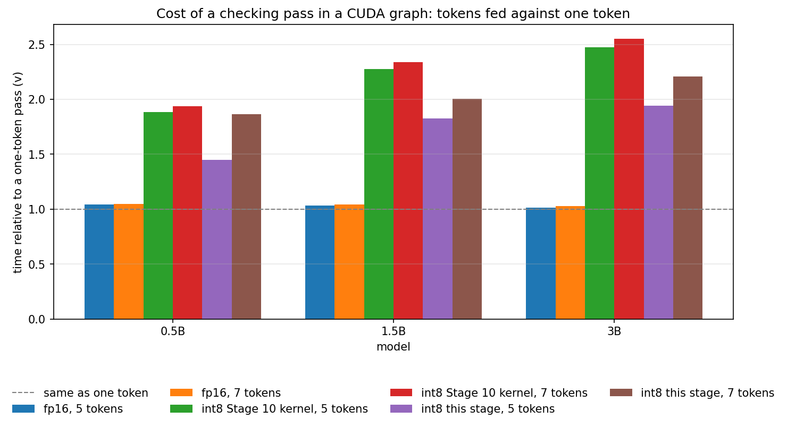

### 6. What does the fair fp16 baseline change? A few percent, and int8 plain decoding keeps its lead.

Numbers: [A checking pass in a graph](RESULTS.md#stage11-block) (the padded head) and [Plain decoding in a graph](RESULTS.md#stage11-plain).

Padding the one-row fp16 head to two rows shortens the fp16 one-token pass by a few percent at 0.5B and 1.5B and barely at 3B, and raises the plain decoding rate by about the same. Stage 10 estimated an eighth of the 1.5B step from the layer's timing alone, so that estimate was several times too large: the layer is slow at one row in a graph, but it is a smaller share of the step than the estimate assumed. The whole-step effect had not been measured until now. int8 in a graph decodes about two fifths faster than the padded fp16 graph at 0.5B, about two thirds faster at 1.5B and about four fifths faster at 3B, which is nearly what it was against the unpadded one. Every graph output equals the eager output of the same weights.

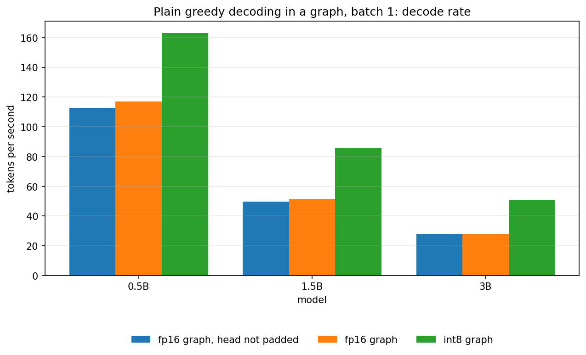

### 7. Do int8 and the lookup multiply now? No, but the new kernel moved them closer.

Numbers: [Speculation in the graph](RESULTS.md#stage11-speculation).

Against the Stage 10 kernel measured in the same session, the row-exact kernels raise int8 with the lookup by a tenth to nearly a fifth on copy and code at both targets and both draft lengths, about the ratio of the two checking costs, as predicted, and not on open text. The gains still do not multiply: about half to two thirds of the product of the two separate gains survives on copy and code (Stage 10: from about three eighths to seven tenths). Against the practical competitor, fp16 with the lookup in a graph, int8 with the lookup is about even on copy and code at 1.5B, about even on code at 3B, a tenth to nearly a fifth slower on copy at 3B, and a quarter to a third faster on open text. The last one is not a lookup result: on open text the lookup rarely finds a draft, and int8 plain decoding in a graph is faster than int8 with the lookup, so the best setup there is int8 plain, as predicted.

The best setup on copy is still fp16 in a graph with the lookup at both targets, and on code the two are level. Against the fp16 eager baseline of every earlier stage the best setup decodes about three and a half times faster on copy at 1.5B and about six times faster at 3B, both with fp16 and the lookup in a graph.

**The cost model.** Fed the tokens per round that the acceptance rate predicts, it overstates the speedup of the int8 lookup rows by between a sixth and a half, again because the lookup's drafts are often shorter than `k`; the prediction of within a quarter held for only some rows.

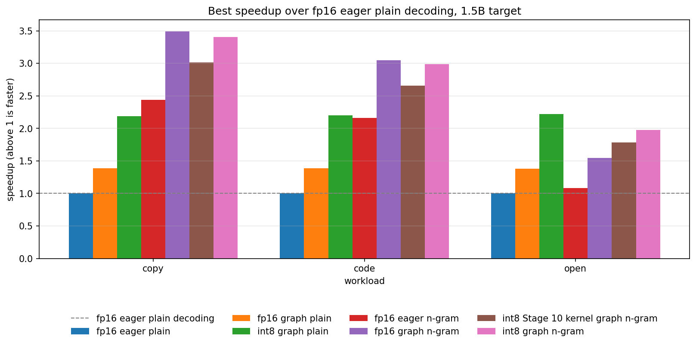

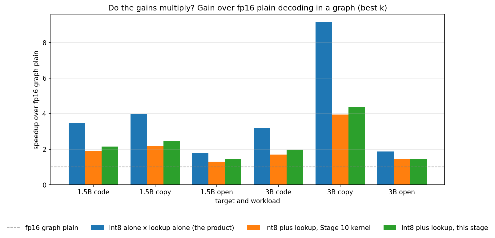

### 8. Is it still exact? Up to fp16 near-ties, and the control can fail.

Numbers: [Speculation in the graph](RESULTS.md#stage11-speculation).

Every setup is checked against its own plain greedy decoding (the first prompt of each workload, thirty-two tokens). All but one of the twenty-four are identical, and the one difference (int8 with the lookup on code at 1.5B) has a logit gap of under a hundredth of a logit, so it is a tie. A decoder whose mask lets every row see all keys up to the end of its block changes the output on all three workloads, so the check can fail.

### 9. What did the clock do? It sat below its maximum under load, higher than in Stage 10, and moved between sections.

Numbers: [GPU state](RESULTS.md#stage11-gpu).

After each warm-up the SM clock was between about one and one and a third gigahertz against a maximum of about one and three fifths, with the software power cap flagged as the throttle reason, so the cap decides the clock here as it did in Stage 10 (when it was lower, about eight tenths to one gigahertz). The multiply-add budget the notebook prints follows the clock: about twelve per weight here, against about nine to ten at the lower clock. The clock differs between sessions and between sections of one session, which is why absolute rates and arithmetic budgets should not be carried from one run to another, and why every comparison here was taken in turns, in one session.

### Predictions against results (Stage 11)

Held: the kernels are correct and a wrong scale is caught; no kept configuration spills and the rule removes some that do; `gemvr` is ahead at few rows and `gemvs` later; the time grows with the rows, to more than twice its one-row value at eight; the winner is slower than the fp16 layer at eight rows; the fp16 checking pass costs one plain step; the int8 checking pass is between one and a half and two plain steps, better than Stage 10's and short of the gate; the new kernel raises int8 with the lookup by about the ratio of the two checking costs on repetitive text and code and not on open text; the best setup is fp16 with the lookup on copy at 1.5B and int8 plain on open text; every difference is a near-tie and the control breaks the output. Missed: no shared memory in the kept configurations (the offline check could not see it, and the loop is clean); `gemvm` winning none (it wins most narrow layers); the shape of the time against the rows (steeper than predicted at two and five rows); the winner beating the fp16 layer at five rows (it does not, so the gate is a no-go); the padded head saving an eighth of the fp16 step (a few percent); converting `x` once being faster everywhere (one layer of three); no noisy comparison after the warm-up (more than a fifth of the one-layer timings were noisy); and the cost model being within a quarter (not with tokens per round from the acceptance rate).

### What this sets up (Stage 11)

The run points at three cheap levers and one structural one, in the order the evidence supports them. None has been tried.

- **Tune in turns.** The installed winners are up to a third slower than the best configuration of a family timed in turns on the one layer where it was visible, so a tuner that confirms its top candidates in turns (or that times every candidate in turns) should lower the pass costs of section 5 for free.
- **Fill the GPU on the narrow layers.** `gemvm` still wins the layers with few output rows. Either relax the fit rule for them or split the loop over `K` across programs, and the new kernels may take them too.
- **Make `x_fp32` a choice.** It loses on two of three large layers, so it belongs in the search (exercise 1).
- **Shorter drafts.** A two-token pass costs far less than a five-token one, and the sweeps used only draft lengths of four and six. Measuring draft lengths of one to three costs little and the cost model says whether they pay.
- **Do less arithmetic per weight.** If the time per extra row is what the kernel computes, the structural fix is to convert each weight once and use it for all the rows in one instruction: tensor cores in a transposed formulation (the weights as the sixteen-row operand), packed half-precision multiply-adds, or integer dot products with quantized activations. Stage 9's tensor-core kernel was flat in the rows and slow, but it was formulated the other way round (exercise 6).

If those do not close the gap, the practical answer on this GPU is already in the table: int8 plain decoding in a graph, and fp16 with the lookup on repetitive text, with the two not composing. After that, draft models with a captured feed, and then the engine leaves the notebook.

### Other plots (Stage 11)

All plots are listed, with captions, under [Plots](RESULTS.md#stage11-plots) in `RESULTS.md`.

## Stage 12: The Engine, and a Head-to-Head with Hugging Face and vLLM

> **Status.** The engine, its server and the load generator are built and tested on a CPU (a tiny random-weight model, real sockets). [`11_engine.ipynb`](11_engine.ipynb) and [`99_vllm_compare.ipynb`](99_vllm_compare.ipynb) have run on a Kaggle T4, and their results are below. The head-to-head with vLLM took two sessions: the first could not create vLLM's environment, and in the second vLLM ran with its default settings.

Stages 1 to 11 were experiments. Each had its own loop: a cache here, a scheduler there, a graph decoder for one sequence, a speculative decoder for one sequence. None of them could serve a request, because a server needs one object that owns the model and its KV memory, accepts requests whenever they arrive, and returns tokens as it makes them. This stage is that object, and then the measurement the whole series was heading for: the same trace served by this engine, by Hugging Face `generate` and by vLLM, timed by the same client on the same clock.

It adds no new lever. Every technique in the engine was measured earlier (continuous batching in Stage 4, the paged cache in Stage 5, lookup speculation in Stages 6 and 10, graph capture in Stage 10), and the engine is where they meet. What is new is what it takes to make them meet: a decode step for a changing set of requests that can live in a CUDA graph, speculation that applies only when it cannot hurt anyone else, sampling per request, and a measurement method that does not hide overload.

- [`11_engine.ipynb`](11_engine.ipynb) builds and measures the engine: correctness against plain decoding on the GPU, the decode paths under load, the engine against Hugging Face at four arrival rates, latency mode, and the server in its own process. It saves `results/stage12.json`.
- [`99_vllm_compare.ipynb`](99_vllm_compare.ipynb) runs vLLM, this repo's server and Hugging Face on the same traces in one session. It is an appendix on purpose (numbered 99, outside the stage chain): vLLM brings its own pinned PyTorch and may or may not run on a T4, and an outside package must not be able to stop the numbered notebooks from running or publishing. It publishes only its own results file (`results/vllm_compare.json`), never code.

## What was built

| Piece | File | What it does |
| --- | --- | --- |
| Sampling | `minivllm/sampling.py` | `SamplingParams` (greedy, temperature, top-k, top-p, stop ids, a seed) and a batched sampler. A request owns its own `torch.Generator`, so its tokens do not depend on who else is in the batch. |
| The engine | `minivllm/llm_engine.py` | `LLMEngine`: a waiting queue, first come first served admission on the paged cache, one prefill per admitted request, one decode step for all running requests per iteration, per-request sampling and stop tokens, streamed step outputs, abort, real-clock timestamps. |
| The graph step | `minivllm/paged_graph.py` | A decode step over the paged cache that has fixed shapes: buckets, a fixed-width gather through a static block table, padding rows that write into a reserved block, one packed input buffer, CUDA-graph capture per bucket, and the checking pass of speculation. Eager without CUDA. |
| The server | `minivllm/server.py` | Standard library HTTP: `POST /v1/completions` (one reply or a server-sent-events stream), `GET /health`, `GET /v1/stats`. One engine thread owns the engine. |
| Load generation | `bench/load.py` | Traces from the generators of Stages 4 and 5 with a digest, open-loop drivers for the engine, any streaming server and Hugging Face, and one summary. |
| vLLM | `bench/compare_vllm.py` | vLLM in its own environment, started as a server process with a list of settings tried in turn, every failed attempt recorded. |

```text
client ──HTTP──> handler threads ──inbox──> engine thread ──> LLMEngine.step()
                                                              ├─ admit: first come first served, only if every block the request will ever need is free
                                                              ├─ prefill each admitted request (one pass over its prompt)
                                                              └─ decode ONE step for all running requests
                                                                   │  eager paged view | bucketed static step | the same step as a CUDA graph
                                                                   └─ latency mode: exactly one greedy request running
                                                                        └─ lookup guesses k tokens, one pass of k + 1 tokens checks them,
                                                                           the agreeing prefix plus one token is kept, the rest is rolled back
              <──events (new tokens of each step)── per-request queue ──┘
```

## The decisions, and why

1. **A request is admitted only if the pool has every block it will ever need** (its prompt plus `max_new - 1` tokens). A running request can therefore never run out of memory half way, nothing is ever preempted, and a request's blocks go back to the pool the moment it finishes, whether by length, by a stop token or by an abort. The price is that a request holds memory for tokens it has not generated yet; allocating lazily and preempting on overflow is the obvious next step (exercise 1).
2. **The engine reserves one block that no request owns (the NULL block).** A captured step has a fixed batch size, so a step with three running requests uses the batch-of-four graph with one padding row. A padding row feeds token zero at position zero and writes its key and value into the NULL block, and the block tables of padding rows (and the unused columns of real rows) point at it. The attention mask hides every column past a row's own position, so the contents of the NULL block are never read by a real row. A test fills it with junk and checks that no real row changes, and a negative control shows the check can fail.
3. **Buckets, warmed ahead.** One graph per (batch size, blocks per sequence), both rounded up to the next power of two (and the limit itself). Graphs are captured before the timed run (`warmup`), and the capture cost is reported on its own, because it is paid once when the server starts and not per request. The graphs share one memory pool.
4. **A fixed-width gather.** The eager paged view gathers exactly as many columns as the longest running request needs. A captured step gathers every block of its bucket through a block table that is a static buffer, and the mask hides the rest. This reads more than the eager view does, so the notebook includes a **control**, the same bucketed step run without capture, to separate the cost of the buckets from the benefit of the graph.
5. **All inputs are one buffer.** The token ids, the positions, the block and offset each key is written to, and the block table of a step are one packed integer tensor, overwritten with a single host-to-device copy per step.
6. **Sampling stays outside the graph.** Each request has its own parameters and its own generator, so the graph returns logits and the sampler runs on them. Greedy rows are one `argmax` for the whole batch.
7. **Speculation only when alone.** A batch already shares each read of the weights across its rows, and checking drafts for every row would multiply the work. With exactly one greedy request running, the weights are read for one row, which is where speculation paid in Stages 6 and 10. So the engine speculates in that case and decodes the batch otherwise, switching on its own, and a sampled request is never speculated. The checking pass has a fixed length (`k + 1` tokens, padded with zeros when the lookup found fewer drafts), the rows after the real drafts are ignored, and a draft is cut so the accepted tokens never exceed `max_new` or the reservation. A stop token inside an accepted block ends the request there.
8. **One engine thread.** The engine is not thread-safe, so exactly one thread touches it. Handler threads post commands to an inbox and read events from a queue of their own. A client that disconnects in the middle of a stream has its request aborted, so its blocks return to the pool. An engine failure becomes an error reply for every waiting client and not a hang.

## How it is measured

- **Parity before speed.** Every mode of the engine is compared with plain cached decoding (`generate_cached`) on the GPU before any timing. A mismatch counts as an fp16 near-tie only if the logit gap at the first difference is small, as in earlier stages, and a **control that must fail** (sampled outputs against the greedy reference) shows the comparison can fail.
- **Open loop.** Every request is sent at its arrival time whether or not earlier ones have finished. A closed loop, where a client waits for its reply before sending the next request, cannot overload anything, so it hides exactly the behaviour a server exists to handle.
- **The same trace, proved.** A trace is fixed by the workload (the `mixed` workload of Stages 4 and 5), the number of requests, the rate and the seeds, and its digest is saved with every row. `99_vllm_compare.ipynb` compares its digests with those of `stage12.json`.
- **The same work.** Every request generates exactly its `max_new` tokens: end-of-sequence is suppressed for Hugging Face and ignored for vLLM, and the engine has no stop tokens in these traces.
- **The metrics.** Time to first token (TTFT), time per output token after the first (TPOT, what a reader of the stream experiences), the longest stall between two events of a stream, request and token throughput, **goodput** (the tokens of the requests that met a latency target, per second of the run) and **capacity** (the highest tested rate at which at least nine tenths of requests meet the target).
- **A generous baseline.** Hugging Face's streamer timestamps every step, so a request counts as finished at its own last token and not when its batch returns. Both Hugging Face and the engine are warmed first, and the GPU is warmed under load before each group, with the clock logged.
- **Turns.** The order of the systems rotates from rate to rate, so a drifting clock does not always favour the same one.

## Predictions (Stage 12)

Written before any GPU run, qualitative on purpose (the numbers will come from the run):

1. Every greedy mode of the engine equals plain decoding up to near-ties, and the sampled control differs.
2. The bucketed step without capture is no faster than the eager paged step (it reads more columns for the same launches). The captured step has a lower time per token than both, most on the smaller model, where launches are most of the step (Stage 10), and the gain shrinks on the larger one. Time to first token improves less than time per token, because a prefill is one large pass.
3. Hugging Face run sequentially saturates first, at about one over the time one request takes alone, and above that its queue grows for the whole trace. Static batching serves more than sequential but saturates before the engine, because a batch runs to its longest request and nothing joins it. The engine's capacity under the latency target is the highest of the in-process systems.
4. In latency mode, lookup speculation is fastest on the repetitive workloads and about neutral on open text, and Hugging Face is slowest.
5. The engine behind HTTP in its own process is close to the in-process engine: a little more time to first token, about the same time per token.
6. Against vLLM, on the 0.5B model the two servers are close at low load (a small model's step is mostly launches). On the larger model and under load I expect vLLM to be ahead, because of its fused paged-attention kernel and its scheduler. These are predictions about direction. If this engine matches vLLM on some rate, the likely reason is the narrow workload (greedy decoding, random token ids, no prefix reuse) on a small model on a small GPU, not that the engine is a better design. It is also possible that a recent vLLM does not run on a T4 at all, in which case the comparison says so.

## Results (Stage 12)

The numbers are in [`RESULTS.md`](RESULTS.md#stage12-setup), gotten from `results/stage12.json`: one Kaggle T4 session, 64 requests of the `mixed` workload at four arrival rates, and the 0.5B and 1.5B models. Nothing below repeats a figure; each section links to its table.

### 1. Is every mode exact? Yes, and the control can fail.

Every greedy output of the engine, in all four modes (eager, the uncaptured static control, graph, graph with lookup), equals plain cached decoding or differs only at a near-tie, and the sampled control differs for most prompts, so the comparison can fail ([parity](RESULTS.md#stage12-parity)). On the GPU the graph modes captured real graphs and fell back to nothing, and the static control captured none.

### 2. What does each decode path buy under load? On the smaller model the graph helps. On the larger one it hurts, and the control says why.

At the middle arrival rate the bucketed step without capture is never faster than the eager paged step. On the smaller model the captured step cuts the median time per token to under two thirds of the eager step's. On the larger model the captured step is more than twice as slow as the eager one, and the uncaptured static control is just as slow, so the loss is in the buckets and not in the capture. The graph lowers the median time to first token by much less than it lowers the time per token on the smaller model, and raises it on the larger one, because a prefill is one large pass and the steps there are slower ([decode paths](RESULTS.md#stage12-modes)).

What the buckets cost is, as a hypothesis (no per-step profile was saved), the fixed-width gather: a bucketed step reads every block of its bucket for every row, padding rows included, and `model.py` then expands the keys and values of the grouped-query heads before attention, so the bytes moved per step grow with the bucket and not with the batch. Slower steps keep more requests running, which fills a larger bucket, which makes the step slower again. That feedback is plausible for the larger model, where the loss is largest, and it is not measured.

### 3. How does the engine compare with Hugging Face as the load rises? Hugging Face is saturated from the lowest rate.

Hugging Face run one request at a time completes the same number of requests per second at every offered rate, so it is saturated from the lowest rate tested; its median time to first token is over ten seconds at every rate, and in static batches over three. The eager engine's median time to first token stays under a quarter of a second at every rate. At the top rate the engine completes over three times the requests per second of the best Hugging Face setup, at both sizes, and every request of the comparison was answered without errors ([load](RESULTS.md#stage12-load)).

The captured step's behaviour under load matches section 2. At the lowest rate it has a lower median time per token than the eager step at both sizes, and at the top rate it is slower than the eager step on the smaller model.

### 4. What is the capacity under the latency target? Hugging Face has none in the tested range, and the engine's is at least the range's middle.

No Hugging Face setup meets the latency target at any tested rate. The engine's capacity is at least four requests per second at both sizes, and the top of the tested range on the smaller model (so for that model the range, not the engine, limits the figure). The eager engine's capacity is not below the graph engine's at either size ([capacity](RESULTS.md#stage12-capacity)).

### 5. What does latency mode buy? A lot, and it is where the graph and the lookup pay.

One request at a time, the graph beats the eager step by over one and a half on every workload, and by more on the smaller model, where launches are more of the step. Lookup speculation beats the graph alone by over one and a half on copy and code at both sizes. It gains less on open text than on copy and code, as the acceptance rate does, which is higher on copy and code at both sizes; on the larger model the lookup is about even with the graph alone on open text, and on the smaller model it still beats the graph alone there by over a third. Hugging Face `generate` is slower per token than the eager engine on every workload and size. Every engine output equals plain decoding or differs at a near-tie ([latency](RESULTS.md#stage12-latency)).

### 6. What does HTTP cost? Little.

Behind the server, in its own process, the engine keeps within a tenth of the in-process tokens per second and adds under a tenth of a second to the median time to first token ([server](RESULTS.md#stage12-server)).

### 7. How does it compare with vLLM? *vLLM is ahead under load. One request at a time the engine matches it on the larger model and trails it on the smaller one.*

`99_vllm_compare.ipynb` ran vLLM, this repo's server and Hugging Face on the same traces in one session on the same T4, the systems taking turns in a different order at each rate. The digests of the four traces are equal to the engine notebook's. vLLM ran with its default settings: a recent release started on a Turing GPU with no other attention backend and without the older engine, which the notebook was ready to fall back to. The engine's server uses the graph decode path at both sizes, so on the larger model it carries the loss of section 2; read its rows with that in mind. [The numbers](RESULTS.md#head-to-head-load):

- **Lightly loaded, a client sees almost the same thing.** At the lowest rate both servers complete the offered rate and meet the latency target at both sizes. vLLM's median time per token is already lower at both sizes.
- **Under load, vLLM's time per token does not move and the engine's does.** Across the four rates vLLM's median time per token stays within a quarter of its lowest value at both sizes, while the engine's rises more than threefold from the lowest rate to the highest. That is what batching is for: the weights are read once for the whole batch, so a bigger batch costs almost nothing more per token. The engine pays for the batch in the gather and in the expansion of the key-value heads (the cause suggested in section 2).
- **That sets the capacity.** vLLM meets the latency target up to the top rate at both sizes. The engine's server does so only on the smaller model, and at the top rate vLLM completes over one and a half times the requests per second of the engine's server at both sizes. Hugging Face meets the target at no tested rate, as in section 4.
- **One request at a time, the answer depends on the size** ([latency mode](RESULTS.md#head-to-head-latency)). On the smaller model vLLM is over a third faster per token than the engine's server on every workload. On the larger one the two are about even, within a quarter of each other on every workload and neither ahead on all of them across sessions: that step is mostly the read of the weights, which both do once. vLLM's first token comes sooner at both sizes, but the engine runs one large prefill pass while vLLM splits its prefills and keeps a prefix cache (and latency mode sends each prompt three times in a row, which a cache can help), so this row says less about the decode path than the others.

**What this shows, and what it cannot.** The same GPU, the same weights and the same traces: vLLM keeps its step flat as the load rises where this engine's does not, so the loss of section 2 belongs to this engine's batched attention path and not to the hardware or the model. The comparison cannot say which part of vLLM's difference matters most, a fused paged-attention kernel that reads the blocks in place or its scheduler. Exercises 4 and 5 are the experiments that would separate them.

**The first session got no further than the install.** Creating vLLM's environment failed for both releases tried, in a fraction of a second: the system Python of the Kaggle image has no working `ensurepip`, so `python -m venv` fails. The fault was the harness's, not the GPU's and not vLLM's. The install now goes through `uv`, as vLLM's own install page does. That session still showed that results carry across sessions: the engine behind HTTP, in a process of its own, had the capacity it had in process, and Hugging Face completed about the same number of requests per second as in the engine notebook (typically within a few percent, never off by more than a fifth). The second session repeated the whole run, with a smaller share of the GPU for vLLM on the larger model (see the lessons).

### Predictions against results (Stage 12)

1. *Every greedy mode equals plain decoding up to near-ties, and the sampled control differs.* Held.
2. *The bucketed step without capture is no faster than the eager paged step, and the captured step has a lower time per token than both, most on the smaller model, with the gain shrinking on the larger one. Time to first token improves less than time per token.* Mostly held on the smaller model and at the lowest rate. **Wrong on the larger model**, where the gain did not shrink but reversed, and wrong at the top rate on the smaller model. The static control was the right thing to include: it showed the cause is the buckets. Time to first token improved less than time per token on the smaller model, as predicted, and got worse on the larger one.
3. *Hugging Face run sequentially saturates first; static batching saturates before the engine; the engine's capacity is the highest.* Held, and the saturation is stronger than predicted: Hugging Face is past its capacity at the lowest rate tested, so the sweep did not find where it saturates. The engine's capacity on the smaller model is the top of the range, so the sweep did not find its limit either.
4. *Lookup speculation is fastest on repetitive workloads and about neutral on open text; Hugging Face is slowest.* Held, except that on the smaller model the lookup still helps on open text.
5. *The engine behind HTTP is close to the in-process engine.* Held.
6. *Against vLLM.* Mostly held. *Close at low load on the smaller model* held only in what a client sees: both servers complete the offered rate and meet the target, but vLLM's time per token is already lower. *vLLM ahead on the larger model and under load* held, by a wide margin in capacity. *A fused kernel and a scheduler as the reason* is consistent with the flat line of vLLM's step but was not isolated. *A recent vLLM may not run on a T4 at all* did not happen: it ran with its default settings. One thing the prediction missed: alone on the larger model the engine is about as fast per token as vLLM.

### What this sets up (Stage 12)

The two modes are different regimes. One request at a time is where the engine's techniques pay most (a captured step, a lookup that is checked in one pass), and a batch of changing requests is where the bucketed fixed-width step costs more than it saves once the model or the batch is large. The levers that follow from the findings, each an exercise below: avoid expanding the KV heads in decode attention, use buckets finer than powers of two, fall back to the eager step above a batch size, and log the per-step batch and bucket (the engine does with `record_steps=True`; the notebook did not turn it on) to see the feedback loop instead of guessing at it. The comparison with vLLM (section 7) says how much these levers have to close: under load, vLLM's time per token stays flat as the engine's rises several times over, and the engine's capacity on the larger model is a quarter of vLLM's.

## What this does not do

- **No preemption, no prefix sharing, no chunked prefill.** A long prompt is one pass, and it stalls the decode steps of the running requests while it runs (the budget for prefills per step bounds how many, not how long).
- **The batched graph step loses to the eager step under load on the larger model** (section 2); the engine keeps both paths and defaults to the eager one.
- **The paged attention is a gather in PyTorch**, not a fused kernel that reads the blocks in place. This is the largest difference from vLLM's attention path.
- **Speculation is greedy-only and for one request at a time.** The guesser is the n-gram lookup of Stage 6. A draft model in the engine, or speculation for a small batch, are exercises.
- **One model family, one GPU.** The engine runs the Qwen2 architecture of the earlier stages on one device, fp16 (the int8 weights of Stages 8 to 11 run unchanged but are not part of this comparison).
- **The vLLM comparison covers one narrow workload and one untuned setup.** The load traces use random token ids, so nothing shares a prefix and vLLM's prefix cache has nothing to do there; chunked prefill, its other features and anything outside the workload are not exercised, and the engine is not charged for lacking them. vLLM ran with its defaults and a memory share chosen so that vLLM, the engine's server and the Hugging Face model fit on one GPU together, which is not how either would be deployed. The share was smaller on the larger model, and its cost to vLLM is the smaller key-value cache it kept, which stayed larger than the engine's pool.

## Stage 13: The Batched Step

> **Status.** Built, tested on a CPU, and run on a Kaggle T4: [`12_batched_step.ipynb`](12_batched_step.ipynb) completed with no failed variant, and its results are below. The comparison with vLLM uses the rows of an earlier session (see the decisions); a same-session rerun of [`99_vllm_compare.ipynb`](99_vllm_compare.ipynb) with the best configuration is the next step.

Stage 12 ended with a plain fact and an unproven explanation. Under load vLLM's time per output token stays nearly flat as the offered load rises, while the engine's rises several times over, and on the larger model the engine's capacity is a quarter of vLLM's. The explanation was a hypothesis, with no per-step profile behind it: a captured step reads every block of its bucket for every row, padding rows included, and `MiniQwen` then copies the keys and values of each grouped-query head up to every query head before attention, so the bytes a step moves grow with the batch times the padded length. A slower step keeps more requests running, which fills a larger bucket, which makes the step slower again.

This stage measures that, and then fixes it with three changes that each aim at one part of the cost. They are run one at a time against the same traces and then together, because the point of an ablation is to say which change did what. It is exercise 5 of Stage 12, built in full.

- [`12_batched_step.ipynb`](12_batched_step.ipynb) counts the bytes of one layer's attention, times its pieces and profiles a whole step; runs seven variants of the engine on the traces of Stage 12 with the per-step log on; reads the fallback threshold from that log; runs a closed-loop concurrency sweep; and serves the best variant over HTTP next to the vLLM rows of [`99_vllm_compare.ipynb`](99_vllm_compare.ipynb). It saves `results/stage13.json`.

## What was built

| Piece | File | What it does |
| --- | --- | --- |
| Lever 1, fold | `minivllm/model.py` | `gqa_attention(q, k, v, mask, n_rep, fold)`. With `fold` the query heads that share a key-value head are moved into the query rows (`[B, n_kv, n_rep * T, hd]`), the mask is repeated along the rows, and attention runs against the keys and values as they are in the cache: nothing is copied to `n_rep` heads. The causal case (prefill, no explicit mask) keeps the expansion. `MiniQwen.forward(..., gqa="expand" or "fold")`. |
| Lever 2, fine buckets | `minivllm/paged_graph.py` | `buckets(limit, scheme)` with a `"fine"` scheme: each size at most a quarter above the one before it once past the smallest sizes, so a step pads far less than with powers of two, at the price of more graphs to capture. `PagedGraphs(..., gqa, bucket_scheme)`, and `warmup(..., max_blocks)`, which captures only the block buckets a workload can reach. |
| Lever 3, eager fallback | `minivllm/llm_engine.py` | `EngineConfig.graph_max_batch`: a decode step with more running requests than this takes the eager paged step instead of the captured one. Also `EngineConfig.gqa` and `.bucket_scheme`. All three are validated, all three default to Stage 12's behavior, and every decode entry of the step log now says which path ran. |
| The server flags | `minivllm/server.py` | `--gqa`, `--bucket-scheme`, `--graph-max-batch`, and `engine_flags(**config)`, which turns a measured `EngineConfig` into the flags that serve it, so a configuration measured in process can be served over HTTP exactly as it was measured. |
| Measurement | `bench/attention_cost.py` | `attention_bytes` (the bytes one layer's attention moves, from the shapes), `time_attention_pieces` (the gather, the expansion and both attentions timed on random tensors of the real shapes inside one CUDA graph), `profile_step` (a profiler view of a callable with kernels grouped into families), `step_table` and `step_curves` (the step log reduced to median step time by running batch), and `crossover_batch` and `fallback_setting` (the running batch from which the eager step is no slower than the captured one, and the engine setting that follows). |
| Closed-loop load | `bench/load.py` | `run_closed` and `run_closed_http`: a fixed number of requests in flight, a new one the moment one finishes, in process and over HTTP. |

One layer's attention in a captured decode step does three things to the cache, and the stage counts all three:

```text
gather   the block table picks each row's blocks out of the paged cache and lays them out as [B, n_kv, NB * block_size, hd]
         (keys and values, two copies each: the index, then the permute that joins the block axis to the position axis)
expand   repeat_interleave copies each key-value head to the n_rep query heads that share it           <- lever 1 removes this
attend   the attention kernel reads the keys and values it is given, n_rep times as many after the expansion
```

## The decisions, and why

1. **Folding is a layout change, not an approximation.** Query head `h` uses key-value head `h // n_rep`, so the query tensor `[B, H, T, hd]` is already `[B, n_kv, n_rep, T, hd]` in memory, and viewing it as `[B, n_kv, n_rep * T, hd]` lets one attention call serve the whole group. A test checks that the folded and the expanded attention agree on random tensors (with a different valid length per row, with a staircase mask, for several `n_rep`), that a head-grouping mistake would be caught, and that every engine path produces the tokens of plain decoding with either setting. Prefill keeps the expansion, because it uses the implicit causal mask and an explicit one would cost more than it saves.
2. **Fine buckets are only worth their graphs if the warm-up is restricted.** A finer scheme has several times as many (batch, blocks) pairs, so `warmup` now takes `max_blocks` and captures only the block buckets a workload can reach, instead of every bucket up to the pool. The capture time is reported on its own (it is paid when a server starts, not per request).
3. **The fallback threshold is read from the step logs, not guessed.** `crossover_batch` pools the decode steps of all four rates and, for every running batch size that both logs saw often enough, compares the medians of the captured and the eager step. The answer has three shapes, and the code names them: no crossover (the captured step is never slower: no fallback), a crossover of one (the eager step wins everywhere: no graphs), or a batch size `r` (fall back above `r - 1`). It is read twice, for the expanded path and for the folded one, because after folding there may be nothing left to fall back from.
4. **One engine is alive at a time, and the baseline is run twice.** Seven engines with their graphs would not all fit with the model, and a fixed order of passes lets a slowly drifting GPU clock favor the early ones. So each pass builds its own engine, warms the GPU under load and logs its state, and the baseline (V1) is run again at the end. The difference between its two passes is the drift of the session, and a gap between two variants smaller than that is not a finding.
5. **A closed loop is added next to the open one.** The open-loop load is still the test of a server, but the batch it produces depends on the engine's own speed, which muddies the view of a single step. A closed loop holds the number of requests in flight fixed, so the running batch is known, no queue builds, and the time per token against concurrency is the cost of a batched step per row. The same sweep can be given to any server over HTTP.
6. **The best variant is chosen by a rule written before the run**, not by looking at the plots: the highest capacity at the target, then the lowest median time per token at the highest rate, first passes only. It is then served over HTTP with the flags `engine_flags` makes from the exact configuration that was measured.
7. **The comparison with vLLM crosses sessions, and says so.** The vLLM rows are read from `results/vllm_compare.json`, which another session produced; a GPU is not the same machine from one session to the next, so the level of a gap to those rows is weaker evidence than the shape of a curve. The comparison made inside one session is the in-process one.
8. **A failure of one variant must not cost the hour.** Each variant runs inside a `try` block that records the error in the results and carries on, as do the microbenchmark shapes, the profile and the server run. The later cells use what exists.
9. **The bytes model counts what the code does.** A first back-of-envelope count treated the gather as one copy of the keys and values. The code makes two (the block-table index and the permute that joins the axes), so the model counts both. The model is an estimate (kernels fuse some traffic, and the mask is ignored), which is why the stage also times the pieces and profiles a real step.

## How it is measured

- **Parity before speed.** Seven configurations (the five single-lever variants, and the two that use the fallback with a small threshold so a batch of twelve starts on the eager path and ends on the graph path) are compared with plain cached decoding. A mismatch counts as an fp16 near-tie only if the logit gap at the first difference is small, a sampled control must differ so the comparison can fail, and the fallback variants must show both paths in their step log, or the check did not exercise the fallback.
- **The same traces as Stage 12.** The constants of `11_engine.ipynb` and `99_vllm_compare.ipynb` (workload `mixed`, the same number of requests, rates and seeds), so the trace digests are the same, and the notebook checks them against `vllm_compare.json`.
- **The step log is on.** Every run records, per decode step, the number of running requests, the bucket and which path ran. The notebook saves the median step time by running batch for every pass.
- **The bytes, then the time, then a profile.** Counted bytes of one layer for both paths over a grid of batch and length; the same pieces timed on random tensors inside a CUDA graph; one whole decode step under the profiler, with the kernels grouped into attention, matmul, copies and indexing, and elementwise work.
- **Capacity and goodput** as in Stage 12: the highest tested rate at which at least nine tenths of requests meet the latency target.

## Predictions (Stage 13)

Written before any GPU run, qualitative on purpose (the numbers will come from the run). The variants are V0 (expanded attention, eager step), V1 (expanded, graph: the Stage 12 baseline), V2 (folded, eager), V3 (folded, graph: lever 1), V4 (expanded, graph, fine buckets: lever 2), V5 (V1 plus the fallback: lever 3) and V6 (all three).

1. Every greedy variant equals plain decoding up to near-ties, the folded ones being the likeliest to show one (the folded attention launches a different kernel shape), and the sampled control differs. The fallback variants take both paths.
2. The expansion and the read of its copy are the largest part of the attention's bytes at every shape, so folding removes most of them, and the ratio of the two paths' bytes depends on the number of query heads per key-value head and not on the batch or the length. The timings follow the bytes where the working set is large and flatten at small shapes, where launches and fixed costs dominate even inside a graph. In a profile of a whole step the attention work is a modest share at a small bucket and the largest at a large one, and folding shrinks the second and not the first. The two paths agree numerically up to fp16 rounding.
3. V1 against V0 reproduces Stage 12: on the larger model the graph step has the lower time per token at the lowest rate and the higher one under load.
4. **Lever 1 (V3)** lowers the time per token under load on both models. On the larger model the graph step is no longer slower than the eager one at any rate. On the smaller model the graph keeps its lead at the highest rate, where it lost in Stage 12.
5. **V2 gains little over V0**: the eager step gathers only the columns the longest request needs, so the expansion is a smaller share of its work.
6. **Lever 2 (V4) helps less than lever 1.** Finer buckets cut padding rows and padding columns, but the expansion still multiplies whatever is gathered by `n_rep`.
7. **Lever 3 (V5)** helps the larger model at the highest rates and changes nothing at the lowest, where the running batch never rises above the threshold. The expanded path has a crossover at a middling batch on the larger model. After folding the captured step is cheaper than the eager one at every batch, so the folded path has no crossover on either model, and V6 reduces to folding plus fine buckets.
8. V6 has the lowest time per token under load on the larger model, and its gain over V3 is small. The drift between the two baseline passes is small next to the gap between V1 and V3.
9. In a closed loop at a concurrency of one the variants are within noise of each other, with the graph variants ahead of the eager one. As the concurrency grows, V1 rises fastest, V0 more slowly, V3 and V6 least, and tokens per second rise with the concurrency for every variant, most for the folded ones.
10. Over HTTP every configuration is slower than in process, by the cost of the rest of the stack. The best variant narrows the gap to vLLM that Stage 12 reported (its time per token rises less with the load, its capacity on the larger model is higher) and does not close it: vLLM's time per token stays flat, and the engine's still rises, because a captured step still gathers every block of its bucket for every row and the weights are read in full whatever the bucket.

## Results (Stage 13)

The numbers are in [`RESULTS.md`](RESULTS.md#stage13-setup), gotten from `results/stage13.json`: one Kaggle T4 session, the 64-request traces of Stage 12 at four rates, the 0.5B and 1.5B models. 

### 1. Is every variant exact? Yes, and the fallback was exercised.

All greedy variants equal plain decoding (a few differ only at a near-tie), the sampled control differs, and the fallback variants took both paths. See [parity](RESULTS.md#stage13-parity).

### 2. Where do the bytes go? Into copies, and folding removes most of them.

The folded path moves under a third of the counted bytes of the expanded one, and the measured time of a layer follows it at large shapes and not at the smallest. The two attentions agree up to fp16 rounding. In a profile of a whole expanded step on the larger model, copying and indexing (the gather, the expansion, the cache writes) is the largest family of kernels, ahead of the matrix products; folding cuts the attention family to under half and the copy family by more than half, and leaves the matrix products where they were. So the hypothesis of Stage 12 was right about the cause. See [bytes](RESULTS.md#stage13-bytes) and [profile](RESULTS.md#stage13-profile).

### 3. What does each lever buy? Folding most, and the three together win.

- **Lever 1.** On the larger model folding cuts the graph step's time per token at the top rate to about half and at least doubles the capacity; it also helps the eager step, which the prediction said it would not. On the smaller model it turns the top-rate loss of the graph step into a large win.
- **Lever 2.** Finer buckets alone help, but less than folding.
- **Lever 3.** The fallback alone, with the threshold read from the expanded path's logs, brings the graph step back to about the eager step and no further: it undoes the loss and gains nothing over folding.
- **All three** have the lowest time per token at the top rate at both sizes and, on the larger model, the only variant with nearly every request within the target there.
- The Stage 12 finding reproduces in the same session: the baseline graph step loses to the eager step at the top rate at both sizes and wins at the lowest.

See [the levers](RESULTS.md#stage13-levers) and [capacity](RESULTS.md#stage13-capacity).

### 4. The thresholds and the drift check

The two passes of the baseline agree within a few percent, so the gaps above are findings. The expanded path has a crossover at both sizes. The folded path has none on the smaller model and one at a larger batch on the larger model, which the prediction missed. See [thresholds](RESULTS.md#stage13-thresholds) and [drift](RESULTS.md#stage13-drift).

### 5. The closed loop: the fallback has a price

With one request in flight the graph variants are alike. At the top concurrency folding alone is the fastest and the baseline the slowest, and all three levers are slower than folding alone: a closed loop holds the batch constant above the threshold, so every step takes the eager path. The threshold was read from open-loop logs, where batches pass through a range of sizes, and it describes that mix, not a general crossing of two costs. See [closed loop](RESULTS.md#stage13-closed).

### 6. How does the best variant compare with vLLM? Much closer, not equal.

Over HTTP the best variant (all three levers for both sizes) answers every request within the target at every rate. At the top rate it cuts the Stage 12 engine's time per token by more than half at both sizes and completes well over one and a half times as many requests per second on the larger model. Its time per token is still over twice vLLM's at the top rate (the vLLM and Stage 12 rows come from another session, so the shape of the curves is the safer reading), and it still rises with the load where vLLM's does not. See [the HTTP table](RESULTS.md#stage13-http).

### Predictions against results (Stage 13)

1. *Every variant exact.* Held.
2. *The expansion and the read of its copy are most of the attention bytes; folding removes most; the two paths agree.* Held; and the profile adds that copying is the largest family of a whole step.
3. *V1 against V0 reproduces Stage 12.* Held.
4. *Lever 1 lowers the time per token under load on both models and the graph is no longer slower than eager.* Held.
5. *V2 gains little over V0.* **Wrong**: folding also helped the eager step on the larger model, by a good margin. The eager step's gather is narrower, but its expansion still cost a lot.
6. *Lever 2 helps less than lever 1.* Held.
7. *Lever 3 helps the larger model at high load and nothing at low load; after folding there is no crossover on either model.* Half held: the fallback alone only matches eager, and the folded path has a crossover on the larger model.
8. *All three levers lowest, gain over lever 1 small.* Held for the lowest; the gain over folding alone is not small in open loop, and negative in the closed loop.
9. *Closed loop: V3 and V6 least and close.* **Wrong** at the top concurrency, for the reason in section 5.
10. *Over HTTP the gap to vLLM narrows and does not close.* Held.

### What this sets up (Stage 13)

The profile says where the rest of the step goes: with the expansion gone, the gather and the matrix products are the large families, and the gather still copies every row to a padded width. Next: rerun `99_vllm_compare.ipynb` with the best configuration in the same session (the real size of the gap), make the fallback depend on the length bucket as well as the batch (exercise 3), and build the in-place paged-attention kernel (`12.4`) if the gather is still the largest family afterwards (built and measured in [Stage 14](docs/stage14.md)).

## What this does not do

- **No fused paged-attention kernel.** Folding removes the expansion, but the gather still copies the keys and values of every row to a fixed width. A kernel that reads the blocks in place (exercise 4 of Stage 12) removes that copy and the padding together, and is where the rest of the gap to vLLM is expected to be.
- **No change to the scheduler.** Admission is still first come first served with the reservation rule; chunked prefill, preemption and prefix sharing are the other exercises of Stage 12.
- **One model family, one GPU, one workload.** The same Qwen2.5 sizes, the same `mixed` workload with random token ids, one T4.
- **The defaults stay as they were.** The three levers are off unless asked for. The results say folding should be on and that all three together are best in open loop; the defaults change with the next code stage, because the published notebook carries the current modules. The best configuration is `--graph --warmup --gqa fold --bucket-scheme fine` plus `--graph-max-batch` from the folded path's crossover where there is one.
- **The HTTP comparison with vLLM is across sessions** (see the decisions above).

## Stage 14: The In-Place Paged Attention Kernel

> **Status.** Built, tested on a CPU and **measured on a Kaggle T4** (full run, no variant failed): [`13_paged_kernel.ipynb`](13_paged_kernel.ipynb) saved `results/stage14.json`, and the numbers are in [`RESULTS.md`](RESULTS.md#stage14). Both kernels compile, are exact and run inside the CUDA graphs. They win clearly when rows fill only part of their bucket, tie or lose at a full bucket, and move their bytes at a small share of the memory bandwidth; in the engine they take a modest share off the time per token at low rates and a large one at the top rate on the larger model. The eager fallback of Stage 13 turned from a help into a cost. The gap to vLLM narrowed again and did not close.

Stage 13 found that a batched decode step was mostly copies and removed the head expansion by folding the query heads. What is left is the **gather**: the blocks of every row are copied, through the block table, into one dense tensor of keys and one of values of a fixed width (the bucket), twice over, and only then does attention run. The cost of the gather is that of the bucket and the padding, not of each row's own length, so a step still gets slower as the load fills the buckets. The best engine of Stage 13 was still about three times vLLM's time per token at the top rate on the larger model, with a curve that rose with the load where vLLM's is flat.

This stage builds exercise 4 of Stage 12: attention that **reads the blocks where they are**. It is the idea of Lab 3's exercise `5.2`, an online softmax over blocks, as a Triton kernel inside the engine.

- [`13_paged_kernel.ipynb`](13_paged_kernel.ipynb) checks the kernels against a reference on the GPU, gates them at the level of one layer (the folded gather path against each kernel, at several fills of the bucket), profiles one step, runs six variants of the engine on the traces of Stage 12 with the step log on, a closed-loop sweep, and serves the best variant over HTTP beside the vLLM rows. It saves `results/stage14.json`.

## What was built

| Piece | File | What it does |
| --- | --- | --- |
| The reference and the readable version | `minivllm/paged_attention.py` | `paged_attention_reference` (gather, then a softmax in fp32: the oracle) and `paged_attention_blockwise` (the kernels' algorithm in torch, one block at a time, also the CPU stand-in). |
| The kernels | `minivllm/paged_attention.py` | `simple`: one program per (row, query head) walks the row's own blocks through its block table, loads each block of keys and values from the pool, and combines the blocks with an online softmax in fp32. `grouped`: one program per (row, key-value head) loads each block once for all the query heads that share it and does the scores and the weighted sum with `tl.dot`, as flash-decoding kernels do. The number of blocks to visit is read from the device, so both run inside a CUDA graph. |
| The views | `minivllm/kv_cache.py`, `minivllm/paged_graph.py` | `write` (store the new key and value) and `attend` (the in-place attention) on the eager decode view and on the static view of the graph step; `update` is `write` plus the gather, unchanged. |
| The model | `minivllm/model.py` | For a one-token row with a view whose `attention` is not `"gather"`, `forward` writes and attends in place; prefill and the checking pass of speculation still gather. |
| The engine and server | `minivllm/llm_engine.py`, `minivllm/server.py` | `EngineConfig.attention` (`"gather"` default, `"paged"`, `"paged_grouped"`, `"paged_torch"`), validated; `--attention`; `engine_flags` knows it. |
| Measurement | `bench/attention_cost.py` | `attention_bytes(mode="paged", fill=...)` and the kernels in `time_attention_pieces`; the profiler groups the kernels into the attention family. |

```text
gather path   cache blocks --(index copy)--> [B, NB, n_kv, bs, hd] --(permute copy)--> [B, n_kv, NB*bs, hd] --> attention over every column, masked
in place      cache blocks --(read where they are, own blocks only)--> online softmax --> output         no copies, no padding blocks
```

## The decisions, and why

1. **The kernel reads each row's own blocks, and the count comes from the device.** The loop bound is `ceil(length / block_size)`, loaded from a tensor inside the kernel. A captured graph has static shapes but not static loop counts, so the kernel can sit in the graph, a padding row (length one, a table of the NULL block) visits one block, and a bucket wider than any row costs nothing.
2. **Two kernels, because which wins is a measurement.** The per-head kernel is the simplest thing that could work and reads a block once per query head of its group, relying on the cache. The grouped kernel loads once and serves the group from registers, at the price of padding the group to sixteen rows for `tl.dot`. Stage 11 taught that a kernel's layout is where its time goes, so both are kept and the gate chooses.
3. **A gate before the engine.** The first measurement is one layer's attention on random tensors of the real shapes, the folded gather path against each kernel at several fills. If neither wins at any realistic fill, the engine runs are expected to show nothing and the result is a no-go.
4. **The fill is the variable that matters.** With every row filling its bucket the two paths read the same keys and values and the kernel saves only the gather copies; with sparse rows it also skips the padding. The gate varies the fill, and the counted bytes (`attention_bytes(mode="paged", fill=...)`) say what the kernel should move.
5. **Prefill and the checking pass keep gathering.** The kernel is for one query token per row. A prefill uses the implicit causal mask and writes whole blocks, and the checking pass has several query rows with a causal pattern inside the new block (an exercise).
6. **Defaults are Stage 13's.** `attention` defaults to the gather and every earlier test passes unchanged; the in-place modes are opt-in until the results say they should be on.
7. **Tests of the algorithm run on a CPU, in Triton's interpreter.** Both kernels equal the reference over block sizes, ragged lengths, scattered tables, group sizes and head sizes; memory no row owns can be filled with NaN without changing the output; wrong kernels (no rescale, no length mask, a whole last block) are caught; the engine gives the tokens of plain decoding with each mode through the eager and the bucketed paths with every lever of Stage 13. What the interpreter cannot show is whether the kernels compile for a T4 and how fast they run.
8. **The variants test the levers of Stage 13 again.** With no padded gather, fine buckets and the eager fallback should matter less, so there are variants without each of them.

## How it is measured

- **Correctness first**, on the GPU: both kernels against the reference in fp16, on the head shapes of both models, with a different length in every row, scattered tables and unreachable memory poisoned with NaN; then every engine variant against plain decoding with the near-tie rule and a sampled control that must differ, the fallback variants with a threshold of two so a batch starts on the eager path and ends on the graph path.
- **The gate**, then **the variants under load** with the same constants and traces as Stages 12 and 13, one engine alive at a time, the baseline run twice as the drift check, **a closed loop**, and **the best variant over HTTP** beside the vLLM rows (read from `vllm_compare.json`, another session, so the shape of the curves is the safer reading).
- **Each variant runs inside a `try` block** that records the error and carries on, as do the gate rows, the profile and the server run.
- **The notebooks are numbered one below the stages.** The notebook and its plots call the engines "Part 11" (the Stage 12 engine), "Part 12" (the best engine of Stage 13) and "Part 13" (this stage). The rows of the first two and of vLLM are read from `vllm_compare.json` and `stage13.json`, measured in other sessions.

## Predictions (Stage 14)

Written before any GPU run, qualitative on purpose.

1. Both kernels agree with the reference to within fp16 rounding on the GPU, and no NaN reaches the output. Every greedy variant equals plain decoding up to near-ties; the in-place variants are the likeliest to show one.
2. At the level of one layer both kernels beat the folded gather path at low fill and the gap narrows as the fill rises to one, where the gain is only the two gather copies. The counted bytes of the in-place read are a small fraction of the gather path's at low fill; the measured time follows them less closely than the library's did in Stage 13, because a hand-written kernel on a T4 does not reach the library's bandwidth.
3. The grouped kernel beats the per-head one on the larger model, where six query heads share a key-value head; the two are closer on the smaller one.
4. In a profile of a whole step the copy family shrinks to a fraction and the matrix products become the largest family, so the step is faster but not by the margin of the layer.
5. Under load both kernels beat Stage 13's best engine at the top rate on both models, by less on the smaller one, and are close to it at the lowest rate.
6. With no padded gather, powers of two instead of fine buckets, and no fallback, should cost little: those variants are close to the best kernel.
7. The time per token still rises with the load, but less; the capacity of the larger model is no lower than Stage 13's.
8. Over HTTP the best variant narrows the gap to vLLM and does not close it: the weights are read in full by every step.
9. A no-go is possible. If the kernels do not compile for the T4, or are slower than the gather at every fill, that is the result, and the notebook records it.

## Results (Stage 14)

Full run on a Kaggle T4, nothing failed. The numbers are in [`RESULTS.md`](RESULTS.md#stage14), gotten from `results/stage14.json`.

### 1. Are the kernels exact? Yes.

Both kernels equal the reference to within fp16 rounding on the head shapes of both models (the grouped kernel a little less closely than the per-head one), and filling every slot that no row owns with NaN changes nothing, so neither reads past a row's length. Every greedy variant equals plain decoding on every prompt, except one near-tie in the baseline of the smaller model; the sampled control differs, and the fallback variants took both the eager and the graph path. See [the correctness tables](RESULTS.md#stage14-correct).

### 2. The gate: the kernels win on sparse rows and not on full ones.

Against the folded gather path of Stage 13, at the level of one layer, both kernels are about two to five times faster when rows fill a quarter of their bucket and about one to three and a half times at half a bucket. At a full bucket the advantage is gone: on the larger model neither kernel beats the gather path by a tenth, and at the largest shape both lose. The prediction that the kernel would still save the two gather copies was wrong: it reads the blocks more slowly than the library reads the gathered tensor. The counted bytes of the in-place read are a twentieth, a tenth and a fifth of the gather path's at those fills, and the measured gain is under half of that ratio everywhere, because the kernels move their bytes at about a tenth of the T4's specified bandwidth while the gather path moves its counted bytes five or six times faster. They are untuned (exercise 1).

Which kernel is faster depends on the batch: the per-head kernel is ahead at a batch of four, where it has more programs to fill the GPU, and the grouped kernel is faster from a batch of sixteen on both models. See [the gate table](RESULTS.md#stage14-gate).

### 3. One whole step under the profiler: the copies go, the attention rises, and the matrix products are now the largest family.

On the larger model, at a batch of 32 rows of 32 blocks, half filled, the copy family falls to a fraction of a tenth, the attention family grows to several times its size (the kernel does what the copies and the library kernel did together), the matrix products are unchanged and now the largest family, and the step is about a fifth shorter. On the smaller model the same step is **slower** with the kernel, in both full runs of the notebook: the kernel costs more than the copies it removes, and the matrix-product family is also longer in that profile, for a reason not found. This is an extreme step (32 rows with long contexts); under load most steps are small. See [the profile](RESULTS.md#stage14-profile).

### 4. The variants under load: a modest gain at low rates, a large one at the top rate on the larger model.

The baseline run twice differs by about five percent at worst (smaller model, top rate) and by about one percent or less on the larger model; a gap smaller than that is not a finding, so the smaller model at the top rate is read with care. A first full run of the same notebook (Version 1 on Kaggle, in the history of this repository) gave the same ranking at the top rate of the larger model, but the two kernel variants that keep the fallback differed by about a tenth between sessions where the baseline drift was a percent: the claims check rankings and wide margins, not exact figures.

- **Stage 13's result reproduces.** The baseline to K0 lowers the time per token at the top rate by more than half on both models, and the baseline of the larger model meets the latency target for only a part of the requests at the two highest rates.
- **Both kernels beat K0 at the top rate on the larger model, and the per-head kernel does at every rate on both models**: by a few percent at low rates, about a tenth on the smaller model and about a quarter on the larger one at the top rate. Most of the gain over the original engine had already come from folding.
- **The grouped kernel does not win under load**, against the prediction: the per-head kernel is ahead of it by a few percent in every cell. Most steps carry few rows (about nine in ten of the smaller baseline's steps have four rows or fewer) and at those batches the per-head kernel is ahead at the gate. The rule that picked the grouped kernel as the faster one looked at the largest batch.
- **Fine buckets no longer matter**: powers of two are within a few percent of fine buckets at every rate on both models.
- **The eager fallback now costs.** K4 (no fallback) equals the variants with the fallback up to the middle rates and is about a sixth lower at the top rate on the larger model, the lowest of all variants; the variants with the fallback sent a sixth to a fifth of their steps to the eager path. The threshold was read from the step log of the gather path; with the kernel a graph step is cheap at larger batches, so a step sent to the eager path is now the slower choice.
- **Capacity no longer separates the variants**: every variant but the baseline reaches the highest tested rate on the larger model. The time per token still rises with the load.

See [the load table](RESULTS.md#stage14-load), [capacity](RESULTS.md#stage14-capacity) and [the drift check](RESULTS.md#stage14-drift).

### 5. The closed loop: flatter, not flat.

With one request in flight the variants are alike. At the top concurrency both kernels are fastest and the baseline slowest, with about a tenth more tokens per second than K0 and about a fifth more than the baseline, and the two kernels are tied. The time per token from one to the top concurrency grows by about three times for the baseline and by less for the kernels: the rest of the rise is the matrix products and the other per-row work of a bigger batch. See [the closed loop](RESULTS.md#stage14-closed).

### 6. How does the best variant compare with vLLM? Closer again, not equal.

Over HTTP the best variant (the grouped kernel without the fallback on the larger model, the per-head kernel on the smaller) answers every request within the target at every rate, and costs little on top of the in-process runs except at the top rate on the larger model. At the top rate it beats the Stage 13 best at both sizes and cuts the Stage 12 engine's time per token to a third or less. On the larger model its time per token went from about eight times vLLM's (the Stage 12 engine) to between three and four times (the Stage 13 best) to between two and three times, and it is still over twice vLLM's at the top rate. The shape is the finding: vLLM's curve is flat, and this engine's still rises with the load (the rows of the other systems are from other sessions, so the shape is the safer reading). See [the HTTP table](RESULTS.md#stage14-http).

### Predictions against results (Stage 14)

1. *Both kernels agree with the reference on the GPU and every greedy variant is exact up to near-ties.* Held.
2. *At one layer both kernels beat the folded gather path at low fill and the gap narrows towards a full bucket, where the gain is the two copies; the counted bytes are a small fraction; the time follows them less closely.* Half held: the gap narrows, but at a full bucket the kernels tie or lose, so the gain is not even the copies. The bytes and the looser time held.
3. *The grouped kernel beats the per-head kernel on the larger model, and the two are closer on the smaller.* **Wrong** as stated: it depends on the batch (grouped from sixteen, per head at four), and under load the per-head kernel was as good or better on both models.
4. *In a step the copy family shrinks and the matrix products become the largest family.* Held on the larger model; **wrong** on the smaller, where the step got slower.
5. *Under load both kernels beat Stage 13's best at the top rate, by less on the smaller model, and are close at the lowest rate.* Held (the grouped kernel's gain on the smaller model is within the drift).
6. *Powers of two and no fallback are close to the best kernel.* Half held: powers of two are; **no fallback is the best variant at the top rate**, because the fallback now costs.
7. *The time per token still rises, but less, and the capacity is no lower.* Held; the capacity of every variant but the baseline is at the top of the sweep, so it no longer discriminates.
8. *Over HTTP the gap to vLLM narrows and does not close.* Held.
9. *A no-go is possible.* Not triggered: the kernels compile, are exact and win under load. But the gate shows the win only on partly filled rows, and the kernels are far from the bandwidth.

### What this sets up (Stage 14)

The kernels are untuned, at about a tenth of the bandwidth, so tuning (exercises 1 and 2) is the largest measured gain left. The defaults should become the in-place attention without the eager fallback; a batch-dependent choice (per head below sixteen rows, grouped above) is a small exercise the step logs justify. The comparison with vLLM should be rerun with this configuration in the same session (`99_vllm_compare.ipynb`), so it is no longer across sessions. After that the matrix products are the largest family of a step, and the weights are read in full every step: larger batches, speculation and quantized weights are the levers left.

## What this does not do

- **Only one query token per row.** Prefill and the checking pass of speculation still gather.
- **No tuning.** Block sizes, warps and the number of key positions loaded per iteration are fixed by hand (an exercise); Stage 10 and 11 showed how much a tuning run can move a kernel.
- **No split of a long row across programs** (flash-decoding), so one very long row is one program.
- **One model family, one GPU, one workload.** The same Qwen2.5 sizes, the `mixed` workload with random token ids, one T4.
- **The defaults stay as they were.** The results say the in-place attention without the eager fallback is best at the top rate; the defaults change with the next code stage, because the published notebook carries the current modules. The comparison with vLLM crosses sessions.

## Lessons

### Stages 1 & 2: Baseline & KV Cache

- **A KV cache is not a free win at small scale.** Decode costs the same per step whether the step recomputes a short sequence or one token, because both are overhead-bound. The cache only pays off past a crossover that is several hundred new tokens here.
- **Short prefills are launch-bound as well.** TTFT is flat across short prompts, so prefill throughput climbs with prompt length, and only for long prompts does TTFT grow and throughput fall.
- **Decode ITL is independent of context length in this range.** It stays flat across the prompt sweep while the KV cache grows a lot.
- **Eager decode reaches a small share of the bandwidth ceiling.** `torch.compile` roughly doubles that share. CUDA graphs are the natural next test.
- **Decode is memory-bound by construction** (about one FLOP per byte against a ridge in the hundreds). Batching, not faster math, is the lever.
- **Benchmark hygiene matters.** Warm up, synchronize before timing, report medians, and restart the kernel before final runs (stale tensors cause fake OOMs and `torch.compile` recompilation stalls).
- **Run-to-run variance is real.** Repeated full runs on the same T4 move the crossover estimates by a large margin, along with the cached step time and the compile speedup (shared hosts and GPU clocks differ between sessions), and the sweep-based and probe estimates can disagree within one run. Quote ranges, not single points, and prefer the direct measurement.

### Stage 3: Static Batching

- **Batching is nearly free in the overhead-bound regime.** Step time stays flat while aggregate throughput scales almost linearly, so the operator gains a lot and each user loses almost nothing. The cost moves to TTFT.
- **Batching does not fix the overhead gap.** The measured points sit at the same small fraction of the bandwidth roof at every batch size, so the remaining headroom is launch overhead.
- **Length variance, not average length, drives the waste.** A few long requests leave most decode slot-steps idle. Raw throughput looks fine while goodput collapses, so always report both.
- **Static batching trades latency for throughput.** Larger batches clear the queue sooner but make finished short requests wait for the slowest request in their batch.
- **A preallocated KV rectangle is mostly empty** once lengths differ, and much emptier if each slot reserves the maximum context.
- **One measured batch is not a trend.** Padding depends on which prompts happen to share a batch, so a single run can land far from the typical value. Average it over many random batches, show the spread, and label the one batch you actually ran as an example.
- **Masks need care.** A fully masked row gives NaN, and 0 times NaN poisons real tokens. A negative control (run without the mask) proves the mask is doing work.

### Stage 4: Continuous Batching

- **Continuous batching removes both static-batching costs at once.** It never computes a finished request, so goodput roughly doubles at the same concurrency, and a request is released when it is done, so response times fall by a factor of two to four and blocked time disappears.
- **Under load the difference is queueing.** Static batching makes a new request wait for a whole batch, long requests included, so it queues at light load and its capacity is low. Continuous batching admits at once, so its response and first-token times stay flat until the slots run out.
- **Utilization misleads.** A GPU that is always busy is not saturated while decode steps are cheap and slots are free. Watch the queue and the time to first token instead.
- **A prefill is a decode step you charge to someone else.** It runs between decode steps and delays everyone running, so the tail gap between tokens is a step plus a prefill. A prefill budget and chunked prefill trade that against first-token latency.
- **A short trace has a drain.** A completed rate measured over a finite trace includes the time the last long request takes to finish, so it understates a server's capacity. Judge saturation from the queue, not from that rate.
- **Slots reserve the worst case.** Most of the pool is empty on average, which caps how many sequences fit and is what paged allocation removes.

### Stage 5: Paged KV Cache

- **Reserving the worst case caps concurrency, and concurrency caps goodput.** A contiguous slot holds memory for the longest request whatever it needs, so a fixed amount of memory runs few sequences. Handing memory out in small blocks as a request needs it fits about twice as many sequences in the same bytes, and goodput follows while memory is the limit.
- **Once memory stops binding, paging has nothing left to win.** At a large budget the two caches run nearly the same number of sequences and the gap closes. Paging is a way to spend scarce memory, not a speedup in itself.
- **A block table is an indirection, and indirection has a price.** Reading through it here means a copy of the keys and values per layer per step, a slightly slower decode step. The idea (allocate by block) is separate from the implementation (gather, or a kernel that reads blocks in place).
- **The block size trades waste against bookkeeping.** The unused tail of the last block grows with the block size. What small blocks cost, a longer table and less efficient access, belongs to the kernel, so a real system picks a block of a few tens of tokens.
- **First come, first served can strand memory.** While the head of the queue waits for blocks that are not free, smaller requests behind it wait too, and free blocks stay unused.
- **Reserving a whole request up front still wastes some memory.** A request holds blocks for tokens it has not generated yet. Allocating lazily recovers that, at the price of preempting a sequence when the pool runs dry.

### Stage 6: N-gram Speculation

- **Speculation spends idle compute.** A launch-bound decode step costs about the same for one token as for several, so checking a draft of several tokens in one pass is almost free, and every accepted token is a pass saved.
- **Exactness comes from checking with the model's own choices.** Every token kept is the model's greedy choice computed from the true prefix, so the output equals plain decoding. The cache rollback is what keeps that true after a rejection.
- **A guess is only as good as its source.** Prompt lookup is free but can only repeat the context. A draft model can guess new text, at the price of running that model, and has to be much cheaper than the big one to pay.
- **Gains depend on the text, and on the model.** Copying and repetitive code gain the most. Free-form text gained less but still gained, probably because a small greedy model repeats itself. Measure on the workload you care about.
- **The gain erodes as the batch grows.** Extra tokens stop being free when many sequences share a pass, and a busy server already uses its spare compute. Speculation is a latency tool for light load.

### Stage 7: Draft-Model Speculation

- **A smaller model is not a proportionally cheaper step when the step is launch-bound.** Layers set the cost, not parameters, so a draft with a third of the weights costs most of a target step when run eagerly.
- **The cost ratio decides, so measure it first.** The same acceptance rate is a gain or a slowdown depending only on `c`. The go/no-go gate costs a few minutes and says which of the two experiments is worth running.
- **A CUDA graph removes launch overhead, and what stays outside the graph is where the next cost hides.** Capturing the single-token step cut the draft step by more than half, and the first guess of each round, which is not captured, is the cost left to attack: for a short draft it is most of the guessing time.
- **A better guesser is not a faster decoder.** The draft model is right more often than the n-gram lookup everywhere and still loses at batch size one, because the lookup's guesses are free. The cost model reproduces both facts once it uses the cost per guess actually paid.
- **Exactness holds for any proposer, and the target's rollback is what keeps it.** A broken proposer only costs acceptance. The rollback matters only after a rejected guess, so a control for it has to guarantee rejections.
- **Batching moves the comparison.** The target's step grows with the batch faster than the draft's, so in the projection the draft's relative cost falls and its gain holds up while the lookup's erodes.

### Stage 8: Weight-Only Int8 Quantization

- **Count the bytes before timing anything, then time it anyway.** An eager dequantize moves five bytes per weight against two for fp16, so the obvious int8 implementation was expected to be slower, and it was slower by more than the byte count says. The gate exists to find a way that is not, and on this build none of the three was.
- **A saving in bytes is not a saving in time.** Bytes read per token halved at every size and the decode step got slower. What matters is whether the kernel reads the new format at the rate the old one was read.
- **A weight format helps only through a kernel that reads it.** The compiler did not turn a dequantize into a fused int8 matmul well enough, and the built-in int8 matmul was slower still. The format is the easy half of quantization.
- **Where it could pay is where the step is already bandwidth-bound.** The fp16 step of the 3B model is mostly limited by reading weights and the 0.5B step is mostly limited by launches, so a faster int8 read would matter for the first and hardly for the second.
- **Bytes stored and bytes read per token are different numbers.** A tied embedding table is stored once and read one row at a time, so quantizing the matrices and the output projection changes memory and bandwidth by different amounts, and the two decide different things (what fits, and the floor of a step).
- **A control has to be able to fail.** The wrong scale ruined the model and one scale per matrix cost accuracy that one scale per row did not, so the accuracy numbers can be believed; a wrong scale that left the model working would have meant the metrics were blind.
- **Perplexity can hide what greedy decoding shows.** Perplexity barely moved while fewer than half of the greedy outputs were identical, because greedy output flips on a near-tie and everything after it follows.
- **Quantization code must not build an autograd graph.** Hugging Face weights require grad, and a scale computed from one with autograd on keeps two fp32 copies of the whole matrix alive. The first run of this notebook ran out of memory on a 0.5B model because of it. The fix is to quantize under `no_grad`, with a test on grad-enabled parameters and a guard in the notebook that stops if allocated memory is far above the stored bytes.
- **fp16 shape effects reach every exactness check.** A checking pass and a plain step round differently, so "identical to plain greedy" is too strict a test on a GPU, and "identical for most of the generation" is a guess. Measure the logit gap at the first difference, and run the unquantized model as a control.
- **A scale applied after the matmul has to fit in the data type.** The int8 product is far larger than the real output, so a power-of-two prescale keeps fp16 from overflowing without costing precision.

### Stage 9: A Fused Int8 Kernel, and the Quantized Model as Its Own Draft

- **Measure what a prediction depends on first.** Whether the int8 copy is a good draft depends only on the weights, so the notebook measured it before any kernel: it is, and the loss that followed is a cost, not a quality problem. Without that, the loss could have been read as "int8 drafts do not work".
- **Gate a kernel at every shape it will meet.** At one token the gate said go, and a gate at one token alone would have hidden the problem: the same kernel family was six to ten times slower than fp16 at five rows, and that is the shape of a checking pass.
- **A fast step is not a fast loop.** The self-draft's step in a graph is cheap and its round is not: the guess time per round, not the step time, is what the speedup divides by, and the notebook records both.
- **Launches can eat a kernel's gain.** The int8 step was slower than fp16 eagerly and faster in a graph, so hand-written kernels belong in a graph (or compiled) decode loop.
- **`torch.compile` can trace a hand-written Triton kernel** (here with CUDA graphs on), which is what turned the kernel into a decode step that beats fp16.
- **Narrow layers are launch-bound and a weight format does not help them.** The `q/o` and `k/v` layers lost to fp16 at one token even with the fused kernel.
- **The copy bandwidth is not a ceiling.** It counts reads and writes, so a read-only kernel can exceed it and a floor built from it is conservative.
- **A projection is not a result.** The one-and-a-half-times estimate for a self-draft with a cheap first guess is arithmetic on measured numbers, and the next notebook has to measure it.
- **Quantization code must not build an autograd graph, and an exactness check needs a logit gap.** Both lessons of Stage 8 were used here, and the near-tie check passed on the first run.

### Stage 10: A Decode Loop That Lives in CUDA Graphs, and Do Int8 and Speculation Multiply

- **Gate a kernel at every row count it will meet, and in the setting it will run in.** The one-row ratio said go by a wide margin and the five-row ratio said no-go: the same lesson as Stage 9, one stage on. Timing in a graph, where launch cost is gone, is what made the layer numbers believable.
- **Sum the parts to find where a loss lives.** The tuner's per-layer times add up to the whole extra cost of an int8 checking pass to within about a tenth, which localizes the loss to one kernel without profiling the model.
- **A winner at the edge of its grid means the search stopped early.** Nearly all the big-matrix winners sat at the largest tile, so the grid, and not only the kernel, is in question.
- **A free guesser isolates the target.** With the n-gram lookup nothing but the checking pass can explain the int8 result, which is why the loss is clean.
- **A cost model is only as good as its inputs.** Tokens per round computed from the acceptance rate assume full-length drafts and overstate the lookup; the measured tokens per round make the same model accurate.
- **Check the baseline's own timings before crediting a gain, and ask for the cause.** The fp16 reference layer was twice as slow at one row as at two in a graph. A diagnostic that padded the input found why in minutes, and it changes every ratio taken against that baseline.
- **Log the clocks.** A T4 at a power cap does not run at its boost clock, the first block timed after heavy work runs slow, and a compute-heavy kernel's ceiling moves with the clock. A spread column showed the problem and `nvidia-smi` explained it; both belong in the results.
- **A re-run is a result.** Running the notebook again reproduced everything except the rows the diagnostics then explained, and showed which claims had margins that were too tight.
- **Do not name a cause you did not profile.** The three-dimensional accumulator is a hypothesis, written as one.
- **A loop that skips a pass is cheaper than a loop that pads it.** A round with no draft has nothing to check, so the graph decoder runs it as an ordinary one-token pass.

### Stage 11: A Better Multi-Row Int8 Kernel, and Does It Make Int8 and Speculation Multiply

- **A hypothesis that survives a rewrite can still be only part of the answer.** Removing the shared-memory traffic from the loop cut the cost of a checking pass by about a fifth and left most of it. The offline reading of the machine code was right about what it measured and silent about the arithmetic.
- **An offline compile is a filter, not a predictor of speed.** It was right about spills and about the loop, wrong about the sign of the fp32 `x`, whose cost is in the bytes and not in the instructions, and blind to dynamic shared memory. Read the field the compiler itself reports.
- **Know what a field means before counting on it.** A Triton kernel's static shared memory is always zero because its shared memory is dynamic, so a check of the static figure passes whatever the kernel does.
- **Tune under the conditions you compare in.** The tuner times candidates one after another and the comparison times them in turns, and they disagree by up to a third on a layer. Noise in a selection becomes a systematic loss, because the minimum of noisy timings is biased.
- **Measure the old thing in the same session.** The Stage 10 kernel timed alongside the new ones made the gain a ratio of two numbers taken together, and showed that Stage 10's number reproduces.
- **A gate written before the run keeps the verdict honest.** The two thresholds were set in advance and the answer, a no-go with real progress, did not need arguing.
- **Check what a fair baseline actually buys.** An estimate from one layer's timing overstated the whole-step effect of the padded head several times over. Measure the step.
- **Log the clock every time.** It sat at a different point from Stage 10's, which moves every arithmetic budget derived from it.
- **Do not name a cause you did not profile.** The arithmetic limit, the narrow-layer parallelism and the cache bytes of the fp32 `x` are readings of the data, written as readings.

### Stage 12: The Engine, and a Head-to-Head with Hugging Face and vLLM

- **An engine is a set of promises, and the tests are the promises.** Tokens do not depend on who else is in the batch. A request never runs out of memory half way. A finished request's blocks return at once. A stop token in the middle of an accepted block ends the request there. A padding row never touches a real request's memory. A client that goes away frees its blocks. None of these is visible in a benchmark and all of them are where an engine breaks, so each is a CPU test with a tiny model, run on both the eager and the bucketed decode path.
- **Composing needed design, not just glue.** A CUDA graph wants static shapes and a batch of changing requests has none, so the engine rounds up to buckets and masks what the rounding added. Speculation wants one sequence and the engine serves many, so it applies speculation only when it is alone. Neither idea is in the earlier stages, and both come from what the earlier stages measured.
- **Cheap controls separate causes.** The bucketed step without capture costs one flag and said whether a result belonged to the graph or to the buckets: on the larger model both lost by the same amount, so the buckets were the problem, and without the control the finding would have read as "CUDA graphs hurt", which is false in latency mode.
- **A technique that wins at batch one can lose in a batch.** The captured step is the best thing in latency mode and the worst under load on the larger model. Each mode needs its own measurement, and an average over both would have hidden both results.
- **Open-loop load shows feedback.** A closed loop that waits for each reply cannot make the engine fall behind, so it could not show that a slower step keeps more requests running, which makes the step slower. Only requests that arrive on their own clock can.
- **Measure through the same door.** vLLM and this repo's server run as separate processes behind the same HTTP interface and are driven by the same client, so the difference between them is the systems and not the harness. The in-process engine is measured separately and the cost of the HTTP layer is its own row.
- **Check the prerequisite where it is cheapest to check.** The first vLLM attempt died at its first command, yet the notebook only reached it after it had built the traces and loaded both models, and the run went on for the rest of the session without it. A prerequisite that can fail (an environment, a download, a server that must start on this GPU) should be tried first, on the smaller model, and its failure printed before the long measurement starts. The notebook now has a cell that brings vLLM up on the smaller model before the long loop.
- **A failure of the harness is not a result about the system.** "vLLM did not run" is true and says nothing about vLLM: the environment step failed, in a Python that `venv` cannot use. The record keeps the two apart (the install attempt, then each start attempt with its reason), so the headline table leaves the vLLM row out until there is something to report instead of blaming the GPU.
- **Budget the memory of everything that shares the GPU.** The second session first failed on the larger model, in Hugging Face's first warm-up, because vLLM's reserved share, the engine server's pools and the Hugging Face model together filled the whole GPU. vLLM's share is a hard reservation and the engine's pools grow with the buckets it captures, so the share for the larger model was lowered (it is in the config of the results) and the run repeated from the top.
- **A flat line is a result.** vLLM's time per token barely moves from the lowest rate to the highest, which is the whole point of batching, and the engine's rises several times over the same range. Nothing else in the series showed as plainly what a batched step has to do, and it needed an outside engine on the same trace to see it.
- **An outside package should not control your pipeline.** The vLLM comparison lives in an appendix notebook outside the stage chain, in its own environment, and publishes only its own results file, so a version of vLLM that does not support the GPU costs one column of one table and nothing else.

### Stage 13: The Batched Step

- **A threshold read from one load describes that load.** The fallback helped in open loop and hurt in a closed loop whose batch never dropped below it. A threshold is a measurement of the mix of batches in the run it came from.
- **A prediction that rests on an assumption about the cost of something should name it.** "Folding will not help the eager step" assumed the eager step's expansion was cheap; the profile shows it was not.
- **The profile before the fix would have been cheaper than the hypothesis.** Stage 12 guessed the cause correctly; the profile in this stage confirms it, and would have said so one stage earlier.

What the build taught:

- **Count what the code does, then test the count.** The first estimate of the gather's bytes was off by a factor of two because the code copies the keys and values twice. The bytes model now has a test against a hand count, and the notebook sets it beside a timing and a profile, because a model of bytes is a hypothesis about time.
- **A change that must not change the answer needs the control that could.** Folding is exact in exact arithmetic, so the test that matters is the one that would fail on a head-grouping mistake: a permuted grouping gives different outputs, and the test checks that it does.
- **Make the threshold an output, not an input.** A fallback batch size picked by hand would be one more number to defend. Reading it from the step logs makes it a measurement, with three honest outcomes, one of which is that there is nothing to fall back to.
- **Put the drift check inside the experiment.** An ablation run in a fixed order on a GPU whose clock moves cannot tell a lever from the order. Running the baseline twice costs one pass and puts a number on how large a difference must be to count.
- **A failure of one arm should not be a failure of the experiment.** Each variant records its error and the run goes on, because the cost of finding a bug an hour in is the hour.

### Stage 14: The In-Place Paged Attention Kernel

What the results taught:

- **Run the gate at the batches the load runs.** The rule that chose the grouped kernel looked at the largest batch; the load runs mostly small steps, where the per-head kernel is ahead.
- **Counted bytes are not time.** A kernel that moves a twentieth of the bytes can be only a few times faster, because it moves them at a tenth of the bandwidth. Compute the rate the kernel reaches.
- **A kernel can win a layer and lose a step.** On the smaller model the profiled step got slower with the kernel, though the layer-level gate and the load runs favour it. Measure at all three levels.
- **A threshold read from one path's logs goes stale when the path changes.** The eager fallback was set from the step log of the gather path, and it cost once the kernel made the graph step cheap.
- **Between sessions the top rate moves more than the drift check says.** The baseline passes of a session agree to a percent, while the variants near overload moved by about a tenth between two runs: read rankings and wide margins.

What the build taught:

- **The algorithm is testable without the hardware.** The kernels' online softmax, their masks and their block-table arithmetic were checked in Triton's interpreter against a plain reference, with mutations (no rescale, no length mask, a whole last block) that the comparison catches. What remains for the GPU is whether the kernels compile and how fast they are.
- **Memory a row does not own must not be read.** Filling every unreachable slot with NaN is a cheap test that a masked load really is masked.
- **Make the loop count a device value.** A captured graph cannot have a data-dependent shape, but a kernel can have a data-dependent loop, which is what lets padding cost nothing.
- **Keep the simple kernel next to the clever one.** The per-head kernel is the control for the grouped one.

## Exercises

Each notebook ends with exercises. They are collected here.

### Stages 1 & 2: Baseline & KV Cache

1. Repeat the crossover sweep with `PROMPT_LEN = 512`. Does the crossover move left or right? (A longer prompt makes every naive step more expensive.)
2. Replace `repeat_interleave` in `model.py` with `enable_gqa=True` in `F.scaled_dot_product_attention` and re-measure ITL.
3. Capture the decode step in a CUDA graph by hand (`torch.cuda.CUDAGraph`) and compare with `mode="reduce-overhead"`.

### Stage 3: Static Batching

1. Sort the `mixed` requests by prompt length before batching and see how much padding disappears.
2. Group requests by expected output length and see how much idle-slot waste disappears.
3. Replace `repeat_interleave` with `enable_gqa=True` and re-run the batch-size sweep, since that copy grows with the batch.
4. Prefill long prompts in chunks and see what happens to TTFT.
5. Extend the batch-size sweep beyond 64 to find where the step stops being free.

### Stage 4: Continuous Batching

1. Prefill a long prompt in chunks across several iterations instead of all at once. What happens to the tail gap between tokens, and to the first-token latency of that request?
2. Increase the number of requests and the arrival rate. Does the capacity gap between the two policies grow? When does the drain of a short trace stop mattering?
3. Admit waiting requests shortest-prompt-first instead of first-come-first-served. What does it do to the median and the tail of the time to first token?
4. Combine a prefill budget with chunking. Which of the two moves the tail gap more?
5. Sweep the slot count at a fixed offered load. Where does adding slots stop helping, and what does it cost in reserved cache?

### Stage 5: Paged KV Cache

1. Allocate lazily: reserve only the blocks a sequence has filled and add one when it needs one. When the pool runs dry, preempt the newest sequence by freeing its blocks and prefilling it again later. How much more memory does this save, and what happens to the tail latency of preempted requests?
2. Time a decode step that gathers through the block table against one that reads a pre-gathered dense tensor, to see how much of the paged step is the copy. Then write the attention so it reads the blocks in place and compare.
3. Share a prefix: give two requests with the same prompt the same prompt blocks, with a reference count, and copy a block only when one sequence writes into it. How much memory does a batch with a long shared system prompt save?
4. Sweep the block size at a tight memory budget, with short requests and again with long ones. Where does the best block size move?
5. Admit the first waiting request that fits instead of strict first come, first served. What does it do to throughput, and to the tail latency of the large request that keeps being passed over?

### Stage 6: N-gram Speculation

1. Use `Qwen/Qwen2.5-0.5B` to draft for larger models of the same family and measure how cheap the draft has to be for speculation to win. This is now the next stage, [`06_draft_model_speculation.ipynb`](06_draft_model_speculation.ipynb).
2. Run speculative decoding inside the continuous or paged scheduler. Each sequence accepts a different number of tokens per pass, so the batch is ragged. What has to change in the decode view and the mask, and how does the measured gain compare with the projection?
3. Speculative sampling (accepting a draft token with probability `min(1, p_target / p_draft)`) needs the draft's probabilities, which an n-gram lookup does not have, so it moved to the next stage.
4. Propose the continuations of the two most recent matches and check both in one pass with a tree-shaped mask. When does it beat a single, longer draft?
5. Sweep the n-gram lengths of the lookup. Does requiring a longer match raise the acceptance, and at what cost in how often a draft is found?

### Stage 7: Draft-Model Speculation

1. Implement speculative sampling. Greedy checking accepts a draft token only if it equals the target's argmax. For sampling at a temperature above zero, accept a draft token with probability `min(1, p_target / p_draft)` and, on rejection, resample from the normalised residual `max(0, p_target - p_draft)`. The proposer must now return the draft's probabilities as well. Why does this keep the output distribution exactly the target's, and can you confirm it by sampling many short continuations?
2. Run draft-model speculation inside the continuous or paged scheduler: one draft cache per running sequence and a ragged accept length per sequence per round. What has to change in the draft's decode view, and how does the measured gain compare with the projection?
3. Build a hybrid proposer that tries the n-gram match first and calls the draft model only when there is no match. When does it beat both proposers, and how often is each side used per workload?
4. Use the first few layers of the target as the draft (self-speculation: no second model, shared weights and cache). How does the acceptance depend on how many layers are kept, and where does the product of acceptance and cost peak?
5. Choose `k` per round from the running acceptance estimate and the measured `c` and `v`, by maximising the predicted speedup. Does it beat the best fixed `k` on a mixed workload?
6. Make the draft cheaper (quantize its weights, share its embedding table) and measure `c` again. Which part of the draft step moves, given where its time goes? Stage 8 tried the quantization half on this GPU, with the ways PyTorch offers, and `c` went up (see its section 6); sharing the embedding table is untried.
7. Capture the first guess of each round in a CUDA graph too. Its input has a variable length (the bonus token, and sometimes the last accepted guess as well), so try one graph per length, or always feed the same number of tokens and mask the extra. How much of the gap between the micro-benchmark cost ratio and the cost per guess seen in the run does it close?
8. Time the plain baseline of each workload several times and take the median, then rerun the 3B target. How much of the 3B `copy` speedup was the slow baseline?

### Stage 8: Weight-Only Int8 Quantization

1. Use one scale per group of 128 input weights instead of one per row. How much does the error per row fall, and what does it cost in stored bytes and in the matmul?
2. Pack two 4-bit weights per byte with group scales (int4). The bytes halve again; what happens to perplexity, and to the speed of a way that has to unpack them?
3. The gate points here. Write the int8-to-fp16 conversion inside the matmul yourself, as a Triton kernel, or try an existing fused weight-only int8 implementation, and compare it with the three ways of the gate. How close to the copy bandwidth does it get, and does the 3B decode step then come near half of its fp16 time? First find out why the three ways lose: profile the eager conversion apart from the matmul, and print the code `torch.compile` generates for the dequantize to see whether the conversion was fused.
4. Quantize the activations too (W8A8), so the matmul can use the integer path of the tensor cores. When does the extra rounding show up in perplexity, and what does the speed gain depend on?
5. Qwen2.5-7B in fp16 does not fit on a T4 and in int8 it does. Load it layer by layer, quantizing on the GPU as you go, and measure its decode step against its floor.
6. Quantize the KV cache. At long contexts the cache, not the weights, is what a step reads. Quantize keys and values to int8 with a scale per head and token, and measure the error and the step time at a long context.
7. Find the weight channels or activations with the largest values and test whether keeping them in fp16 improves the one-scale-per-matrix control more than the per-channel one. Also locate the positions where the largest logit difference of the per-channel model occurs.
8. Combine Stage 7 and this stage under a real load: does a quantized target move the best draft length, or the winner between the n-gram lookup and the draft model?

### Stage 9: A Fused Int8 Kernel, and the Quantized Model as Its Own Draft

1. The `k/v` projections have few output rows, so a one-token kernel gives the T4's multiprocessors little to do. Split the loop over `K` across programs and reduce the partial sums, and see whether the narrow layers stop being launch-bound.
2. Capture the entire int8 decode step in a CUDA graph, not only the draft's single-token step, and compare it with eager mode for int8 and fp16. How much of the step is launch cost?
3. Pack two 4-bit weights per byte with a scale per group of 128 (int4). The kernel unpacks in registers; what happens to perplexity, to the bandwidth the kernel reaches, and to the acceptance of a 4-bit self-draft?
4. Let the int8 self-draft propose several candidates per position and check them in one pass with a tree mask. Does the higher acceptance still pay once the checking pass is wider?
5. Quantize the activations too (W8A8) and use the integer path of the tensor cores. When does the extra rounding show in perplexity and in acceptance?
6. Qwen2.5-7B in fp16 does not fit on a T4 and in int8 it does. Load it layer by layer and measure its decode step against its floor with this kernel.
7. Quantize the KV cache. At long contexts the cache, not the weights, is what a step reads. Quantize keys and values to int8 and measure the step time at a long context.
8. Profile the kernel and find whether the conversion, the reduction or the memory system limits it, then change the tile shape or the loop to move it.

### Stage 10: A Decode Loop That Lives in CUDA Graphs, and Do Int8 and Speculation Multiply

1. Replace the three-dimensional accumulator of the multi-row kernel by one two-dimensional accumulator per row in an unrolled loop, each updated from the same int8 tile. Does the time per layer stop growing with the rows?
2. The winners sit at the largest tile of the grid and the smallest warp count. Extend the grid (a wider tile, a longer step along `K`, other warp counts) and see where the optimum is.
3. Profile the multi-row kernel (Nsight Compute or `triton.testing`) and find whether the conversion, the FMAs, the layout conversions or the memory system limits it at eight rows.
4. `tl.dot` needs sixteen rows, and the Stage 9 tile is flat in the rows at a tenth to a fifth of the fp16 layer's speed. Use a transposed formulation (the weights as the sixteen-row operand, the few activation rows as the narrow one) and see whether the tensor cores beat the FMA units.
5. Make `DraftModel` feed the tokens the target accepted as one captured fixed-length pass, so a round with a 0.5B draft is graph launches end to end. What does the cost ratio become, and does the 0.5B draft beat the lookup on open text?
6. Capture checking passes for several lengths and run the smallest that fits the drafts found, instead of padding to `k + 1`. When does it pay, given that every extra graph costs memory?
7. Replace the greedy acceptance with speculative sampling: accept a draft with probability `min(1, p / q)` and resample on rejection. The output distribution stays the target's. What changes in the rollback?
8. The multi-row kernel stops at eight rows. Where is the crossover with the dequantize path, and with a kernel tuned for the batch sizes of a server?
9. The `k/v` projections have few output rows. Split the loop over `K` across programs and reduce the partial sums; does the pass stop being launch-bound inside the graph?
10. Capture the prompt pass for a few bucketed lengths. How much of the time to the first token is launches?
11. Check several candidate continuations per position in one pass with a tree mask. With a fixed-shape graph, what is the mask, and what does a wider block cost on int8?

### Stage 11: A Better Multi-Row Int8 Kernel, and Does It Make Int8 and Speculation Multiply

1. The grids carry the conversion of `x` as always on. Add it as a dimension of the search for the tiles that need the fewest instructions, and see which layers pick the fp16 `x` (the run says `mlp gate/up` and `mlp down` should).
2. `q`, `k` and `v` read the same input, and so do `gate` and `up`. Convert `x` once per input, or have the norm write fp32 directly, and measure the whole pass and not the layer.
3. Profile the winners with Nsight Compute: the machine code was only counted offline. Find whether the conversion, the multiply-adds, the cache reads of `x` or the memory system limits them at five rows.
4. Load the next weight tile into registers while the current one is multiplied, so more bytes are in flight at the low occupancy these kernels have.
5. The time of the winner against the rows has a knee. Move it: change what is unrolled, split the rows across two programs, or process a pair of rows per weight read, and measure where the knee goes.
6. `tl.dot` needs sixteen rows, so a checking pass pads. Use a transposed formulation (the weights as the sixteen-row operand, the few activation rows as the narrow one) and see whether the tensor cores beat the FMA units.
7. The narrow layers still choose `gemvm`. Split the loop over `K` across programs and reduce the partial sums, or relax the fit rule for them, and see whether the new kernels take them.
8. Tune in turns: confirm the top few candidates of every case with `interleaved_times` before installing a winner, and see how much `v` falls.
9. Run the sweeps at draft lengths of one to three. The cost model says what a two-token or three-token pass is worth against the tokens it yields.
10. Make `DraftModel` feed the tokens the target accepted as one captured fixed-length pass, so a round with a 0.5B draft is graph launches end to end.
11. Replace the greedy acceptance with speculative sampling: accept a draft with probability `min(1, p / q)` and resample on rejection. What changes in the rollback?

### Stage 12: The Engine, and a Head-to-Head with Hugging Face and vLLM

1. **Preemption.** Allocate blocks lazily and, when the pool runs dry, preempt the newest request (free its blocks, put it back at the head of the queue, recompute its prompt on re-admission). Measure what it buys at high load and what it costs in recomputation.
2. **Chunked prefill.** Split a long prompt into chunks and interleave them with decode steps, to bound the stall a prefill causes for the requests already running. Look at the stall percentile before and after.
3. **Prefix caching.** Share the blocks of identical prompt prefixes between requests (copy on write at the first block that differs). It needs reference counts in the block allocator. Measure it on a trace where requests share a system prompt.
4. **A paged-attention kernel.** The gather copies the keys and values of every running request each step. A kernel that reads the blocks in place removes the copy; the bucketed step makes the interface to it simple.
5. **Fix the batched graph step.** Three levers, one at a time, against the same traces: fold the query heads of each key-value head into the query length so the keys and values are not expanded (a decode step of one token has the same mask for every query head), use buckets finer than powers of two, and fall back to the eager paged step above a batch size. Turn on `record_steps` and save the log in the results, so the batch and the bucket of every step are visible.
6. **Sampling in the graph.** Move the greedy rows' `argmax` into the graph and measure the step.
7. **Speculation for two or three requests.** Allow lookup speculation while up to `m` requests run and find the `m` where it stops paying.
8. **int8 in the engine.** `quantize_model` returns a model the engine can run unchanged. Measure the decode paths with it and compare with Stages 9 to 11.
9. **vLLM's own speculation.** Run vLLM with its n-gram speculation in latency mode and compare it with the engine's lookup.
10. **Another workload.** Replace `mixed` with a workload with a long shared prefix, or with very long outputs, and see which result moves.

### Stage 13: The Batched Step

1. **Where the weights stop dominating.** Use `profile_step` at several batch sizes and lengths and find where the attention work overtakes the weight reads in a decode step on each model. Predict the point from `attention_bytes` and the bytes of the weights first.
2. **Fold the checking pass.** The checking pass of speculation runs `T > 1` tokens with an explicit mask. Confirm that the folded attention handles it and measure whether folding helps or hurts there.
3. **A threshold that depends on length.** The fallback uses the batch size alone, but the captured step's cost depends on the block bucket too. Make the decision a function of both, read from `step_table(..., by=("batch_bucket", "block_bucket"))`, and compare it with the single threshold on the traces of the stage.
4. **Attack padding at its source.** Fine buckets pad less after the fact. Admit and order requests so that rows in a step have similar lengths (the scheduler may choose which waiting request to admit), and measure how much padding that removes before and after the buckets.
5. **The price of more graphs.** Fine buckets capture several times as many graphs. Measure the start-up time and the graph memory against the steady-state gain, and try capturing lazily instead of ahead of time.
6. **The closed loop against vLLM.** Run `run_closed_http` against vLLM in the environment of `99_vllm_compare.ipynb` for the same concurrencies and compare the slopes of time per token with this engine's variants.
7. **Predict a different model.** The ratio of the bytes of the two paths depends on `n_rep`. Compute it with `attention_bytes` for a model with a different group size (including one with `n_rep = 1`, where folding must change nothing), predict the speedup of the layer, then measure it with `time_attention_pieces`.
8. **Fold the prefill.** Prefill keeps the expansion because it uses the implicit causal mask. Give it an explicit mask, fold it, and see whether a long prompt gets cheaper or dearer.
9. **How many repeats to see five percent.** Run the baseline several times and report the spread of its median time per token. How many repetitions does it take to resolve a gap of one twentieth between two variants at the highest rate?
10. **Find the next bottleneck.** With the best variant, profile a step at the highest rate again. Name the largest family. Is it the gather, the matmuls or something that is not a kernel at all (the host side of building a step), and what would remove it?

### Stage 14: The In-Place Paged Attention Kernel

1. **Tune the kernels.** Load several `block_size` slots of keys per loop iteration and vary the number of warps; read the best setting from a measurement, as in Stage 10.
2. **Split a long row.** Divide the key positions of one row across several programs and combine their partial softmaxes (flash-decoding); find the length where it pays.
3. **Fuse the write.** Write the new token's key and value inside the kernel, so they are written and read in one launch.
4. **Wider groups and other head sizes.** Let the grouped kernel serve more than sixteen query heads per key-value head and a head size that is not a power of two.
5. **The checking pass.** Use the kernel for the several query rows of the checking pass of speculation, with the causal pattern inside the new block.
6. **An int8 cache.** Quantize the KV cache and read it in the kernel (exercise `8.6`); measure at long contexts.
7. **The closed loop against vLLM.** Run `run_closed_http` against vLLM and compare the slopes of time per token with this engine's variants.
8. **Find the next bottleneck.** Profile the best variant at the top rate and name the largest family; is it the matrix products, and what would shrink them?

## How to reproduce

### Stages 1 & 2

1. Open `01_baseline_and_kv-cache.ipynb` on Kaggle with Accelerator = GPU T4 and Internet = On.
2. Run top to bottom.
3. Restart the kernel before the final benchmark run. The `torch.compile` section has a one-time warm-up of about a minute.
4. `QUICK` in the setup cell is `False` in the shipped notebook, so the dense probe sweep runs (about 4 extra minutes) and produces the probe figures. Set it to `True` for a faster run that skips them.
5. The publish cell at the end pushes results to GitHub, and code only if this is the newest stage, so rerunning this notebook later publishes results only. It needs a Kaggle secret named `minivllm-github-token` holding a GitHub token, and `PUSH = False` skips it.

### Stage 3

Open `02_static_batching.ipynb` the same way (Kaggle, GPU T4, Internet on) and run top to bottom. It is self-contained, so it does not need Stages 1 & 2 to have been run first. Set `QUICK = True` for a shorter pass. The publish cell is the same one as above. It publishes results always and code only while this is the newest stage.

### Stage 4

Open `03_continuous_batching.ipynb` the same way (Kaggle, GPU T4, Internet on) and run top to bottom. It is self-contained, so it does not need the earlier notebooks to have been run first. It takes about a quarter of an hour, because the static baseline has to be run under every load level. Set `QUICK = True` for a pass of about five minutes. The publish cell is the same one as above, and as the newest notebook it publishes code as well as results.

### Stage 5

Open `04_paged_kv_cache.ipynb` the same way (Kaggle, GPU T4, Internet on) and run top to bottom. It is self-contained, so it does not need the earlier notebooks to have been run first. It takes about a quarter of an hour. Set `QUICK = True` for a pass of about five minutes. The publish cell is the same one as above, and as the newest notebook it publishes code as well as results.

### Stage 6

Open `05_ngram_speculation.ipynb` the same way (Kaggle, GPU T4, Internet on) and run top to bottom. It is self-contained, so it does not need the earlier notebooks to have been run first. It takes about ten minutes. Set `QUICK = True` for a pass of about four minutes. The publish cell is the same one as above, and as the newest notebook it publishes code as well as results.

### Stage 7

Open `06_draft_model_speculation.ipynb` the same way (Kaggle, GPU T4, Internet on) and run top to bottom. It is self-contained, so it does not need the earlier notebooks to have been run first. It downloads two or three models, so the first run spends a few minutes on the network, and the full run took about fifteen to twenty minutes on a Kaggle T4, most of it the sweep in section 4. Set `QUICK = True` for a pass with one target and one draft length. The publish cell is the same one as above, and as the newest notebook it publishes code as well as results.

### Stage 8

Open `07_weight_quantization.ipynb` the same way (Kaggle, GPU T4, Internet on) and run top to bottom. It is self-contained, so it does not need the earlier notebooks to have been run first. It downloads three models, so the first run spends a few minutes on the network, and the `torch.compile` runs of the speed section take between half a minute and a minute each. A full first run takes roughly twenty to twenty-five minutes, less with the models cached (an estimate from the recorded timings and the Kaggle session timer, not a stopwatch measurement). Set `QUICK = True` for a pass with the smallest model only. The publish cell is the same one as above, and as the newest notebook it publishes code as well as results.

### Stage 9

Open `08_fused_int8_and_self_speculation.ipynb` the same way (Kaggle, GPU T4, Internet on) and run top to bottom. It is self-contained, so it does not need the earlier notebooks to have been run first. It downloads three models, so the first run spends a few minutes on the network, and the Triton kernels and the `torch.compile` attempts add compile time to the gate and the step section. Set `QUICK = True` for a pass with the 1.5B target only. The publish cell is the same one as above, and as the newest notebook it publishes code as well as results.

### Stage 10

Open `09_graph_speculation.ipynb` the same way (Kaggle, GPU T4, Internet on) and run top to bottom. It is self-contained, so it does not need the earlier notebooks to have been run first. It downloads three models, so the first run spends a few minutes on the network, and the Triton kernels add compile time to the tuning run (every candidate of the tuning grid is compiled and captured in a graph). Set `QUICK = True` for a pass with the 1.5B target only and fewer repeats. The publish cell is the same one as above, and as the newest notebook it publishes code as well as results.

### Stage 11

Open `10_multirow_kernel.ipynb` the same way (Kaggle, GPU T4, Internet on) and run top to bottom. It is self-contained, so it does not need the earlier notebooks to have been run first. It downloads three models, so the first run spends a few minutes on the network, and the Triton kernels add a lot of compile time to the tuning run (every candidate of the pruned grids is compiled once per row count, which is why that section is the longest). Set `QUICK = True` for a pass with the 1.5B target only, fewer row counts and fewer repeats. The publish cell is the same in every notebook and needs a Kaggle secret named `minivllm-github-token`. 

### Stage 12

- **Notebooks.** Run [`11_engine.ipynb`](11_engine.ipynb) on a Kaggle T4 (Internet on), then [`99_vllm_compare.ipynb`](99_vllm_compare.ipynb) (it installs vLLM into its own environment with `uv`, so it takes longer to start, and a cell before the long loop brings vLLM up on the smaller model so that a failure shows early). Set `QUICK = True` for a short pass. Three processes share the GPU in that notebook (vLLM, the engine's server and the Hugging Face model), so `GPU_SHARE` sets how much vLLM reserves per model size; on a different GPU, check that the three fit.
- **The server.** `python -m minivllm.server --model Qwen/Qwen2.5-0.5B --graph --warmup --speculate-k 4 --port 8000`, then `curl -N localhost:8000/v1/completions -d '{"prompt": "Hello", "max_tokens": 32, "stream": true}'`.
- **The engine in code.**

  ```python
  from minivllm.llm_engine import EngineConfig, LLMEngine
  from minivllm.sampling import SamplingParams
  engine = LLMEngine(model, EngineConfig(num_blocks=1024, graph_decode=True, speculate_k=4))
  outputs = engine.generate([prompt_ids], SamplingParams(max_new=64))      # or add_request(...) and step() yourself
  ```

- **A trace against any system.** `bench.load.make_trace("mixed", n=64, rate=4.0)` builds a trace; `run_engine`, `run_http` and `run_hf` serve it and return results that `summarize` reduces.

### Stage 13

- **The notebook.** Run [`12_batched_step.ipynb`](12_batched_step.ipynb) on a Kaggle T4 (Internet on, the secret `minivllm-github-token` attached). Set `QUICK = True` first: it runs every variant, the closed loop and the server section on the 0.5B model with fewer requests and two rates, in about ten minutes, and it publishes, so set `PUSH = False` if a smoke run should not push. The full run takes about an hour and twenty minutes; restart the kernel before it.
- **One variant by hand.**

  ```python
  from minivllm.llm_engine import EngineConfig, LLMEngine
  engine = LLMEngine(model, EngineConfig(num_blocks=1024, graph_decode=True, pad_head=True, gqa="fold", bucket_scheme="fine", graph_max_batch=24))
  engine.graphs.warmup(max_blocks=48)       # capture the buckets a workload of up to 48 blocks per request can reach
  ```

- **The same configuration over HTTP.** `python -m minivllm.server --model Qwen/Qwen2.5-1.5B --graph --warmup --gqa fold --bucket-scheme fine --graph-max-batch 24`, or let `engine_flags(**config)` build the flags.
- **A closed-loop sweep.** `bench.load.run_closed(engine, n_concurrent=16, n_requests=32, prompt_len=128, max_new=64)` in process, or `run_closed_http(url, ...)` against any server; `summarize` reduces the results.
- **The step log.** `EngineConfig(record_steps=True)`, then `bench.attention_cost.step_table(engine.step_log, by=("running",))` and `crossover_batch(graph_log, eager_log)`.

### Stage 14

- **The notebook.** Run [`13_paged_kernel.ipynb`](13_paged_kernel.ipynb) on a Kaggle T4 (Internet on, the secret `minivllm-github-token` **attached before pressing run**). Set `QUICK = True` and `PUSH = False` first: it runs every variant, the closed loop and the server section on the 0.5B model with fewer requests and two rates, in about ten minutes. The full run takes about an hour; restart the kernel before it.
- **One kernel by hand.**

  ```python
  from minivllm.paged_attention import paged_attention
  out = paged_attention(q, cache.k[layer], cache.v[layer], tables, lens, kernel="grouped")     # q [B, H, hd], tables [B, NB], lens [B]
  ```

- **The engine.** `EngineConfig(graph_decode=True, pad_head=True, gqa="fold", bucket_scheme="fine", attention="paged_grouped")`, or `python -m minivllm.server --graph --warmup --gqa fold --bucket-scheme fine --attention paged_grouped`.

---

## How the code works

| Module | What it does |
| --- | --- |
| `minivllm/model.py` | `MiniQwen`: our forward pass (RMSNorm, RoPE, GQA, SwiGLU) over Hugging Face weights. `forward(ids, cache=None, positions=None, attn_mask=None, all_logits=False)` returns logits for the last position only, or for every position with `all_logits` (Stage 6, to check a draft). With a cache, a prompt of several tokens must start from an empty cache unless an explicit mask is given (the checking pass of speculative decoding). The optional `positions` (per-sequence RoPE positions) and `attn_mask` (padding-aware mask) are what batching adds; leaving them out reproduces Stages 1 & 2. GQA expands KV heads with `repeat_interleave` by default. Stage 13 adds `gqa_attention(q, k, v, attn_mask, n_rep, fold)` and `forward(..., gqa="expand" or "fold")`: folded, the query heads that share a key-value head are viewed as extra query rows (`[B, n_kv, n_rep * T, hd]`, the mask repeated along the rows) and attention runs against the unexpanded keys and values; the implicit causal case (prefill) keeps the expansion. Stage 8 adds one `linear(x, w, b)` helper that every matrix product goes through: `F.linear` for an fp16 weight and `qlinear` for a `QWeight`, so a quantized model runs through the same forward pass and the fp16 path is unchanged. Stage 11 adds `head(x, pad)` (the output projection): with `pad`, a one-row fp16 head is computed on two copies of the row and the first is kept, because cuBLAS picks a slow kernel for one row under CUDA-graph capture; `forward(..., pad_head=True)` turns it on and an int8 head is never padded. |
| `minivllm/kv_cache.py` | `KVCache`: contiguous, preallocated `[layers, batch, kv_heads, max_len, head_dim]`. `update` writes and returns the filled slice, `advance` moves the length once per forward pass, `bytes_per_token` feeds the roofline. `SlotCache` (Stage 4): a pool of slots with a length per slot, plugged into `forward` through a prefill view (one new prompt into one free slot) and a decode view (one token for every slot at its own column). `KVCache.truncate` (Stage 6) rolls the length back over rejected draft tokens. `PagedCache` (Stage 5): one pool of fixed-size blocks `[layers, num_blocks, kv_heads, block_size, head_dim]` and a block table and length per sequence. `add` reserves the blocks a request needs, `free` returns them, a prefill view writes a prompt block by block, and a decode view writes each sequence's new token at its own block and offset and gathers the keys and values of the running sequences through their block tables. |
| `minivllm/speculative.py` | `PromptLookup` (a draft that needs no model: the tokens that followed the most recent earlier occurrence of the last few tokens) and `generate_speculative` (Stage 6): prefill, then each pass feeds the last token and a draft of up to `k` tokens on top of the cache with an explicit mask, accepts the longest prefix that matches the model's own greedy choices plus one bonus token, and truncates the cache. The output equals plain greedy decoding. `rollback=False` exists only for the negative control |
| `minivllm/draft.py` | `DraftModel` (Stage 7): a small model as a proposer, `proposer(context, k)`, with the same interface as `PromptLookup`. It keeps its own KV cache and syncs it each call (truncate to the longest prefix shared with the new context, feed the new tokens, guess `k` tokens greedily), so a call costs `k` draft steps and no prefill. Modes: `eager` (an ordinary `KVCache`), `static` (a `StaticKVCache` of fixed shape, run eagerly) and `graph` (the single-token step captured in a CUDA graph and replayed, falling back to `static` with `graph_error` set if capture is not possible). `sync=False` is the negative control (never roll back). `time_step` times one draft step for `c`. `StaticKVCache`: the fixed-shape cache a graph needs (writes at device-side positions, returns the whole buffer, the mask decides what counts). `TimedProposer` records the time of every guess for any proposer. `StaticForward` (Stage 10): a forward pass for a fixed number of tokens `T` over a `StaticKVCache`, captured in a CUDA graph. The token ids `[1, T]` and positions `[T]` are static device buffers that `run(ids, start)` overwrites, the attention mask is computed from the positions inside the captured pass, and the logits are the graph's output (`[1, T, vocab]` with `all_logits`, else `[1, vocab]`; overwritten by the next run). It follows `DraftModel`'s capture pattern (warm-up on a side stream, then capture, then zero the cache) and, without CUDA or if capture fails, runs the same pass eagerly with `graph_error` set. `causal=False` is the negative control (every row sees all keys up to the end of the block). `pad_head=True` (Stage 11) passes the padded fp16 head down, so a graph step of an fp16 model is not slowed by the one-row cuBLAS kernel |
| `minivllm/graph_decode.py` | `GraphDecoder(model, max_len, ks, capture, causal)` (Stage 10): decoding where every model pass is a graph replay. It owns a `StaticKVCache`, a captured one-token pass (`step`) and, for each draft length `k` in `ks`, a captured pass of `k + 1` tokens with all logits (`verify[k]`). `plain(ids, max_new)` prefills eagerly through the static cache, then feeds the argmax of each pass into the input buffer of the next on the device and reads the whole generation back once. `speculative(ids, max_new, k, proposer)` is the loop of `generate_speculative` with the checking pass in a graph: the block `[last token] + drafts` is padded with zeros to length `k + 1`, the rows after the real drafts are ignored, a round with no draft at all runs the one-token pass, and the rollback after a rejected draft is only not advancing the length (stale keys are masked and overwritten before any row can read them). Both return stats in the formats `sweep_proposers` reads, so the same sweep times the eager and the graph decoder. `pad_head=True` (Stage 11) captures every pass with the padded fp16 head |
| `minivllm/sampling.py` | Sampling for the engine (Stage 12). `SamplingParams` (`max_new`, `temperature`, `top_p`, `top_k`, `stop_ids`, `seed`, validated on creation; temperature 0 is greedy). `filter_logits` (top-k keeps ties at the k-th logit, top-p keeps the smallest set whose mass reaches `top_p`, always at least the first token, never modifies its input), `sample_token` and `sample_rows` (one `argmax` for all greedy rows of a batch, the other rows drawn one by one from their own `torch.Generator`), and `finish_reason` (`stop` before `length`). A request's tokens depend on its own seed and not on the batch it ran in |
| `minivllm/llm_engine.py` | `LLMEngine` (Stage 12): the pieces of Stages 4 to 10 behind one interface. `add_request(prompt_ids, params)` queues a request (a request that could never run, empty or longer than the pool or the RoPE table, raises `ValueError`), `step()` admits the head of the queue while the pool has every block the request will ever need (first come, first served, `max_seqs` and an optional prefill budget respected), prefills each admitted request, then decodes ONE step for all running requests, each at its own position, and returns the tokens each request produced, `abort`, `generate` (run a list to completion), `pop_output`. The engine reserves one block that no request owns (the NULL block, see `paged_graph.py`). A finished request (length, stop token, abort) gives its blocks back at once. `RequestOutput` carries the tokens, the finish reason and the timestamps (`ttft_s`, `e2e_s`, per-token times) from `clock` (`time.perf_counter` by default, a fake clock in tests). `EngineConfig(graph_decode, graph_capture, pad_head, speculate_k, ...)` selects the decode path: the eager paged view, the bucketed static step with or without CUDA-graph capture, and lookup speculation in latency mode (exactly one greedy request running: guess up to `k` tokens by n-gram lookup, check them in one fixed-length pass over the paged cache, keep the agreeing prefix plus one token, roll back by not advancing the length; two or more requests, or a sampled one, take the batch path). Stage 13 adds `EngineConfig.gqa` (`"expand"` or `"fold"`), `.bucket_scheme` (`"pow2"` or `"fine"`) and `.graph_max_batch` (a decode step with more running requests than this takes the eager paged step), all validated and defaulting to Stage 12's behavior; with `record_steps` every decode entry of the step log carries `path` (`"graph"` or `"eager"`). Not thread-safe: one thread calls it (`server.py` wraps it) |
| `minivllm/paged_graph.py` | The decode step over the paged cache that can live in a CUDA graph (Stage 12). `StaticPagedView` (a `PagedCache` view for fixed B rows by T tokens by NB blocks: writes each row's keys at (block, offset) from static tensors, gathers every block of the bucket through a static block table). `PagedStep(model, cache, null_block, B, T, NB)`: one pass whose inputs are one packed integer buffer (`ids`, `pos`, write blocks, write offsets, block table) overwritten by `load(rows)` in a single host-to-device copy, the mask computed from the positions inside the pass, captured as a CUDA graph (warm-up on a side stream, shared memory pool) or, without CUDA or if capture fails, run eagerly with `graph_error` set. Padding rows (`pad_row`) feed token 0 at position 0 and write only into the NULL block; slots past the blocks a request owns (a padded checking pass) also go to the NULL block and positions are clamped to the RoPE table. `PagedGraphs` keeps one step per (B, T, NB, all_logits) bucket, created on first use (`buckets(limit, scheme)`: powers of two up to the limit, or with the Stage 13 `"fine"` scheme sizes at most a quarter apart once past the smallest; `bucket_for`) or ahead of time with `warmup` (Stage 13: `max_blocks` keeps only the block buckets a workload can reach), and reports `mode`, `graph_error` and the total capture time. `PagedStep` and `PagedGraphs` take `gqa` and `bucket_scheme` |
| `minivllm/server.py` | A standard-library HTTP server in front of the engine (Stage 12). `EngineThread` owns the engine on one thread: handler threads call `submit` and `abort`, which post commands to an inbox, and read `("tokens" / "done" / "error")` events from a queue per request; it turns an engine failure into error replies and not hung clients. `MiniServer` (`ThreadingHTTPServer`): `POST /v1/completions` (text with a tokenizer, `prompt_token_ids` or an OpenAI-style list of ids as `prompt`, `max_tokens`, `temperature`, `top_p`, `top_k`, `stop_token_ids`, `seed`, `stream`), one JSON reply or a server-sent-events stream (one event per engine step that produced tokens for the request, a final event with the finish reason and usage, `[DONE]`), `GET /health`, `GET /v1/stats`, a 400 with a reason for bad input, and a request whose client disconnects mid-stream is aborted. `python -m minivllm.server --model ... --graph --warmup --speculate-k 4` loads a model and serves it; Stage 13 adds `--gqa`, `--bucket-scheme` and `--graph-max-batch`, `make_parser()` and `engine_flags(**config)`, which turns the `EngineConfig` fields a benchmark varies into the flags that serve exactly that configuration (anything the flags cannot express raises) |
| `minivllm/paged_attention.py` | Attention that reads the paged cache where it is (Stage 14). `paged_attention_reference` (gather, then a softmax in fp32: the oracle), `paged_attention_blockwise` (the kernels' algorithm in torch, one block at a time), and two Triton kernels for one query token per row over `[num_blocks, n_kv, block_size, hd]` pools: `simple` (one program per row and query head) and `grouped` (one program per row and key-value head, each block loaded once for the whole group, scores and weighted sum with `tl.dot`), both walking the row's own blocks through its block table with an online softmax, the block count read from a device tensor so they capture in a CUDA graph. `paged_attention(q, k_pool, v_pool, tables, lens, kernel)`; `ATTENTION_MODES` and `attend_in_place` are what `EngineConfig.attention` and the views use. Optional Triton; with `TRITON_INTERPRET=1` the kernels run on a CPU. |
| `minivllm/quant.py` | Weight-only int8 (Stage 8). `QWeight`: an int8 matrix `[out, in]`, its scales (one per output row, or one for the whole matrix in the control) and the `path` that computes the product. `quantize_weight` (symmetric, values in [-127, 127], so zero stays zero), `dequantize`, `reconstruction_error` and `channel_errors` (relative error per row). All four run without autograd: a Hugging Face weight requires grad, and a scale computed from one with autograd on keeps two fp32 copies of the matrix alive. `qlinear(x, qw, bias)`: the `dequant` path is `F.linear(x * PRE, q.to(x.dtype)) * (scale / PRE)` (eagerly this writes and re-reads a full fp16 copy of the weights, so it moves more bytes than fp16, and only a compiler that fuses the conversion makes it pay; `PRE = 2**-7` keeps the large int8 product inside the fp16 range), the `intpack` path is `torch._weight_int8pack_mm`, where this build has it, the `triton` path (Stage 9) is the fused kernel of `minivllm/int8_kernel.py`. `quantize_model` returns a `MiniQwen` whose layer matrices and `lm_head` are `QWeight`s (the embedding table, norms and biases stay; a tied `lm_head` becomes its own int8 copy; `inplace=True` replaces the matrices so the fp16 copies can be freed), `set_path` switches the matmul path, and `weight_bytes_stored` and `weight_bytes_read` count the bytes held and the bytes one batch-1 step reads (a tied table is stored once but one row of it is read) |
| `minivllm/int8_kernel.py` | The fused weight-only int8 matmul in Triton (Stage 9): `y = (x @ q.T) * scale`, int8 weights read as bytes, converted in registers, accumulated in fp32, scale applied to the fp32 result. `gemv1` handles one token (a tile of weights times a slice of the input on the FMA units, one reduction at the end), `gemvm` (Stage 10) handles 2 to 8 rows (each int8 tile is loaded once, converted in registers and multiplied by every row on the FMA units into a `[MAX_M, BLOCK_N, BLOCK_K]` accumulator reduced once at the end; `MAX_M` is the smallest of 2, 4 and 8 that holds the rows), `dot` handles a block of tokens on the tensor cores (rows of x tiled by 16, or 64 beyond) and `dequant` (Stage 10) is the fallback above 8 rows: convert the weights to fp16 and use the fp16 matmul. Stage 11 adds `gemvr` and `gemvs`, two multi-row kernels compiled for an exact number of rows (1 to 8) that keep one named accumulator per row and load the x row as a pointer tile whose row stride is zero, so nothing passes through shared memory (the layout changes around gemvm's 3-D accumulator were stores, loads and barriers in its loop): `gemvr` keeps a `[BLOCK_N, BLOCK_K]` tile per row and reduces it once (fewest instructions, most registers), `gemvs` sums over K inside the loop into a `[BLOCK_N]` vector per row (more instructions, far fewer registers). Both take `EVEN_K` and `EVEN_N` flags (the masks are dropped when the shapes divide the blocks, which lets the compiler use wide loads) and a config field `x_fp32` (the host converts x to fp32 once before the launch, because converting at every use costs a fifth to two fifths more instructions in the loop). `kernel_info(cfg, rows, N, K)` reads the registers, spilled registers and shared memory of a compiled kernel (empty in the interpreter). `fits(cfg, rows)` is the rule that prunes their grids `GEMVR_GRID` and `GEMVS_GRID` (`row_grid(variant, rows)`): it comes from compiling both kernels for the T4 offline, without a GPU, and reading the registers, spills, barriers and loop instructions, and it drops the tiles that spill accumulators or stage a reduction through shared memory. Block sizes are compile-time constants taken from an explicit table `{(N, K, row bucket): config}` installed by `set_configs` (filled by `bench.metrics.tune_int8_kernel` from the grids `GEMV1_GRID`, `GEMVM_GRID`, `GEMVR_GRID`, `GEMVS_GRID` and `DOT_GRID`, with one row bucket for each of 1 to 8 rows (Stage 11; Stage 10 shared one for 3 to 4 and one for 5 to 8), 9 to 16 and more), with a heuristic `default_config` for an untuned shape (the `gemvs` kernel for 2 to 8 rows, the one the offline compile shows to be safe at every row count); Triton's autotuner is not used because it cannot run inside CUDA-graph capture. `int8_matmul(x, q, scale, config=None)` is the entry point, `HAVE_TRITON` says whether Triton is installed (it is optional: `qlinear` imports this module only for a `QWeight` whose path is `triton`). With `TRITON_INTERPRET=1` set before the first import the kernels run on the CPU |
| `minivllm/block_allocator.py` | `BlockAllocator` (Stage 5): which block ids are free. `allocate(n)`, `free(ids)` (a double free raises) and a FIFO free list, so blocks are recycled in release order and a sequence's blocks end up scattered |
| `minivllm/engine.py` | `generate_naive`, and `generate_cached` which returns TTFT and per-step ITL. Its `decode_fn` hook swaps in a `torch.compile`d forward for decode only. |
| `minivllm/utils.py` | `first_mismatch` for token comparison |
| `minivllm/batching.py` | `left_pad` (stack variable-length prompts, padding on the left) and `Layout` (RoPE positions and attention masks for a left-padded batch, for prefill and for each decode step) |
| `minivllm/scheduler.py` | `Request` (with an arrival time), `run_static`: static batching in waves (pad, prefill once, decode until the longest request is done) with per-request timestamps and per-wave padding, idle-slot and KV accounting. Stage 4 adds `run_static_online` (static batching under arrivals: take what has arrived, never wait for a full batch) and `run_continuous` (iteration-level scheduling over a `SlotCache`, with an optional limit on prefills per iteration), both on a virtual clock that advances by measured GPU time and jumps over idle gaps. Stage 5 adds `run_paged`: continuous batching over a `PagedCache`, admitting the request at the head of the queue when the pool has blocks for all it will store (first come, first served, so a request that does not fit holds the line) and running a decode step over exactly the running sequences. |
| `bench/metrics.py` | `sync_time`, `pct`, `bench_cached`, `bench_naive`, `sweep_lengths`, `sweep_prompts` (TTFT and decode ITL vs prompt length), `bench_batch` and `sweep_batch_sizes` (throughput vs batch size), `summarize_static` (goodput, padding, idle slots, latency, KV utilization), `summarize_online` (goodput, response time, time to first token, the gap a running request sees between tokens, slot occupancy and KV slot use) `sweep_load` (both policies at several arrival rates), and, for Stage 5, the memory fields of `summarize_online` (tokens stored, reserved and handed out, fill, how often memory held a request back) and `sweep_memory` (a contiguous and a paged cache of the same memory, closed or under arrivals), and, for Stage 6, `verify_cost` (forward pass time against tokens fed per sequence and batch size) and `sweep_speculative` (plain against speculative decoding on named workloads: acceptance, tokens per pass, speedup, exactness), and, for Stage 7, `acceptance_alpha` (the per-token acceptance rate), `expected_tokens_per_round` and `predicted_speedup` (the cost model), `step_time_ms` (a plain target step, the denominator of `c`) and `sweep_proposers` (plain against several proposers in one session, one shared baseline per workload), and, for Stage 8, `time_stats` (median and spread of repeated timings), `linear_gate` (one layer, fp16 against each int8 way, a way that does not work reported with its reason; Stage 9 adds the Triton kernel with `include_triton`), `compile_forward`, `decode_step_stats` (a decode step at a fixed length, as `time_stats`), `logit_error` (largest and mean difference, KL, top-1 agreement), `perplexity` and `token_agreement` (greedy outputs against a reference), and, for Stage 9, `tune_int8_kernel` (time a grid of block sizes per layer shape and row count, install the fastest as the kernel's table) and the `baseline_runs` option of `sweep_proposers` (time the plain baseline several times and use the median), and, for Stage 10, `time_in_graph` (time a function as repeated calls inside one CUDA graph, falling back to eager calls without CUDA), the `reps` option of `tune_int8_kernel` (time each candidate in a graph), `include_dot` in `linear_gate` (add the tensor-core kernel forced at every row count), and the `plain_fn` and `spec_fn` hooks of `sweep_proposers` (swap in the graph decoder for the eager engine), and, for Stage 11, the `gemvr_grid` and `gemvs_grid` options of `tune_int8_kernel` (the default is every configuration that fits the row count), `gpu_state` (clocks, temperature, power and throttle reasons from `nvidia-smi`, empty without a GPU), `warm_up_gpu` (heavy fp16 products until the clock settles, returning the state before and after), `interleaved_times` (time several candidates taking turns, in rounds with the order rotated, so a drifting clock hits all alike; `use_graph=False` for a function that already replays a graph) and `summarize_rounds` (median, range and a noisy flag over the rounds); `tune_int8_kernel` also reports the fastest configuration and time of every kernel variant that ran (`best_by_variant`) |
| `bench/texts.py` | Small hand-written text workloads for speculative decoding (Stage 6): `copy` (repeat a passage), `code` (repetitive code), `open` (free-form writing); `corpus` (Stage 8): the same passages and snippets with no instruction wrapper, the text perplexity and logit error are measured on |
| `bench/roofline.py` | bandwidth (spec and measured), weight bytes, decode ceiling, decode FLOPs, `roofline_point`, `batch_roofline_points` (one point per batch size), `kv_capacity` (analytic KV projection) |
| `bench/workload.py` | `make_requests`, `WORKLOADS`, `spread_prompt_lens`: reproducible synthetic request sets, `padding_pct`, the padding share of one random batch (CPU only, so the notebook can average it over many batches), and `poisson_arrivals` and `with_arrivals`, which give the same requests Poisson arrival times so every policy sees the same trace |
| `bench/load.py` | Load generation and the head-to-head metrics (Stage 12). `make_trace` (a named workload of `bench/workload.py` with Poisson arrivals: the same generators as Stages 4 and 5) and `trace_digest` and `trace_info` (a hash of everything that defines a trace, to prove two runs used the same one). `RequestResult` and `summarize` (TTFT, TPOT, response time, the longest stalls between events of a stream, request and token throughput, and goodput: tokens of the requests within a latency target). Open-loop runners that return `RequestResult`s on the same clock: `run_engine` (the `LLMEngine` in process), `run_http` (any streaming `/v1/completions`, one thread per request, every event timestamped, the token count from the server's `usage` when it sends one) and `run_hf` (Hugging Face `generate`, first come first served, up to `max_batch` requests at once left-padded, a streamer timestamping every step; generous to Hugging Face by counting a request done at its own last token). Stage 13 adds the closed loop: `closed_trace`, `run_closed` (the engine in process, `n_concurrent` requests in flight, the next sent the moment one finishes) and `run_closed_http` (the same over HTTP, one client thread per slot). Every request generates exactly its `max_new` tokens |
| `bench/compare_vllm.py` | Running other servers next to the engine (Stage 12). `ServerProcess` (any server as a subprocess in its own session, started, polled on `/health` and stopped with its children, a failed start raises `VllmStartError` with the end of its log), `VllmServer` (vLLM's OpenAI server), `install_vllm` (a virtual environment and `pip install vllm`, recording instead of raising), `vllm_versions`, `start_first_that_works` (try settings in turn, record every failed attempt) and `publish_results` (push only named results files: for the appendix notebook, which must never publish code). Nothing here imports vllm |
| `bench/attention_cost.py` | Where a batched decode step spends its time (Stage 13). `attention_bytes` (the bytes one layer's gather, key-value expansion and attention read move, per mode, from the shapes: the gather is two copies of the keys and values, the expansion reads once and writes `n_rep` times, the attention reads what it is given), `time_attention_pieces` (the gather, the expansion, both attentions and the two whole paths timed on random tensors of the real shapes, `reps` calls inside one CUDA graph, on a CPU as a smoke test), `kernel_family` and `profile_step` (a `torch.profiler` view of any callable, kernels grouped into attention, matmul, copy and index, elementwise, other), and the step log of the engine reduced: `decode_steps`, `step_table` (median step time by running batch or by bucket), `step_curves` (several variants, for `line_groups`), `crossover_batch` (the smallest running batch from which the eager step is no slower than the captured one, `None` if there is none) and `fallback_setting` (the `EngineConfig` fields that follow: nothing, `graph_max_batch`, or graphs off) |
| `bench/plots.py` | `line` (optional log axes), `line_band` (a line with a shaded band up to a higher percentile), `line_stacked` (two panels sharing x, instead of two y-axes), `tradeoff_curve` (one labelled point per setting), `bar`, `stacked_bar` (optional value labels and a percentile range), `cdf_plot`, `line_groups` and `line_groups_stacked` (one line per policy), `step_timeline` (decode steps and prefills over time), `find_crossover`, `crossover_plot`, `roofline_plot`, `roofline_batch_plot`, `grouped_bar` (side-by-side bars per category, Stage 7), and the older `line_dual` (two y-axes, kept for reference). Every plot saves to `results/<name>.png` |
| `bench/io.py` | `save_results` |
| `bench/publish.py` | `publish`: what every notebook's publish cell calls (pull, then `sync_to_clone`, commit, push, failing loudly). `sync_to_clone` always copies results and copies code only if the notebook's stage (read from its own `results/stage*.json`) is at least the stage recorded in `minivllm/STAGE` |


`results/stage3.json` (written by the Stage 3 notebook) has keys `env`, `config`, `batch_scaling`, `roofline`, `padding`, `waste`, `latency` and `kv_memory`.

`results/stage1_2.json` keys: `env` (GPU, versions, model revision, `max_pos`), `prompt_len`, `table` (naive vs cached), `roofline` (bandwidths, bytes, FLOPs, ceilings, ridge points), and `extended` (crossover sweeps and estimates, prompt sweep with TTFT and ITL, compiled decode tok/s and warm-up). The probe fields (`probe_n_new_sweep`, `crossover_targeted_probe`) are `null` when `QUICK = True`.

## Repo layout

Implemented:

```text
minivllm/
├── README.md
├── REPORT.md                        # full report from docs/ 
├── docs/                            # one write-up per stage, code.md, exercises.md, learned.md 
├── RESULTS.md                       # measured numbers, from results/stage*.json
├── LICENSE                          # MIT
├── 01_baseline_and_kv-cache.ipynb   # Stages 1 & 2 walkthrough; writes the modules below via %%writefile
├── 02_static_batching.ipynb         # Stage 3 walkthrough; self-contained, writes the modules too
├── 03_continuous_batching.ipynb     # Stage 4 walkthrough; self-contained, writes the modules too
├── 04_paged_kv_cache.ipynb          # Stage 5 walkthrough; self-contained, writes the modules too
├── 05_ngram_speculation.ipynb       # Stage 6 walkthrough; self-contained, writes the modules too
├── 06_draft_model_speculation.ipynb # Stage 7 walkthrough; self-contained, writes the modules too
├── 07_weight_quantization.ipynb     # Stage 8 walkthrough; self-contained, writes the modules too
├── 08_fused_int8_and_self_speculation.ipynb # Stage 9 walkthrough; self-contained, writes the modules too
├── 09_graph_speculation.ipynb       # Stage 10 walkthrough; self-contained, writes the modules too
├── 10_multirow_kernel.ipynb         # Stage 11 walkthrough; self-contained, writes the modules too
├── 11_engine.ipynb                  # Stage 12: the engine, against Hugging Face; self-contained, writes the modules too; saves results/stage12.json
├── 12_batched_step.ipynb            # Stage 13: the batched step, three changes to it, a closed-loop sweep, the best variant next to vLLM; self-contained, writes the modules too; saves results/stage13.json
├── 13_paged_kernel.ipynb            # Stage 14: the in-place paged-attention kernels, gated and run in the engine; self-contained, writes the modules too; saves results/stage14.json
├── 99_vllm_compare.ipynb            # appendix to Stage 12: vLLM, the engine's server and Hugging Face on the same traces; not a stage, publishes only its results file
├── minivllm/
│   ├── model.py
│   ├── kv_cache.py                  # contiguous cache, the slot pool (Stage 4), and the paged block pool (Stage 5)
│   ├── block_allocator.py           # free blocks (Stage 5)
│   ├── speculative.py               # prompt-lookup draft and the checking loop (Stage 6)
│   ├── draft.py                     # a small model as the draft, its synced cache, the CUDA-graph step (Stage 7), the fixed-length graph pass (Stage 10)
│   ├── graph_decode.py              # plain and speculative decoding where every model pass is a graph replay (Stage 10)
│   ├── sampling.py                  # SamplingParams, top-k, top-p, per-request seeds, stop ids (Stage 12)
│   ├── llm_engine.py                # LLMEngine: queue, admission, prefill, batched decode, sampling, lookup speculation (Stage 12)
│   ├── paged_graph.py               # the bucketed decode step over the paged cache and its CUDA graphs (Stage 12)
│   ├── server.py                    # HTTP server with streaming on top of the engine (Stage 12)
│   ├── paged_attention.py           # attention that reads the paged cache in place: reference, blockwise torch, two Triton kernels (Stage 14)
│   ├── quant.py                     # weight-only int8: QWeight, quantize_model, qlinear, byte counts (Stage 8)
│   ├── int8_kernel.py               # the fused int8 matmul in Triton, tuned block sizes (Stage 9), the multi-row kernel and the dequantize fallback (Stage 10), the row-exact kernels, the fit rule and the grids (Stage 11)
│   ├── batching.py                  # left padding, positions, masks (Stage 3)
│   ├── scheduler.py                 # static batching (Stage 3); static under arrivals and continuous batching (Stage 4); paged (Stage 5)
│   ├── engine.py
│   └── utils.py
├── bench/
│   ├── metrics.py
│   ├── roofline.py
│   ├── plots.py
│   ├── workload.py                  # synthetic request sets (Stage 3), Poisson arrivals (Stage 4)
│   ├── texts.py                     # text workloads for speculative decoding (Stage 6), the Stage 8 corpus
│   ├── publish.py                   # notebook publish rule: results always, code only from the newest stage
│   ├── load.py                      # traces, open-loop runners for the engine, a server and Hugging Face, the summary (Stage 12)
│   ├── compare_vllm.py              # vLLM in its own environment as a server process, a results-only publisher (Stage 12)
│   ├── attention_cost.py            # bytes model, microbenchmark and profile of the batched step, step-log tables, the fallback crossover (Stage 13)
│   └── io.py
└── results/                         # stage*.json + plots
```

**Still planned:** Hugging Face against naive against cached on a real model; today that check lives in the notebooks and needs a GPU.

### Conventions for every stage

- One notebook per stage, prototyped in the notebook, then extracted into the package with `%%writefile`.
- A parity check against Hugging Face runs before any benchmark.
- Results go to `results/stageN_*.json`, plots to `results/stageN_*.png`. Update `RESULTS.md` with `results/stage*.json`.
- Warm up, synchronize, report medians and p50/p99, and record the environment.
- Each stage ends with a Takeaway that states what it removed and what it exposes next.
- **Every notebook ends with the same publish cell**. Only the `PUSH` and `COMMIT_MSG` lines differ. The cell calls `bench.publish.publish`, which pulls first, then copies, commits and pushes, and raises on any git failure. Results are always published. Code (`minivllm/`, `bench/`) is published only when the notebook is at least as new as the stage recorded in `minivllm/STAGE`, so an older notebook rerun later cannot overwrite newer code, and nothing needs toggling when a new stage is added. Leave `FORCE_CODE = False`.
- **A notebook's stage comes from its results file name.** Save results as `results/stage<N>.json` (`stage1_2.json` counts as stage 2). The publish step reads the number from that file, so a new notebook needs no stage constant.
- **A notebook that is not a stage is an appendix: number it 90 or above.** `check_repo.py` treats every notebook numbered below 90 as part of the stage chain (the newest must carry all the code, and each must save `results/stage<N>.json` and publish code). `99_vllm_compare.ipynb` has no stage and must never publish code, so it takes a number above the chain, saves a results file without the `stage` prefix and publishes only that file through `bench.compare_vllm.publish_results`. The guard holds an appendix to those two rules and still requires its `bench/publish.py` cell to match the repo and its cited sources to be listed in the README.

## Benchmark harness

- [x] TTFT, inter-token latency, throughput, and p50/p99 (single stream)
- [x] Throughput, step latency, goodput and short-request blocking vs batch size (static batching, all requests arriving at once)
- [x] Memory-bandwidth roofline: achieved vs theoretical tokens/sec
- [x] Metrics under load: response time, time to first token and completed throughput vs offered load, with open-loop Poisson arrivals on a virtual clock (static vs continuous batching)
- [x] Open-loop load on a real clock against the engine, any streaming server and Hugging Face `generate` (`bench/load.py`), with goodput under a latency target
- [x] Comparison against HF generate on the same GPU and the same traces (`11_engine.ipynb`)
- [x] Comparison against vLLM on the same traces: `99_vllm_compare.ipynb` (the first session could not create vLLM's environment; the second ran vLLM with its defaults)

## Notebook gotchas

- **Benchmark noise:** shared GPUs and warm-up effects skew numbers. Warm up, synchronize, use medians.
- **Concurrency testing:** the load sweeps of Stages 4 and 5 simulate arrivals on a virtual clock that advances by measured GPU time, so there are no real clients or sleeps. Stage 12 measures on a real clock (`bench/load.py`): requests are sent at their arrival times by a thread per request over HTTP, or by the loop that drives the engine in process.
- **Memory across cells:** reruns can hold stale tensors and cause fake OOMs. Restart the kernel before final runs.
- **Reproducibility:** pin the GPU type, torch version and model revision, since Kaggle and Colab hardware varies.
- **Comparing against vLLM:** installing it is slow and version-sensitive, and it may not support the GPU, so it runs in its own notebook (`99_vllm_compare.ipynb`), in its own virtual environment, as a server process that is driven over HTTP, and the notebook records every setting it tried. The environment is made with `uv`, not `python -m venv`: the system Python of a Kaggle image has no working `ensurepip`, so `venv` fails there before anything is installed (the first run lost vLLM to exactly that).

## Next: measure the engine, then widen it

Eleven stages built the engine one idea at a time: a KV cache, batching, continuous scheduling, a paged cache, speculative decoding with two kinds of guesser, a weight format that reads fewer bytes per token, a kernel that reads it, a decode loop that lives in CUDA graphs, and a retry of the multi-row int8 kernel. The kernel line stopped at Stage 11 with a documented negative result (the extra rows of a checking pass look limited by arithmetic on a T4, so int8 and the lookup do not multiply), and its remaining levers stay as exercises. [`docs/learned.md`](docs/learned.md) is what those stages taught.

Stage 12 is the engine itself: one `LLMEngine` that composes continuous batching, the paged cache, graph decoding and the lookup, with sampling, stop tokens and a small server, and a load generator that serves the same open-loop traces to the engine, Hugging Face `generate` and vLLM. The engine run is in ([`11_engine.ipynb`](11_engine.ipynb)): it is exact in every mode, far ahead of Hugging Face under load, and a large win in latency mode, and it found a regression, the batched captured step losing to the eager one on the larger model. The vLLM comparison ([`99_vllm_compare.ipynb`](99_vllm_compare.ipynb)) is in too: vLLM keeps its time per token flat as the load rises where the engine's rises several times over, so vLLM holds the latency target at the top rate at both sizes and the engine only on the smaller model, while one request at a time the two are close. What comes next is the fixes the regression points at (do not expand the key-value heads in decode attention, finer buckets, a fallback to the eager step above a batch size) and what the engine still lacks, each an exercise in [`docs/stage12.md`](docs/stage12.md): preemption, chunked prefill, prefix caching and a paged-attention kernel. Two questions from earlier stages stay open: draft models whose feed is captured in a graph, and a bigger GPU where decode is limited by reading the weights, where a small draft model should also be cheaper relative to its target.

## References

**The model**

- Qwen2.5 technical report: https://arxiv.org/abs/2412.15115

**Serving systems**

- Kwon et al., *Efficient Memory Management for LLM Serving with PagedAttention* (vLLM): https://arxiv.org/abs/2309.06180
- Ainslie et al., *GQA: Training Generalized Multi-Query Transformer Models from Multi-Head Checkpoints* (grouped-query attention, the key-value sharing that Stage 13 folds instead of expanding): https://arxiv.org/abs/2305.13245
- Shazeer, *Fast Transformer Decoding: One Write-Head is All You Need* (multi-query attention): https://arxiv.org/abs/1911.02150
- Milakov and Gimelshein, *Online normalizer calculation for softmax* (the running softmax of the in-place attention of Lab 3): https://arxiv.org/abs/1805.02867
- Dao et al., *FlashAttention: Fast and Memory-Efficient Exact Attention with IO-Awareness*: https://arxiv.org/abs/2205.14135
- vLLM, the project the paper describes and the system Stage 12 is compared with: https://github.com/vllm-project/vllm
- Yu et al., *Orca: A Distributed Serving System for Transformer-Based Generative Models* (OSDI 2022), the origin of iteration-level (continuous) scheduling: https://www.usenix.org/conference/osdi22/presentation/yu
- Agrawal et al., *Taming Throughput-Latency Tradeoff in LLM Inference with Sarathi-Serve* (chunked prefill): https://arxiv.org/abs/2403.02310
- Hugging Face Transformers, text generation (`generate`, the baseline of Stage 12): https://huggingface.co/docs/transformers/main_classes/text_generation

**Speculative decoding**

- Leviathan et al., *Fast Inference from Transformers via Speculative Decoding*: https://arxiv.org/abs/2211.17192
- Chen et al., *Accelerating Large Language Model Decoding with Speculative Sampling*: https://arxiv.org/abs/2302.01318
- Saxena, *Prompt Lookup Decoding* (the n-gram guesser): https://github.com/apoorvumang/prompt-lookup-decoding
- Zhao et al., *QSpec: Speculative Decoding with Complementary Quantization Schemes*: https://arxiv.org/abs/2410.11305

**Quantization**

- Dettmers et al., *LLM.int8(): 8-bit Matrix Multiplication for Transformers at Scale*: https://arxiv.org/abs/2208.07339
- Frantar et al., *GPTQ: Accurate Post-Training Quantization for Generative Pre-trained Transformers*: https://arxiv.org/abs/2210.17323
- Xiao et al., *SmoothQuant: Accurate and Efficient Post-Training Quantization for Large Language Models*: https://arxiv.org/abs/2211.10438
- Lin et al., *AWQ: Activation-aware Weight Quantization for LLM Compression and Acceleration*: https://arxiv.org/abs/2306.00978
- PyTorch, *gpt-fast* (weight-only int8 with `torch.compile`): https://github.com/pytorch-labs/gpt-fast

**Kernels and performance**

- Williams, Waterman, Patterson, *Roofline: An Insightful Visual Performance Model*: https://dl.acm.org/doi/10.1145/1498765.1498785
- Tillet, Kung, Cox, *Triton: An Intermediate Language and Compiler for Tiled Neural Network Computations*: https://dl.acm.org/doi/10.1145/3315508.3329973
- PyTorch, *Accelerating PyTorch with CUDA Graphs*: https://pytorch.org/blog/accelerating-pytorch-with-cuda-graphs/
