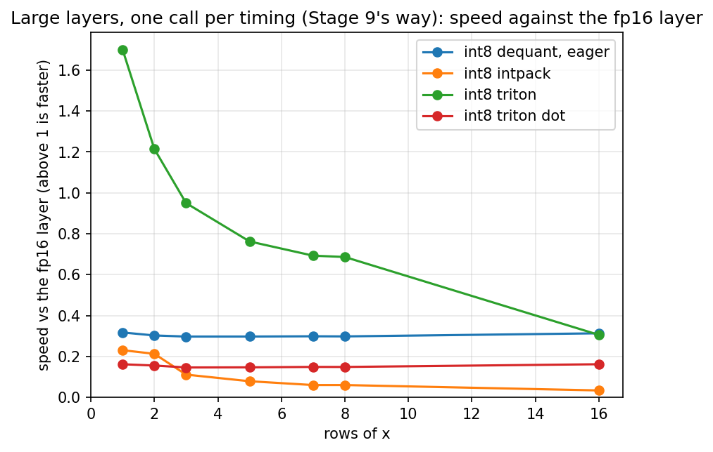
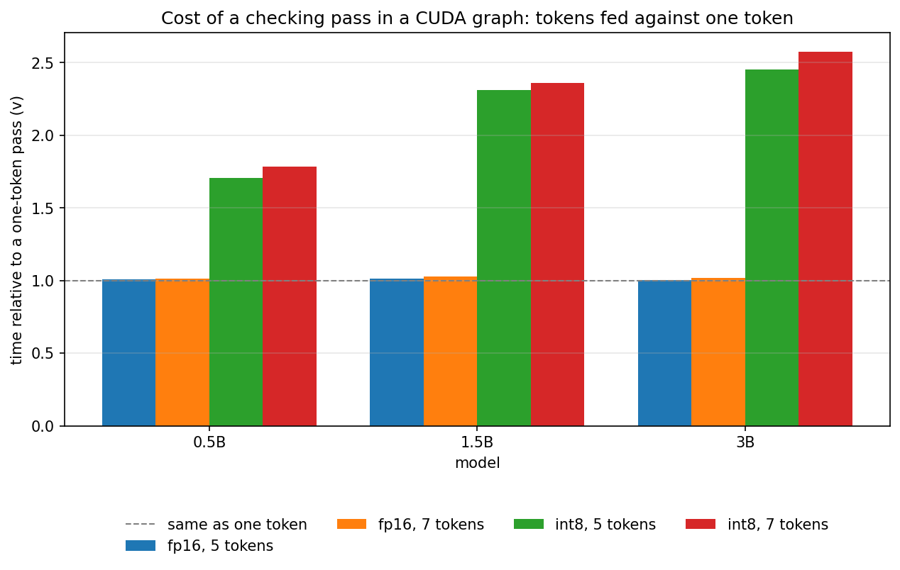
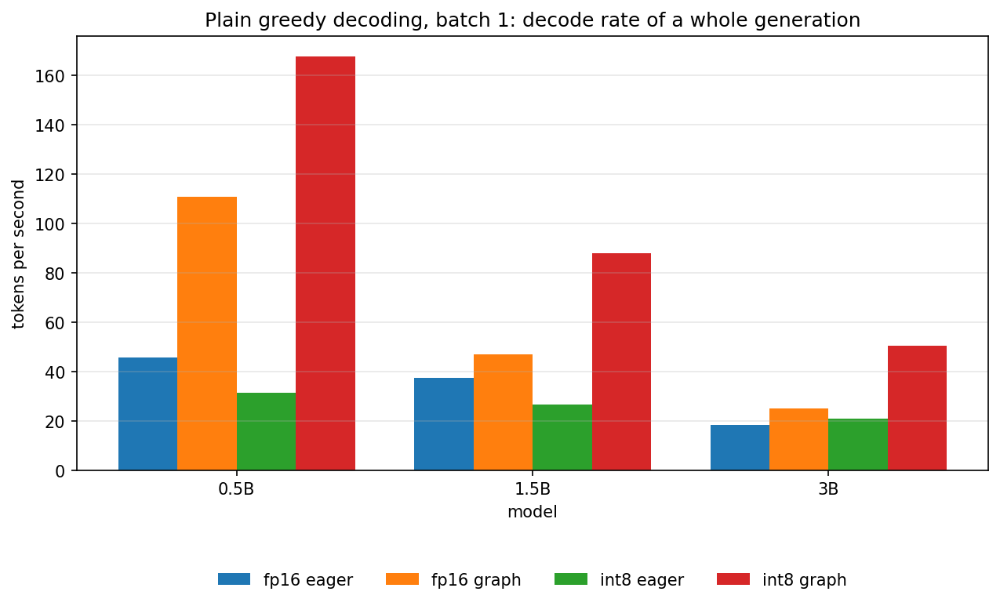
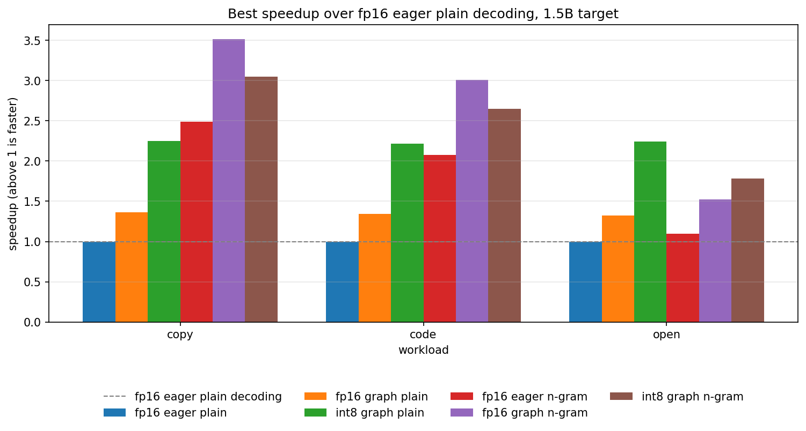

# Stage 10: A Decode Loop That Lives in CUDA Graphs, and Do Int8 and Speculation Multiply

[Overview](../README.md) | [Full report](../REPORT.md) | [Measured numbers](../RESULTS.md) | [How the code works](code.md)

[`09_graph_speculation.ipynb`](../09_graph_speculation.ipynb) picks up the two things Stage 9 could not fix. The fused int8 kernel made a one-token decode step faster than fp16, but only inside a CUDA graph or under `torch.compile`: a Triton kernel launched eagerly costs about as much CPU time as it saves. And anything that fed several tokens through the int8 model was slow, because the kernel for a block of tokens used the tensor cores and read the weights several times slower than the fp16 layer did, so the checking pass of speculative decoding cost the int8 model two to three and a half times a one-token step. Stage 9's speculation loop was eager, so even a fast kernel could not have won in it.

Working the Stage 9 numbers through again changed the order of the next steps. The int8 copy as the draft of its own model is the best guesser there is, but its ceiling is set by arithmetic: a draft that is the same model at half the bytes costs about half a target step by construction, so against a fair baseline (the fp16 model in a CUDA graph, not eager) the most a self-draft can give is a modest gain, and it is slower than simply running the int8 model in a graph. It only makes sense when the output has to be exactly the fp16 model's. The question Stage 9 started with is cleaner with a guesser that costs nothing, the n-gram lookup: then the only thing that decides is the cost of the checking pass, and the target, fp16 or int8, is the thing under test.

**Stage 10 asks whether int8 weights and speculative decoding multiply.** Speculation cuts the number of weight reads per token and int8 cuts the bytes per read, so in a step that is limited by reading weights the two should compose. Two pieces are needed that Stage 9 did not have.

- **A multi-row int8 kernel** (`gemvm` in `minivllm/int8_kernel.py`). The checking pass feeds the last accepted token and up to `k` drafts, two to eight rows of `x`. A few rows is not a matrix product, it is a few matrix-vector products that share their weights, and the weights are the expensive thing to move. The kernel loads each int8 tile once, converts it in registers, and multiplies it by every row on the ordinary FMA units into a three-dimensional accumulator that is reduced once at the end. No tensor cores, no shared-memory staging. Above eight rows the int8 path falls back to the dequantize path, which is fine for a prompt, where the matmul is compute-bound anyway. The tuner now times each candidate as repeated calls inside one CUDA graph, because for the small layers the launch is as large as the kernel and hid the differences in Stage 9.
- **A forward pass that lives in a graph** (`StaticForward` in `minivllm/draft.py`, `GraphDecoder` in `minivllm/graph_decode.py`). A captured pass for a fixed number of tokens over the static KV cache, with static buffers for the token ids and positions, the attention mask computed from the positions inside the graph, and the logits as the graph's output. A plain decode step is the pass for one token; the checking pass of speculation with `k` drafts is the pass for `k + 1` tokens, with short drafts padded and a round with no draft at all run as an ordinary one-token step. The token never leaves the GPU between steps. The rollback after a rejected draft is free: a pass writes its keys at the positions it is given, a row only attends to keys at or before its own position, so the stale keys of rejected drafts sit beyond the decoder's length where no row can see them and the next pass overwrites them. Nothing is copied or cleared. A control keeps this honest: a mask that lets rows see later keys breaks the output.

The notebook proves what it can before it measures: the kernel against the dequantize path at every shape and at every row count from one to nine, sixteen and thirty-seven, with a control that must fail (a wrong scale); the graph decoder against plain greedy decoding of the same weights for any proposer (the tests use an always-wrong one, an always-right one and one that proposes fewer tokens than the block holds), with a control that must break; then the go/no-go gate on the large layers, timed in a CUDA graph.

| # | Section | Question |
| --- | --- | --- |
| 1 | The multi-row kernel | Is it correct at every row count, which kernel does the tuner pick for each, and does it beat the fp16 layer at two to eight rows, in a graph and the Stage 9 way? Was Stage 9's tensor-core kernel just badly tiled? |
| 2 | A forward pass in a graph | What does a block of tokens cost against a single token in a graph, for fp16 and int8, and eagerly? Does the multi-row kernel change what the model computes? |
| 3 | Plain decoding in a graph | What does quantization buy a decoder at batch one once the loop itself is fast, as a rate of a whole generation? |
| 4 | Speculation in the graph | Do int8 and the n-gram lookup multiply, against fp16 eager, fp16 in a graph and int8 in a graph? Is the output still exact? Does the cost model predict the speedups? |

## Predictions (Stage 10)

Written before the first run, and kept here so the results can be compared with them. They come from arithmetic on the Stage 9 numbers, and the second and fourth are the ones I am least sure of.

- **The kernel.** It agrees with the dequantize path to within fp16 rounding at every row count and a wrong scale is caught. On the large layers at five rows, inside a graph, it is faster than the fp16 layer, because the weights are read once at one byte each and a handful of rows is a handful of multiply-adds per weight, which the FMA units of a T4 have room for if they overlap with the loads. Five, seven and eight rows cost the same, since the kernel pads to eight accumulators, and fewer rows cost a little less. The tensor-core kernel stays far slower at five rows whatever tile the new grid finds. The tuner picks the one-token kernel at one row, the multi-row kernel at two to eight, and the tensor-core or dequantize path above eight. The risk is Triton's handling of a three-dimensional accumulator, and the tuning table will show it.
- **A pass in a graph.** For fp16 a pass of five or seven tokens costs a little more than a one-token pass. For int8 it costs more than that, but far less than the slow kernel did in Stage 9, and int8 in a graph is still faster than fp16 in a graph at those lengths. Eager int8 passes are much slower than graph passes, and fp16 ones much less so. The multi-row kernel's logits differ from the dequantize path's by far less than int8 differs from fp16, with the same top token.
- **Plain decoding.** A graph helps fp16 a lot at the smallest model, where the step is mostly launches, and almost not at all at 3B, where it is mostly weight reads. Int8 in a graph is faster than fp16 in a graph, by more for bigger models, and several times faster than fp16 eager (the baseline of every earlier stage) at the smallest model. Eager int8 stays slower than eager fp16.
- **Speculation.** The n-gram lookup helps both weight formats on repetitive text and code and is about neutral on open text, where it rarely finds a draft and the rounds without one are plain steps. The gains multiply, less a little: int8 plus the lookup beats each alone on repetitive text and code, by somewhat less than the product of the two separate gains, because the checking pass costs more relative to a plain step on int8 than on fp16. Against fp16 eager plain decoding the combination reaches several times on repetitive text, with the larger model gaining most. The cost model, fed with the measured checking cost and acceptance, predicts the speedups to within about a quarter and overstates open text. Every difference from plain greedy is an fp16 near-tie, an fp16 eager run shows near-ties without any graph or int8, and the non-causal control changes the output.

## Results (Stage 10)

All measured values are in [`RESULTS.md`](../RESULTS.md#stage10-setup) (source: [`results/stage10.json`](../results/stage10.json)), measured on a Tesla T4 with `Qwen/Qwen2.5-0.5B`, `1.5B` and `3B` (the speculation section uses the 1.5B and 3B models as targets), PyTorch 2.11, Triton 3.6 and transformers 5.16. Every timing is a median of repeated runs with the spread recorded, and the plain baselines of the speculation sweep are the median of three timings. The speculative rows are single passes of three prompts per workload and 96 generated tokens each, so differences of a few percent are noise. The notebook was run three times and the results file holds the last run. I compared the first and the last: every figure that matters reproduces (the kernel, the gate, the cost of a checking pass, the speculation ratios), and what differs is noise and the 3B fp16 baselines, which are the subject of the follow-up check below. The claims below depend on the direction and rough size of differences.

**What the run is about.** The question was whether int8 weights and speculative decoding multiply once the decode loop lives in CUDA graphs. They do not, and the reason is one kernel. The graph decoder works, the n-gram lookup works, and fp16 with the lookup in a graph is the best setup on repetitive text. The multi-row int8 kernel is a no-go: a checking pass costs the int8 model about two plain steps where it costs fp16 one, so int8 with the lookup loses to fp16 with the lookup on copy and code and to int8 plain decoding on open text.

**Two things the run turned up in its own measurements,** both settled by two diagnostic cells added to the notebook after the first run (the [follow-up check](#follow-up-check-d1-and-d2) below). The fp16 `lm_head` layer is about twice as slow at one row as at two when it runs in a graph, because the one-row kernel cuBLAS picks under graph capture is slow, and that flatters every figure taken against an fp16 graph step at one token. And the 3B fp16 rows of the plain-decoding section and of the speculation baselines were measured slow, because the first block timed after heavy work runs on a GPU whose clocks are still settling. The claims and the discussion below rest on the passes of section 3 and on rows that are not affected, and say where a figure is.

### 1. Is the multi-row kernel correct, and what does the tuner pick? Correct, and it picks as predicted.

Numbers: [The multi-row kernel](../RESULTS.md#stage10-kernel).

The kernel agrees with the dequantize path to within fp16 output rounding at every shape and at every row count from one to nine, sixteen and thirty-seven, and a wrong scale is caught by the same check, so the check can fail. The tuner chose the one-token kernel at one row on every shape, the multi-row kernel at two, four and eight rows on every shape, and the dequantize path above eight rows on every shape in the last run (the tensor-core kernel won one shape at sixteen rows in the first). Two candidates per shape did not compile or launch at eight, sixteen and a hundred and twenty-eight rows. The table counts them without naming them, but at sixteen rows and above only tensor-core tiles and the dequantize path are candidates, so they are tensor-core tiles. The tensor-core kernel, in other words, never mattered in this stage.

### 2. Does it beat the fp16 layer? No: the gate is a no-go, and the kernel is not memory-bound.

Numbers: [The go/no-go gate](../RESULTS.md#stage10-gate).

Inside a CUDA graph, on the three large layers, the tuned kernel beats the fp16 layer at one row (by between one and two thirds and two times on the two MLP layers), is about even at two rows (a little better or a little worse depending on the layer), and from three rows up is slower than the fp16 layer on every large layer, with the gap widening: roughly seven tenths of the fp16 layer's speed at three rows, five eighths at five, three fifths at eight and under a third at sixteen. The gate is a no-go at five rows. The prediction was a gain of between one and a third and one and four fifths at five rows, so this missed by a wide margin. The same measurement the Stage 9 way (one call per timing, launch cost included) tells the same story with a smaller gain at one row.

The kernel is not memory-bound. Its time grows with the rows, by more than half between two and eight rows on every large layer, and at eight rows it reads about a quarter of the copy bandwidth where the one-token kernel reads roughly eight tenths to nine tenths of it. Five, seven and eight rows cost almost the same (the kernel pads to eight accumulators, and going from five to eight rows costs only a few percent more), which is the design working as intended. Three rows are not as smooth: on the largest MLP layer the three-row layer is slower than the five-row one, so the tile the tuner chose for the three-to-four-row bucket is a worse one. The tuner's winners sit at the edge of its grid: all but one of the winners on matrices of ten million weights or more use the largest tile of the grid, and most winners use the smallest warp count, so the grid was too small. That says the search stopped early, not why the kernel is slow.

What limits it is not settled, and the arithmetic needs care, because of the clocks (follow-up check). Under this load the T4 runs power-capped at about a gigahertz, far below its boost clock, so its multiply-add peak is about 2.3 trillion a second and not the roughly 4 trillion of the boost-clock figure. At the copy bandwidth, eight multiply-adds per weight would need about five sixths of that peak, four rows about two fifths and two rows about a fifth. So at eight rows the FMA units could not keep up with memory even for a perfect kernel on this clock, which fits the time growing with the rows. But the kernel is nowhere near the FMA peak either: it reaches about a twelfth of it at two rows and about a fifth at eight (on `lm_head`). It is neither memory-bound nor FMA-bound, so there is real inefficiency in it as well. My leading hypothesis is the three-dimensional accumulator, whose broadcast and reduction layouts the one-token kernel does not need, together with the conversion of each int8 weight; I did not profile it, so it is a guess.

The tensor-core kernel of Stage 9 is not just badly tiled for few rows. Its time hardly changes between one and sixteen rows, at a tenth to a fifth of the fp16 layer's speed, and at five rows it is between three and a half and five times slower than the tuned multi-row kernel. A cost that does not depend on the rows is a per-weight cost, which is consistent with Stage 9's suspicion about the conversion and the staging through shared memory, still unprofiled.

The one-row ratio deserves a caveat: it is flattered by the fp16 layer's own slowness at one row in a graph (follow-up check). On the two MLP layers, which do not show it, the gain is between one and two thirds and two times.

### 3. What does a checking pass cost in a graph? Nothing for fp16, about two plain steps for int8, and that is the kernel.

Numbers: [A forward pass in a graph](../RESULTS.md#stage10-block).

For fp16, feeding five or seven tokens costs the same as feeding one at every size, to within a few percent: the cost factor `v` of the cost model is one. For int8 it is not. It is about one and three quarters at 0.5B and between two and a third and about two and three fifths at 1.5B and 3B, where the prediction was between one and a tenth and one and three fifths. So a five-token int8 pass is slower than the fp16 one at every size, by about a third, although the one-token int8 pass is faster than the fp16 one by a factor that grows with the model (and is flattered at one token by the `lm_head` effect).

The whole difference is the kernel. Adding up the tuned layer times of section 2 over every matrix of a model, eight rows cost as much more than one row as the measured seven-token pass costs more than the one-token pass, to within about a tenth at 1.5B and 3B (at 0.5B the small layers are latency-bound in the tuning timings, so the sum overshoots and was not used). Attention, norms and the cache add nothing to speak of to a wider block. The graph also explains why Stage 9 saw so little: in eager mode a pass of five or seven tokens costs about what one token costs for both formats, because launches dominate, and the graph removes the launches. The graph speeds the one-token pass up by a factor that shrinks as the model grows and is larger for int8 than for fp16 (for fp16 at 3B it is almost none, since that step is weight reads and not launches).

Accuracy is not the problem. The multi-row kernel's logits differ from the dequantize path's with a KL divergence more than fifty times smaller than int8's difference from fp16, and the top token is the same at every position of every block checked.

### 4. What does plain decoding in a graph buy? A lot, and int8 gets more of it than fp16.

Numbers: [Plain decoding in a graph](../RESULTS.md#stage10-plain).

The graph decoder costs almost nothing over the single pass it replays: its time per token is at most about a tenth above the section 3 pass (the largest ratios are on the fp16 rows, which are the first rows timed after each model load) and about equal or below it for int8. In a graph int8 decodes faster than fp16 at every size, by about one and a half at 0.5B, nearly one and nine tenths at 1.5B and about two at 3B, which is the Stage 9 step result seen as a rate. The graph helps fp16 most at the smallest model, where the step is mostly launches (more than twice), and by a quarter to two fifths at 1.5B; at 3B it helps almost not at all. Eager int8 decoding stays slower than eager fp16 at every size. Against the eager fp16 baseline of every earlier stage, int8 in a graph decodes about three and two thirds times faster at 0.5B and about two and a third times faster at 1.5B, and at 3B about one and nine tenths times against section 3's eager pass.

Three cautions. The 3B fp16 rows of the table were measured during the warm-up described in the follow-up check, so they are slow (the eager row also has a very large spread), and every 3B ratio against them is inflated: the table says about two for int8 against fp16 in a graph and about two and three quarters against eager, where the steady-state rates give about one and nine tenths for both. Second, int8's lead over the fp16 graph step is flattered by the fp16 `lm_head` effect, which is an avoidable cost: for 1.5B, an fp16 `lm_head` run at its two-row speed would shorten the fp16 graph step by about an eighth and put int8's lead at about one and a half rather than one and seven tenths (judging by the size of the layer, the cost should be a larger share of the step at 0.5B and a smaller one at 3B, which I did not measure). [Stage 11](stage11.md) measured the whole step with the head padded and found a few percent, not an eighth, so this estimate from one layer's timing was several times too large. Third, none of this touches the eager comparison. Every output equals the eager output of the same weights, so no tie had to be read.

### 5. Do int8 and speculation multiply? No.

Numbers: [Speculation in the graph](../RESULTS.md#stage10-speculation).

**The lookup in a graph with fp16 weights** more than doubles plain decoding in a graph on copy and code at both targets (by far more on copy at 3B, where the lookup is accepted almost every time) and gives a small gain on open text, where it rarely finds a draft. The graph speeds the fp16 lookup up by about two fifths at 1.5B and barely at 3B. The lookup's acceptance depends on the workload and not on the weights: it differs by less than a tenth between fp16 and int8 on the same workload.

**With int8 weights** the lookup beats int8 plain decoding on copy at both targets (by a third at 1.5B, by more than twofold at 3B), is about a fifth better on code at 1.5B and a little worse at 3B, and loses to it on open text, by about a fifth at 1.5B and a quarter at 3B. The prediction that it would be about neutral on open text missed: a round that does find a draft costs the int8 model more than two plain steps for well under two tokens.

**The gains do not multiply.** Int8 plus the lookup reaches somewhere between about three eighths and seven tenths of the product of the two separate gains, and fp16 with the lookup in a graph beats int8 with the lookup on copy and code at both targets. The best graph setup is fp16 with the lookup on copy and code and int8 plain decoding on open text. The reason is the checking cost `v` measured inside the sweep: between about one and nine tenths and two and two fifths plain steps for the int8 lookup rounds on copy and code (about one and a half on open text, where many rounds find no draft and run the cheap one-token pass), against one for fp16. Against the fp16 eager baseline of every earlier stage, the best setup decodes about three and a half times faster on copy at 1.5B, about three times on code and about two and a quarter times on open text. At 3B the baselines of the sweep were measured slow (follow-up check), so the table overstates the ratios; against the steady-state fp16 rates the best setup is about five and a half times on copy, about twice on code and nearly twice on open text.

**The cost model.** Fed the tokens per round that the acceptance rate predicts, it overstates the speedup of every lookup row, by a seventh to a half, because the lookup's drafts are often shorter than `k`; the prediction that it would be within a quarter held for only part of the rows. Fed the measured tokens per round instead, it predicts them to within about a tenth, slightly optimistic (the sweep also pays for the prefill). So the model is right and the usual inputs are wrong for this guesser.

**A projection, not a result.** If the int8 checking pass cost about one and a seventh plain steps instead of about two, the same arithmetic with the measured acceptance, step times and prefill puts int8 plus the lookup at about one and a third to one and four fifths times the measured fp16 graph plus lookup once each format's own prefill is included, which is the basis of every other speedup here (about one and three fifths to nearly twice for decoding alone). The low end is copy at 3B, where the fp16 lookup run is so short that the prefill is a large share of it. Nothing in this notebook measured a cheaper kernel, and the clocks (follow-up check) suggest that eight rows may not reach that on this GPU, so this is the size of the prize and not a finding.

### 6. Is it still exact? Up to fp16 near-ties, and the control can fail.

Numbers: [Speculation in the graph](../RESULTS.md#stage10-speculation).

Every setup is checked against its own plain greedy decoding (the first prompt of each workload, thirty-two tokens). Twenty-two of the twenty-four are identical, and the two differences (the int8 lookup on code, at both targets) have a logit gap of a hundredth of a logit or exactly zero between the two tokens, so they are ties. A decoder whose mask lets every row see all keys up to the end of its block, the control that must break the rollback and the causal mask, changes the output on all three workloads, so the check can fail. Over the whole sweep, the graph does not lower how many outputs equal plain greedy (fp16 in a graph has as many identical outputs as fp16 eager), and int8 has somewhat fewer than fp16, all of its differences being in the lookup rows, where the checking pass uses the multi-row kernel and the plain step the one-token one, probably because the two round differently. Only the checked outputs have their logit gap read. The eager fp16 control showed no difference in the checked prompts, so those checks do not by themselves show that ties occur without a graph or int8; the counts over the whole sweep do (the eager fp16 engine also differs from its own plain greedy in a few outputs).

### Follow-up check (D1 and D2)

The two diagnostic cells sit in [`09_graph_speculation.ipynb`](../09_graph_speculation.ipynb) with their outputs; their numbers are not in the results file, so this section gives them in words.

**D1, the fp16 `lm_head` at one row.** The layer at the 1.5B shape was timed at one, two and three rows, eagerly and in a graph, twice in opposite row orders, with `F.linear` and with a plain matrix product, and with the input padded to two rows with only one used. In a graph one row takes about twice as long as two or three, with both ways of writing it and in both orders (so it is not a warm-up effect), while the padded version takes the two-row time, about twice as fast as the one-row layer it computes the same result for. Eagerly the one-row layer is only about a sixth slower than the two-row one. So the cause is the one-row kernel that cuBLAS selects under graph capture, and the fix is to compute `lm_head` on two rows. That is an avoidable cost in every fp16 graph step at one token (estimated here at about an eighth of the 1.5B step; [Stage 11](stage11.md) later measured the padded step directly and found a few percent), which is why a fair fp16 graph baseline should pad it, and why the figures above that compare against the fp16 graph step at one token are flattered a little. The graph speculative decoder's checking passes are not affected (they feed several rows), only its plain steps and its rounds with no draft.

**D2, the 3B fp16 baseline.** The 3B fp16 model was timed eight times, eager and graph alternating. Both modes start about a quarter below where they end and settle within four or five repetitions, roughly half a minute, and the steady rates agree with section 3's passes. `nvidia-smi` read after the runs shows the GPU under load at clocks between 810 and 990 MHz, against a maximum of 1590, at 74 to 79 degrees and 54 to 66 watts of its 70 watt limit, with the software power cap flagged as the throttle reason in most readings, and the clock rose as the temperature fell while the rate rose. So the 3B fp16 noise is a clock and thermal warm-up of the first block timed after heavy work (here, right after the model load and the earlier sections), not something about eager or graph mode. In this notebook the fp16 rows are always the first timed after a load, which is why they are the noisy ones at every size, most at 3B, and why the int8 rows that follow them are quiet. It also means the absolute rates of this notebook were measured at power-capped clocks, so compute-heavy kernels are slower than a boost-clock T4 would allow, and a 1590 MHz figure should not be used for any ceiling.

### Predictions against results (Stage 10)

Held: the kernel is correct and a wrong scale is caught; the tuner picks the one-token kernel, the multi-row kernel and the dequantize path as predicted; the tensor-core kernel stays far slower; five, seven and eight rows cost nearly the same; the fp16 checking pass costs a single step; the multi-row kernel's logits match the dequantize path's; the graph helps fp16 most at the smallest model and the eager multi-token passes are launch-bound; the loop adds little; the lookup helps fp16 on repetitive text and code and not on open text; the graph speeds the lookup up by less for the bigger model; every difference is a near-tie and the control breaks the output. Missed: the gate (a no-go, where a gain was predicted), the int8 checking cost (about twice a plain step, where between one and a tenth and one and three fifths was predicted), a five-token int8 pass faster than the fp16 one (slower), the gains multiplying (they do not), int8 plus the lookup being neutral on open text (it loses), and the cost model being within a quarter (only with the measured tokens per round).

### What this sets up (Stage 10)

The result points at one thing. The graph decoder works, the lookup is free, and the whole int8 loss sits in one kernel whose per-layer times add up to the full extra cost of a checking pass. So the next notebook rewrites that kernel and gates it again, with the same gate (the tuned five-row layer at least as fast as the fp16 layer, in a graph). The leads are these. The winners sit at the corner of the grid (the largest tile and the smallest warp count), so a larger grid is the cheap first step. The three-dimensional accumulator is the leading suspect, so the second is one two-dimensional accumulator per row in an unrolled loop, which has the layout the fast one-token kernel has and reads each weight tile once. Because the clocks cap the multiply-add rate, the third is to cut the arithmetic per weight: a four-row variant (a draft length of three) needs half the multiply-adds of the eight-row one, and packed half-precision multiply-adds or the integer dot-product instructions of the T4 (which need quantized activations) do more per instruction. The notebook should also fix what this one measured badly: compute the fp16 `lm_head` on two rows so that the fp16 baseline is fair, log the GPU clocks and temperature around every timing block, run a warm-up of tens of seconds before the first block and between sizes, alternate the modes being compared, flag rows with a large spread, and time the fp16 reference layer at one, two and three rows. If the gate passes, the measurement to repeat is the 2 by 2 of section 5, and the projection above says what it would be worth. After that, draft models with a captured feed, and then the engine leaves the notebook.

### Other plots (Stage 10)

All plots are listed, with captions, under [Plots](../RESULTS.md#stage10-plots) in `RESULTS.md`.

## Lessons

- **Gate a kernel at every row count it will meet, and in the setting it will run in.** The one-row ratio said go by a wide margin and the five-row ratio said no-go: the same lesson as Stage 9, one stage on. Timing in a graph, where launch cost is gone, is what made the layer numbers believable.
- **Sum the parts to find where a loss lives.** The tuner's per-layer times add up to the whole extra cost of an int8 checking pass to within about a tenth, which localizes the loss to one kernel without profiling the model.
- **A winner at the edge of its grid means the search stopped early.** Nearly all the big-matrix winners sat at the largest tile, so the grid, and not only the kernel, is in question.
- **A free guesser isolates the target.** With the n-gram lookup nothing but the checking pass can explain the int8 result, which is why the loss is clean.
- **A cost model is only as good as its inputs.** Tokens per round computed from the acceptance rate assume full-length drafts and overstate the lookup; the measured tokens per round make the same model accurate.
- **Check the baseline's own timings before crediting a gain, and ask for the cause.** The fp16 reference layer was twice as slow at one row as at two in a graph. A diagnostic that padded the input found why in minutes, and it changes every ratio taken against that baseline.
- **Log the clocks.** A T4 at a power cap does not run at its boost clock, the first block timed after heavy work runs slow, and a compute-heavy kernel's ceiling moves with the clock. A spread column showed the problem and `nvidia-smi` explained it; both belong in the results.
- **A re-run is a result.** Running the notebook again reproduced everything except the rows the diagnostics then explained, and showed which claims had margins that were too tight.
- **Do not name a cause you did not profile.** The three-dimensional accumulator is a hypothesis, written as one.
- **A loop that skips a pass is cheaper than a loop that pads it.** A round with no draft has nothing to check, so the graph decoder runs it as an ordinary one-token pass.

## Exercises

1. Replace the three-dimensional accumulator of the multi-row kernel by one two-dimensional accumulator per row in an unrolled loop, each updated from the same int8 tile. Does the time per layer stop growing with the rows?
2. The winners sit at the largest tile of the grid and the smallest warp count. Extend the grid (a wider tile, a longer step along `K`, other warp counts) and see where the optimum is.
3. Profile the multi-row kernel (Nsight Compute or `triton.testing`) and find whether the conversion, the FMAs, the layout conversions or the memory system limits it at eight rows.
4. `tl.dot` needs sixteen rows, and the Stage 9 tile is flat in the rows at a tenth to a fifth of the fp16 layer's speed. Use a transposed formulation (the weights as the sixteen-row operand, the few activation rows as the narrow one) and see whether the tensor cores beat the FMA units.
5. Make `DraftModel` feed the tokens the target accepted as one captured fixed-length pass, so a round with a 0.5B draft is graph launches end to end. What does the cost ratio become, and does the 0.5B draft beat the lookup on open text?
6. Capture checking passes for several lengths and run the smallest that fits the drafts found, instead of padding to `k + 1`. When does it pay, given that every extra graph costs memory?
7. Replace the greedy acceptance with speculative sampling: accept a draft with probability `min(1, p / q)` and resample on rejection. The output distribution stays the target's. What changes in the rollback?
8. The multi-row kernel stops at eight rows. Where is the crossover with the dequantize path, and with a kernel tuned for the batch sizes of a server?
9. The `k/v` projections have few output rows. Split the loop over `K` across programs and reduce the partial sums; does the pass stop being launch-bound inside the graph?
10. Capture the prompt pass for a few bucketed lengths. How much of the time to the first token is launches?
11. Check several candidate continuations per position in one pass with a tree mask. With a fixed-shape graph, what is the mask, and what does a wider block cost on int8?

## How to run it

Open `09_graph_speculation.ipynb` the same way (Kaggle, GPU T4, Internet on) and run top to bottom. It is self-contained, so it does not need the earlier notebooks to have been run first. It downloads three models, so the first run spends a few minutes on the network, and the Triton kernels add compile time to the tuning run (every candidate of the tuning grid is compiled and captured in a graph). Set `QUICK = True` for a pass with the 1.5B target only and fewer repeats. The publish cell is the same one as above, and as the newest notebook it publishes code as well as results.
