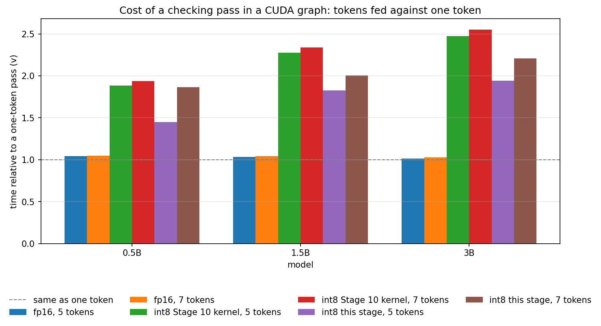
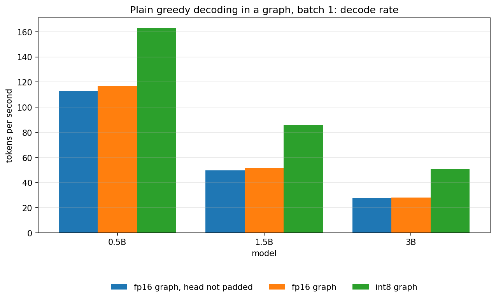
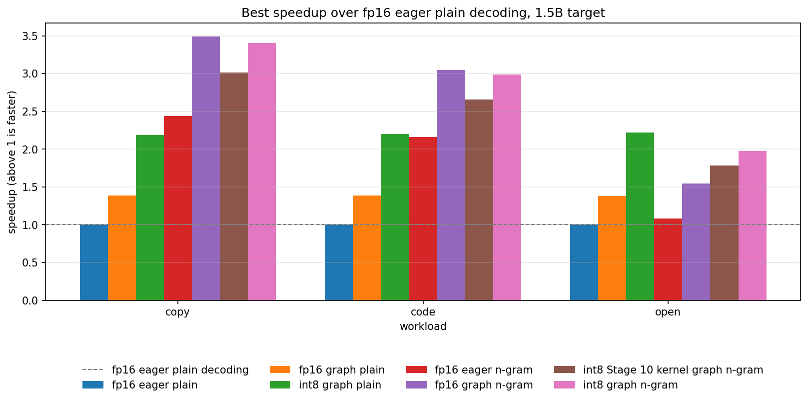
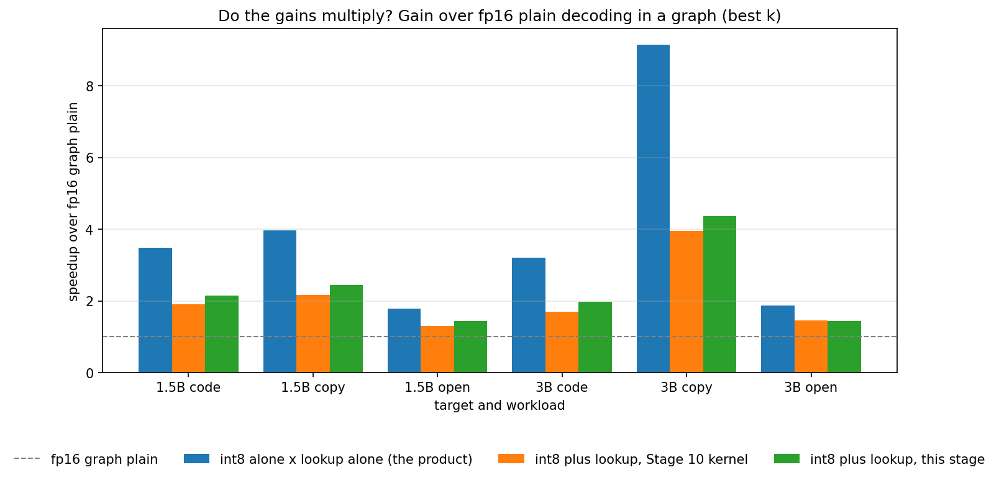

# Stage 11: A Better Multi-Row Int8 Kernel, and Does It Make Int8 and Speculation Multiply

[Overview](../README.md) | [Full report](../REPORT.md) | [Measured numbers](../RESULTS.md) | [How the code works](code.md)

[`10_multirow_kernel.ipynb`](../10_multirow_kernel.ipynb) retries the one thing Stage 10 left broken. The graph decoder worked and the n-gram guesser was free, so the only thing under test in Stage 10 was the target model, and the answer was that int8 weights and speculative decoding did not multiply: the multi-row int8 kernel was slower than the fp16 layer, its time grew with the number of rows, and an int8 checking pass cost about two plain steps where the fp16 one cost about one. The per-layer times added up to that whole extra cost, so the loss was one kernel.

**Stage 11 asks whether that was the kernel or the idea.** Stage 10 left two pieces of evidence that it was the kernel, both gathered after the run without a GPU. Triton ships its own `ptxas` and disassembler, so a kernel can be compiled for the T4 on any machine and its machine code read. The compiled `gemvm` has shared-memory stores, loads and barriers inside its main loop: the three-dimensional accumulator and the broadcast of `x` need layout changes that Triton implements through shared memory, and a kernel whose job is to stream weights has no use for shared memory. And the arithmetic has room. At the clock the T4 runs under load, set by its power cap and not its boost clock, several fused multiply-adds fit in the time one int8 weight takes to arrive, which is more than a few rows of multiply-adds need, though the conversion and the address arithmetic share those slots.

- **Two row-exact kernels** (`gemvr` and `gemvs` in `minivllm/int8_kernel.py`). Each is compiled for an exact number of rows (one to eight) and keeps one named accumulator per row, so nothing is padded and nothing is staged. The row of `x` is loaded as a pointer tile whose row stride is zero, so every thread reads the values it needs from the cache instead of receiving a broadcast through shared memory. `gemvr` keeps a full tile per row and reduces it once at the end (the fewest instructions per weight, the most registers); `gemvs` sums over `K` inside the loop into a vector per row (more instructions, far fewer registers). Unmasked loads are used when the shape divides the block, and the host converts `x` to fp32 once before the launch, because converting at every use cost a fifth to two fifths more instructions in the loop when counted offline.
- **A pruned search.** Compiling every tile of both grids for the T4 offline, at two, three, five and eight rows, and reading the registers, local memory and barriers of the compiled loop gave a rule (`fits`) that drops the tiles that spill accumulators to local memory or reduce through shared memory. Every configuration the rule keeps was then compiled at every row count from two to eight, and none of them spilled accumulators, used static shared memory or had a barrier in its loop (one `gemvs` tile has a single local load, which the device check below would show as a spill if it were one). The tuner times only the rest, once for each row count from one to eight (Stage 10 shared one tuned configuration between three to four rows and between five to eight), and keeps the fastest configuration of each kernel family as well as the overall winner, so one run says what each family reached. The notebook then checks the rule on the device: registers, spills and shared memory as the GPU compiler reports them.
- **A fair clock.** Stage 10 found that the first timing after a heavy phase runs at a different clock from the steady state, and that a T4 under load sits at its power cap. Every timed section here starts with the GPU under load for a while, the state of the GPU is logged and saved, and the candidates that are compared with each other take turns over several rounds with the order rotated, so a drifting clock hits them alike. A comparison whose rounds disagree is flagged as noisy.
- **A fair baseline.** Stage 10 also found that cuBLAS picks a slow kernel for a one-row fp16 product inside a graph, which is exactly the output projection of the one-token pass, and that padding it to two rows removes the cliff. The fp16 graph decoder here pads that product (`pad_head`), so int8 is not measured against a handicapped fp16. The padded product is a different cuBLAS kernel and can differ from the one-row product in the last bit, so the exactness check keeps its near-tie rule.

The notebook proves what it can before it measures: every kernel variant against the dequantize path at every shape and at every row count from one to nine, sixteen and thirty-seven, with a control that must fail (a wrong scale); the exactness of every speculative output against the same weights' plain greedy decoding, with the non-causal control that must break it. Then it runs the measurements of Stage 10 again with the new kernels, and measures the Stage 10 kernel in the same session so that the effect of the kernel alone is a ratio of two numbers taken together.

| # | Section | Question |
| --- | --- | --- |
| 1 | Tuning and the compiler | Which kernel wins at each row count, how much faster than Stage 10's kernel, and did the offline compile predict the registers and spills on the device? |
| 2 | The one-layer gate | Are the new kernels correct, and do they beat the fp16 layer at two to eight rows, in a graph, with the candidates timed in turns? |
| 3 | Converting x once | Does the fp32 copy of `x` pay for its extra kernel? |
| 4 | A checking pass in a graph | What is `v`, the cost of a checking pass in plain steps, for fp16, for int8 with the Stage 10 kernel and for int8 with the new one, and which side of the gate written before the run is it on? |
| 5 | Plain decoding | What does the padded head change for the fp16 baseline? |
| 6 | Speculation | Do int8 and the lookup multiply now, and does int8 with the lookup beat fp16 with the lookup, both in a graph? |

## Predictions (Stage 11)

Written before the first run, and kept here so the results can be compared with them. They come from the offline instruction counts and the Stage 10 numbers, and the third and fourth are the ones I am least sure of.

- **The compiler.** Every configuration the rule keeps compiles on the device with no spilled registers and no shared memory, and the ones it removes include spills at five and eight rows.
- **The kernel.** Both new kernels are correct at every row count and a wrong scale is caught. At two to eight rows one of the new kernels wins every large layer and `gemvm` wins none, with `gemvr` ahead at few rows and `gemvs` at seven and eight. The time of the winner grows with the rows, slowly at first: close to the one-row time at two rows, between one and a half and twice at five rows, above twice at eight, because eight rows of arithmetic plus the conversion and address work are close to or above what the clock can hide. On the large layers at five rows it is faster than the fp16 layer, but not by much, and slower than it at eight rows.
- **A pass in a graph.** The cost of a checking pass of five tokens in plain steps, `v`, stays near one for fp16, and for int8 falls from about two to somewhere between one and a half and two with the new kernel: better, short of the gate written before the run (at most one and three tenths is a go, below one and seven tenths is partial). The padded head makes the fp16 one-token step shorter at every size, by about an eighth at 1.5B, more at the smallest model and less at the largest.
- **Speculation.** The new kernel raises the rate of int8 plus the lookup on repetitive text and code by about the ratio of the old `v` to the new one, and not on open text. The gains still do not fully multiply, and the best setup on repetitive text and code is still fp16 in a graph with the lookup at 1.5B unless the gate is a go; at 3B the two are close. On open text the best setup is int8 plain in a graph. The fair fp16 baseline lowers every ratio of int8 to fp16 relative to Stage 10. Every speculative output equals plain greedy decoding up to fp16 near-ties, and the non-causal control breaks the output.

## Results (Stage 11)

All measured values are in [`RESULTS.md`](../RESULTS.md#stage11-setup) (source: [`results/stage11.json`](../results/stage11.json)), measured on a Tesla T4 with `Qwen/Qwen2.5-0.5B`, `1.5B` and `3B` (the speculation section uses the 1.5B and 3B models as targets), PyTorch 2.11, Triton 3.6 and transformers 5.16, the same stack as Stage 10. The notebook was run once, and the results file holds that run. Every timing is a median of repeated runs with the spread recorded, the comparisons between kernels are timed in turns with the order rotated, and a timing whose rounds disagree is flagged. The speculative rows are single passes of three prompts per workload and 96 generated tokens each, so differences of a few percent are noise. The claims below depend on the direction and rough size of differences.

**What the run is about.** The question was whether Stage 10's loss was the kernel or the idea. The answer is in between and it is not the one the stage hoped for. The row-exact kernels are better than Stage 10's: the checking pass of an int8 model costs about a fifth to a quarter fewer plain steps, and int8 with the lookup is a tenth to nearly a fifth faster than with the old kernel on repetitive text and code. But the layer is still slower than the fp16 layer from five rows up, a five-token int8 pass still costs close to two plain steps against one for fp16, and both gates written before the run are a no-go. On this GPU the extra rows of a checking pass look limited by arithmetic and not by the weights, so the two gains still do not multiply: int8 with the lookup is about even with fp16 with the lookup on repetitive text, behind it on copy at 3B, and ahead of it on open text only because int8 plain decoding is.

**Things the run turned up in its own measurements.** The offline compile was right about spills and blind to the shared memory a Triton kernel allocates (section 2). The tuner's installed winners are sometimes a fifth to a third slower than the best configuration of a family timed in turns (section 3), so the pass costs below are probably a little pessimistic. Converting `x` to fp32 once, which the offline instruction count favoured, pays on one large layer of three (section 4). And the padded fp16 head, which Stage 10 estimated at an eighth of the fp16 step, saves a few percent (section 6).

### 1. Is every kernel correct, and what does the tuner pick? Correct, and the new kernels win the big layers while `gemvm` keeps the narrow ones.

Numbers: [The row-exact kernels, the tuner and the compiler](../RESULTS.md#stage11-kernel).

Every kernel variant, at its tuned configuration, agrees with the dequantize path to within fp16 output rounding at every shape and at every row count from one to nine, sixteen and thirty-seven, and a wrong scale is caught by the same check, so the check can fail. The tuner chose the one-token kernel at one row on every shape. From two to eight rows it split: the row-exact kernels won nearly every case of the two layers with many output rows (`mlp gate/up` and `lm_head`), and `gemvm` still won most cases of the narrow ones (every case of `attn k/v`, most of `attn q/o` and `mlp down`). The prediction that `gemvm` would win none was wrong. `gemvr` was ahead at two and three rows and `gemvs` from four rows up, as predicted for the rows it covers (the prediction named seven and eight, where `gemvm` took many of the cases instead). Most winners of the new kernels run a single warp per program. No candidate failed to compile or launch.

The better of the two new kernels was faster than `gemvm` at every row count from two to eight, averaged over the large layers, by between about a twelfth and a third. Their time grows with the rows at every step: on the large layers the winner takes about one and a half times its one-row time at two rows, about two and a half times at five rows and about three times at eight, and the share of the copy bandwidth it reaches falls from about nine tenths at one row to under a third at eight. That is steeper than predicted (close to the one-row time at two rows, between one and a half and twice at five), and it is the shape of a kernel limited by what it computes for each extra row and not by the weights it reads.

### 2. Did the compiler do what the offline compile said? On spills yes. On shared memory the offline check was blind, and the loop is clean.

Numbers: [The row-exact kernels, the tuner and the compiler](../RESULTS.md#stage11-kernel).

The notebook read the registers, spilled registers and shared memory of the configurations on the device (the fitted configurations of both kernels at two, five and eight rows, and a sample of the ones the rule removed). No configuration the rule keeps spills, and the rule removes some that do, so the rule is right about spills. The prediction that the kept ones use no shared memory was wrong as stated: most of them report some on the device, every kept `gemvr` configuration with more than one warp and none with one warp. The offline check read the static shared memory of the compiled binary, which a Triton kernel leaves at zero because it allocates its shared memory dynamically, so it could not have seen this.

What matters for the design is whether the main loop touches shared memory, and that is a different question. [`tools/offline_compile.py`](../tools/offline_compile.py) compiles the winners of this run for the T4 without a GPU, reads the shared memory the compiler allocates (the same field the device check reads) and lists where each shared-memory load and store and each barrier sits in the machine code. In every winner the main loop has none. A winner with more than one warp has them after the loop, in the reduction across the warps of a program, and so do a few single-warp ones, whose final layout change needs them. So the premise holds, a streaming loop with no shared-memory traffic, and the claim "no shared memory" does not.

### 3. Do the new kernels beat the fp16 layer? Not at five rows: the gate is a no-go again, with less to blame on the kernel.

Numbers: [The one-layer gate](../RESULTS.md#stage11-gate).

Inside a CUDA graph, on the three large layers of the gate model, with every way timed in turns, the tuned winner is more than three times faster than the fp16 layer at one row, a sixth faster at two rows, an eighth faster at three, about even at four, and slower from five rows up: about seven eighths of the fp16 layer's speed at five rows and three quarters at eight. The gate is a no-go at five rows. The prediction was a gain of up to three fifths at five rows, so this missed, and the prediction of a loss at eight rows held. The new winner is between an eighth and nearly a third faster than Stage 10's `gemvm`, timed in the same turns, at every row count from two to eight, so the shortfall against the fp16 layer at five rows shrank from about three tenths to about an eighth and did not close.

Three things stand out. First, the winner's time keeps growing with the rows (section 1), so the gap widens with the rows just as it did in Stage 10. The offline instruction counts at five rows were close to the budget the notebook printed for this clock (about twelve multiply-adds per weight fit in the time one weight arrives, and the conversion and the address arithmetic share those slots), which fits a kernel limited by what it computes; I did not profile it, so this is a hypothesis. Second, the new kernels lose the narrow layers to `gemvm` (section 1). A likely reason is parallelism: the fit rule needs a tile of at least a fixed size per thread, which for a layer with few output rows leaves too few programs to fill the GPU. That is also a guess. Third, the tuner's table is not the best the kernels can do. In the layer table, the winner the tuner installed for `mlp gate/up` at five rows is about a third slower than the `gemvs` configuration timed in turns, and more than a fifth of all the one-layer timings were flagged noisy even after the warm-up and with the candidates taking turns. The tuner times its candidates one after another while the clock moves, and its choices inherit that noise.

### 4. Does converting `x` once pay? On one large layer of three.

Numbers: [The one-layer gate](../RESULTS.md#stage11-gate) (the last table).

The conversion of `x` to fp32 is a kernel of its own, and alone it takes well under a tenth of the call on every large layer. But it pays on only one: on `lm_head` the call with the fp32 `x` is about two thirds faster than converting in the loop, and on `mlp gate/up` and `mlp down` it is slower, by about a fifth and by more than half. All three rows are flagged noisy, so the signs are more reliable than the sizes, and the notebook's prediction (faster on all of them) missed. The offline instruction count favoured the fp32 `x` everywhere; what it did not count is that an fp32 `x` doubles the bytes each thread reads from the cache for it, which is my reading of the two losses and not something I profiled. The grids carry `x_fp32` only as on, so the tuner never had the choice (exercise 1).

### 5. What does a checking pass cost now? About one and four fifths to nearly two plain steps for int8, one for fp16, and that is a no-go.

Numbers: [A checking pass in a graph](../RESULTS.md#stage11-block).

For fp16, feeding two to seven tokens costs the same as feeding one to within a few percent at every size, with the padded head: `v` is one. For int8 with the Stage 10 kernel, measured in this session, a five-token pass costs about two and a quarter plain steps at 1.5B and about two and a half at 3B, which is what Stage 10's own run measured, so that result reproduces. With the row-exact kernels it costs about one and four fifths at 1.5B and nearly two at 3B, and the new kernels lower the cost at every size and every block length. It rises with the block length and with the model size. The gate written before the run was a go at one and three tenths or less and partial below one and seven tenths, so the verdict is a no-go. The prediction (between one and a half and two) held, and it said as much: better, short of the gate.

The rise with the model size is what an arithmetic-limited kernel would show: a plain step has costs that do not grow with the model (launches, attention, the cache), which dilute the extra rows at a small model and matter less at a large one. That, too, is a reading and not a measurement. Short blocks are much cheaper than long ones (a two-token pass costs well under the five-token one), but the sweeps below only used draft lengths of four and six.

### 6. What does the fair fp16 baseline change? A few percent, and int8 plain decoding keeps its lead.

Numbers: [A checking pass in a graph](../RESULTS.md#stage11-block) (the padded head) and [Plain decoding in a graph](../RESULTS.md#stage11-plain).

Padding the one-row fp16 head to two rows shortens the fp16 one-token pass by a few percent at 0.5B and 1.5B and barely at 3B, and raises the plain decoding rate by about the same. Stage 10 estimated an eighth of the 1.5B step from the layer's timing alone, so that estimate was several times too large: the layer is slow at one row in a graph, but it is a smaller share of the step than the estimate assumed. The whole-step effect had not been measured until now. int8 in a graph decodes about two fifths faster than the padded fp16 graph at 0.5B, about two thirds faster at 1.5B and about four fifths faster at 3B, which is nearly what it was against the unpadded one. Every graph output equals the eager output of the same weights.

### 7. Do int8 and the lookup multiply now? No, but the new kernel moved them closer.

Numbers: [Speculation in the graph](../RESULTS.md#stage11-speculation).

Against the Stage 10 kernel measured in the same session, the row-exact kernels raise int8 with the lookup by a tenth to nearly a fifth on copy and code at both targets and both draft lengths, about the ratio of the two checking costs, as predicted, and not on open text. The gains still do not multiply: about half to two thirds of the product of the two separate gains survives on copy and code (Stage 10: from about three eighths to seven tenths). Against the practical competitor, fp16 with the lookup in a graph, int8 with the lookup is about even on copy and code at 1.5B, about even on code at 3B, a tenth to nearly a fifth slower on copy at 3B, and a quarter to a third faster on open text. The last one is not a lookup result: on open text the lookup rarely finds a draft, and int8 plain decoding in a graph is faster than int8 with the lookup, so the best setup there is int8 plain, as predicted.

The best setup on copy is still fp16 in a graph with the lookup at both targets, and on code the two are level. Against the fp16 eager baseline of every earlier stage the best setup decodes about three and a half times faster on copy at 1.5B and about six times faster at 3B, both with fp16 and the lookup in a graph.

**The cost model.** Fed the tokens per round that the acceptance rate predicts, it overstates the speedup of the int8 lookup rows by between a sixth and a half, again because the lookup's drafts are often shorter than `k`; the prediction of within a quarter held for only some rows.

### 8. Is it still exact? Up to fp16 near-ties, and the control can fail.

Numbers: [Speculation in the graph](../RESULTS.md#stage11-speculation).

Every setup is checked against its own plain greedy decoding (the first prompt of each workload, thirty-two tokens). All but one of the twenty-four are identical, and the one difference (int8 with the lookup on code at 1.5B) has a logit gap of under a hundredth of a logit, so it is a tie. A decoder whose mask lets every row see all keys up to the end of its block changes the output on all three workloads, so the check can fail.

### 9. What did the clock do? It sat below its maximum under load, higher than in Stage 10, and moved between sections.

Numbers: [GPU state](../RESULTS.md#stage11-gpu).

After each warm-up the SM clock was between about one and one and a third gigahertz against a maximum of about one and three fifths, with the software power cap flagged as the throttle reason, so the cap decides the clock here as it did in Stage 10 (when it was lower, about eight tenths to one gigahertz). The multiply-add budget the notebook prints follows the clock: about twelve per weight here, against about nine to ten at the lower clock. The clock differs between sessions and between sections of one session, which is why absolute rates and arithmetic budgets should not be carried from one run to another, and why every comparison here was taken in turns, in one session.

### Predictions against results (Stage 11)

Held: the kernels are correct and a wrong scale is caught; no kept configuration spills and the rule removes some that do; `gemvr` is ahead at few rows and `gemvs` later; the time grows with the rows, to more than twice its one-row value at eight; the winner is slower than the fp16 layer at eight rows; the fp16 checking pass costs one plain step; the int8 checking pass is between one and a half and two plain steps, better than Stage 10's and short of the gate; the new kernel raises int8 with the lookup by about the ratio of the two checking costs on repetitive text and code and not on open text; the best setup is fp16 with the lookup on copy at 1.5B and int8 plain on open text; every difference is a near-tie and the control breaks the output. Missed: no shared memory in the kept configurations (the offline check could not see it, and the loop is clean); `gemvm` winning none (it wins most narrow layers); the shape of the time against the rows (steeper than predicted at two and five rows); the winner beating the fp16 layer at five rows (it does not, so the gate is a no-go); the padded head saving an eighth of the fp16 step (a few percent); converting `x` once being faster everywhere (one layer of three); no noisy comparison after the warm-up (more than a fifth of the one-layer timings were noisy); and the cost model being within a quarter (not with tokens per round from the acceptance rate).

### What this sets up (Stage 11)

The run points at three cheap levers and one structural one, in the order the evidence supports them. None has been tried.

- **Tune in turns.** The installed winners are up to a third slower than the best configuration of a family timed in turns on the one layer where it was visible, so a tuner that confirms its top candidates in turns (or that times every candidate in turns) should lower the pass costs of section 5 for free.
- **Fill the GPU on the narrow layers.** `gemvm` still wins the layers with few output rows. Either relax the fit rule for them or split the loop over `K` across programs, and the new kernels may take them too.
- **Make `x_fp32` a choice.** It loses on two of three large layers, so it belongs in the search (exercise 1).
- **Shorter drafts.** A two-token pass costs far less than a five-token one, and the sweeps used only draft lengths of four and six. Measuring draft lengths of one to three costs little and the cost model says whether they pay.
- **Do less arithmetic per weight.** If the time per extra row is what the kernel computes, the structural fix is to convert each weight once and use it for all the rows in one instruction: tensor cores in a transposed formulation (the weights as the sixteen-row operand), packed half-precision multiply-adds, or integer dot products with quantized activations. Stage 9's tensor-core kernel was flat in the rows and slow, but it was formulated the other way round (exercise 6).

If those do not close the gap, the practical answer on this GPU is already in the table: int8 plain decoding in a graph, and fp16 with the lookup on repetitive text, with the two not composing. After that, draft models with a captured feed, and then the engine leaves the notebook.

### Other plots (Stage 11)

All plots are listed, with captions, under [Plots](../RESULTS.md#stage11-plots) in `RESULTS.md`.

## Lessons

- **A hypothesis that survives a rewrite can still be only part of the answer.** Removing the shared-memory traffic from the loop cut the cost of a checking pass by about a fifth and left most of it. The offline reading of the machine code was right about what it measured and silent about the arithmetic.
- **An offline compile is a filter, not a predictor of speed.** It was right about spills and about the loop, wrong about the sign of the fp32 `x`, whose cost is in the bytes and not in the instructions, and blind to dynamic shared memory. Read the field the compiler itself reports, and check the offline tool against the device when the device is available.
- **Know what a field means before counting on it.** A Triton kernel's static shared memory is always zero because its shared memory is dynamic, so a check of the static figure passes whatever the kernel does.
- **Tune under the conditions you compare in.** The tuner times candidates one after another and the comparison times them in turns, and they disagree by up to a third on a layer. Noise in a selection becomes a systematic loss, because the minimum of noisy timings is biased.
- **Measure the old thing in the same session.** The Stage 10 kernel timed alongside the new ones made the gain a ratio of two numbers taken together, and showed that Stage 10's number reproduces.
- **A gate written before the run keeps the verdict honest.** The two thresholds were set in advance and the answer, a no-go with real progress, did not need arguing.
- **Check what a fair baseline actually buys.** An estimate from one layer's timing overstated the whole-step effect of the padded head several times over. Measure the step.
- **Log the clock every time.** It sat at a different point from Stage 10's, which moves every arithmetic budget derived from it.
- **Do not name a cause you did not profile.** The arithmetic limit, the narrow-layer parallelism and the cache bytes of the fp32 `x` are readings of the data, written as readings.

## Exercises

1. The grids carry the conversion of `x` as always on. Add it as a dimension of the search for the tiles that need the fewest instructions, and see which layers pick the fp16 `x` (the run says `mlp gate/up` and `mlp down` should).
2. `q`, `k` and `v` read the same input, and so do `gate` and `up`. Convert `x` once per input, or have the norm write fp32 directly, and measure the whole pass and not the layer.
3. Profile the winners with Nsight Compute: the machine code was only counted offline. Find whether the conversion, the multiply-adds, the cache reads of `x` or the memory system limits them at five rows.
4. Load the next weight tile into registers while the current one is multiplied, so more bytes are in flight at the low occupancy these kernels have.
5. The time of the winner against the rows has a knee. Move it: change what is unrolled, split the rows across two programs, or process a pair of rows per weight read, and measure where the knee goes.
6. `tl.dot` needs sixteen rows, so a checking pass pads. Use a transposed formulation (the weights as the sixteen-row operand, the few activation rows as the narrow one) and see whether the tensor cores beat the FMA units.
7. The narrow layers still choose `gemvm`. Split the loop over `K` across programs and reduce the partial sums, or relax the fit rule for them, and see whether the new kernels take them.
8. Tune in turns: confirm the top few candidates of every case with `interleaved_times` before installing a winner, and see how much `v` falls.
9. Run the sweeps at draft lengths of one to three. The cost model says what a two-token or three-token pass is worth against the tokens it yields.
10. Make `DraftModel` feed the tokens the target accepted as one captured fixed-length pass, so a round with a 0.5B draft is graph launches end to end.
11. Replace the greedy acceptance with speculative sampling: accept a draft with probability `min(1, p / q)` and resample on rejection. What changes in the rollback?

## How to run it

Open `10_multirow_kernel.ipynb` the same way (Kaggle, GPU T4, Internet on) and run top to bottom. It is self-contained, so it does not need the earlier notebooks to have been run first. It downloads three models, so the first run spends a few minutes on the network, and the Triton kernels add a lot of compile time to the tuning run (every candidate of the pruned grids is compiled once per row count, which is why that section is the longest). Set `QUICK = True` for a pass with the 1.5B target only, fewer row counts and fewer repeats. The publish cell is the same in every notebook and needs a Kaggle secret named `minivllm-github-token`.
