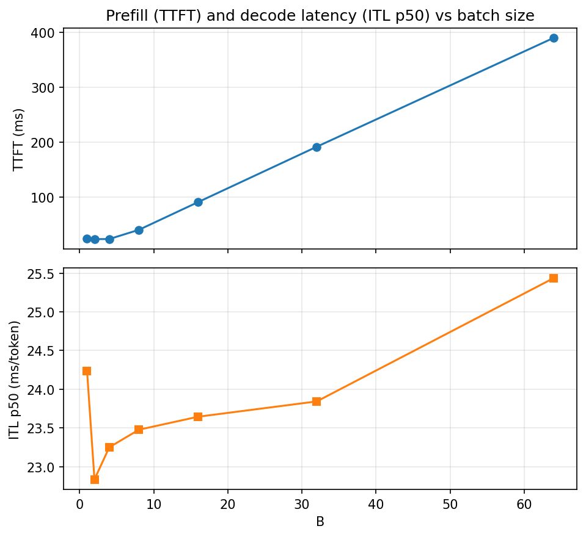

# Stage 3: Static Batching

[Overview](../README.md) | [Full report](../REPORT.md) | [Measured numbers](../RESULTS.md) | [How the code works](code.md)

[`02_static_batching.ipynb`](../02_static_batching.ipynb) tests the Stage 2 prediction that batch-1 decode is overhead-bound and far below the hardware ridge point, so serving several sequences per step should be nearly free, and then measures what static batching costs.

It first makes batching correct (left-padded prompts, per-sequence RoPE positions, an attention mask) and proves it with four gates before any benchmark. Then it runs these experiments:

| # | Section | Question |
| --- | --- | --- |
| 4 | A. Batch-size scaling | How much aggregate throughput does batching buy, and where does the step stop being free? |
| 5 | A2. Roofline revisited | Do the measured points follow the bandwidth roof as arithmetic intensity grows with batch size? |
| 6 | B. Padding waste | How much of a batch is padding when prompt lengths differ? |
| 7 | C. Idle decode slots | How much work goes to requests that already finished, and does the batching gain survive a realistic mix of lengths? |
| 8 | D. The latency hit | How long do short requests wait for the longest request in their batch? |
| 9 | E. KV memory over-allocation | How much of the preallocated KV cache holds real tokens, and what would that mean for a larger model? |

Sections 1 to 3 cover setup, the code and the correctness gates, and sections 10 to 12 save the results, optionally publish them and summarize. Like the Stage 1 & 2 notebook, it is self-contained: its `%%writefile` cells write the whole `minivllm/` and `bench/` packages.

## Results (Stage 3)

All measured values are in [`RESULTS.md`](../RESULTS.md#stage3-setup) (source: [`results/stage3.json`](../results/stage3.json)), measured on the same Tesla T4 and model as Stages 1 & 2. The workload runs in sections 7 and 8 are single passes because they are long, so treat their throughput numbers as having some noise. The idle and padding shares are exact counts and do not.

### 1. Is batching still correct?

Yes. Four gates ran before any benchmark: the default path still matches Hugging Face, a padded batch of very different prompt lengths matches each prompt run alone (logits at fp16 noise level, identical greedy tokens), extra padding does not change the logits, and a negative control without the mask and positions changes the answers by orders of magnitude more. One bug worth remembering: a padding query row with nothing to attend to makes the softmax NaN, and one NaN row poisons the real tokens that read its values. Letting every row attend to at least itself fixes it.

### 2. What does batching buy? Almost everything, almost for free.

Numbers: [Batch-size scaling](../RESULTS.md#stage3-batch-scaling).

Aggregate decode throughput scales almost perfectly linearly with batch size across the whole sweep, while the step time stays essentially flat. Each request therefore keeps nearly the same speed whether it is served alone or with many others. The largest batch tested was `B = 64`, so the knee where the step stops being free was **not reached**. The p99 step latency adds jitter but no trend in the batch size. The cost shows up in TTFT instead: it stays flat while the batch holds only a few hundred prompt tokens (prefill is launch-bound, as in Stage 2, and the flat region matches the one Stage 2 found for a single prompt) and then grows roughly in proportion to the batch as prefill becomes compute-bound.

Numbers: [Batched roofline](../RESULTS.md#stage3-roofline).

Arithmetic intensity grows in proportion to the batch, because the weights are read once for every sequence. The measured points move up the bandwidth roof **parallel to it, at a constant small fraction of it**, the same fraction Stage 2 measured for eager batch-1 decode. So batching uses the headroom but does not close the gap between the measured rate and the roof. That gap is launch overhead, not bandwidth, and it is what `torch.compile` and CUDA graphs attack.

### 3. What does static batching waste?

Numbers: [Padding waste](../RESULTS.md#stage3-padding), [Idle decode slots](../RESULTS.md#stage3-idle-decode), [Goodput vs batch size](../RESULTS.md#stage3-goodput).

- **Padding.** The share of prompt slots that are padding depends on how uneven the prompts are, and on which prompts happen to share a batch. Averaged over many random batches it grows steadily with the spread factor, but any single batch can land well above or below that average, so one measured batch is an example and not a trend. Padding always costs KV-cache memory. It costs time only once prefill is compute-bound, where TTFT grows with the padded size.
- **Idle decode slots.** A batch decodes until its longest request is done, and finished requests keep their slot and keep being computed. With any long requests in the mix, most decode slot-steps are idle. Raw throughput barely changes (the GPU is just as busy) while **goodput**, the tokens people actually asked for, collapses. A few long requests keep entire batches running.
- **The gain does not survive a realistic mix.** With equal request lengths goodput stays close to the ideal linear line. With mixed lengths it bends away from that line already at small batch sizes and then flattens, because a larger batch is more likely to contain a long request, so more slots idle for longer and the padded prompt grows. Both shares rise with the batch size and then level off once every batch contains the longest prompt and a long output.

  
  

 

<!--
| | |
|---|---|
|  |  |
-->

The two kinds of waste share a unit (a share of slots) but not a cost: idle decode slots turn almost one-for-one into lost goodput, while padding costs prefill time and KV memory.

### 4. Who pays? Short requests.

Numbers: [Latency of short requests](../RESULTS.md#stage3-latency).

Static batching returns a batch only when its longest request is done, so a short request is released long after it finished. Two effects pull in opposite directions. With all requests arriving at once, a larger batch clears the queue sooner, which **shortens** every request's total response time. Blocking **lengthens** it: the time a finished short request waits for its batch grows steadily with batch size, until at the largest batch most of a short request's response time is spent finished and waiting. Total response time falls with the batch size and then flattens (it can even tick up at the largest batch, where the whole workload is a single batch), which hides the waiting and is why blocked time is reported separately. The trade is cheap for a while and steepest at the end: past a mid-sized batch, extra goodput costs much more blocking.

### 5. How much preallocated KV is used?

Numbers: [KV memory over-allocation](../RESULTS.md#stage3-kv-memory).

Each batch allocates one rectangle of cache slots sized for its longest prompt and longest output. With mixed lengths, utilization falls as the batch grows and settles at a minority of the allocated bytes, and it is far lower if every slot reserves the model's maximum context, as a server that does not know the output length would. This model is too small for memory to bind. The projection table in `RESULTS.md` (analytic, not measured) shows the same ratio for larger models, where contiguous reservation limits the batch to a handful of sequences while the actual tokens would fit many more. The ratio is the same for every model, because it depends only on the reserved context versus the actual length. What the model changes is whether the absolute count is large enough to matter.

### What this sets up (Stage 3)

Static batching keeps the throughput and charges the waiting to the users, and it reserves cache for lengths nobody uses. Both are scheduling and memory problems, not compute problems, and they are what Stages 4 and 5 remove.

### Other plots (Stage 3)

The plots not embedded above, including the step-latency band, the padding and prefill time of the measured batch, the blocked-time distribution and the KV-utilization plots, are listed, with captions, under [Plots](../RESULTS.md#stage3-plots) in `RESULTS.md`.

## Lessons

- **Batching is nearly free in the overhead-bound regime.** Step time stays flat while aggregate throughput scales almost linearly, so the operator gains a lot and each user loses almost nothing. The cost moves to TTFT.
- **Batching does not fix the overhead gap.** The measured points sit at the same small fraction of the bandwidth roof at every batch size, so the remaining headroom is launch overhead.
- **Length variance, not average length, drives the waste.** A few long requests leave most decode slot-steps idle. Raw throughput looks fine while goodput collapses, so always report both.
- **Static batching trades latency for throughput.** Larger batches clear the queue sooner but make finished short requests wait for the slowest request in their batch.
- **A preallocated KV rectangle is mostly empty** once lengths differ, and much emptier if each slot reserves the maximum context.
- **One measured batch is not a trend.** Padding depends on which prompts happen to share a batch, so a single run can land far from the typical value. Average it over many random batches, show the spread, and label the one batch you actually ran as an example.
- **Masks need care.** A fully masked row gives NaN, and 0 times NaN poisons real tokens. A negative control (run without the mask) proves the mask is doing work.

## Exercises

1. Sort the `mixed` requests by prompt length before batching and see how much padding disappears.
2. Group requests by expected output length and see how much idle-slot waste disappears.
3. Replace `repeat_interleave` with `enable_gqa=True` and re-run the batch-size sweep, since that copy grows with the batch.
4. Prefill long prompts in chunks and see what happens to TTFT.
5. Extend the batch-size sweep beyond 64 to find where the step stops being free.

## How to run it

Open `02_static_batching.ipynb` the same way (Kaggle, GPU T4, Internet on) and run top to bottom. It is self-contained, so it does not need Stages 1 & 2 to have been run first. Set `QUICK = True` for a shorter pass. The publish cell is the same one as above. It publishes results always and code only while this is the newest stage.
