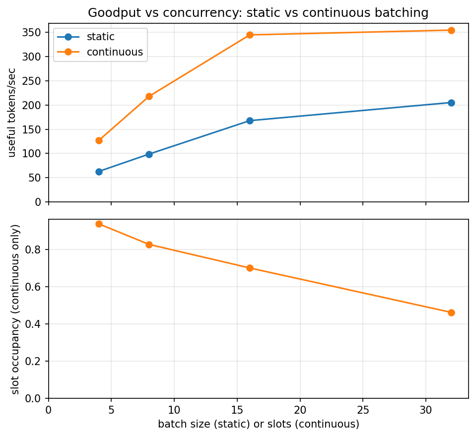
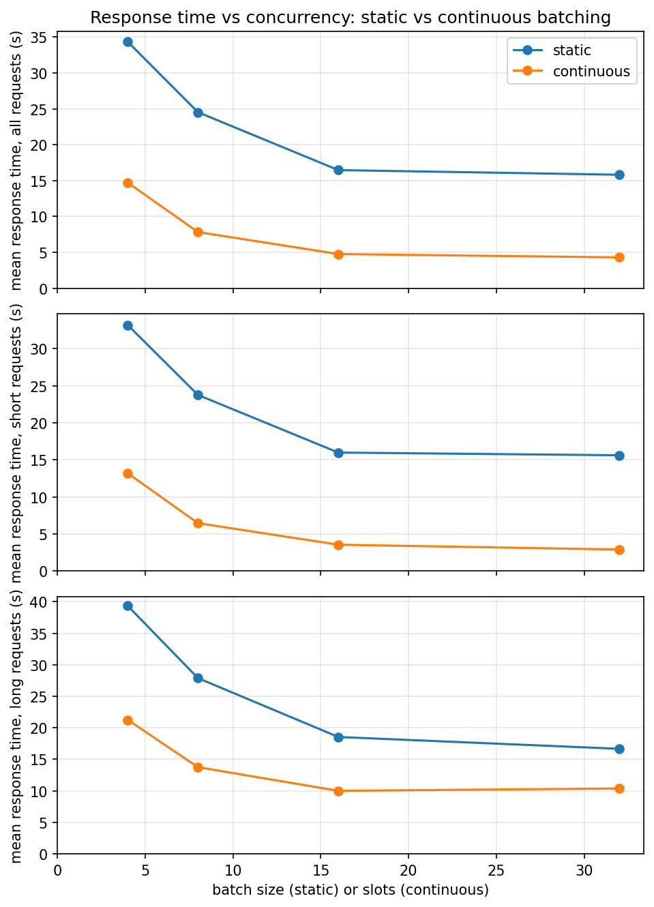
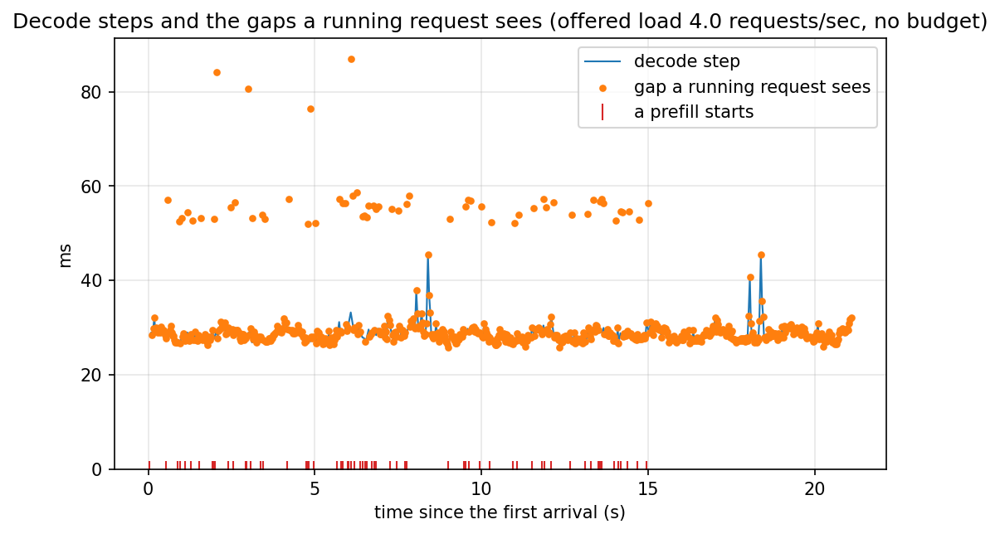
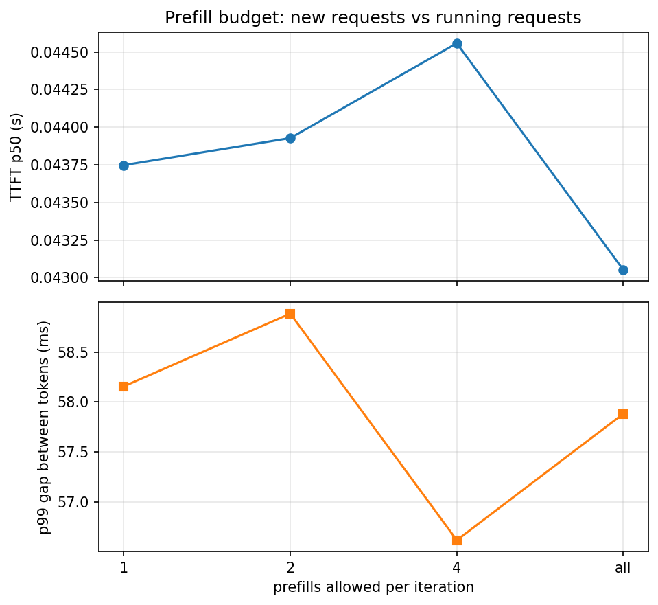
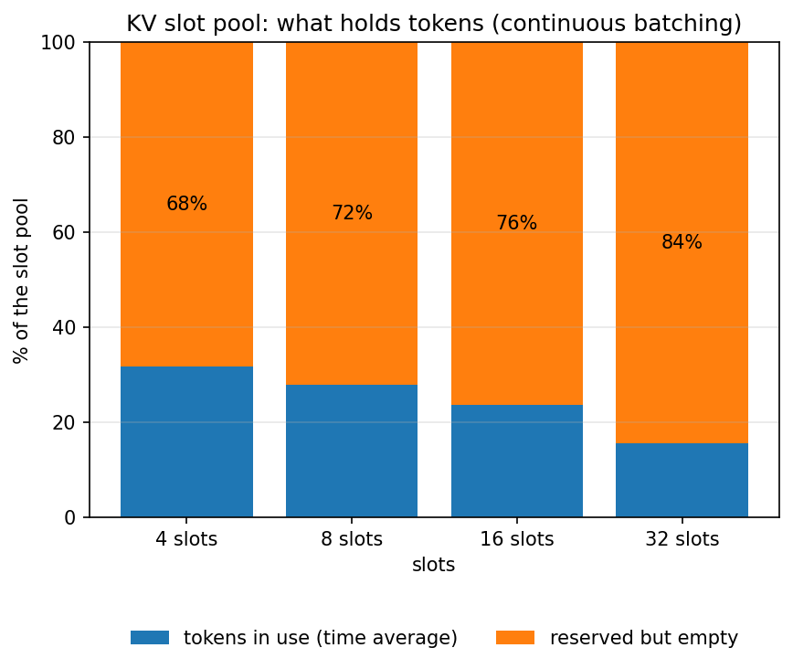

# Stage 4: Continuous Batching

[Overview](../README.md) | [Full report](../REPORT.md) | [Measured numbers](../RESULTS.md) | [How the code works](code.md)

[`03_continuous_batching.ipynb`](../03_continuous_batching.ipynb) answers the question Stage 3 ended with: what if a finished request could leave its slot at once, and a waiting request could take it?

It replaces the one-length-for-everyone KV cache with a pool of slots that each have their own length (`SlotCache`), and the wave-by-wave scheduler with an iteration-level one (`run_continuous`). Every iteration, waiting requests are prefilled into free slots (alone, with no padding), one decode step runs for all slots at their own positions, and a request is released the moment it has produced all its tokens. It proves this correct first: the tokens match running each request alone, even when requests arrive over time and slots are reused, and a negative control shows that the mask hiding a reused slot's stale keys matters. Then it runs these experiments:

| # | Section | Question |
| --- | --- | --- |
| 4 | A. Closed batch | At the same concurrency and with the same requests as Stage 3, how much goodput and response time does continuous batching win back? |
| 5 | B. Open-loop load | With requests arriving over time, where does each policy stop keeping up, and what happens to latency and time to first token on the way? |
| 6 | C. Prefill interference | What does a new request's prefill cost the requests already running, and what does a limit on prefills per iteration trade? |
| 7 | D. KV slot reservation | How much of the slot pool holds tokens, and how many more sequences would a paged cache fit in the same memory? |

Static and continuous batching are compared on the **same** Poisson arrival trace. Both run on a *virtual clock* that advances by the measured GPU time of each step and jumps over idle gaps, so a low-load run takes seconds while the latency stays exact. Like the earlier notebooks it is self-contained: its `%%writefile` cells write the whole `minivllm/` and `bench/` packages.

## Results (Stage 4)

All measured values are in [`RESULTS.md`](../RESULTS.md#stage4-setup) (source: [`results/stage4.json`](../results/stage4.json)), measured on the same Tesla T4 and model as the earlier stages. Every cell of the closed-batch and load sweeps is a single pass over one request set or one arrival trace, so treat the numbers as having some noise, especially in the tails. With only a few dozen requests the response time p99 is simply the slowest request.

### 1. Is continuous batching correct?

Yes. Requests arriving at different times and sharing a few slots, so that slots are freed and reused and sequences sit at different positions in the same decode step, produce exactly the tokens that running each request alone produces. Limiting the prefills per iteration changes only the schedule, not the tokens. A negative control shows why the per-slot mask matters: when a slot is reused by a short sequence, it still holds the keys of its longer previous occupant, and ignoring the mask changes the logits by far more than fp16 noise, while a slot with nothing stale is unaffected.

### 2. What does it win back? About twice the goodput, at a fraction of the response time.

Numbers: [Closed batch](../RESULTS.md#stage4-closed).

At the same concurrency and with the same requests as Stage 3, continuous batching delivers about twice the goodput of static batching up to moderate concurrency, and somewhat less at the largest pool, because it never computes a finished request. Mean response time falls by a factor of two to four, and short requests gain the most: they are released when they are done instead of when the longest request in their batch is, so their blocked time is zero by construction. The gain is not unlimited. Slot occupancy falls as the slot count grows, because a closed batch of this size cannot keep a large pool full, so goodput stops rising once the workload cannot fill the slots.

### 3. What happens under load? Static batching queues early, continuous batching barely queues.

Numbers: [Open-loop load](../RESULTS.md#stage4-load).

With requests arriving over time, static batching already queues at the lowest load tested, because a request that arrives while a batch is running must wait for the whole batch, long requests included. Its median response time and time to first token are several times those of continuous batching at light load, and both climb with every step in the offered load, while its completed rate flattens at a low level well below the offered load: that is its capacity. Continuous batching admits a request as soon as a slot is free, so its median response time and its time to first token stay nearly flat across the sweep, and it only starts to queue at the top of the range. Its completed rate keeps rising to more than twice the level where static batching flattens, and it has not flattened yet, so its capacity is at least that high.

Two caveats for reading the load results. First, the completed-versus-offered plot understates continuous batching's capacity, because a finite trace ends only when the last long request has drained, so the completed rate bends away from the offered load even before the queue forms. The time to first token and the queueing time are the clearer saturation signals. Second, a GPU that is busy all the time is not necessarily saturated under continuous batching: a decode step costs about the same for a few or many live requests (Stage 3), so the GPU can be busy while slots are still free. What saturates a continuous server is its slot count.

### 4. What does a new request cost the others? One more step.

Numbers: [Prefill interference](../RESULTS.md#stage4-prefill-budget).

A new request has to be prefilled before it can decode, and that prefill runs between decode steps, so every request already running waits for it. The median gap a running request sees between two tokens is just the decode step, but the tail gap is about twice that: a decode step plus one prefill. A limit of one prefill per iteration trims the worst gap and costs a little tail time to first token, which is the trade the budget is meant to offer, but at this load the effect is small. Prefills are cheap in this launch-bound regime (about one decode step each, a small share of the GPU time) and rarely is more than one request waiting. The cost grows with longer prompts and heavier load, which is why production servers split long prompts into chunks.

### 5. What is still wasted? The reserved cache.

Numbers: [KV slot reservation](../RESULTS.md#stage4-kv-slots).

Continuous batching fixed the compute waste, but every slot is still a rectangle sized for the longest request the workload can produce. On average only a minority of the slot pool holds tokens, and the share falls as slots are added, since a larger pool is less often full. The waste here is not padding or finished tails but reservation: memory held for tokens that may never exist. A paged cache, which allocates in small blocks as a sequence grows, would fit a few times more sequences in the same memory. That figure is an upper bound, and the one based on the peak use is the more honest. For this small model memory does not bind, but for a model with a large cache per token the reservation caps the slot count at a handful.

### What this sets up (Stage 4)

Continuous batching keeps the batch full, so the next limit is memory: how many sequences fit, and with them the throughput, is capped by the worst-case slot reservation. That is what Stage 5 removes.

### Other plots (Stage 4)

The plots not embedded above, including the completed-versus-offered load plot, are listed, with captions, under [Plots](../RESULTS.md#stage4-plots) in `RESULTS.md`.

## Lessons

- **Continuous batching removes both static-batching costs at once.** It never computes a finished request, so goodput roughly doubles at the same concurrency, and a request is released when it is done, so response times fall by a factor of two to four and blocked time disappears.
- **Under load the difference is queueing.** Static batching makes a new request wait for a whole batch, long requests included, so it queues at light load and its capacity is low. Continuous batching admits at once, so its response and first-token times stay flat until the slots run out.
- **Utilization misleads.** A GPU that is always busy is not saturated while decode steps are cheap and slots are free. Watch the queue and the time to first token instead.
- **A prefill is a decode step you charge to someone else.** It runs between decode steps and delays everyone running, so the tail gap between tokens is a step plus a prefill. A prefill budget and chunked prefill trade that against first-token latency.
- **A short trace has a drain.** A completed rate measured over a finite trace includes the time the last long request takes to finish, so it understates a server's capacity. Judge saturation from the queue, not from that rate.
- **Slots reserve the worst case.** Most of the pool is empty on average, which caps how many sequences fit and is what paged allocation removes.

## Exercises

1. Prefill a long prompt in chunks across several iterations instead of all at once. What happens to the tail gap between tokens, and to the first-token latency of that request?
2. Increase the number of requests and the arrival rate. Does the capacity gap between the two policies grow? When does the drain of a short trace stop mattering?
3. Admit waiting requests shortest-prompt-first instead of first-come-first-served. What does it do to the median and the tail of the time to first token?
4. Combine a prefill budget with chunking. Which of the two moves the tail gap more?
5. Sweep the slot count at a fixed offered load. Where does adding slots stop helping, and what does it cost in reserved cache?

## How to run it

Open `03_continuous_batching.ipynb` the same way (Kaggle, GPU T4, Internet on) and run top to bottom. It is self-contained, so it does not need the earlier notebooks to have been run first. It takes about a quarter of an hour, because the static baseline has to be run under every load level. Set `QUICK = True` for a pass of about five minutes. The publish cell is the same one as above, and as the newest notebook it publishes code as well as results.
