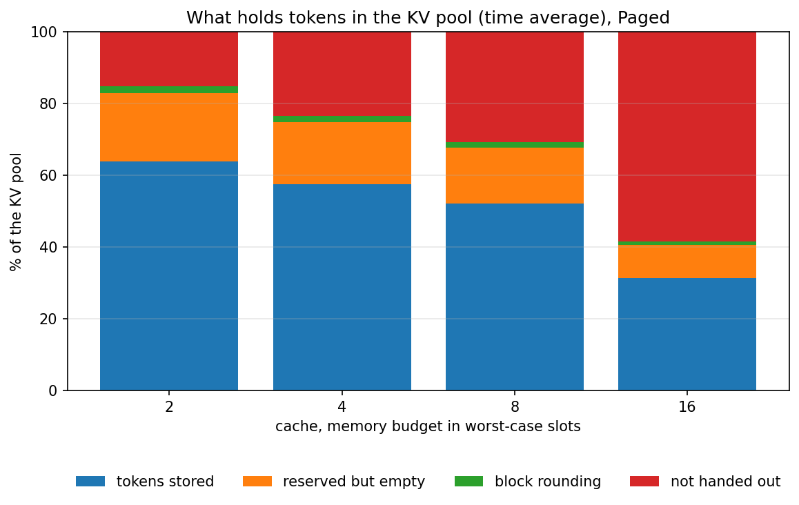
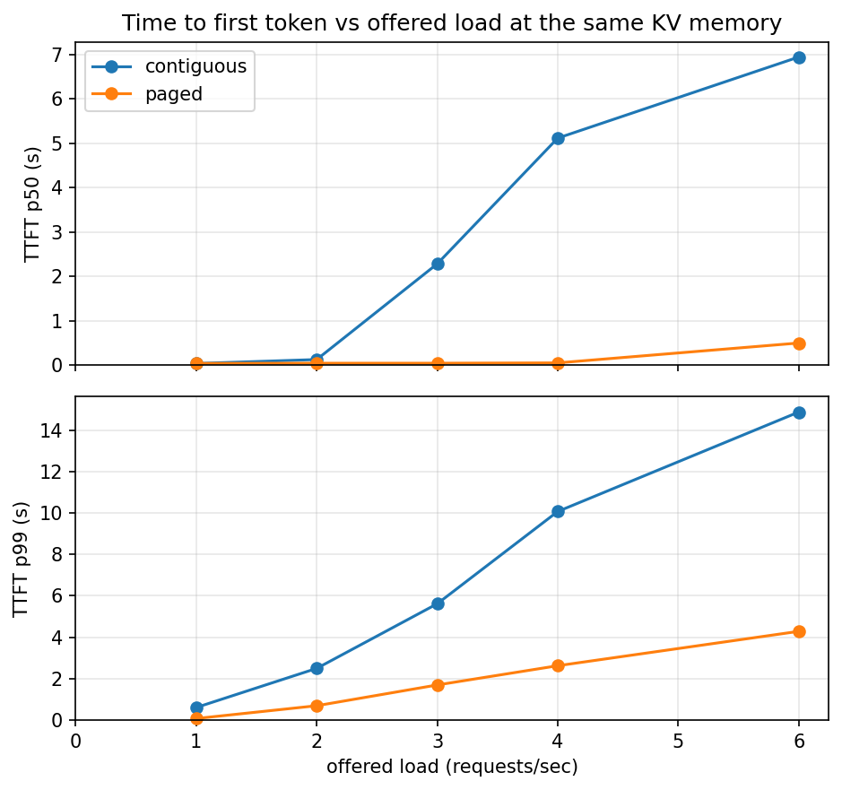
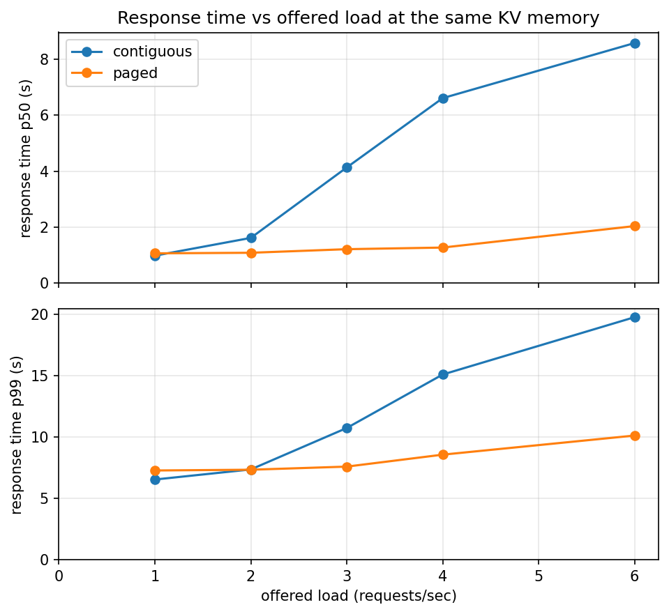

# Stage 5: Paged KV Cache

[Overview](../README.md) | [Full report](../REPORT.md) | [Measured numbers](../RESULTS.md) | [How the code works](code.md)

[`04_paged_kv_cache.ipynb`](../04_paged_kv_cache.ipynb) answers the question Stage 4 ended with: what if a sequence held only the memory its request needs, instead of a rectangle sized for the longest request?

It cuts the KV memory into small fixed-size blocks in one shared pool. A `BlockAllocator` hands blocks out and takes them back, and `PagedCache` gives every sequence a block table, the list of blocks that hold its tokens, so token `t` lives in block `table[t // block_size]` at offset `t % block_size`. A request is admitted when the pool has enough free blocks for all it will store and returns them the moment it finishes, so blocks are recycled and scattered over the pool. Attention gathers a sequence's keys and values through its block table into one dense tensor, then runs the same attention as before (a fused paged-attention kernel would read the blocks in place, which is exercise 2). `run_paged` is `run_continuous` with admission by memory in place of admission by free slot. It proves this correct first: the tokens match running each request alone while requests wait for memory and blocks are recycled, the block size does not change them, and a negative control shows that the mask hiding a recycled block's stale keys matters. Then it runs these experiments:

| # | Section | Question |
| --- | --- | --- |
| 4 | A. Same memory, more sequences | Given the same KV memory as a contiguous cache, how many more sequences run at once, and what does that do to goodput and response time? |
| 5 | B. Where the memory goes | What share of the pool holds tokens in each cache, and what is left over? |
| 6 | C. The price: gather and block size | What does reading the cache through a block table cost, and how does the block size trade waste against speed? |
| 7 | D. Open-loop load at fixed memory | With requests arriving over time and a tight KV budget, where does each cache stop keeping up? |

Both caches always get the **same number of bytes**: a budget is counted in worst-case slots, the memory a contiguous cache needs for that many sequences, and the paged cache gets those bytes as blocks. Like the earlier notebooks it is self-contained: its `%%writefile` cells write the whole `minivllm/` and `bench/` packages.

## Results (Stage 5)

All measured values are in [`RESULTS.md`](../RESULTS.md#stage5-setup) (source: [`results/stage5.json`](../results/stage5.json)), measured on the same Tesla T4 and model as the earlier stages. Both caches always get the same number of bytes, and every cell of the sweeps is a single pass over one request set or one arrival trace, so treat the numbers as having some noise, especially in the tails. With only a few dozen requests the response time p99 is simply the slowest request.

### 1. Is paging correct?

Yes. Requests arriving at different times, in a pool so small that requests have to wait for memory and blocks are recycled and scattered, produce exactly the tokens that running each request alone produces, for several block sizes. A negative control shows why the per-sequence mask matters: when a block is recycled, it still holds the keys of its previous owner, and ignoring the mask changes the logits by far more than fp16 noise, while a sequence on fresh blocks is unaffected.

### 2. What does it buy at the same memory? About twice the sequences, so more goodput, until memory stops binding.

Numbers: [Same memory](../RESULTS.md#stage5-memory).

A contiguous slot reserves the worst case, so a fixed amount of memory holds only as many sequences as it has slots, however short they are. A paged sequence holds only what its request needs, so the same bytes hold about twice as many of the typical request: the paged cache runs about as many sequences at once as a contiguous cache with twice the memory. More sequences in each decode step means each weight read serves more tokens (Stage 3's lesson), so goodput rises by more than a third while memory is the limit, mean response time falls by well over a third, and time to first token falls even more, because requests no longer wait for a slot. The gain is not unlimited. When memory is plentiful nothing waits for it any more, the caches run nearly the same number of sequences, and the gap closes.

### 3. Where does the memory go? Mostly into tokens, with a small rounding term and some stranded by the queue.

Numbers: [Where the KV memory goes](../RESULTS.md#stage5-kv-breakdown).

Only a minority of the contiguous pool holds tokens, and the share falls as slots are added. In the paged pool a much larger share holds tokens at every budget. What remains is memory reserved for tokens still to come (a request is given all its blocks when it is admitted), the rounding of each sequence's last block, which is a small share of the pool, and memory that is not handed out. Some of that last part is unavoidable slack at a large budget, where the workload cannot use it. But even at the tightest budget some memory is not handed out while requests wait: the first request in line does not fit in the free blocks, and strict first come, first served keeps the smaller requests behind it waiting (exercise 5). Reserving lazily, one block at a time, would shrink the reserved-but-empty part, at the price of preempting a sequence when the pool runs dry (exercise 1).

<!--  -->

<!-- 

  
  

 -->

### 4. What does it cost? A slightly slower step, and waste that grows with the block size.

Numbers: [The gather and the block size](../RESULTS.md#stage5-block-size).

Attention now reads its keys and values through a block table. Here that means gathering the blocks of every running sequence into a dense tensor before the ordinary attention, which costs a copy and a few more kernel launches per layer, so the decode step is a little slower than the contiguous one at the same concurrency. A fused paged-attention kernel, which reads the blocks in place, would not pay for the copy (exercise 2). In this implementation the step time does not depend on the block size over the range tested, so the block size only trades waste: the unused tail of each sequence's last block grows with the block size, from negligible at small blocks to a large share of the memory at the largest. This experiment cannot show what makes very small blocks costly in a real kernel (a longer block table and less efficient memory access), so it is the waste side of the trade only.

### 5. What happens under load? The contiguous cache queues early, the paged cache keeps admitting.

Numbers: [Open-loop load at fixed memory](../RESULTS.md#stage5-load).

With the same small KV memory and requests arriving over time, the two caches look alike at light load. As the rate rises, the contiguous cache runs out of slots long before memory is used, so requests queue, its time to first token climbs, and its completed rate flattens well below the offered load: that is its capacity at this memory. The paged cache keeps admitting while there are free blocks, so it runs more sequences, completes more requests, and its time to first token stays low where the contiguous cache's climbs. Its completed rate is still rising at the top of the sweep, so its capacity is at least that high. It too would saturate, when memory or the cap on running sequences runs out, and the share of steps in which memory held a request back shows when that starts. The caveat from Stage 4 applies: the completed rate of a finite trace understates capacity, so judge saturation from the time to first token and the queueing time.

### What this sets up (Stage 5)

The engine now uses its KV memory well and keeps the batch full, so what is left is the cost of each step: every decode step still reads all the weights, and the gather is a copy that a better kernel would avoid. Stage 6 attacks it with speculative decoding: guess several tokens, check them all in one pass, and keep the ones the model agrees with, so one weight read can yield several tokens.

### Other plots (Stage 5)

The plots not embedded above, including the two single-cache versions of the memory breakdown and the completed-versus-offered load plot, are listed, with captions, under [Plots](../RESULTS.md#stage5-plots) in `RESULTS.md`.

## Lessons

- **Reserving the worst case caps concurrency, and concurrency caps goodput.** A contiguous slot holds memory for the longest request whatever it needs, so a fixed amount of memory runs few sequences. Handing memory out in small blocks as a request needs it fits about twice as many sequences in the same bytes, and goodput follows while memory is the limit.
- **Once memory stops binding, paging has nothing left to win.** At a large budget the two caches run nearly the same number of sequences and the gap closes. Paging is a way to spend scarce memory, not a speedup in itself.
- **A block table is an indirection, and indirection has a price.** Reading through it here means a copy of the keys and values per layer per step, a slightly slower decode step. The idea (allocate by block) is separate from the implementation (gather, or a kernel that reads blocks in place).
- **The block size trades waste against bookkeeping.** The unused tail of the last block grows with the block size. What small blocks cost, a longer table and less efficient access, belongs to the kernel, so a real system picks a block of a few tens of tokens.
- **First come, first served can strand memory.** While the head of the queue waits for blocks that are not free, smaller requests behind it wait too, and free blocks stay unused.
- **Reserving a whole request up front still wastes some memory.** A request holds blocks for tokens it has not generated yet. Allocating lazily recovers that, at the price of preempting a sequence when the pool runs dry.

## Exercises

1. Allocate lazily: reserve only the blocks a sequence has filled and add one when it needs one. When the pool runs dry, preempt the newest sequence by freeing its blocks and prefilling it again later. How much more memory does this save, and what happens to the tail latency of preempted requests?
2. Time a decode step that gathers through the block table against one that reads a pre-gathered dense tensor, to see how much of the paged step is the copy. Then write the attention so it reads the blocks in place and compare.
3. Share a prefix: give two requests with the same prompt the same prompt blocks, with a reference count, and copy a block only when one sequence writes into it. How much memory does a batch with a long shared system prompt save?
4. Sweep the block size at a tight memory budget, with short requests and again with long ones. Where does the best block size move?
5. Admit the first waiting request that fits instead of strict first come, first served. What does it do to throughput, and to the tail latency of the large request that keeps being passed over?

## How to run it

Open `04_paged_kv_cache.ipynb` the same way (Kaggle, GPU T4, Internet on) and run top to bottom. It is self-contained, so it does not need the earlier notebooks to have been run first. It takes about a quarter of an hour. Set `QUICK = True` for a pass of about five minutes. The publish cell is the same one as above, and as the newest notebook it publishes code as well as results.
