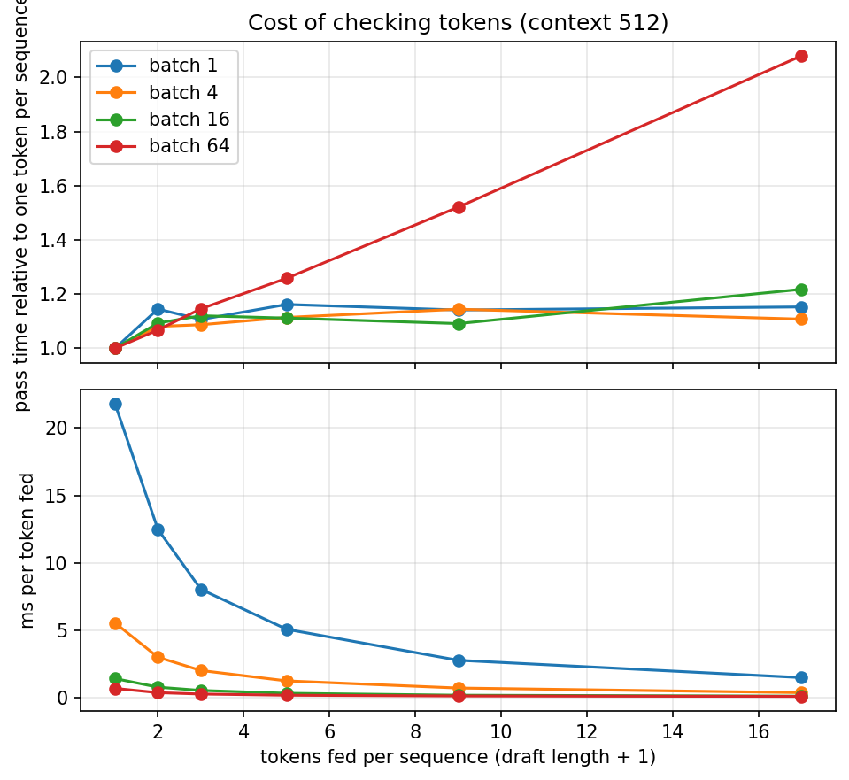
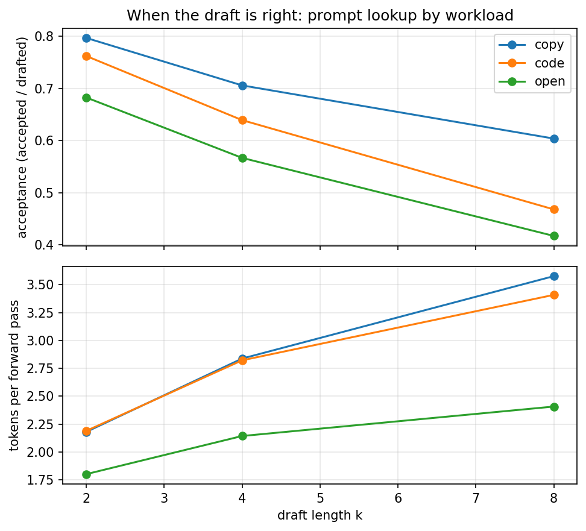
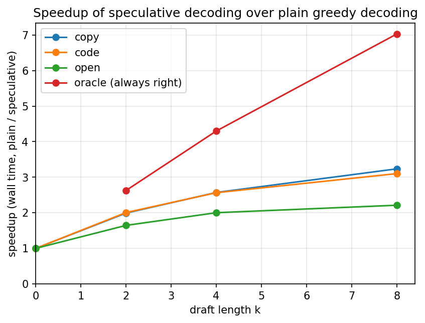
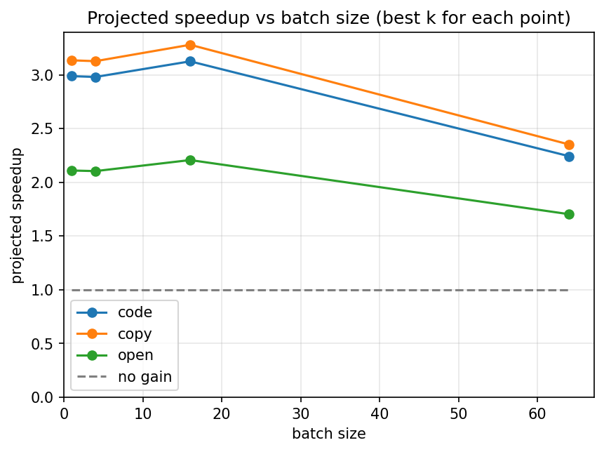

# Stage 6: N-gram Speculation

[Overview](../README.md) | [Full report](../REPORT.md) | [Measured numbers](../RESULTS.md) | [How the code works](code.md)

[`05_ngram_speculation.ipynb`](../05_ngram_speculation.ipynb) answers the question Stage 5 ended with: a decode step still reads all the weights to produce one token per sequence, so what if one step could produce several?

A decode step on this GPU is launch-bound, so feeding it a few more tokens costs almost nothing. Speculative decoding spends that slack. A draft guesses the next `k` tokens, one forward pass feeds the last token and the whole draft together and reads the model's own choice after each, and the longest prefix of the draft that agrees with the model is kept, plus one bonus token. Every kept token is the model's own greedy choice, so the output is the same as plain greedy decoding, only in fewer passes. The draft here is **prompt lookup**: find where the last few tokens occurred earlier in the context and propose what followed them. It needs no second model, and it works when the output repeats the input. Checking the draft needs two small changes: `model.forward` can return the logits of every position and accept several tokens on a non-empty cache when given an explicit mask, and `KVCache.truncate` rolls the cache back over the rejected tokens. The notebook proves this correct first: the output equals plain greedy decoding for several draft lengths on real prompts, a negative control shows that skipping the rollback breaks the output, and two artificial drafts (always wrong, always right) show the extremes. Then it runs these experiments:

| # | Section | Question |
| --- | --- | --- |
| 4 | A. Why checking is cheap | How does the time of a forward pass grow when each sequence feeds more tokens, and at which batch size do the extra tokens stop being free? |
| 5 | B. When guessing works | How often is the draft right on text that copies its input, on repetitive code, and on open-ended writing? |
| 6 | C. The speedup | How much faster is it, how close is that to what the two measurements above predict, and what is the ceiling with a perfect draft? |
| 7 | D. Under batching | What happens to the gain when many sequences share each pass? (A projection from sections 4 and 5, not an end-to-end measurement.) |

Like the earlier notebooks it is self-contained: its `%%writefile` cells write the whole `minivllm/` and `bench/` packages. Weight quantization, the other direction considered for this stage, is left for the standalone engine on a bigger GPU, where decode is limited by reading the weights and not by launching kernels. Replacing the lookup with a small draft model is the next stage.

## Results (Stage 6)

All measured values are in [`RESULTS.md`](../RESULTS.md#stage6-setup) (source: [`results/stage6.json`](../results/stage6.json)), measured on the same Tesla T4 and model as the earlier stages. Every cell is a single pass over a handful of prompts (four per workload), so treat the numbers as having some noise. The batching section is a projection, not a measurement.

### 1. Is speculative decoding correct?

Yes. For prompts of all three kinds and several draft lengths, the generated tokens match plain greedy decoding over the compared prefix. A negative control shows why the cache rollback matters: without it the output goes wrong at the first rejected draft. Two artificial drafts show the extremes: one that is always wrong gives one token per pass and the plain output, and one that is always right (an oracle that already knows the answer) gives the maximum number of tokens per pass and the plain output. Over the full generation length a few outputs differ from plain greedy after many identical tokens. That is what an fp16 near-tie would look like, since a checking pass has a different matrix shape from a one-token step, but the notebook counts these outputs and does not locate where they diverge, so the cause is an inference.

### 2. Why is checking cheap? Because a decode step is launch-bound, until the batch gets large.

Numbers: [Cost of checking tokens](../RESULTS.md#stage6-verify-cost).

At small batch sizes a pass that feeds several tokens per sequence costs only a little more than the one-token step, and the extra cost is about the same whether a few tokens or many are fed: a small, roughly fixed price appears as soon as more than one token is fed and then barely grows. The time per token fed therefore falls almost in proportion to the tokens fed. At a large batch the picture changes. The step is already heavier, and feeding many tokens per sequence makes it grow with the tokens in flight, so the extra tokens stop being free. This is the same wall Stage 3 met when it grew the batch, seen from the other side.

### 3. When is a guess right? When the output repeats what is already in the context, which is more often than expected.

Numbers: [Plain vs speculative decoding](../RESULTS.md#stage6-speculative).

Prompt lookup proposes what followed an earlier occurrence of the last few tokens. When the model copies a passage, or continues repetitive code, the draft is found and right most of the time, so one pass yields several tokens. Acceptance falls as the draft gets longer, because a long draft is only accepted up to its first wrong token, but tokens per pass still rise with the draft length. Open-ended writing also gains, less than copying, which was not what we expected: the draft is found in about half of the passes and is right more than half the time. A likely reason is that the lookup searches the whole context, including the model's own output, and greedy decoding from a small model tends to repeat itself, so even free-form text offers matches. The notebook does not measure this, so treat it as a hypothesis, and expect the gain on open-ended text to depend on the model and on greedy decoding.

### 4. How much does it buy? About two to three times on repetitive text, close to what the passes predict.

Numbers: [Plain vs speculative decoding](../RESULTS.md#stage6-speculative), [The ceiling](../RESULTS.md#stage6-oracle).

The speedup follows from two measurements: tokens per pass, and how much more a checking pass costs than a plain step. Their product is within a few percent of the measured speedup, so almost nothing is lost outside the forward passes. Copying and repetitive code come out about two to three times faster than plain decoding, and the speedup is still rising at the longest draft tried, with diminishing returns as acceptance falls, so the best draft length was not found within the range. The ceiling run shows where the limit is: a draft that is always right would do much better at every length, so the limit is the quality of the draft, not the cost of checking it.

### 5. What happens under batching? The gain erodes for long drafts but stays above one, in a projection.

Numbers: [Projection to batching](../RESULTS.md#stage6-projection).

We did not build batched speculation, because every sequence accepts a different number of tokens and the batch becomes ragged. Instead the notebook combines the two measurements it has: tokens per pass from the single-sequence runs, divided by the cost of a checking pass at each batch size. The projection assumes every sequence behaves like the one measured and ignores drafting time, so it overstates the real gain and is useful for its trend. The projected gain is largest at small batch and erodes at the largest batch tried, mostly for the long drafts, whose checking pass costs the most there, but it stays above one throughout the range. Beyond that range, and in a real server, speculation and batching compete for the same spare capacity: a busy server already fills each pass with many sequences, which is the other way to spend idle compute. That makes speculation mainly a latency tool for lightly loaded servers.

### What this sets up (Stage 6)

Prompt lookup can only repeat what is already in the context. The next stage keeps the checking pass exactly as it is and plugs in a small draft model, so the guesses can be new text, and compares the two guessers head to head on the same prompts.

### Other plots (Stage 6)

All plots are listed, with captions, under [Plots](../RESULTS.md#stage6-plots) in `RESULTS.md`.

## Lessons

- **Speculation spends idle compute.** A launch-bound decode step costs about the same for one token as for several, so checking a draft of several tokens in one pass is almost free, and every accepted token is a pass saved.
- **Exactness comes from checking with the model's own choices.** Every token kept is the model's greedy choice computed from the true prefix, so the output equals plain decoding. The cache rollback is what keeps that true after a rejection.
- **A guess is only as good as its source.** Prompt lookup is free but can only repeat the context. A draft model can guess new text, at the price of running that model, and has to be much cheaper than the big one to pay.
- **Gains depend on the text, and on the model.** Copying and repetitive code gain the most. Free-form text gained less but still gained, probably because a small greedy model repeats itself. Measure on the workload you care about.
- **The gain erodes as the batch grows.** Extra tokens stop being free when many sequences share a pass, and a busy server already uses its spare compute. Speculation is a latency tool for light load.

## Exercises

1. Use `Qwen/Qwen2.5-0.5B` to draft for larger models of the same family and measure how cheap the draft has to be for speculation to win. This is now the next stage, [`06_draft_model_speculation.ipynb`](../06_draft_model_speculation.ipynb).
2. Run speculative decoding inside the continuous or paged scheduler. Each sequence accepts a different number of tokens per pass, so the batch is ragged. What has to change in the decode view and the mask, and how does the measured gain compare with the projection?
3. Speculative sampling (accepting a draft token with probability `min(1, p_target / p_draft)`) needs the draft's probabilities, which an n-gram lookup does not have, so it moved to the next stage.
4. Propose the continuations of the two most recent matches and check both in one pass with a tree-shaped mask. When does it beat a single, longer draft?
5. Sweep the n-gram lengths of the lookup. Does requiring a longer match raise the acceptance, and at what cost in how often a draft is found?

## How to run it

Open `05_ngram_speculation.ipynb` the same way (Kaggle, GPU T4, Internet on) and run top to bottom. It is self-contained, so it does not need the earlier notebooks to have been run first. It takes about ten minutes. Set `QUICK = True` for a pass of about four minutes. The publish cell is the same one as above, and as the newest notebook it publishes code as well as results.
