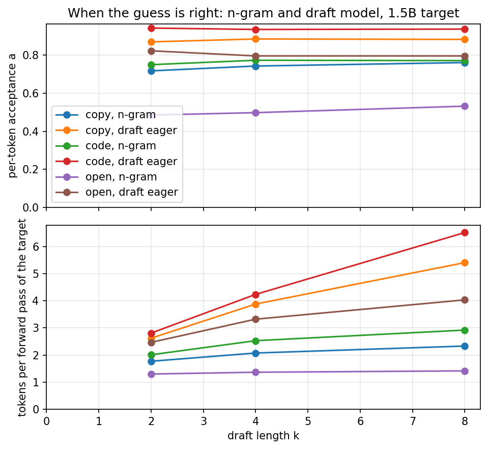
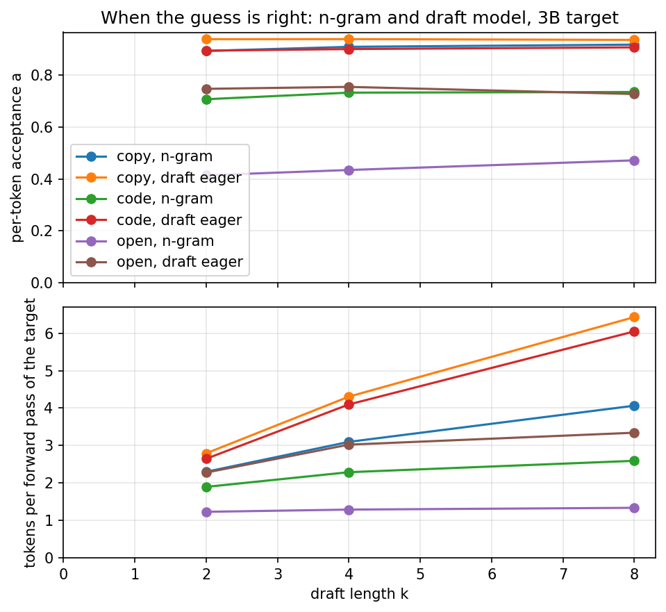
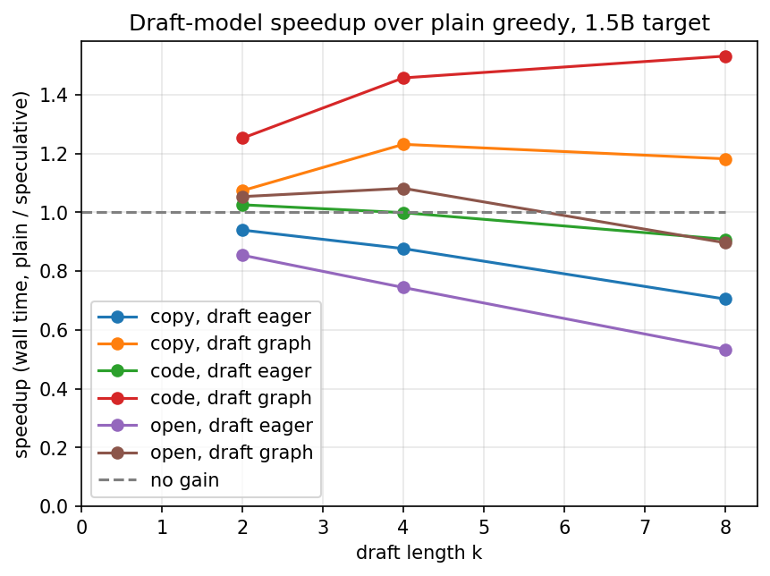
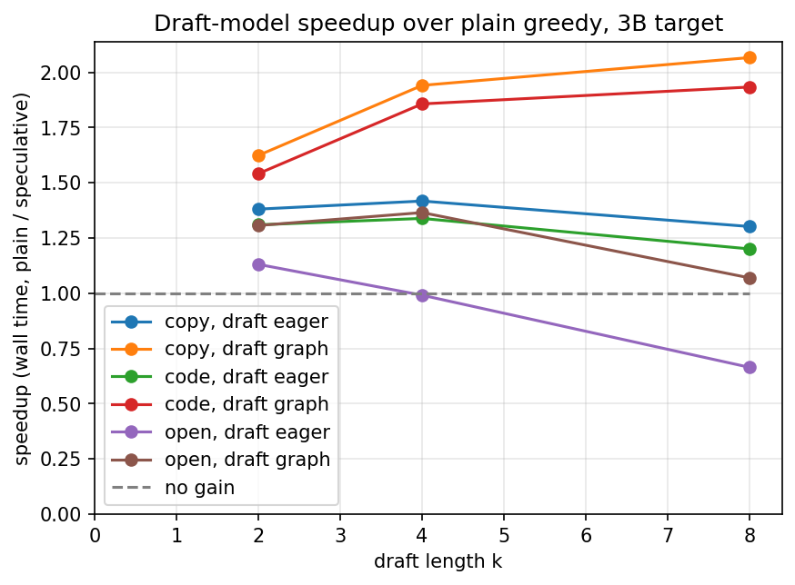
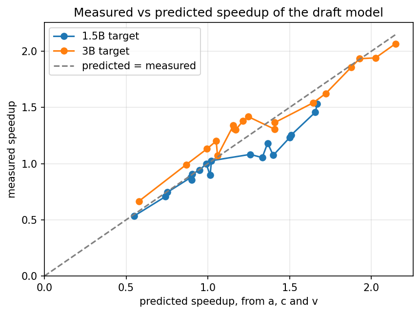
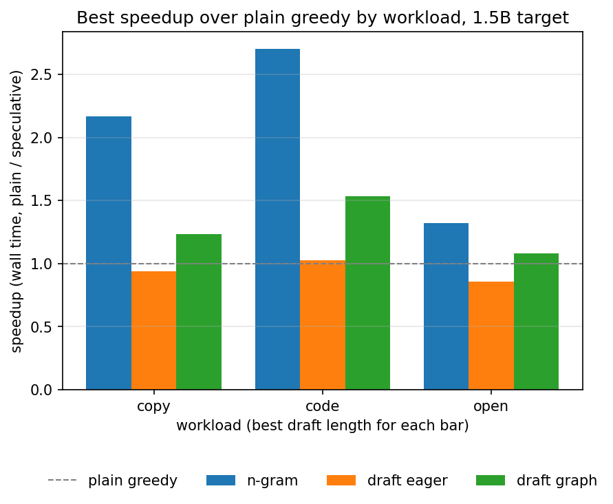
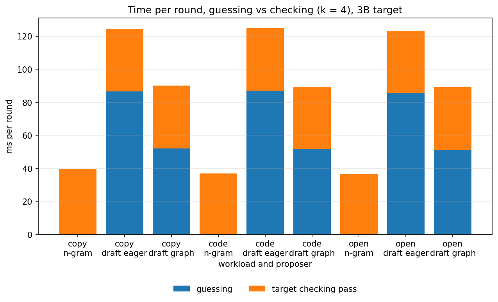
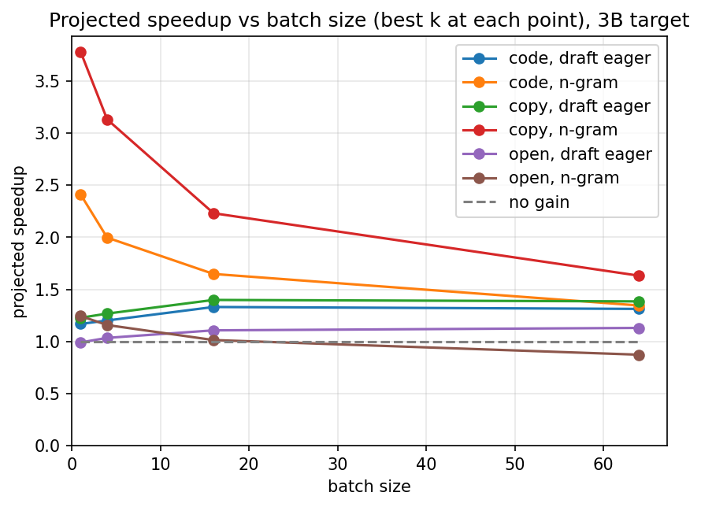

# Stage 7: Draft-Model Speculation

[Overview](../README.md) | [Full report](../REPORT.md) | [Measured numbers](../RESULTS.md) | [How the code works](code.md)

[`06_draft_model_speculation.ipynb`](../06_draft_model_speculation.ipynb) takes the checking pass of Stage 6 and replaces its guesser. Prompt lookup is free but can only repeat what is already in the context. A **draft model**, a small model of the same family, guesses new text by ordinary greedy decoding, and a larger model checks the guesses in one pass. The checker `generate_speculative` is not edited: a draft model is just another `proposer(context, k) -> list of token ids`, the interface `PromptLookup` already has. The pair is `Qwen/Qwen2.5-0.5B` as the draft and `Qwen/Qwen2.5-1.5B` and `Qwen/Qwen2.5-3B` as the targets: one family and one tokenizer, and each target fits on a 16 GB T4 next to the draft.

A draft model changes the question from "is the guess right" to "is the guess worth its price". One round with `k` guesses costs `k` draft steps plus one checking pass, so the notebook starts from a cost model and writes it down before it measures anything:

```text
tokens per round  =  (1 - a^(k+1)) / (1 - a)       a = per-token acceptance rate of the draft
cost per round    =  k * c + v                     in plain target steps:  c = draft step time / target step time,
                                                   v = cost of the checking pass over a plain step (near one while launch-bound)
speedup           =  tokens per round / cost per round
```

The same acceptance rate can mean a win or a loss depending only on `c`. If a decode step were limited by reading the weights, `c` would follow the parameter ratio and be small. But decode on this GPU is overhead-bound (Stages 2 and 3): a step costs about its number of kernel launches, which grows with the number of layers and not with the number of parameters, so `c` may be close to one even though the draft has far fewer parameters. The notebook therefore opens with a **go/no-go gate**: it measures `c` and `a` first, says plainly if the draft model cannot pay, and carries on measuring either way, because a "no" is a result. The fix it tests is a **CUDA graph** over the draft's single-token step, which replays the whole step with one launch.

`DraftModel` (in `minivllm/draft.py`) keeps its own KV cache and **syncs** it every round. The context has grown by the guesses the target accepted and one token of its own, so the draft truncates its cache to the longest prefix it shares with the new context (keeping the keys of accepted guesses, dropping the rest), feeds the few tokens the cache does not have, and guesses `k` tokens greedily. A call therefore costs exactly `k` draft forward passes and never a prefill. It runs in three modes: eager (an ordinary cache), static (a fixed-shape `StaticKVCache` run eagerly, to tell the cost of fixed shapes from the benefit of the graph) and graph (the static step captured once with `torch.cuda.graph` and replayed; if capture is not possible it falls back to the static path and records why).

The notebook proves the result correct before it measures anything: both models still match Hugging Face, a draft's proposals after any pattern of accepted and rejected guesses equal its own greedy decode, and speculative output equals plain greedy decoding of the target for the n-gram proposer and for the draft in every mode. Three controls show what each part is for. A draft that skips its own rollback only **loses acceptance**: its output is still identical, because the target checks every token, so a broken proposer can waste time but not change the result. A *target* that skips its rollback does break the output, as in Stage 6, once a guess has been rejected (when every guess is accepted there is nothing to roll back). And a draft that is the target itself is accepted every time and yields `k + 1` tokens per round, the ceiling of the method. Then it runs these experiments:

| # | Section | Question |
| --- | --- | --- |
| 1 | The go/no-go gate | What is `c`, the draft step cost over the target step cost, in eager, static-shape and CUDA-graph form, and how does it compare with the weight ratio and the layer ratio? What is `a` on open-ended text? Does the cost model predict a win? |
| 2 | The proposer | How does `DraftModel` keep its cache in step with a context the target keeps rewriting? |
| 3 | Correctness | Is the output still exactly plain greedy decoding, and do the negative controls break what they should? |
| 4 | Acceptance | How often is the draft right, by workload and draft length, for each of the two targets, next to the n-gram proposer rerun in the same session? |
| 5 | Speedup | How close is the measured speedup to the cost model, what did the CUDA graph change, and what does the Stage 6 projection method say about larger batches? |
| 6 | Head to head | Which proposer wins on which workload, at its best draft length, and where does a round spend its time, guessing or checking? |

Like the earlier notebooks it is self-contained: its `%%writefile` cells write the whole `minivllm/` and `bench/` packages. The two targets are loaded one after the other, so only one is in memory with the draft at a time. The CUDA-graph path can only run on a GPU, so on a machine without one the draft falls back to the static path and the unit tests exercise that twin; the notebook reports whether capture worked.

## Results (Stage 7)

All measured values are in [`RESULTS.md`](../RESULTS.md#stage7-setup) (source: [`results/stage7.json`](../results/stage7.json)), measured on a Tesla T4 with `Qwen/Qwen2.5-0.5B` as the draft and `Qwen/Qwen2.5-1.5B` and `Qwen/Qwen2.5-3B` as the targets, four prompts per workload and 128 generated tokens per prompt. Every cell is a single pass, so treat the numbers as having some noise. The CUDA graph was captured successfully on this GPU. The batching section is a projection, not a measurement.

**One caveat: the plain baseline is timed once.** Every speedup divides by it, so one slow baseline run inflates every speedup in its row, and it varies between runs. Across three runs of this notebook (the first two are in the git history) the 3B `copy` baseline differed by about a quarter between the first run and the reruns, and with it the headline 3B `copy` n-gram speedup. The 3B baselines also sat above the 3B micro-benchmark step in all three runs, by a few percent to about a half, for a reason the notebook does not locate, while the 1.5B baselines did not. So read a single speedup against the 3B baseline as good to about a quarter. The cost ratios, the ratios between proposers inside one workload and target (which share the baseline) and the projections moved much less between runs, and the claims below are written to depend only on those. Timing the baseline several times is in the exercises.

### 1. Is draft-model speculation correct? Yes, and each control shows what its rollback is for.

Both models still match Hugging Face. A `DraftModel` proposes its own greedy continuation after any pattern of accepted and rejected guesses, in all three modes, with a few guesses differing (probably fp16 near-ties in the masked static path, which the notebook does not locate). Speculative output equals plain greedy decoding at every draft length, for the n-gram proposer and for the draft model in every mode. Over full-length runs most outputs are identical and the rest differ late in the generation, which is what an fp16 near-tie would look like but is an inference here, as in Stage 6.

Three controls, measured in the notebook and not stored in the results file, show what each part is for. A draft that skips its own rollback keeps its guesses worse (its acceptance and its tokens per round roughly halve) but the output stays identical, because the target checks every token: a broken proposer can waste time and cannot change the result. The *target* skipping its rollback does break the output, as soon as a guess has been rejected: every output broke with the draft model on open text, and every workload broke with a proposer that is always wrong. A first version of this control used a good draft on a copy prompt and showed nothing, because no guess was rejected and a round that accepts everything keeps everything it fed. It now guarantees rejections. And a draft that is the target itself is accepted every time and reaches the maximum tokens per round for the generation length.

### 2. What does a draft step cost? Nearly as much as a target step, until it is captured in a CUDA graph.

Numbers: [Cost of a draft step](../RESULTS.md#stage7-cost), [The go/no-go gate](../RESULTS.md#stage7-gate).

The draft has about a third of the 1.5B target's weights and about a sixth of the 3B target's, but most of the 1.5B target's layers and two thirds of the 3B target's, and an eager draft step costs about its share of the layers and not of the weights. That is the launch-bound picture of Stages 2 and 3 from the other side: a smaller model is not a proportionally cheaper step, because the step is paid for in kernel launches. Run over a fixed-shape cache, still eagerly, the step costs only slightly more, so the fixed shapes a graph needs are almost free. Replaying the step from a CUDA graph removes most of the launch cost: the draft step takes about half the time or less, and the cost ratio `c` falls from near the layers ratio to much nearer the weights ratio.

The gate turned on exactly this. At the measured acceptance on open text, the cost model predicts a slowdown for the eager draft and a gain for the graph draft, so the same draft is a no-go in one mode and a go in the other, and the rest of the run measured how far reality sits from that prediction.


### 3. Is the draft right? More often than the n-gram lookup on every workload, and about as often at every draft length.

Numbers: [Plain vs n-gram vs draft model](../RESULTS.md#stage7-sweep).

The per-token acceptance rate of the draft model is higher than the n-gram lookup's on every workload and for both targets, and the gap is widest on open-ended text, where the lookup has least to copy from. The draft is also accepted often on text that copies its input and on repetitive code, since copying is easy for a small model. The acceptance rate barely moves as the draft gets longer, which is what the independence assumption of the cost model needs, and the tokens per round that the closed form predicts match the measured tokens per pass closely for the draft model. For the n-gram lookup the closed form is optimistic: it often proposes fewer than `k` tokens, or none, so a round does not have a fixed length.




### 4. What does the speedup follow? The cost model, once it is given what a round really pays.

Numbers: [Plain vs n-gram vs draft model](../RESULTS.md#stage7-sweep), [Cost of a draft step](../RESULTS.md#stage7-cost).

The eager draft model slows decoding down for the 1.5B target at the longest draft on every workload, because each extra guess costs nearly a full target step and a longer draft buys fewer new tokens per guess. With the 3B target the cost ratio is lower and the eager draft does better, but the 3B baselines are the noisiest, so the projection at batch size one, which does not use the plain baseline, is the safer read: at most a modest gain on repetitive text and about none on open text. The graph draft is faster than the eager draft at every draft length, workload and target, and its best draft length is longer than the eager draft's.

The cost model fed with the micro-benchmark `c` is accurate for the eager draft and **overstates** the gain of the graph draft. The reason is visible in the guess times: a round's guess time is one eager step plus one graph step for each further guess, to within about a tenth at every draft length and target. The first guess of a round feeds the new tokens (the bonus token, and sometimes the last accepted guess) through an ordinary pass, which the graph does not cover, so the cost per guess seen during the run is higher than the cost of a replayed step. Given the cost per guess actually seen in the run, the cost model predicts the draft model's speedup to within about a quarter on every row, and much closer on most. The next lever is therefore the first guess of each round, not the replayed steps.

The prediction written before the run also said the eager gate would be a no-go and the graph a go; with the 1.5B target the measured speedups on open text agree in sign, and the graph's gain is smaller than the gate's prediction for the reason above.





### 5. Who wins? The n-gram lookup, on every workload and both targets, though the gap closes on open text with the larger target.

Numbers: [Head to head](../RESULTS.md#stage7-head-to-head).

The prediction written before the run was that the n-gram lookup would win on text that copies its input and the draft model on ordinary prose. Half of it held. The n-gram lookup wins `copy` and `code` clearly with both targets. On open-ended text it also still wins: clearly with the 1.5B target and narrowly with the 3B target, where the graph draft comes within a small margin. Stage 6 had already found that the lookup gains on open text too, probably because it also searches the model's own output and a small greedy model repeats itself. So the draft model is the better *guesser* everywhere, and still loses on this GPU at batch size one, because its guesses are not free: the time split shows the draft's guessing slice comparable to or taller than the target's checking pass, while the lookup's slice is negligible. To pay, a draft model would need a much cheaper step or a much larger target. The n-gram speedup is still rising at the longest draft length on every workload, so its best draft length was not found within the range.





### 6. What happens under batching? The n-gram gain erodes and the draft model's holds up, in a projection.

Numbers: [Projection to batching](../RESULTS.md#stage7-projection), [Cost of checking tokens and of a draft step by batch size](../RESULTS.md#stage7-verify-cost).

The prediction written before the run was the opposite for the draft model: that it would erode faster, because each of its guesses is a full step that gets heavier with the batch. What the measured step times show is that the target's step grows with the batch faster than the draft's, so the draft's step cost relative to the target's falls as the batch grows, and its projected gain holds up or rises while the n-gram lookup's erodes. On open text the lookup's projected gain is gone, at or below one, by the largest batch, and with the 3B target the draft model's projected gain overtakes it there. That the target's step grows faster is read off the measured step times, and the notebook does not break either step down further. As in Stage 6 this is a projection: it assumes every sequence behaves like the single sequence measured, ignores the raggedness of a batch and the fact that each sequence would need its own draft cache, and it covers the eager draft only, since the captured graph is for batch size one. It overstates the real gain and is useful for its trend.



### What this sets up (Stage 7)

The graph covers all the guesses of a round but the first, which feeds the new tokens through an ordinary pass. Capturing that pass too, which has a variable length, is the cheapest next step. Beyond it, the draft step is still dominated by launches and layers, so a draft with fewer layers, or a bigger GPU where decode is limited by reading the weights and a small model really is proportionally cheaper, changes the answer. That is the next stage's ground: leaving the notebook, running the engine on a bigger GPU and comparing it with an established serving system on the same traces.

### Other plots (Stage 7)

All plots are listed, with captions, under [Plots](../RESULTS.md#stage7-plots) in `RESULTS.md`.

## Lessons

- **A smaller model is not a proportionally cheaper step when the step is launch-bound.** Layers set the cost, not parameters, so a draft with a third of the weights costs most of a target step when run eagerly.
- **The cost ratio decides, so measure it first.** The same acceptance rate is a gain or a slowdown depending only on `c`. The go/no-go gate costs a few minutes and says which of the two experiments is worth running.
- **A CUDA graph removes launch overhead, and what stays outside the graph is where the next cost hides.** Capturing the single-token step cut the draft step by more than half, and the first guess of each round, which is not captured, is the cost left to attack: for a short draft it is most of the guessing time.
- **A better guesser is not a faster decoder.** The draft model is right more often than the n-gram lookup everywhere and still loses at batch size one, because the lookup's guesses are free. The cost model reproduces both facts once it uses the cost per guess actually paid.
- **Exactness holds for any proposer, and the target's rollback is what keeps it.** A broken proposer only costs acceptance. The rollback matters only after a rejected guess, so a control for it has to guarantee rejections.
- **Batching moves the comparison.** The target's step grows with the batch faster than the draft's, so in the projection the draft's relative cost falls and its gain holds up while the lookup's erodes.

## Exercises

1. Implement speculative sampling. Greedy checking accepts a draft token only if it equals the target's argmax. For sampling at a temperature above zero, accept a draft token with probability `min(1, p_target / p_draft)` and, on rejection, resample from the normalised residual `max(0, p_target - p_draft)`. The proposer must now return the draft's probabilities as well. Why does this keep the output distribution exactly the target's, and can you confirm it by sampling many short continuations?
2. Run draft-model speculation inside the continuous or paged scheduler: one draft cache per running sequence and a ragged accept length per sequence per round. What has to change in the draft's decode view, and how does the measured gain compare with the projection?
3. Build a hybrid proposer that tries the n-gram match first and calls the draft model only when there is no match. When does it beat both proposers, and how often is each side used per workload?
4. Use the first few layers of the target as the draft (self-speculation: no second model, shared weights and cache). How does the acceptance depend on how many layers are kept, and where does the product of acceptance and cost peak?
5. Choose `k` per round from the running acceptance estimate and the measured `c` and `v`, by maximising the predicted speedup. Does it beat the best fixed `k` on a mixed workload?
6. Make the draft cheaper (quantize its weights, share its embedding table) and measure `c` again. Which part of the draft step moves, given where its time goes? Stage 8 tried the quantization half on this GPU, with the ways PyTorch offers, and `c` went up (see its section 6); sharing the embedding table is untried.
7. Capture the first guess of each round in a CUDA graph too. Its input has a variable length (the bonus token, and sometimes the last accepted guess as well), so try one graph per length, or always feed the same number of tokens and mask the extra. How much of the gap between the micro-benchmark cost ratio and the cost per guess seen in the run does it close?
8. Time the plain baseline of each workload several times and take the median, then rerun the 3B target. How much of the 3B `copy` speedup was the slow baseline?

## How to run it

Open `06_draft_model_speculation.ipynb` the same way (Kaggle, GPU T4, Internet on) and run top to bottom. It is self-contained, so it does not need the earlier notebooks to have been run first. It downloads two or three models, so the first run spends a few minutes on the network, and the full run took about fifteen to twenty minutes on a Kaggle T4, most of it the sweep in section 4. Set `QUICK = True` for a pass with one target and one draft length. The publish cell is the same one as above, and as the newest notebook it publishes code as well as results.
