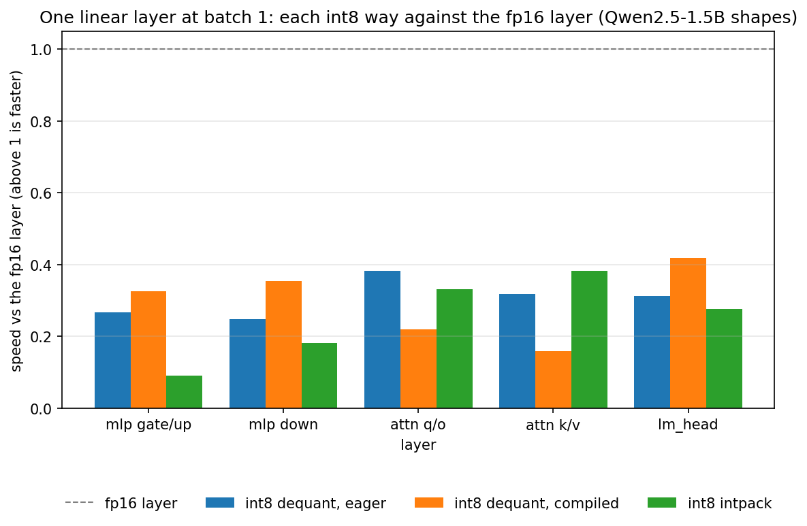
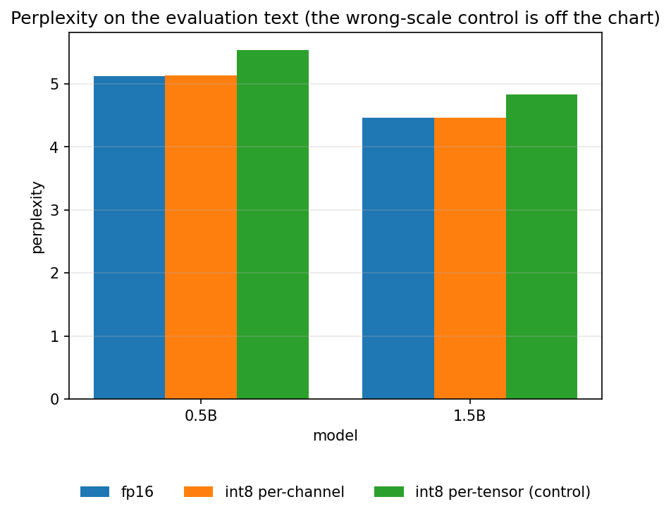
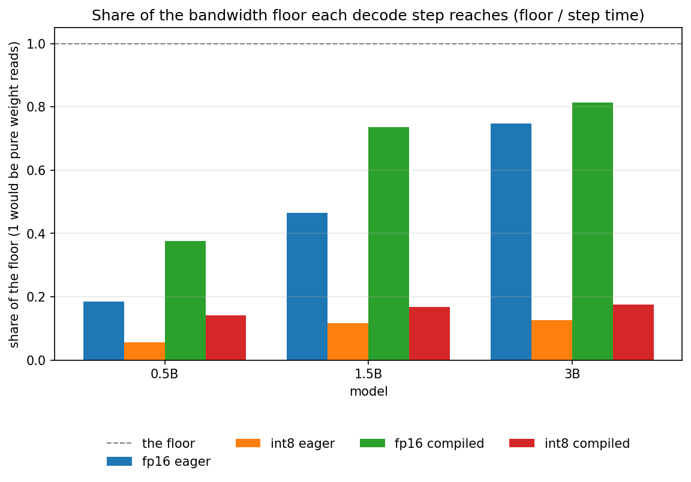

# Stage 8: Weight-Only Int8 Quantization

[Overview](../README.md) | [Full report](../REPORT.md) | [Measured numbers](../RESULTS.md) | [How the code works](code.md)

[`07_weight_quantization.ipynb`](../07_weight_quantization.ipynb) asks the question Stage 7 left open from the other side. Stage 7 found that a decode step on this GPU is launch-bound: a draft model with a third of the target's weights still cost most of a target step, and even after a CUDA graph removed the launches the draft step stayed well above what reading its weights alone would take. Weight bytes were not what limited the step. **If a step were limited by the bytes it reads, how much could be saved by reading fewer?**

**Weight-only int8 quantization** stores every weight matrix as one byte per weight plus one scale per output row, and keeps the activations in fp16. For a weight `W` of shape `[out, in]` and a row `r`:

```text
scale_r = max |W[r, :]| / 127
q[r, j] = round(W[r, j] / scale_r)        an integer in [-127, 127], stored as int8
y       = (x @ q.T) * scale               the scale applies to the output row, the activations stay fp16
```

That halves the bytes of the matrices. Whether it makes a decode step faster depends on one thing: whether the step is limited by bandwidth. The notebook opens with a **go/no-go gate**, as Stage 7 did, because the obvious implementation is a trap. Eager PyTorch has no int8 weight-only matmul, so it converts the weights to fp16 first, which writes a full fp16 copy of the matrix and reads it back. Counting bytes per weight:

| Way | Bytes moved per weight |
| --- | --- |
| fp16 layer | 2 (read) |
| int8, eager dequantize, then matmul | 1 (read int8) + 2 (write fp16) + 2 (read fp16) = 5 |
| int8, conversion fused into the matmul | 1 (read int8) |

So the straightforward way moves two and a half times *more* bytes than the layer it replaces, and only a fused kernel gets the saving. The gate times one linear layer at the real Qwen2.5 shapes with each way this PyTorch build has (the eager dequantize, the same function under `torch.compile`, and `torch._weight_int8pack_mm` where it exists for this GPU), against the measured copy bandwidth. A way that does not work here is reported with the reason, and if no way beats fp16 that is the result, and the rest of the notebook measures accuracy, memory and the gap to the bandwidth floor anyway.

The package change is small. `minivllm/quant.py` holds `QWeight` (an int8 matrix and its scales), `quantize_weight`, `quantize_model` and `qlinear`; `MiniQwen.forward` calls one `linear(x, w, b)` helper that is `F.linear` for an fp16 weight, so the fp16 path is unchanged and a test keeps it matching Hugging Face. The embedding table, the norms, the biases and the RoPE tables stay as they are. Two details matter. First, **bytes stored are not bytes read**: Qwen2.5-0.5B, 1.5B and 3B tie the embedding table to `lm_head`, so quantizing `lm_head` leaves an fp16 table for the lookup next to an int8 copy for the final matmul, and the saving in memory is smaller than the saving in bytes read per token. Second, the int8 product `x @ q.T` is about `127 / amax(row)` times bigger than the real output and fp16 stops at 65504, so `qlinear` scales its input by a power of two first and undoes it in the output scale.

The notebook runs these experiments, with a prediction written down before each benchmark:

| # | Section | Question |
| --- | --- | --- |
| 1 | The go/no-go gate | Does any way of multiplying by an int8 weight read fewer bytes per second than the fp16 layer, at the real layer shapes? |
| 2 | The quantizer | What does per-channel int8 store, what is the error per row, and how do bytes stored differ from bytes read per token? |
| 3 | Accuracy | What do int8 weights cost in logits, perplexity and greedy output, and can the metrics tell a broken quantizer from a good one? |
| 4 | Memory | What do the weights take on the GPU, fp16 against int8, for 0.5B, 1.5B and 3B? |
| 5 | Speed | How do the decode step times of fp16 and int8, eager and under `torch.compile` with CUDA graphs, compare with each other and with the bandwidth floor, by model size and batch size? |
| 6 | Back to Stage 7 | Does a quantized draft model lower the cost ratio `c`, and is speculation still exact with a quantized target? |

Two controls make the accuracy numbers trustworthy. One scale for the whole matrix instead of one per row shows what per-channel scales are for, and a deliberately wrong scale (each row gets its neighbour's) must wreck the model, or the metrics could not detect a broken quantizer. Every timing in the speed section is a median of repeated runs with its spread recorded, because the plain baseline of Stage 7 was timed once and one of its numbers differed noticeably between runs.

## Predictions (Stage 8)

Written before the first run, and kept here so the results can be compared with them.

- **Gate.** The fp16 layer sits near the copy bandwidth on the large layers and far below it on the small ones. The eager dequantize is slower than fp16 by about the extra traffic. Whether the compiled way fuses the conversion on this GPU and torch version, and whether `torch._weight_int8pack_mm` exists for a T4, is not known in advance, which is why the gate comes first.
- **Accuracy.** Per-channel int8 keeps the logits close, the perplexity within a few percent of fp16 and most greedy outputs identical, but not all of them. One scale per matrix is clearly worse. The wrong scale breaks the model.
- **Memory.** Bytes read per token fall to about half of fp16's at every size. Bytes stored fall by much less for the smallest model, where the embedding table is a large share, and by more for the bigger ones.
- **Speed.** Eager int8 is slower than eager fp16 at every size and batch. Compiled int8 gains only if the compiler fuses the conversion, and more for 3B than for 0.5B. At larger batch the gain shrinks. No step reaches the bandwidth floor.
- **Stage 7.** An eager int8 draft step is not cheaper than the fp16 one, and a graph-mode one falls only by the bandwidth part of a small model's step, so `c` does not fall much. Speculation with a quantized target is still exact relative to that target's own greedy output.

## Results (Stage 8)

All measured values are in [`RESULTS.md`](../RESULTS.md#stage8-setup) (source: [`results/stage8.json`](../results/stage8.json)), measured on a Tesla T4 with `Qwen/Qwen2.5-0.5B`, `1.5B` and `3B` (the accuracy section runs the two smaller ones), PyTorch 2.11 and transformers 5.16. Every timing is the median of repeated runs with the spread recorded. The spread of the decode steps is a few percent at most; it is larger for the smallest layers of the gate, whose time is a single launch. The notebook was run once, so read the numbers as having some noise, and the claims below depend on the direction and rough size of differences, not on the second digit.

**What the result is about.** The gate tried three ways of multiplying by an int8 weight that stock PyTorch offers on this GPU: an eager dequantize, the same function under `torch.compile`, and the built-in `torch._weight_int8pack_mm`. The verdict is about those three ways on a T4. It is not a statement that int8 weights cannot speed up decoding: a hand-written fused kernel (exercise 3), or a library that has one, may do what these three did not, and the notebook does not test them.

### 1. Does any int8 way beat the fp16 layer? No: the gate is a no-go on this GPU and build.

Numbers: [The go/no-go gate](../RESULTS.md#stage8-gate).

On the large layers (the two MLP shapes and `lm_head`) the fp16 layer reaches most of the measured copy bandwidth at batch size one, as predicted, and on the small `k/v` layer it reaches a small fraction of it, because that layer is one launch over a few hundred thousand weights. No int8 way is faster than the fp16 layer on any large layer, at batch size one or sixteen, so the gate says no-go. The best of the three is the compiled dequantize, and it is still several times slower than fp16.

Two parts of the prediction missed. The eager dequantize was predicted to be slower by about the extra traffic, roughly two to two and a half times; on the large layers it is three to four times slower. The extra time over the fp16 layer, set against the bytes the conversion has to move, implies that the conversion kernel moves bytes at well under half of the copy bandwidth. That is an inference: it assumes the matmul that follows costs what the fp16 layer costs, and the notebook does not time the two kernels apart. The prediction also left open whether `torch.compile` would fuse the conversion into the matmul, and whether `torch._weight_int8pack_mm` would exist for a T4. Compiling helps a little over the eager way and nowhere near enough, so either the conversion was not fused or the fused kernel is slow, and the notebook does not tell the two apart (it does not inspect the generated code). `torch._weight_int8pack_mm` exists and runs, and is slower than the eager way on every large layer at batch size one and far slower than fp16 at batch size sixteen, where its time grows with the batch as if every row of the batch re-read the weights. That reading of the timing pattern is a guess.




### 2. What does the quantizer cost per weight? A small error per row, and one scale per matrix is several times worse.

Numbers: [The quantizer](../RESULTS.md#stage8-quantizer).

After per-channel quantization the median relative error of a weight row is of order one percent for every kind of matrix of the 0.5B model. One scale for the whole matrix makes it larger for every kind, from under twice as large for the value projection to about six times as large for the MLP matrices. That is the effect the control was built to show: a row of small weights gets steps set by the largest weight anywhere in the matrix and loses its resolution.


### 3. What does int8 cost in accuracy? Almost nothing in perplexity, something in the greedy output, and both controls can fail.

Numbers: [Accuracy](../RESULTS.md#stage8-accuracy).

Per-channel int8 keeps the perplexity within a fraction of a percent of fp16 for both sizes, the KL divergence from the fp16 distribution is a few thousandths of a nat, and the top-1 token is the same at nearly every position. One scale per matrix is clearly worse: a perplexity several percent higher and a KL more than twenty times larger. The wrong scale destroys the model, with a perplexity in the millions, so these metrics do detect a broken quantizer (the notebook stops if they do not).

The prediction that most greedy outputs would match fp16 was too optimistic. Fewer than half of the per-channel int8 outputs are identical to fp16's over 128 tokens: two of six at 0.5B and three of six at 1.5B. The matching prefix tells where they part. Both repetitive-code outputs match completely for both sizes, the `copy` outputs match for most of their length, and the open-ended outputs part early, much earlier at 0.5B, whose prompts there are ten tokens long and leave the continuation free. That is what near-ties flipping an early token would look like, with the rest of the sequence following, but this comparison does not measure the margin at the first difference (section 6 does, for speculation), so it is an inference. The largest difference of any single logit is also large for per-channel int8 although the mean difference is small, so a few positions are far off; the notebook does not locate them, and the outlier channels of exercise 7 are the first thing to look at.



### 4. What does it save? Half of the bytes read per token at every size, and a share of the stored bytes that grows with the model.

Numbers: [Memory](../RESULTS.md#stage8-memory).

The prediction held. Bytes read per token fall to half at every size, because every matrix and `lm_head` is int8. Bytes stored fall by less, because the embedding table stays in fp16 for the lookup next to the int8 copy that `lm_head` reads: the saving is about a fifth for the 0.5B model, where the table is a large share of the weights, and about two fifths for the 3B model. The memory a loaded model takes agrees with its stored bytes to within a couple of percent, so nothing else is holding memory. A 3B model in int8 takes about three fifths of its fp16 memory, which is what makes exercise 5 (a model that does not fit in fp16) possible.


### 5. Does it make a decode step faster? No: int8 is slower at every size and batch size, eager and compiled, and by more for larger models.

Numbers: [Decode step time](../RESULTS.md#stage8-speed).

First the fp16 steps, which set the stage. The share of its bandwidth floor that an fp16 step reaches rises with the model: small for 0.5B, where the step is launch-bound as in Stages 2 and 7, and for 3B about three quarters eagerly and about four fifths compiled. So at 3B the step is mostly limited by reading the weights, which is the regime where int8 should help if it could be read as bytes.

It does not help. The eager int8 step is slower than the eager fp16 step at every size and batch size, and at batch size one the slowdown grows with the model, from under twice for 0.5B to about three times for 3B, because the extra work is per weight. The compiled int8 step is slower than the compiled fp16 step at every size, and compiling recovers only part of the eager loss. The time the eager dequantize adds to a step is about the same at every batch size, which is what a conversion that touches every weight once per step would do, so the slowdown ratio shrinks with the batch only because the fp16 step itself grows. The built-in int8 matmul is faster than the eager dequantize at batch size one for the smallest model, slower for the larger two, and slower than the eager way from batch size four up at every size, by a factor that grows with the batch. Every int8 step stays far below its (halved) floor.

Against the predictions: eager int8 slower everywhere held; compiled int8 gaining only if the compiler fused the conversion held in the sense that it did not and there was no gain; and no step reaching the floor held. The prediction that the gain would be larger for 3B than for 0.5B has nothing to apply to, since there is no gain. What grows with the size is the loss.

What a fused kernel could do is a projection, not a measurement. If an int8 step reached the same share of its floor that the fp16 step reaches for 3B, it would take about half the time, because its floor is half. Nothing in this notebook reads int8 weights as bytes at that rate, so the projection is the size of the gap a fused kernel would be chasing, not a result. The `torch.compile` warm-up took between half a minute and a minute per run, so the six compiled runs add a few minutes to the notebook.





### 6. Does a quantized draft help Stage 7? No: it raises the cost ratio, and speculation stays exact up to fp16 near-ties.

Numbers: [A quantized draft](../RESULTS.md#stage8-draft).

Stage 7's exercise 6 asked what happens to `c`, the draft step over the target step, if the draft is made cheaper by quantizing it. With these ways it gets more expensive: `c` rises for the int8 draft in eager mode and in graph mode. The prediction for eager mode was that `c` would not fall, which held. For graph mode it said `c` would fall a little; it rose by a lot. The captured step now contains the dequantize work as well, which is the likely reason, but the notebook does not break the captured step down, so that is an inference.

Exactness needed one correction. A quantized target still gives, in principle, the output of its own plain greedy decoding, but on a GPU in fp16 a checking pass and a plain step multiply different matrix shapes and round differently, so an output can differ from plain greedy exactly where the target's top two tokens are nearly tied (Stage 6 saw the same effect and could only infer it). The first version of this check required the outputs to agree for most of the generation and failed on exactly such a difference. It now runs the fp16 target as a control and, at the first difference, reads the target's own logit gap between the two tokens. The fp16 target's three outputs are all identical to plain greedy. The int8 target's outputs are identical for two of the three prompts, and the third differs at the third generated token with a logit gap of about a hundredth, a tie. This is three prompts of thirty-two tokens, so it supports "no difference was large", not a rate of near-ties.


### What this sets up (Stage 8)

Weight bytes are a real saving in memory and, at 3B, a possible saving in time, but the time saving needs a kernel that reads the int8 weights as bytes, and the three ways stock PyTorch gave this notebook on a T4 are not that. The obvious next step is exercise 3: a fused kernel, written by hand or taken from a library, compared with the three ways of the gate. Where it would matter most is where the fp16 step is already near its floor, as 3B is here, and not for 0.5B, whose step is limited by launches. That is also the ground of leaving the notebook: a bigger GPU and a comparison with an established serving system on the same traces.

### Other plots (Stage 8)

All plots are listed, with captions, under [Plots](../RESULTS.md#stage8-plots) in `RESULTS.md`.

## Lessons

- **Count the bytes before timing anything, then time it anyway.** An eager dequantize moves five bytes per weight against two for fp16, so the obvious int8 implementation was expected to be slower, and it was slower by more than the byte count says. The gate exists to find a way that is not, and on this build none of the three was.
- **A saving in bytes is not a saving in time.** Bytes read per token halved at every size and the decode step got slower. What matters is whether the kernel reads the new format at the rate the old one was read.
- **A weight format helps only through a kernel that reads it.** The compiler did not turn a dequantize into a fused int8 matmul well enough, and the built-in int8 matmul was slower still. The format is the easy half of quantization.
- **Where it could pay is where the step is already bandwidth-bound.** The fp16 step of the 3B model is mostly limited by reading weights and the 0.5B step is mostly limited by launches, so a faster int8 read would matter for the first and hardly for the second.
- **Bytes stored and bytes read per token are different numbers.** A tied embedding table is stored once and read one row at a time, so quantizing the matrices and the output projection changes memory and bandwidth by different amounts, and the two decide different things (what fits, and the floor of a step).
- **A control has to be able to fail.** The wrong scale ruined the model and one scale per matrix cost accuracy that one scale per row did not, so the accuracy numbers can be believed; a wrong scale that left the model working would have meant the metrics were blind.
- **Perplexity can hide what greedy decoding shows.** Perplexity barely moved while fewer than half of the greedy outputs were identical, because greedy output flips on a near-tie and everything after it follows.
- **Quantization code must not build an autograd graph.** Hugging Face weights require grad, and a scale computed from one with autograd on keeps two fp32 copies of the whole matrix alive. The first run of this notebook ran out of memory on a 0.5B model because of it, and the CPU tests did not notice because their weights did not require grad. The fix is to quantize under `no_grad`, with a test on grad-enabled parameters and a guard in the notebook that stops if allocated memory is far above the stored bytes.
- **fp16 shape effects reach every exactness check.** A checking pass and a plain step round differently, so "identical to plain greedy" is too strict a test on a GPU, and "identical for most of the generation" is a guess. Measure the logit gap at the first difference, and run the unquantized model as a control.
- **A scale applied after the matmul has to fit in the data type.** The int8 product is far larger than the real output, so a power-of-two prescale keeps fp16 from overflowing without costing precision.

## Exercises

1. Use one scale per group of 128 input weights instead of one per row. How much does the error per row fall, and what does it cost in stored bytes and in the matmul?
2. Pack two 4-bit weights per byte with group scales (int4). The bytes halve again; what happens to perplexity, and to the speed of a way that has to unpack them?
3. The gate points here. Write the int8-to-fp16 conversion inside the matmul yourself, as a Triton kernel, or try an existing fused weight-only int8 implementation, and compare it with the three ways of the gate. How close to the copy bandwidth does it get, and does the 3B decode step then come near half of its fp16 time? First find out why the three ways lose: profile the eager conversion apart from the matmul, and print the code `torch.compile` generates for the dequantize to see whether the conversion was fused.
4. Quantize the activations too (W8A8), so the matmul can use the integer path of the tensor cores. When does the extra rounding show up in perplexity, and what does the speed gain depend on?
5. Qwen2.5-7B in fp16 does not fit on a T4 and in int8 it does. Load it layer by layer, quantizing on the GPU as you go, and measure its decode step against its floor.
6. Quantize the KV cache. At long contexts the cache, not the weights, is what a step reads. Quantize keys and values to int8 with a scale per head and token, and measure the error and the step time at a long context.
7. Find the weight channels or activations with the largest values and test whether keeping them in fp16 improves the one-scale-per-matrix control more than the per-channel one. Also locate the positions where the largest logit difference of the per-channel model occurs.
8. Combine Stage 7 and this stage under a real load: does a quantized target move the best draft length, or the winner between the n-gram lookup and the draft model?

## How to run it

Open `07_weight_quantization.ipynb` the same way (Kaggle, GPU T4, Internet on) and run top to bottom. It is self-contained, so it does not need the earlier notebooks to have been run first. It downloads three models, so the first run spends a few minutes on the network, and the `torch.compile` runs of the speed section take between half a minute and a minute each. A full first run takes roughly twenty to twenty-five minutes, less with the models cached (an estimate from the recorded timings and the Kaggle session timer, not a stopwatch measurement). Set `QUICK = True` for a pass with the smallest model only. The publish cell is the same one as above, and as the newest notebook it publishes code as well as results.
