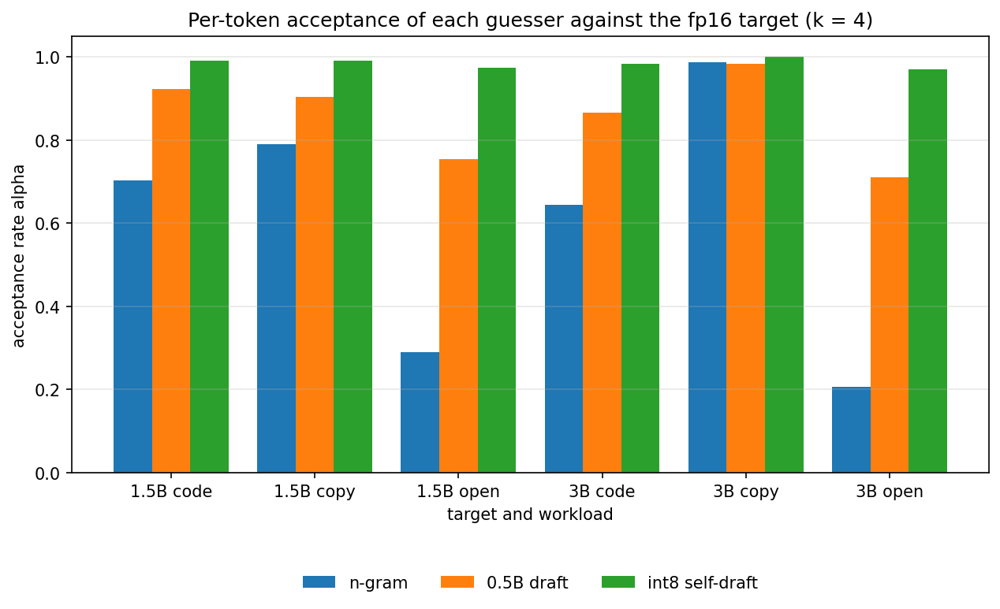
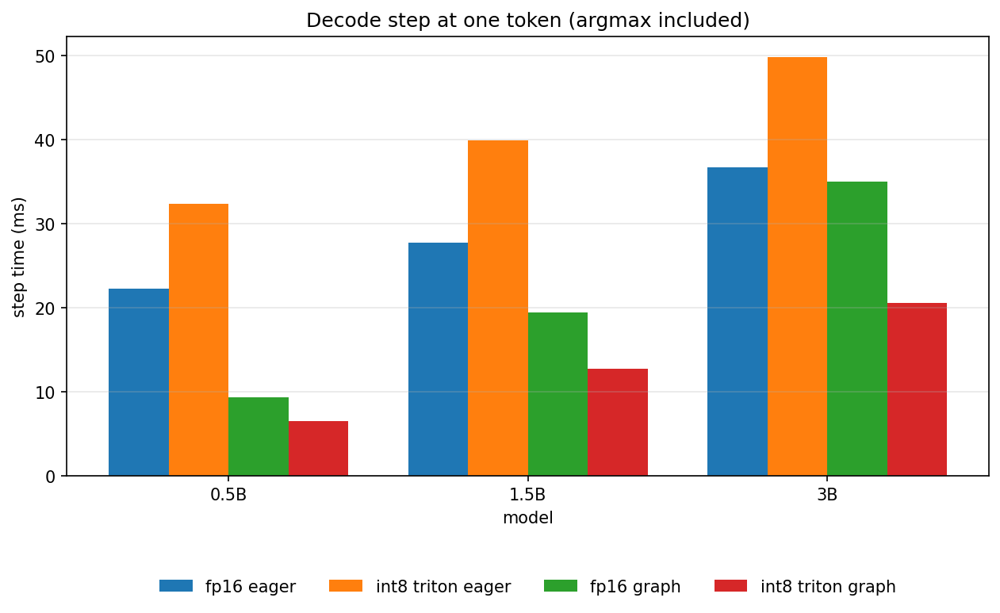
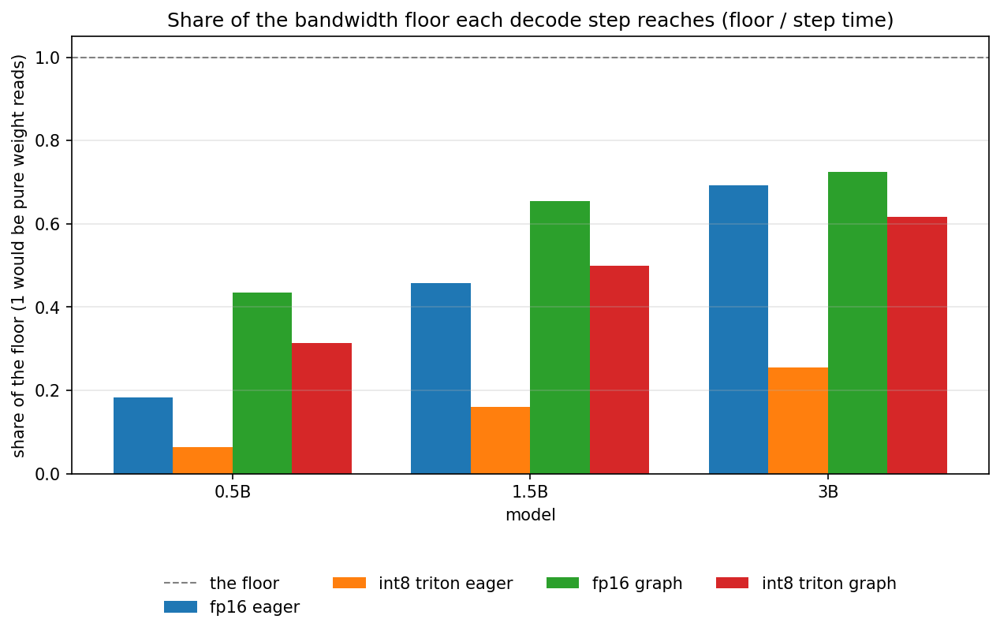
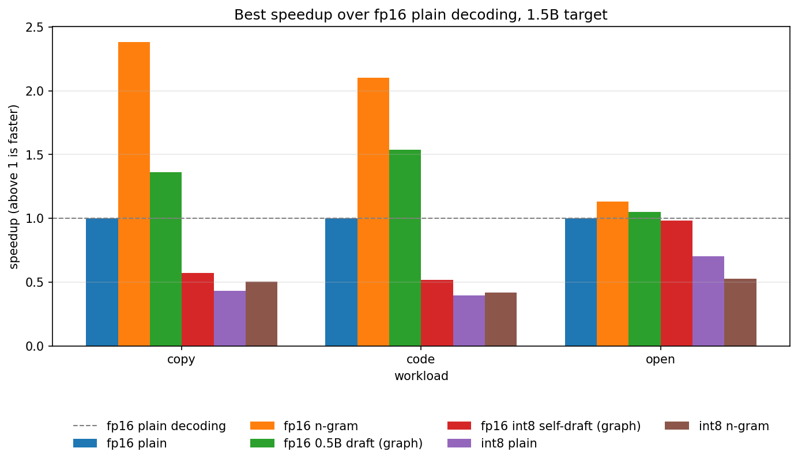

# Stage 9: A Fused Int8 Kernel, and the Quantized Model as Its Own Draft

[Overview](../README.md) | [Full report](../REPORT.md) | [Measured numbers](../RESULTS.md) | [How the code works](code.md)

[`08_fused_int8_and_self_speculation.ipynb`](../08_fused_int8_and_self_speculation.ipynb) takes up what Stage 8 left open. Stage 8 ended with a no-go: weight-only int8 halves the bytes a decode step reads, but none of the three ways PyTorch offers to multiply by an int8 weight (an eager dequantize, the same under `torch.compile`, the built-in `torch._weight_int8pack_mm`) read those bytes as fast as the fp16 layer reads its own, so every int8 decode step was slower than fp16 and a quantized draft raised Stage 7's cost ratio. The result pointed at the missing piece, a kernel that reads the int8 weights as bytes, and at where it would matter most: the 3B model's fp16 step was already mostly limited by reading weights.

Stage 9 writes that kernel in Triton and asks what it buys, alone and together with speculative decoding. There are two ways the two could combine, and the notebook measures both.

- **An int8 target with speculation.** Speculation cuts the number of weight reads per token and int8 cuts the bytes per read. In a bandwidth-bound step the two should multiply. This needs a kernel: the time the eager dequantize adds to a step is about the same at every batch size (Stage 8), so speculation, which spreads a step over several tokens for fp16 and int8 alike, cannot by itself turn int8 from a loss into a gain.
- **The int8 copy as the draft of its own model (self-speculation).** The int8 copy is nearly the same model: Stage 8 measured the same top token as fp16 at almost every position. Its guesses should therefore be right far more often than a 0.5B model's, and it shares the target's embedding table, so it costs the int8 matrices and not a second model. Whether its guesses are also cheap is what the kernel decides. Whether they are *right* does not depend on any kernel, so the notebook measures that first.

**The kernel** (`minivllm/int8_kernel.py`) computes `y = (x @ q.T) * scale` with `q` an int8 matrix and one scale per output row. It loads a tile of int8 weights, converts it to fp16 in registers, multiplies, accumulates in fp32 and applies the scale to the fp32 result, so the traffic is one byte per weight and there is no fp16 overflow to guard against (Stage 8's input prescale is not needed). There are two kernels: `gemv1` for a single token, which multiplies a tile of weights by a slice of the input on the FMA units and reduces once at the end, and `dot` for a block of tokens (a decode batch, the checking pass of speculation, a prompt), which uses the tensor cores and reads the weights once for all the rows. Block sizes are compile-time constants, chosen by a tuning run over a small grid for every real layer shape and kept in an explicit table; Triton's own autotuner is not used because it times candidate launches and so cannot run inside CUDA-graph capture, which the draft's step needs. `qlinear` gets a third path, `"triton"`, and imports the kernel only then, so a machine without Triton still works. On a machine without a GPU the same kernels run in Triton's interpreter, which is how the unit tests check them.

As in Stage 7 and Stage 8, the notebook proves what it can before it measures: the kernel against the dequantize path at every layer shape and several row counts, with a control that must fail (a wrong scale), then the go/no-go gate on one layer. Every timing is a median of repeated runs with the spread, and the plain baseline of every speedup is timed several times and its median used, the weakness of Stage 7's single timing.

| # | Section | Question |
| --- | --- | --- |
| 1 | Acceptance of an int8 self-draft | How often does the int8 copy guess the fp16 model's next token, against a 0.5B draft and the n-gram lookup? No kernel needed. |
| 2 | The kernel | Is it correct, how do the tuned block sizes differ by shape, and does it beat the fp16 layer and the three ways of Stage 8? |
| 3 | The decode step | What does it do to a whole step at 0.5B, 1.5B and 3B, eager and in a CUDA graph, against the bandwidth floor, and what does the checking pass cost? Accuracy is checked against Stage 8's. |
| 4 | Speculation with it | Do an int8 target and the n-gram lookup multiply? What is the cost ratio of the int8 self-draft, and does it beat the n-gram lookup and the 0.5B draft? Does the cost model predict the speedups? |

## Predictions (Stage 9)

Written before the first run, and kept here so the results can be compared with them.

- **Acceptance.** The int8 self-draft is accepted very often on every workload: on repetitive text and code at least as often as the n-gram lookup, and on open-ended text clearly more often than the 0.5B draft, where the lookup has little to copy. It is accepted a little more often for the 3B target than for the 1.5B one, which is a weaker guess.
- **The kernel.** It agrees with the dequantize path to within fp16 rounding at every shape and row count, and a wrong scale is caught. If it reaches somewhat less than the share of the copy bandwidth that the fp16 layer reaches, it should beat the fp16 layer on the large layers at one token by a factor between one and a half and two, with two as the ceiling. It does not beat the fp16 layer on the small `k/v` layer, which is launch-bound. At several tokens the tensor-core kernel stays near its one-token result, because the weights are still read once. Whether Triton reaches that on a T4 is not known in advance, which is why this is a gate.
- **The decode step.** The int8 step is faster than the fp16 step at 3B, less so at 1.5B and about not at all at 0.5B, whose step is limited by launches. A CUDA graph removes the launch cost that Triton makes larger in eager mode. The checking pass costs only a little more than a single token for both weight formats. No step reaches its floor.
- **Speculation.** An int8 target with the n-gram lookup is faster than an fp16 target with the n-gram lookup by about the factor int8 gives a plain step: the two gains multiply. The int8 self-draft's cost ratio in a graph is probably higher than the 0.5B draft's, since it reads a model three times larger, and its acceptance is much higher, so the question is which wins. It should beat the 0.5B draft everywhere and the n-gram lookup on open text; on repetitive text, where the lookup's guesses are free, the lookup should still win. The cost model should predict the speedups to within about a quarter and overstate the graph draft's gain, because the first guess of every round is an eager pass (Stage 7).

## Results (Stage 9)

All measured values are in [`RESULTS.md`](../RESULTS.md#stage9-setup) (source: [`results/stage9.json`](../results/stage9.json)), measured on a Tesla T4 with `Qwen/Qwen2.5-0.5B`, `1.5B` and `3B` (the speculation sections use the 1.5B and 3B models as targets and the 0.5B model as the small draft), PyTorch 2.11, Triton 3.6 and transformers 5.16. Every timing is a median of repeated runs with the spread recorded, and every speedup divides by a plain baseline that is itself the median of three timings, so the baseline noise of Stage 7 is not in these rows. The speculative rows are single passes of three prompts per workload and 96 generated tokens each, so differences of a few percent are noise. The notebook was run once. The claims below depend on the direction and rough size of differences.

**What the run is about.** The question was whether a kernel that reads int8 weights as bytes turns Stage 8's no-go around, and whether the int8 copy can be a draft for its own model. The answer is mixed, and the mix is informative: the kernel wins where it was written to win (one token, in a CUDA graph), the int8 copy is the best guesser of all, and the combination loses in this notebook because one part of the kernel, the part that handles several tokens at once, is slow.

### 1. Is the int8 copy a good draft for its own model? Yes, the best guesser of the three, on every workload.

Numbers: [Acceptance of an int8 self-draft](../RESULTS.md#stage9-acceptance).

The per-token acceptance of the int8 self-draft is very high on every workload and for both targets, and higher than the 0.5B draft's everywhere, with the widest margin on open-ended text, where a small model is wrong most often and the n-gram lookup has little to copy (its acceptance there is low, as in Stage 7). That is the prediction, and it held except for one detail: the self-draft was not consistently more accepted for the 3B target than for the 1.5B one, which was a guess. Tokens per round follow: with a draft length of four, the self-draft produces nearly the maximum of five tokens per round on every workload. This part does not depend on any kernel, so it stands whatever the kernel does: the int8 copy is nearly the same model.

### 2. Is the kernel correct, and does it beat the fp16 layer? Correct, and yes at one token, no at several tokens and on the narrow layers.

Numbers: [The fused int8 kernel](../RESULTS.md#stage9-kernel), [The go/no-go gate](../RESULTS.md#stage9-gate).

The kernel agrees with the dequantize path to within fp16 output rounding at every shape and row count, and a wrong scale is caught by the same check, so the check can fail. Its accuracy is that of Stage 8: the perplexity of the Triton path equals the dequantize path's to within noise, and both sit within a fraction of a percent of fp16's.

The gate is a **go**, and uneven. At one token the kernel beats the fp16 layer on all three large layers and beats every way of Stage 8 on all three. The gain is largest on `lm_head`, where the int8 layer is more than twice as fast as the fp16 layer, and about a fifth to a quarter on the two MLP shapes. The tuned one-token kernel reads the MLP matrices at roughly half to two thirds of the measured copy bandwidth, and `lm_head` at the copy bandwidth or slightly above. A figure above the copy bandwidth is not a measurement error: the copy figure counts bytes read plus bytes written, so a kernel that only reads can exceed it, and the "floor" of every step in this notebook, which divides bytes read by the copy figure, is therefore a conservative floor. The narrow attention layers (`q/o`, `k/v`) lose: they are launch-bound (Stage 8), a Triton launch costs more than a cuBLAS one, and fewer bytes do not help a layer that is one launch. Exercise 1 is aimed at them.

Two parts of the prediction missed. The gain on the MLP layers is smaller than the factor of one and a half to two that I expected, because the kernel reaches a smaller share of the copy bandwidth there than the fp16 layer does. And the prediction that the tensor-core kernel "stays near its one-token result" at several rows was wrong by a large margin: at five and sixteen rows on the large layers it is six to twelve times slower than the fp16 layer, and tuned it reaches under a tenth of the copy bandwidth. I did not profile it, so the reason is an inference: the kernel converts each int8 tile to fp16 and moves it through shared memory to the tensor cores, and a T4 has no asynchronous copies, so with a small tile nothing overlaps the loads with the conversion and the weights arrive slowly. The one-token kernel has none of that, which is why it is fast.

### 3. Does it make a decode step faster? In a CUDA graph and compiled, yes, at every size and more for bigger models; eagerly, no.

Numbers: [Decode step time](../RESULTS.md#stage9-step).

This is the result that matters most. In **eager** mode the int8 step is slower than the fp16 step at every size (and much slower at several rows, where the slow kernel runs). In a **CUDA graph**, and under **`torch.compile`** (which did trace the hand-written kernel, to my surprise), the int8 step is faster than the fp16 step at every size, and by more for bigger models: roughly one and a third times for 0.5B, one and a half for 1.5B and nearly one and four fifths for 3B, where the int8 compiled step reaches about seven tenths of its bandwidth floor. The reason eager mode loses is the number of kernel launches: the gap between the eager and the graph int8 step at 3B is far larger than the same gap for fp16, which is what launches that cost the CPU more than cuBLAS launches would look like, but I did not profile the launches, so that too is an inference. The prediction was a gain in eager mode at 3B and a graph that removes launch cost; the second half held and the first did not.

The gain follows the share of the step that is weight traffic, as the Stage 8 data predicted: small for 0.5B, whose step is mostly launches even in a graph, and larger for 3B. No step reaches its floor.

### 4. What does a block of tokens cost? Little for fp16, a lot for int8 beyond the smallest model.

Numbers: [The checking pass](../RESULTS.md#stage9-step).

Speculation needs the checking pass (feeding the last token and the draft in one pass) to cost about what one token costs, and for fp16 it does: feeding five tokens costs a few percent to an eighth more than feeding one, at every size. For int8 it does not: feeding five tokens costs more than twice as much as feeding one for the 1.5B model and three and a half times as much for the 3B model (for 0.5B it is hidden by the launch-bound step). That is the slow tensor-core kernel again, now inside a decode loop, and it is what the next section pays for.

### 5. Does speculation with it pay? Not with this kernel, and the cost model says exactly why.

Numbers: [Speculation with the int8 model](../RESULTS.md#stage9-speculation).

**An int8 target with the n-gram lookup** is slower than an fp16 target with the n-gram lookup on every workload and both targets, and slower than fp16 plain decoding. The lookup does gain over the int8 plain decoding on copy text and about nothing on code, and it loses to it on open text, because the checking pass costs the int8 model several times a plain step; and the int8 plain decoding in these runs is the eager one. So the gains do not multiply here, which was the prediction that missed most.

**The int8 self-draft** has a cost ratio in a graph that is below one and above the 0.5B draft's (it is a model three to six times larger, at half the bytes), and above one when run eagerly. And yet its measured speedups over fp16 plain decoding are below one on copy and code, at most about one on open text, and it does not beat the n-gram lookup anywhere. The n-gram lookup keeps beating both drafts on copy and code, as in Stage 7. The reason is in the time per round: the guess time of the self-draft is several times what `k - 1` graph steps should cost. A round's first guess feeds the tokens the target just accepted through the draft model in an ordinary pass, and with an int8 draft that pass is two or more tokens through the slow multi-token kernel, once per round (and the whole prompt, on the first round). The first guess of each round was already the cost left to attack at the end of Stage 7, and here it is the whole story.

The cost model confirms it. Fed with each row's measured acceptance, guess time and checking time, it predicts the speedup of every draft row (the 0.5B draft and the self-draft, graph and eager) to within about a tenth, so the loss is not a failure of the idea but a measured cost. For the n-gram lookup it is optimistic, as in Stage 7.

**A projection, not a result.** If the first guess of a round cost one graph step instead of a slow multi-token pass, the same cost model, with the measured acceptance, step and checking times, gives the self-draft roughly one and a half times fp16 plain decoding on the 1.5B target on every workload, and a gain over the n-gram lookup and the 0.5B draft on open text; on the 3B target it gives about one and a third times on open text and no gain over the lookup on copy. Nothing in this notebook measured a cheaper feed, so this is the size of the prize, not a finding.

### 6. Is it still exact? Up to fp16 near-ties, as before.

Numbers: [Speculation with the int8 model](../RESULTS.md#stage9-speculation).

Every setup is checked against its own plain greedy decoding (speculation keeps a model's output; it does not make int8 match fp16). Three quarters of the checked outputs are identical, and at every difference the target's own logit gap between the two tokens is a tie: a hundredth of a logit or exactly zero. This is a small check (the first prompt of each workload, thirty-two tokens), so it supports "no difference was large", not a rate of ties.

### What this sets up (Stage 9)

The result points at one thing. The one-token kernel and the graph make the int8 decode step about twice as fast as the fp16 one at 3B, and the int8 copy is the best draft there is, but anything that feeds several tokens through the int8 model is slow. A kernel for a handful of rows, which reads each weight once and does its products on the FMA units instead of the tensor cores (a checking block of five tokens is five multiplications per weight, which a T4's FMA units have room for), would fix both the checking pass of an int8 target and the first guess of a self-draft. For prompts, falling back to the dequantize path costs little. After that the questions of this stage can be asked again with the loss removed: the end-to-end speed of a compiled int8 decoder, and the self-draft against the n-gram lookup on open text. The engine outside the notebook comes after.

### Other plots (Stage 9)

All plots are listed, with captions, under [Plots](../RESULTS.md#stage9-plots) in `RESULTS.md`.

## Lessons

- **Measure what a prediction depends on first.** Whether the int8 copy is a good draft depends only on the weights, so the notebook measured it before any kernel: it is, and the loss that followed is a cost, not a quality problem. Without that, the loss could have been read as "int8 drafts do not work".
- **Gate a kernel at every shape it will meet.** At one token the gate said go, and a gate at one token alone would have hidden the problem: the same kernel family was six to ten times slower than fp16 at five rows, and that is the shape of a checking pass.
- **A fast step is not a fast loop.** The self-draft's step in a graph is cheap and its round is not: the guess time per round, not the step time, is what the speedup divides by, and the notebook records both.
- **Launches can eat a kernel's gain.** The int8 step was slower than fp16 eagerly and faster in a graph, so hand-written kernels belong in a graph (or compiled) decode loop.
- **`torch.compile` can trace a hand-written Triton kernel** (here with CUDA graphs on), which is what turned the kernel into a decode step that beats fp16.
- **Narrow layers are launch-bound and a weight format does not help them.** The `q/o` and `k/v` layers lost to fp16 at one token even with the fused kernel.
- **The copy bandwidth is not a ceiling.** It counts reads and writes, so a read-only kernel can exceed it and a floor built from it is conservative.
- **A projection is not a result.** The one-and-a-half-times estimate for a self-draft with a cheap first guess is arithmetic on measured numbers, and the next notebook has to measure it.
- **Quantization code must not build an autograd graph, and an exactness check needs a logit gap.** Both lessons of Stage 8 were used here, and the near-tie check passed on the first run.

## Exercises

1. The `k/v` projections have few output rows, so a one-token kernel gives the T4's multiprocessors little to do. Split the loop over `K` across programs and reduce the partial sums, and see whether the narrow layers stop being launch-bound.
2. Capture the entire int8 decode step in a CUDA graph, not only the draft's single-token step, and compare it with eager mode for int8 and fp16. How much of the step is launch cost?
3. Pack two 4-bit weights per byte with a scale per group of 128 (int4). The kernel unpacks in registers; what happens to perplexity, to the bandwidth the kernel reaches, and to the acceptance of a 4-bit self-draft?
4. Let the int8 self-draft propose several candidates per position and check them in one pass with a tree mask. Does the higher acceptance still pay once the checking pass is wider?
5. Quantize the activations too (W8A8) and use the integer path of the tensor cores. When does the extra rounding show in perplexity and in acceptance?
6. Qwen2.5-7B in fp16 does not fit on a T4 and in int8 it does. Load it layer by layer and measure its decode step against its floor with this kernel.
7. Quantize the KV cache. At long contexts the cache, not the weights, is what a step reads. Quantize keys and values to int8 and measure the step time at a long context.
8. Profile the kernel and find whether the conversion, the reduction or the memory system limits it, then change the tile shape or the loop to move it.

## How to run it

Open `08_fused_int8_and_self_speculation.ipynb` the same way (Kaggle, GPU T4, Internet on) and run top to bottom. It is self-contained, so it does not need the earlier notebooks to have been run first. It downloads three models, so the first run spends a few minutes on the network, and the Triton kernels and the `torch.compile` attempts add compile time to the gate and the step section. Set `QUICK = True` for a pass with the 1.5B target only. The publish cell is the same one as above, and as the newest notebook it publishes code as well as results.
